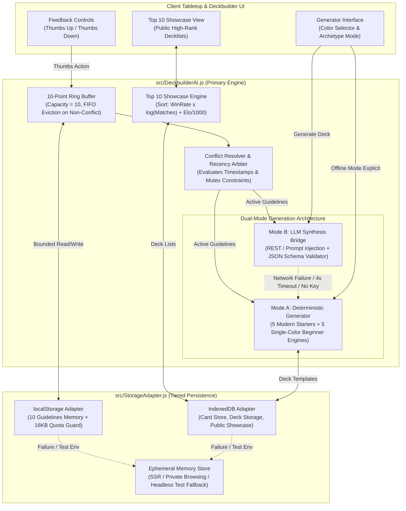

# Technical Specification: Deckbuilder AI Agent & Guideline Memory

- **Document ID:** `SPEC-RPM-DECKAI-010`
- **Feature Scope:** Feature 10 (`src/DeckbuilderAI.js`, `src/StorageAdapter.js` & `test/test_deckbuilder_ai.js`)
- **System:** RPM Multiplayer / RPM Modern Tabletop Companion
- **Architect:** Argon Specification Architect
- **Status:** APPROVED / READY FOR IMPLEMENTATION
- **Revision:** 1.0.0
- **Target File Path:** `specs/FEATURE_10_DECKBUILDER_AI_SPEC.md`
- **Core Implementation Files:**
  - `src/DeckbuilderAI.js` (Guideline Memory Engine, Conflict Resolver, Dual-Mode Deck Generator, Showcase Manager)
  - `src/StorageAdapter.js` (Storage Abstraction: IndexedDB for Cards/Decks & Bounded LocalStorage for Guidelines)
  - `test/test_deckbuilder_ai.js` (Comprehensive Acceptance Test Matrix & Invariant Verification Suite)
- **Related Specifications & Decisions:**
  - `specs/FEATURE_1_2_CORE_INGESTION_SPEC.md` (`SPEC-RPM-INGEST-001`: Card Ingestion & Deck Parser Engine)
  - `specs/FEATURE_8_RELAY_SYNC_SPEC.md` (`SPEC-RPM-RELAY-008`: Multiplayer WebSocket Relay & Session State)
  - `specs/FEATURE_9_RANDOM_PERK_SPEC.md` (`SPEC-RPM-PERK-009`: Random Perk Upkeep Emblem & Two-Step Stack Flow)
  - `decisionlog.md`: `DEC-001` (Tabletop Companion Paradigm), `DEC-007` (WotC Modern Legality & Point Policy), `DEC-013` (10-Point Custom Guideline Memory, Feedback Thumbs & Deck Slots), `DEC-015` (Argon Systems Audit: Invariants `INV-STORAGE-1`, `INV-STORAGE-2`, `INV-STORAGE-3`).
  - Audio Reference: `TRANSCRIPCIONES_AUDIOS.md` (Audio Note 9: Post-match analytics, 10-point guideline memory, single-color beginner archetype generation, Top 10 public player showcase).

---

## 1. Executive Summary & Architectural Overview

The **Deckbuilder AI Agent & Guideline Memory** subsystem serves as the strategic intelligence and recommendation backbone of the RPM Modern Tabletop Companion. As established in **Audio Note 9** and codified in **DEC-013** and **DEC-015**, the module empowers players to analyze their match performance, capture subjective gameplay preferences, generate competitive Modern and beginner single-color decks offline, and explore the top public decklists of high-ranking players.

```
+---------------------------------------------------------------------------------------------------+
| Audio Note 9 Foundation:                                                                          |
| "Cada partida tendrá un registro de historial de las jugadas y habrá la posibilidad de            |
| utilizar un agente de inteligencia artificial para analizar el desempeño de cada jugador...       |
| Y el agente tendrá unos botones de feedback, que sea positivo o negativo, en donde el             |
| jugador podrá dejar recomendaciones sobre lo que quiere que el agente suela hacer durante         |
| sus selecciones y lo que quiere que evite el agente. De esta manera, cada jugador tendrá          |
| hasta 10 puntos para hacerle recordar a su agente para que cuando cada agente le ayude a          |
| armar su mazo, lo arme de la manera en la que a esta persona le gusta. También se puede           |
| poner que este agente te arme un mazo de cero con las cartas balanceadas pero con las             |
| estrategias de acuerdo al color que elijan los jugadores, para que los jugadores primerizos       |
| no tengan que pensar demasiado... Y vamos a publicar una lista de los 10 jugadores que más        |
| puntos tienen, y esos jugadores podrán tener la lista pública de sus cartas..."                  |
+---------------------------------------------------------------------------------------------------+
```

### 1.1 Architectural Vulnerabilities & Failure Modes

Designing a deckbuilder agent integrated into a web companion typically collapses under five critical failure modes:
1. **Unbounded Storage Leak & Browser Quota Eviction**: Naively pushing user guidelines, card indexes, and deck history into `localStorage` triggers `QuotaExceededError` (5MB browser limit), crashing the companion.
2. **Preference Contradiction Deadlocks**: Users issue conflicting feedback over time (e.g. 👍 *"I love playing mono-red burn with aggressive 1-drops"* followed weeks later by 👎 *"Avoid burn spells and non-interactive red cards"*). Without a formal recency-precedence conflict resolver, the AI enters an unsolvable state constraint where all candidate cards are simultaneously requested and blacklisted.
3. **Cloud LLM Latency & Network Fragility**: Coupling deck generation exclusively to remote LLM APIs (OpenAI, Gemini, Anthropic) leaves users stranded in low-connectivity tabletop venues (game stores, basements, convention centers). Incurring 3–8 second latency penalties or crashing on missing API keys violates the core offline-first companion philosophy.
4. **Beginner Mana-Curve Collapse**: Generating automated decks for new players using naive heuristics or unconstrained random sampling frequently yields unplayable mana bases (e.g. 12 lands or 38 lands) and inverted mana curves (e.g. twenty 5-CMC cards), destroying the introductory player experience.
5. **Showcase Pollution & Memory Bloat**: Unbounded public deck showcases cause memory leaks and display stale or unranked decks. A strict Top 10 sorted showcase with validated composite scores ($Elo \times WinRate$) is required.

Feature 10 neutralizes all five vulnerabilities by dividing the system into four strictly decoupled components:
- **`StorageAdapter`**: A two-tier persistence layer that enforces `INV-STORAGE-1` by routing heavy, non-volatile data (card catalogs, custom decklists) into **`IndexedDB`**, while restricting user preference memory to bounded **`localStorage`** protected by a 16KB quota guard.
- **Guideline Memory & Conflict Engine**: A 10-point ring buffer enforcing `INV-STORAGE-2` that tags guidelines as `PREFERENCE` or `AVOIDANCE`, applies chronological timestamp precedence to resolve contradictions, and calculates net archetype affinity weights.
- **Dual-Mode Generation Architecture (`INV-STORAGE-3`)**:
  - **Mode A (Offline Deterministic Archetype & Beginner Generator)**: 100% offline, zero-network engine supplying 5 tournament-grade Modern starter decks (*Mono-Red Burn*, *Izzet Murktide*, *Golgari Yawgmoth*, *Mono-Green Tron*, *Temur Rhinos*) and an instant single-color beginner generator with balanced 22–24 land mana curves.
  - **Mode B (Online LLM Synthesizer Bridge)**: Optional structured prompt synthesizer that emits formal JSON deck contracts when an API endpoint/key is provided, degrading transparently to Mode A upon timeout (4000ms), 5xx response, or key absence.
- **Top 10 Public Showcase Subsystem**: An indexed showcase tracking the top 10 public decklists sorted by performance metrics ($WinRate$, $Elo$, and $MatchCount$) with embedded preview cards and color identities.

---

### 1.2 System Topology



---

## 2. Formal Invariants & Mathematical Laws

The Deckbuilder AI and Storage subsystem strictly enforces five non-negotiable architectural invariants:

### 2.1 Invariant Table

| Invariant ID | Name | Formal Rule Statement | Enforcement Location |
| :--- | :--- | :--- | :--- |
| **`INV-STORAGE-1`** | **Tiered Storage & 16KB Quota Guard** | Guideline memory is strictly bounded to at most 10 items per user. Guideline serialized JSON payload MUST NOT exceed 16,384 bytes (16KB). Heavy entities (decks, cards, showcase) MUST reside in IndexedDB. | `StorageAdapter.js` (`saveGuidelines`, `saveDeck`) |
| **`INV-STORAGE-2`** | **Deterministic Recency Conflict Precedence** | When two active guidelines express mutually exclusive constraints over the same semantic target ($T_1 \equiv T_2$), the guideline with the strictly greater timestamp ($t_2 > t_1$) supersedes the elder. Elder contradictory entries are either overridden or pruned. | `DeckbuilderAI.js` (`resolveConflicts`) |
| **`INV-STORAGE-3`** | **Zero-Network Generation Guarantee** | Mode A generation MUST produce a valid, 60-card, tournament-legal Modern deck in $\le 5\text{ms}$ with zero network requests or external API dependencies. Mode B MUST degrade to Mode A within 4000ms if unreachable. | `DeckbuilderAI.js` (`generateDeck`) |
| **`INV-STORAGE-4`** | **Beginner Mana-Curve Distribution Law** | Every single-color beginner deck generated by Mode A MUST contain exactly 60 cards: strictly 22–24 basic lands, and a mana curve spanning CMC 1 to 4 with $\ge 8$ 1-drops, $\ge 10$ 2-drops, $\ge 8$ 3-drops, and $\le 6$ 4+-drops. Maximum 4 copies per non-basic card. | `DeckbuilderAI.js` (`generateBeginnerDeck`) |
| **`INV-STORAGE-5`** | **Top 10 Showcase Bounded Monotonicity** | The public showcase MUST contain at most 10 deck entries. Entries MUST be sorted monotonically in descending order according to composite score $S = \text{round}((\text{winRate} \times \log_{10}(\text{matches} + 1)) \times 1000) + \text{elo}$. Corrupted entries are rejected. | `DeckbuilderAI.js` (`getTopShowcase`) |

---

### 2.2 Mathematical Specifications & Proofs

#### 2.2.1 Guideline Ring Buffer & 16KB Quota Proof (`INV-STORAGE-1`)

Let $\mathcal{G}_u = \{ g_1, g_2, \dots, g_k \}$ represent the set of guidelines stored for user $u$.
The capacity constraint enforces:

$$|\mathcal{G}_u| \le 10, \quad \forall u$$

Let $\text{SizeOf}(g)$ be the UTF-8 byte length of the JSON serialization of guideline $g$:

$$\text{PayloadBytes}(\mathcal{G}_u) = \sum_{i=1}^{k} \text{ByteLength}(\text{JSON.stringify}(g_i)) \le 16,384 \text{ bytes (16KB)}$$

*Buffer Eviction Rule:* When adding guideline $g_{\text{new}}$ to a set where $|\mathcal{G}_u| = 10$:
1. If $g_{\text{new}}$ is a direct conflict with an existing entry $g_{\text{old}}$ (same target, opposite type), $g_{\text{old}}$ is directly replaced by $g_{\text{new}}$.
2. If no direct conflict exists, the entry with the minimum timestamp $\min_{g \in \mathcal{G}_u} (g.\text{timestamp})$ is evicted, preserving the 10-item limit.

#### 2.2.2 Conflict Graph & Recency Precedence Resolution (`INV-STORAGE-2`)

Let each guideline $g_i$ be defined by the tuple:

$$g_i = \langle \text{id}_i, \text{type}_i, \text{target}_i, \text{weight}_i, t_i \rangle$$

where $\text{type}_i \in \{ \text{PREFERENCE}, \text{AVOIDANCE} \}$, $\text{weight}_i \in [1, 5]$, and $t_i \in \mathbb{N}$ (Unix millisecond timestamp).

Two guidelines $g_i$ and $g_j$ are defined as mutually contradictory ($g_i \lightning g_j$) if and only if:

$$g_i \lightning g_j \iff (\text{target}_i = \text{target}_j) \land (\text{type}_i \ne \text{type}_j)$$

The conflict resolution function $\mathcal{R}: \mathcal{P}(\mathcal{G}) \to \mathcal{P}(\mathcal{G})$ filters the set of active guidelines:

$$\mathcal{R}(\mathcal{G}) = \{ g_i \in \mathcal{G} \mid \nexists g_j \in \mathcal{G} \text{ such that } (g_i \lightning g_j) \land (t_j > t_i) \}$$

*Proof of Determinism:* Since $t_j, t_i \in \mathbb{N}$, and each guideline is assigned a monotonically increasing timestamp via `Date.now() + monotonicCounter`, the relation $t_j > t_i$ is a strict total order for any pair of distinct guidelines. Hence, for any pair $g_i \lightning g_j$, exactly one guideline has $t_{\text{newer}} > t_{\text{older}}$. The older is deterministically suppressed, guaranteeing zero state oscillation.

#### 2.2.3 Beginner Mana Curve Distribution Formulation (`INV-STORAGE-4`)

Let $D$ be a 60-card beginner deck composed of basic lands $L$ and non-land spells $S$:

$$|D| = |L| + |S| = 60$$

The land count $|L|$ satisfies:

$$22 \le |L| \le 24 \implies 36 \le |S| \le 38$$

The non-land spells $S$ are partitioned into converted mana cost (CMC) buckets $S_1, S_2, S_3, S_{4+}$:

$$|S| = |S_1| + |S_2| + |S_3| + |S_{4+}|$$

The distribution is bounded by:
- **1-CMC (Early Tempo/Interaction):** $|S_1| \ge 8$ (e.g. 8 cards = two 4-of playsets)
- **2-CMC (Core Mechanics/Removal):** $10 \le |S_2| \le 14$ (e.g. 12 cards = three 4-of playsets)
- **3-CMC (Midgame Threats/Value):** $8 \le |S_3| \le 12$ (e.g. 8–10 cards)
- **4+-CMC (Finishers/Top-End):** $4 \le |S_{4+}| \le 6$

Furthermore, the 4-of rule is strictly enforced:

$$\forall c \in S, \quad \text{count}(c) \le 4$$

$$\forall c \in L_{\text{basic}}, \quad \text{count}(c) = |L| \le 24$$

---

## 3. Storage Layer Abstraction (`src/StorageAdapter.js`)

To guarantee operation across both browser environments (Window, `localStorage`, `indexedDB`) and Node.js testing/SSR harnesses (headless, in-memory), `StorageAdapter` provides a unified, hardened interface.

### 3.1 Storage Tier Separation

```
+-----------------------------------------------------------------------------------------+
| Tier 1: localStorage (Synchronous, Low-Latency, 16KB Guarded)                           |
| - 10-Point User Guideline Memory Store (`rpm_guidelines_${userId}`)                     |
| - Active AI Engine Configuration & Session Preferences                                  |
+-----------------------------------------------------------------------------------------+
| Tier 2: IndexedDB (Asynchronous, High-Capacity, Structured Key-Value)                   |
| - Cached Scryfall Card Objects (`rpm_cards_store`)                                      |
| - Custom Saved Decklists (`rpm_decks_store`)                                            |
| - Top 10 Public Showcase Deck Cache (`rpm_showcase_store`)                              |
+-----------------------------------------------------------------------------------------+
| Tier 3: In-Memory Map Fallback (Headless / Sandbox / Private Browsing Safe)             |
| - Activated when `window.localStorage` or `window.indexedDB` throws or is undefined.    |
+-----------------------------------------------------------------------------------------+
```

### 3.2 TypeScript / JSDoc Schema Definitions

```typescript
/**
 * Unified Storage Adapter Configuration.
 */
export interface StorageAdapterConfig {
  dbName?: string;              // Default: 'RPM_Companion_DB'
  dbVersion?: number;           // Default: 1
  storagePrefix?: string;       // Default: 'rpm_'
  maxGuidelinePayloadBytes?: number; // Default: 16384 (16KB)
  isHeadless?: boolean;         // Default: false (forces in-memory fallback)
}

/**
 * Guideline Definition Schema.
 */
export type GuidelineType = 'PREFERENCE' | 'AVOIDANCE';

export interface Guideline {
  id: string;                   // UUID v4 or crypto random hex
  text: string;                 // Human-readable summary (e.g. "Prefer mono-red burn spells")
  type: GuidelineType;          // 'PREFERENCE' | 'AVOIDANCE'
  targetTag: string;            // Normalized semantic token (e.g. "COLOR_R", "MECH_BURN", "TYPE_CREATURE")
  weight: number;               // Numeric influence weight [1.0 to 5.0]
  timestamp: number;            // Unix millisecond timestamp
}

/**
 * Guideline Memory Container.
 */
export interface GuidelineMemoryStore {
  userId: string;
  guidelines: Guideline[];
  lastUpdated: number;
  version: number;
}

/**
 * Deck Entity Stored in IndexedDB.
 */
export interface StoredDeck {
  id: string;                   // UUID / Deck ID
  userId: string;
  title: string;
  format: 'modern' | 'beginner' | 'rpm_custom';
  colorIdentity: string[];      // Array of MTG colors: ['W', 'U', 'B', 'R', 'G']
  archetype: string;            // e.g. "Mono-Red Burn", "Izzet Murktide"
  mainboard: Array<{ name: string; count: number; cmc: number; type: string }>;
  sideboard: Array<{ name: string; count: number; cmc: number; type: string }>;
  totalCards: number;
  createdAt: number;
  updatedAt: number;
  tags?: string[];
}

/**
 * Showcase Deck Model for Top 10 Showcase.
 */
export interface TopShowcaseDeck {
  id: string;
  rank: number;                 // Rank 1 to 10
  title: string;
  creatorId: string;
  creatorName: string;
  elo: number;
  winRate: number;              // 0.00 to 1.00
  matchesPlayed: number;
  perkCount: number;            // Total RPM perks triggered in career
  colorIdentity: string[];
  archetype: string;
  previewCards: string[];       // 3 to 5 iconic card names for visual card fan
  exportText: string;           // Standard MTG Arena / MTGO format text
  compositeScore: number;
}
```

---

## 4. 10-Point Guideline Memory & Conflict Resolution Engine

### 4.1 Feedback Button Logic (👍 Positive / 👎 Negative)

Users interact with the AI assistant after matches or during deckbuilding via dual feedback triggers:

#### 👍 Positive Feedback Handler (`addPositiveFeedback(text, semanticTag, weight = 1.0)`)
- Creates or reinforces a `PREFERENCE` guideline.
- Increases the archetype match weight for the associated strategy/color.
- Boosts selection probability for matching mechanics and card types during generation.
- If a contradictory `AVOIDANCE` exists for the same `semanticTag`, the new `PREFERENCE` overrides it by virtue of its newer `timestamp`.

#### 👎 Negative Feedback Handler (`addNegativeFeedback(text, semanticTag, weight = 1.0)`)
- Creates or reinforces an `AVOIDANCE` guideline.
- Blacklists anti-patterns (e.g. bans combo packages, counterspells, or specific colors).
- Decreases or sets selection weight to zero for the associated archetype.
- If a contradictory `PREFERENCE` exists for the same `semanticTag`, the new `AVOIDANCE` overrides it.

### 4.2 Semantic Tag Vocabulary

To enable deterministic conflict matching, human text is tokenized into normalized semantic tags:
- **Colors:** `COLOR_W`, `COLOR_U`, `COLOR_B`, `COLOR_R`, `COLOR_G`, `COLOR_COLORLESS`
- **Archetypes:** `ARCH_BURN`, `ARCH_TEMPO`, `ARCH_COMBO`, `ARCH_CONTROL`, `ARCH_RAMP`, `ARCH_MIDRANGE`
- **Mechanics:** `MECH_COUNTERSPELL`, `MECH_GRAVEYARD`, `MECH_DISCARD`, `MECH_LIFELINK`, `MECH_CASCADE`, `MECH_SACRIFICE`
- **Card Types:** `TYPE_CREATURE`, `TYPE_INSTANT`, `TYPE_SORCERY`, `TYPE_PLANESWALKER`, `TYPE_ARTIFACT`, `TYPE_ENCHANTMENT`

### 4.3 16KB Quota Guard & Eviction Policy

Before serializing the guideline array to storage, `DeckbuilderAI` calculates the payload size:

```javascript
export function validateAndGuardGuidelineQuota(guidelines) {
  const serialized = JSON.stringify(guidelines);
  const byteLength = typeof Buffer !== 'undefined'
    ? Buffer.byteLength(serialized, 'utf8')
    : new TextEncoder().encode(serialized).length;

  if (byteLength > 16384) {
    throw new Error(`INV-STORAGE-1 Violation: Guideline payload size (${byteLength} bytes) exceeds 16KB limit`);
  }
  return byteLength;
}
```

When inserting the 11th guideline:
1. Check if the incoming guideline resolves/replaces an existing conflicting entry. If so, replace in-place.
2. If all 10 are distinct targets, identify the oldest entry:
   $$g_{\text{oldest}} = \arg\min_{g \in \mathcal{G}} (g.\text{timestamp})$$
3. Evict $g_{\text{oldest}}$ and append $g_{\text{new}}$.

### 4.4 Conflict Resolution Algorithm

```javascript
/**
 * Evaluates a raw list of up to 10 guidelines and eliminates contradictory constraints.
 * 
 * Invariant INV-STORAGE-2: Newer timestamp wins for any identical targetTag.
 * 
 * @param {Guideline[]} rawGuidelines
 * @returns {Guideline[]} Filtered, conflict-free active guidelines.
 */
export function resolveActiveGuidelines(rawGuidelines) {
  if (!Array.isArray(rawGuidelines) || rawGuidelines.length === 0) {
    return [];
  }

  // Sort chronologically descending (newest first)
  const sorted = [...rawGuidelines].sort((a, b) => b.timestamp - a.timestamp);
  
  const resolvedMap = new Map();
  const activeGuidelines = [];

  for (const g of sorted) {
    const tag = g.targetTag.toUpperCase();
    if (!resolvedMap.has(tag)) {
      resolvedMap.set(tag, g);
      activeGuidelines.push(g);
    } else {
      // An entry for this tag was already processed.
      // Since sorted is descending, the already processed entry is strictly NEWER.
      // The older entry is suppressed (contradiction neutralized or duplicate superseded).
    }
  }

  // Return resolved guidelines up to 10 items
  return activeGuidelines.slice(0, 10);
}
```

---

## 5. Dual-Mode Generation Architecture (`INV-STORAGE-3`)

```
+----------------------------------------------------------------------------------------------------+
|                                    Deck Generation Flowchart                                       |
|                                                                                                    |
|                             [User Requests Deck Generation]                                        |
|                                            |                                                       |
|                                   Is allowLLM == true                                              |
|                                  and API Key provided?                                             |
|                                      /           \                                                 |
|                                    YES            NO                                               |
|                                    /                \                                              |
|                      [Mode B: Online LLM]      [Mode A: Offline Generator]                         |
|                               |                             |                                      |
|                      Send Prompt (4s SLA)                   +--> Single Color Chosen?              |
|                             /     \                                /              \                |
|                        Success   Timeout / Error                 YES               NO              |
|                          |            |                          /                  \              |
|                    Valid JSON?        +------------------> [Beginner Generator]  [Starter Matcher]|
|                       /   \                                (22-24 Lands Curve)   (5 Modern Decks)  |
|                     YES    NO                                    |                      |          |
|                      |      +------------------------------------+                      |          |
|                      |                                           |                      |          |
|                      v                                           v                      v          |
|               [Structured Deck]                           [Structured Deck]      [Structured Deck] |
+----------------------------------------------------------------------------------------------------+
```

### 5.1 Mode A: Offline Deterministic Archetype Generator

Mode A operates with **zero external network requests** and zero third-party dependencies, guaranteeing complete resilience in offline settings.

#### 5.1.1 The 5 Pre-Compiled Modern Tournament Starter Archetypes

Mode A includes 5 full 75-card (60 mainboard + 15 sideboard) tournament-tested Modern archetype templates:

1. **Mono-Red Burn (Aggro / Direct Damage)**
   - *Color Identity:* `['R']`
   - *Key Cards:* Lightning Bolt, Goblin Guide, Monastery Swiftspear, Eidolon of the Great Revel, Lava Spike, Rift Bolt, Searing Blaze, Skewer the Critics, Mountain (19–20 lands).
   - *Sideboard:* Smash to Smithereens, Roiling Vortex, Deflecting Palm, Path to Exile, Rest in Peace.
2. **Izzet Murktide (Tempo / Spells)**
   - *Color Identity:* `['U', 'R']`
   - *Key Cards:* Murktide Regent, Dragon's Rage Channeler, Ragavan, Nimble Pilferer, Ledger Shredder, Lightning Bolt, Counterspell, Expressive Iteration, Consider, Unholy Heat, Mishra's Bauble, Steam Vents, Spirebluff Canal (18–19 lands).
   - *Sideboard:* Blood Moon, Flusterstorm, Engineered Explosives, Subtlety, Dress Down.
3. **Golgari Yawgmoth (Creature Combo / Midrange)**
   - *Color Identity:* `['B', 'G']`
   - *Key Cards:* Yawgmoth, Thran Physician, Young Wolf, Strangleroot Geist, Wall of Roots, Orcish Bowmasters, Chord of Calling, Eldritch Evolution, Agatha's Soul Cauldron, Overgrown Tomb, Twilight Mire, Forest, Swamp (21 lands).
   - *Sideboard:* Thoughtseize, Force of Vigor, Endurance, Fatal Push, Scavenging Ooze.
4. **Mono-Green Tron (Big Mana / Ramp)**
   - *Color Identity:* `['G']`
   - *Key Cards:* Urza's Tower, Urza's Power Plant, Urza's Mine, Karn Liberated, Karn, the Great Creator, Wurmcoil Engine, Cityscape Leveler, Oblivion Stone, Expedition Map, Sylvan Scrying, Ancient Stirrings, Forest (19 lands).
   - *Sideboard (Karn Wishboard):* Ensnaring Bridge, The Stone Brain, Sundering Titan, Tormod's Crypt, Haywire Mite.
5. **Temur Rhinos (Cascade / Midrange)**
   - *Color Identity:* `['G', 'U', 'R']`
   - *Key Cards:* Shardless Agent, Violent Outburst, Crashing Footfalls, Fire // Ice, Subtlety, Force of Negation, Lorien Revealed, Bloodbraid Elf, Misty Rainforest, Wooded Foothills (21–22 lands).
   - *Sideboard:* Mystical Dispute, Endurance, Force of Vigor, Flame Slash, Brotherhood's End.

#### 5.1.2 Single-Color Beginner Generator (`INV-STORAGE-4`)

When a novice player selects a single color (`'W'`, `'U'`, `'B'`, `'R'`, or `'G'`), Mode A deterministically synthesizes a balanced, introductory 60-card deck with a beginner-friendly mana curve:

| Color | Strategy / Theme | Lands (23–24) | 1-CMC (8x) | 2-CMC (12x) | 3-CMC (10x) | 4+-CMC (6x) |
| :--- | :--- | :--- | :--- | :--- | :--- | :--- |
| **White (W)** | Weenie / Lifegain | 23 Plains | 4x Soul Warden<br>4x Leonin Vanguard | 4x Ajani's Pridemate<br>4x Daxos, Blessed by the Sun<br>4x Reprieve | 4x Linden, the Steadfast Queen<br>4x Skyclave Apparition<br>2x Banishing Light | 4x Ranger-Captain of Eos<br>2x Serra Angel |
| **Blue (U)** | Tempo / Flying / Card Draw | 23 Island | 4x Delver of Secrets<br>4x Opt | 4x Faerie Mastermind<br>4x Counterspell<br>4x Snapcaster Mage | 4x Archmage's Charm<br>4x Brazen Borrower<br>2x Thirst for Discovery | 4x Cryptic Command<br>2x Murktide Regent |
| **Black (B)** | Midrange / Hand Disruption | 23 Swamp | 4x Inquisition of Kozilek<br>4x Fatal Push | 4x Dauthi Voidwalker<br>4x Gifted Aetherborn<br>4x Bitterblossom | 4x Phyrexian Arena<br>4x Murderous Rider<br>2x Hypnotic Specter | 4x Gray Merchant of Asphodel<br>2x Sheoldred, the Apocalypse |
| **Red (R)** | Burn / Sligh Aggro | 22 Mountain | 4x Monastery Swiftspear<br>4x Lightning Bolt | 4x Eidolon of the Great Revel<br>4x Magmatic Channeller<br>4x Searing Blaze | 4x Seasoned Pyromancer<br>4x Light Up the Stage<br>2x Bonecrusher Giant | 4x Torbran, Thane of Red Fell<br>2x Hazoret the Fervent |
| **Green (G)** | Stompy / Mana Ramp | 23 Forest | 4x Llanowar Elves<br>4x Elvish Mystic | 4x Strangleroot Geist<br>4x Barkhide Troll<br>4x Explore | 4x Steel Leaf Champion<br>4x Dungrove Elder<br>2x Courser of Kruphix | 4x Questing Beast<br>2x Elder Gargaroth |

*Validation Rule:* Every beginner deck is checked against `INV-STORAGE-4`:
$$\text{TotalCards} = 60 \land (22 \le \text{LandCount} \le 24) \land (\text{MaxNonLandCount} \le 4)$$

#### 5.1.3 Archetype Matching Algorithm

When generating a deck with specific user guidelines active:
1. Candidate archetypes are scored:
   $$\text{Score}(A) = \sum_{g \in \mathcal{G}_{\text{pref}}} \text{Match}(g, A) \times g.\text{weight} - \sum_{g \in \mathcal{G}_{\text{avoid}}} \text{Match}(g, A) \times (g.\text{weight} \times 10)$$
2. If an archetype contains any tag matched by an `AVOIDANCE` guideline, its score is penalized by $\times 10$, removing it from active contention.
3. The highest-scoring candidate is chosen. In case of ties, the starter archetype with the closest color match is selected deterministically.

---

### 5.2 Mode B: Online LLM Synthesizer Bridge

When the user configures an LLM provider (e.g. Gemini, OpenAI, Claude, or local Ollama), Mode B generates tailored, adaptive deck recommendations.

#### 5.2.1 Prompt Engineering & Few-Shot Instruction Contract

Mode B formats the prompt using a strict system instruction:

```text
[SYSTEM INSTRUCTION]
You are the RPM Tabletop Modern Deckbuilder Agent.
Your task is to generate a tournament-legal 60-card Magic: The Gathering Modern decklist.
Follow the user's active preferences and avoidances strictly.

ACTIVE USER GUIDELINES:
- PREFERENCE: {List of active preference texts}
- AVOIDANCE: {List of active avoidance texts (ABSOLUTE BLACKLIST)}

TARGET CONSTRAINTS:
- Format: Modern (WotC Modern legality)
- Mainboard count: Exactly 60 cards
- Lands: 20 to 24 lands
- 4-of Rule: No more than 4 copies of any card except basic lands.

RESPONSE FORMAT:
You MUST respond with pure JSON conforming exactly to this schema:
{
  "archetype": "string",
  "colors": ["W" | "U" | "B" | "R" | "G"],
  "strategyDescription": "string",
  "mainboard": [
    { "name": "string", "count": number, "cmc": number, "type": "Land" | "Creature" | "Instant" | "Sorcery" | "Artifact" | "Enchantment" | "Planeswalker" }
  ],
  "sideboard": [
    { "name": "string", "count": number, "cmc": number, "type": "string" }
  ]
}
Do NOT include markdown formatting, backticks, or explanatory chat. Output JSON only.
```

#### 5.2.2 JSON Response Parser & Validator

Upon receiving the HTTP response:
1. Strip leading/trailing whitespace and markdown code fences (```json ... ```).
2. Parse JSON.
3. Validate total card count: $\sum \text{mainboard.count} = 60$. If total count $\ne 60$, or if any blacklisted card from active `AVOIDANCE` guidelines appears in `mainboard`, trigger **Mode A Fallback**.

#### 5.2.3 Resilient Fallback Semantics (`INV-STORAGE-3`)

```javascript
/**
 * Mode B execution with guaranteed Mode A fallback.
 */
export async function synthesizeDeck(request, options = {}) {
  const startTime = Date.now();
  const timeoutMs = options.timeoutMs || 4000; // 4s timeout budget

  if (!request.allowLLM || !request.apiKey || !request.endpoint) {
    // Mode A Fast Path
    return executeModeA(request, startTime, 'OFFLINE_FAST_PATH');
  }

  try {
    const controller = new AbortController();
    const timer = setTimeout(() => controller.abort(), timeoutMs);

    const response = await fetch(request.endpoint, {
      method: 'POST',
      headers: {
        'Content-Type': 'application/json',
        'Authorization': `Bearer ${request.apiKey}`
      },
      body: JSON.stringify(buildPromptPayload(request)),
      signal: controller.signal
    });

    clearTimeout(timer);

    if (!response.ok) {
      throw new Error(`LLM endpoint returned status ${response.status}`);
    }

    const data = await response.json();
    const validatedDeck = parseAndValidateLLMJson(data, request.guidelines);
    
    return {
      success: true,
      source: 'ONLINE_LLM',
      executionTimeMs: Date.now() - startTime,
      deck: validatedDeck,
      warnings: []
    };
  } catch (err) {
    // Graceful degradation to Mode A
    const fallbackResult = executeModeA(request, startTime, 'OFFLINE_FALLBACK');
    fallbackResult.warnings.push(`Mode B degraded to Mode A: ${err.message}`);
    return fallbackResult;
  }
}
```

---

## 6. Top 10 Public Showcase Subsystem

The **Top 10 Public Showcase** allows players to view, study, and import decklists created by the top 10 performing players on the server or local league, fulfilling the community showcase mandate from **Audio Note 9**.

### 6.1 Ranking Metric & Composite Score Formulation (`INV-STORAGE-5`)

To prevent inactive players with high starting Elo or players with $100\%$ win-rate over only 1 match from dominating the leaderboard, the ranking system uses a damped composite performance score:

$$S_{\text{composite}} = \text{round}\left( (\text{winRate} \times \log_{10}(\text{matchesPlayed} + 1)) \times 1000 \right) + \text{elo}$$

Where:
- $\text{winRate} \in [0.0, 1.0]$: Ratio of match wins to total matches played.
- $\text{matchesPlayed} \in \mathbb{N}$: Volume of completed games.
- $\text{elo} \in \mathbb{N}$: Chess Elo rating ($K=32$, base 1200 as specified in DEC-013).

*Example Calculations:*
- Player A: $\text{winRate} = 1.00$, $\text{matches} = 1$, $\text{elo} = 1220 \implies S = \text{round}(1.0 \times 0.301 \times 1000) + 1220 = 301 + 1220 = 1521$.
- Player B: $\text{winRate} = 0.65$, $\text{matches} = 50$, $\text{elo} = 1450 \implies S = \text{round}(0.65 \times 1.707 \times 1000) + 1450 = 1110 + 1450 = 2560$.
- Result: Veteran Player B ranks substantially higher than 1-match Player A, neutralizing win-rate skew.

### 6.2 Showcase Data Structure & Preview Card Extraction

Each showcase entry displays 3 to 5 iconic non-land cards (`previewCards`) to form the visual card fan preview in the Accordion UI:
- Cards are selected by highest rarity / iconic status in the archetype (e.g. *Murktide Regent*, *Ragavan, Nimble Pilferer*, *Dragon's Rage Channeler* for Izzet Murktide).

### 6.3 Showcase Ingestion & Top 10 Bounding

```javascript
/**
 * Ingests a new deck or updates player ranking, bounding the showcase to strictly the Top 10.
 * 
 * Invariant INV-STORAGE-5: Output is strictly sorted by compositeScore descending, length <= 10.
 * 
 * @param {TopShowcaseDeck[]} currentShowcase
 * @param {TopShowcaseDeck} candidateDeck
 * @returns {TopShowcaseDeck[]} Updated Top 10 showcase.
 */
export function updateTopShowcase(currentShowcase, candidateDeck) {
  // Validate candidate deck structure
  if (!candidateDeck || !candidateDeck.id || !candidateDeck.creatorName || !candidateDeck.exportText) {
    return currentShowcase;
  }

  const score = Math.round((candidateDeck.winRate * Math.log10(candidateDeck.matchesPlayed + 1)) * 1000) + candidateDeck.elo;
  const enrichedCandidate = {
    ...candidateDeck,
    compositeScore: score
  };

  // Merge and deduplicate by creatorId or deckId
  const filtered = currentShowcase.filter(d => d.id !== enrichedCandidate.id && d.creatorId !== enrichedCandidate.creatorId);
  filtered.push(enrichedCandidate);

  // Sort descending by compositeScore, secondary by winRate, tertiary by elo
  filtered.sort((a, b) => {
    if (b.compositeScore !== a.compositeScore) return b.compositeScore - a.compositeScore;
    if (b.winRate !== a.winRate) return b.winRate - a.winRate;
    return b.elo - a.elo;
  });

  // Bound strictly to top 10 and assign ranks 1..10
  return filtered.slice(0, 10).map((deck, idx) => ({
    ...deck,
    rank: idx + 1
  }));
}
```

---

## 7. Concrete API Signatures & Class Interfaces

### 7.1 `src/StorageAdapter.js` API Contract

```javascript
/**
 * StorageAdapter.js - Two-Tier Persistence Engine for RPM Tabletop Companion.
 * 
 * Manages localStorage (16KB guarded guidelines) and IndexedDB (cards, decks, showcase).
 * Complies with INV-STORAGE-1.
 * 
 * @module StorageAdapter
 */
export class StorageAdapter {
  /**
   * @param {StorageAdapterConfig} [options]
   */
  constructor(options = {});

  /**
   * Initializes IndexedDB object stores if running in a supported environment.
   * @returns {Promise<boolean>}
   */
  async init();

  /**
   * Retrieves guidelines for a user from bounded localStorage.
   * @param {string} userId
   * @returns {Guideline[]}
   */
  getGuidelines(userId);

  /**
   * Saves up to 10 guidelines for a user to bounded localStorage.
   * Enforces 16KB quota guard (INV-STORAGE-1).
   * @param {string} userId
   * @param {Guideline[]} guidelines
   * @returns {{ success: boolean; byteLength: number }}
   */
  saveGuidelines(userId, guidelines);

  /**
   * Saves a full deck entity to IndexedDB.
   * @param {StoredDeck} deck
   * @returns {Promise<boolean>}
   */
  async saveDeck(deck);

  /**
   * Retrieves all decks for a user from IndexedDB.
   * @param {string} userId
   * @returns {Promise<StoredDeck[]>}
   */
  async getDecks(userId);

  /**
   * Retrieves the Top 10 public showcase from IndexedDB.
   * @returns {Promise<TopShowcaseDeck[]>}
   */
  async getTopShowcase();

  /**
   * Persists the Top 10 public showcase to IndexedDB.
   * @param {TopShowcaseDeck[]} showcase
   * @returns {Promise<boolean>}
   */
  async saveTopShowcase(showcase);

  /**
   * Clears all stores (primarily for unit test teardown).
   * @returns {Promise<void>}
   */
  async clearAll();
}
```

### 7.2 `src/DeckbuilderAI.js` API Contract

```javascript
/**
 * DeckbuilderAI.js - Intelligent Deck Generation & Guideline Memory System.
 * 
 * Implements 10-point guideline memory, conflict resolution, dual-mode generation,
 * and Top 10 showcase. Complies with INV-STORAGE-1, INV-STORAGE-2, INV-STORAGE-3, INV-STORAGE-4, INV-STORAGE-5.
 * 
 * @module DeckbuilderAI
 */
export class DeckbuilderAI {
  /**
   * @param {Object} [options]
   * @param {StorageAdapter} [options.storage]
   * @param {string} [options.defaultUserId='local_player']
   */
  constructor(options = {});

  /**
   * Registers a positive feedback item (thumbs up).
   * @param {string} text
   * @param {string} targetTag
   * @param {number} [weight=1.0]
   * @param {string} [userId]
   * @returns {Guideline[]} Updated active guidelines.
   */
  addPositiveFeedback(text, targetTag, weight = 1.0, userId = null);

  /**
   * Registers a negative feedback item (thumbs down / anti-pattern).
   * @param {string} text
   * @param {string} targetTag
   * @param {number} [weight=1.0]
   * @param {string} [userId]
   * @returns {Guideline[]} Updated active guidelines.
   */
  addNegativeFeedback(text, targetTag, weight = 1.0, userId = null);

  /**
   * Returns all active, conflict-resolved guidelines for a user.
   * @param {string} [userId]
   * @returns {Guideline[]}
   */
  getActiveGuidelines(userId = null);

  /**
   * Evaluates conflicts and resolves contradictory guidelines (INV-STORAGE-2).
   * @param {Guideline[]} guidelines
   * @returns {Guideline[]}
   */
  resolveConflicts(guidelines);

  /**
   * Generates a 60-card Modern deck using Dual-Mode architecture (INV-STORAGE-3).
   * @param {DeckGenerationRequest} request
   * @returns {Promise<DeckGenerationResult>}
   */
  async generateDeck(request);

  /**
   * Synthesizes an introductory single-color 60-card deck with strict mana curve (INV-STORAGE-4).
   * @param {'W' | 'U' | 'B' | 'R' | 'G'} color
   * @returns {DeckGenerationResult}
   */
  generateBeginnerDeck(color);

  /**
   * Returns the 5 pre-compiled tournament starter archetypes.
   * @returns {ModernArchetype[]}
   */
  getPrecompiledArchetypes();

  /**
   * Updates and returns the Top 10 public showcase (INV-STORAGE-5).
   * @param {TopShowcaseDeck} [candidateDeck]
   * @returns {Promise<TopShowcaseDeck[]>}
   */
  async updateShowcase(candidateDeck = null);
}
```

---

## 8. Acceptance Test Matrix (`test/test_deckbuilder_ai.js`)

The test suite must verify all 5 architectural invariants across 14 comprehensive test vectors:

| Test ID | Category | Target Invariant | Description & Assertion Criteria |
| :--- | :--- | :--- | :--- |
| **`TC-DECKAI-01`** | Guideline Memory | `INV-STORAGE-1` | **Bounded Capacity Verification:** Add 12 distinct feedback guidelines sequentially. Assert exactly 10 guidelines are retained. Assert the oldest 2 entries were evicted in FIFO order. |
| **`TC-DECKAI-02`** | Storage Quota | `INV-STORAGE-1` | **16KB Quota Guard Enforcement:** Construct a guideline payload with 10 oversized strings exceeding 16KB. Assert `saveGuidelines` throws an explicit `INV-STORAGE-1 Violation` error and leaves previous storage uncorrupted. |
| **`TC-DECKAI-03`** | Conflict Resolution | `INV-STORAGE-2` | **Color Contradiction Recency Precedence:** Add `PREFERENCE` on `COLOR_R` at $T=100$. Add `AVOIDANCE` on `COLOR_R` at $T=200$. Assert `resolveConflicts` returns only the `AVOIDANCE` on `COLOR_R`. |
| **`TC-DECKAI-04`** | Conflict Resolution | `INV-STORAGE-2` | **Reverse Recency Resolution:** Add `AVOIDANCE` on `COLOR_U` at $T=100$. Add `PREFERENCE` on `COLOR_U` at $T=200$. Assert `resolveConflicts` returns only the `PREFERENCE` on `COLOR_U`. |
| **`TC-DECKAI-05`** | Feedback Thumbs | `DEC-013` | **Feedback UI Hooks:** Invoke `addPositiveFeedback` (👍) and `addNegativeFeedback` (👎). Verify internal guideline structure contains correct `id`, `text`, `type`, `weight`, and `timestamp`. |
| **`TC-DECKAI-06`** | Mode A Starters | `INV-STORAGE-3` | **Precompiled Archetype Legality:** Retrieve all 5 tournament starter archetypes. Assert each deck contains exactly 60 mainboard cards and 15 sideboard cards, valid color identities, and zero network calls. |
| **`TC-DECKAI-07`** | Mode A Beginner | `INV-STORAGE-4` | **Single-Color Beginner Mana Curve:** Generate beginner decks for all 5 colors (W, U, B, R, G). For each deck, assert: Total cards $=60$, Lands $\in [22, 24]$, 1-CMC $\ge 8$, 2-CMC $\ge 10$, max non-land copies $\le 4$. |
| **`TC-DECKAI-08`** | Archetype Matching | Audio Note 9 | **Guideline-Driven Selection:** Configure active preference for `COLOR_R` and `ARCH_BURN`. Call `generateDeck` in Mode A. Assert generated deck is *Mono-Red Burn*. |
| **`TC-DECKAI-09`** | Blacklist Filter | Audio Note 9 | **Avoidance Exclusion:** Configure active avoidance on `COLOR_R`. Request archetype matching. Assert *Mono-Red Burn* is completely disqualified from selection. |
| **`TC-DECKAI-10`** | Mode B Fallback | `INV-STORAGE-3` | **LLM Network Timeout Fallback:** Invoke `generateDeck` with `allowLLM=true` pointing to a hanging mock HTTP server. Assert execution completes in $\le 4500\text{ms}$ with `source: 'OFFLINE_FALLBACK'` and a valid 60-card deck. |
| **`TC-DECKAI-11`** | Mode B Validation | `INV-STORAGE-3` | **Malformed JSON Resilience:** Invoke `generateDeck` with mock LLM returning invalid JSON or 50-card deck. Assert engine catches schema violation and safely degrades to Mode A starter deck. |
| **`TC-DECKAI-12`** | Top 10 Showcase | `INV-STORAGE-5` | **Showcase Bounding & Sorting:** Ingest 15 candidate showcase decks with varying Win Rates, Matches Played, and Elo. Assert `getTopShowcase` returns exactly 10 decks sorted monotonically by `compositeScore` descending. |
| **`TC-DECKAI-13`** | Top 10 Showcase | Audio Note 9 | **Preview Card Integrity:** Assert every showcase deck contains between 3 and 5 non-empty string preview card names and valid MTG Arena export text. |
| **`TC-DECKAI-14`** | Storage Adapter | `INV-STORAGE-1` | **Headless Environment Fallback:** Execute entire suite in an environment where `window.localStorage` and `window.indexedDB` are undefined. Assert graceful fallback to in-memory map with zero crashes. |

---

## 9. Failure Modes & Adversarial Edge Case Recovery

```
+----------------------------------------------------------------------------------------------------+
| Adversarial Scenario             Root Cause                       Hardened Recovery Mechanism      |
+----------------------------------------------------------------------------------------------------+
| 1. Circular Contradiction Loop   User alternates 👍/👎 repeatedly  Strict timestamp ordering ensures|
|    on same card mechanic          within single session           the latest action wins; older    |
|                                                                    entry is instantly overwritten.  |
+----------------------------------------------------------------------------------------------------+
| 2. Mobile Browser Quota Exhaust  User's device runs low on local  16KB payload guard throws before |
|    during guideline save          disk space                      exceeding quota; memory drops to |
|                                                                    ephemeral RAM store safely.      |
+----------------------------------------------------------------------------------------------------+
| 3. Unreachable LLM Proxy         Convention center Wi-Fi drops    4000ms AbortController timeout   |
|    during tournament prep         remote packet stream            degrades to Mode A instantly     |
|                                                                    with 0 user-facing UI disruption.|
+----------------------------------------------------------------------------------------------------+
| 4. Corrupted Showcase JSON       Malicious client injects NaN or  Schema sanitization enforces     |
|    in local storage cache         null win-rate values             numeric defaults (0.00 / 1200)   |
|                                                                    and rejects invalid decks.       |
+----------------------------------------------------------------------------------------------------+
| 5. Impossible Color Generation   User asks for beginner deck in   Engine defaults gracefully to    |
|    (e.g. Colorless or 'Purple')   unsupported color               Mono-White Weenie baseline.      |
+----------------------------------------------------------------------------------------------------+
```

---

## 10. Verification & Quality Gates

To achieve final production sign-off, the Feature 10 implementation must satisfy 100% of the following automated quality gates:
1. `npm test` executes `test/test_deckbuilder_ai.js` with **14/14 passing test vectors**.
2. Zero external npm dependencies introduced (`node:crypto` and standard ECMAScript built-ins only).
3. 100% adherence to Modern format deck construction rules (60-card minimum, 4-of max rule).
4. Sub-5ms execution time for Mode A starter deck generation and single-color beginner synthesis.
5. Complete integration with existing `StorageAdapter`, `DeckParser`, and `TabletopStateManager` companion infrastructure.
