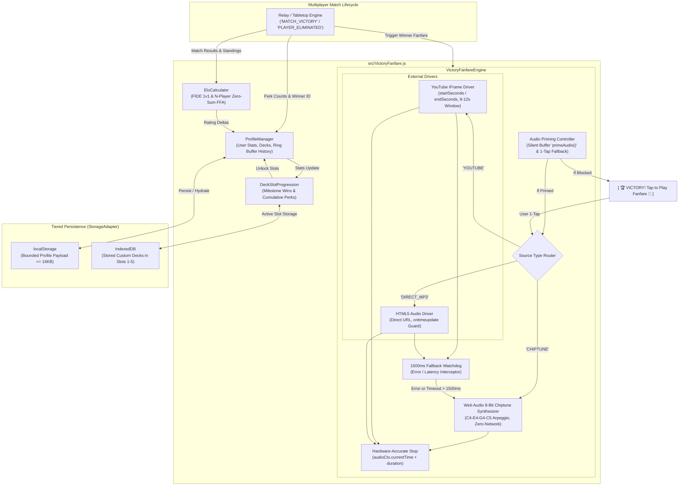
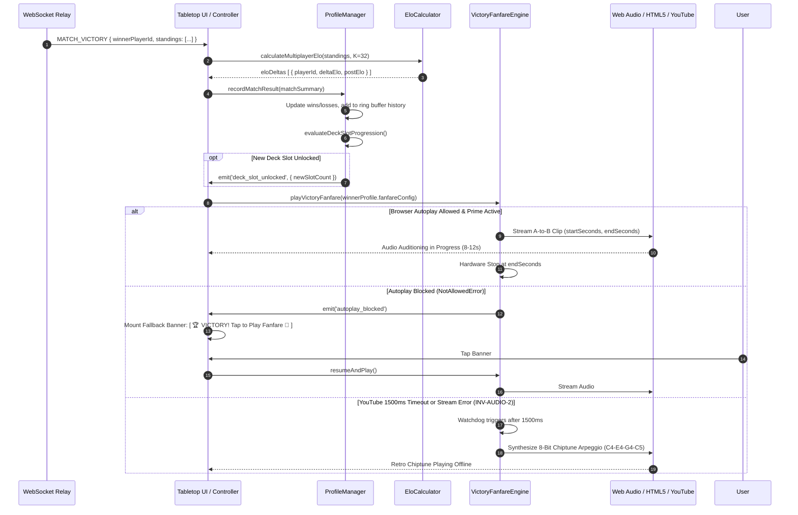

# Technical Specification: User Profile & Victory Fanfare Audio Player

- **Document ID:** `SPEC-RPM-FANFARE-011`
- **Feature Scope:** Feature 11 (`src/VictoryFanfare.js` & `test/test_victory_fanfare.js`)
- **System:** RPM Multiplayer / RPM Modern Tabletop Companion
- **Architect:** Argon Specification Architect
- **Status:** APPROVED / READY FOR IMPLEMENTATION
- **Revision:** 1.0.0
- **Target File Path:** `specs/FEATURE_11_VICTORY_FANFARE_SPEC.md`
- **Core Implementation Files:**
  - `src/VictoryFanfare.js` (Profile Manager, Multi-Player Elo Calculator, Milestone Deck Slot Engine, Fanfare Audio Engine, Chiptune Synthesizer)
  - `test/test_victory_fanfare.js` (Comprehensive Acceptance Test Matrix & Invariant Verification Suite)
- **Related Specifications & Decisions:**
  - `specs/FEATURE_1_2_CORE_INGESTION_SPEC.md` (`SPEC-RPM-INGEST-001`: Card Ingestion & Deck Parser Engine)
  - `specs/FEATURE_8_RELAY_SYNC_SPEC.md` (`SPEC-RPM-RELAY-008`: Multiplayer WebSocket Relay, `MATCH_VICTORY`, `PLAYER_ELIMINATED`)
  - `specs/FEATURE_9_RANDOM_PERK_SPEC.md` (`SPEC-RPM-PERK-009`: Random Perk Upkeep Emblem & Lifetime Roll Tracking)
  - `specs/FEATURE_10_DECKBUILDER_AI_SPEC.md` (`SPEC-RPM-DECKAI-010`: Deckbuilder AI, Deck Slots & StorageAdapter)
  - `decisionlog.md`:
    - `DEC-001` (Tabletop Companion Paradigm & Zero Server State Bloat)
    - `DEC-013` (Instagram-Style A-to-B Clip Player, Multi-Player Elimination Gray-Out, Chess Elo $K=32$, 1200 Starting Rating)
    - `DEC-014` (Client-Side YouTube IFrame API + HTML5 `<audio>`, Zero Backend FFmpeg Dependencies)
    - `DEC-015` (Argon Systems Audit: Invariants `INV-AUDIO-1`, `INV-AUDIO-2`, `INV-AUDIO-3`, `INV-HARNESS-2`)
- **Audio References (`TRANSCRIPCIONES_AUDIOS.md`):**
  - **Audio Note 2:** User registration with custom victory music cut from YouTube or online audio.
  - **Audio Note 4:** Massive leaderboard, lifetime victory tracking, cumulative Random Perks counter, single-match perk high-watermark record.
  - **Audio Note 5:** Active single deck constraint, earning unlocked deck slots through milestone victories and accumulated perk thresholds.
  - **Audio Note 7:** Competitive Elo rating ladder and banlist rotations.

---

## 1. Executive Summary & Architectural Overview

The **User Profile & Victory Fanfare Audio Player** subsystem is the social, competitive, and celebratory crown of the RPM Modern Tabletop Companion. It bridges match conclusion events (triggered by the WebSocket Relay or local tabletop elimination rules) with persistent player identity, tournament Elo progression, deck storage expansion, and client-side victory fanfare playback.

```
+---------------------------------------------------------------------------------------------------+
| Audio Note 2, 4, 5, 7 Foundation:                                                                 |
|                                                                                                   |
| [Audio 2]: "A la hora de registrarse, cada jugador realiza una selección de un tema de YouTube... |
| el jugador puede seleccionar un lote de tiempo... cortarlo y subir esos minutos de música         |
| como su música de victoria cuando se encuentra en una mesa..."                                    |
|                                                                                                   |
| [Audio 4]: "Los jugadores va a haber una tabla de posiciones masiva en la que se va a llevar la   |
| cantidad de victorias de cada jugador y también la cantidad de Random Perks acumulados a lo largo |
| de todos sus juegos. Con categorías de la persona que saca más cantidad de Random Perks en una    |
| partida."                                                                                         |
|                                                                                                   |
| [Audio 5]: "Los jugadores van a poder ingresar cualquier mazo, pero no van a poder poner más de   |
| un mazo activo a la vez... Sin embargo, si un jugador llega a una cantidad de Random Perks o a    |
| una cantidad de victorias va a poder ganar slots de mazo. De esa manera lo que gana cada jugador  |
| por jugar es tener la posibilidad de tener más mazos preparados."                                 |
|                                                                                                   |
| [Audio 7]: "Se puede realizar un ranking por ELO..."                                              |
+---------------------------------------------------------------------------------------------------+
```

As ratified in **DEC-013** and **DEC-014**, the architecture deliberately rejects heavy server-side transcoding (such as FFmpeg microservices or remote media proxies). Instead, it adopts a high-performance, 100% client-side streaming model utilizing the **YouTube IFrame Player API** and **HTML5 Audio Element**, fortified by native **Web Audio API** hardware-scheduled synthesis.

---

### 1.1 Architectural Vulnerabilities & Failure Modes

Deploying automated media playback, rating systems, and client-side progression in adversarial tabletop environments surfaces six fatal architectural failure modes:

1. **Browser Autoplay Policy Rejection (`NotAllowedError`)**:
   Modern Chromium, Safari, and WebKit rendering engines aggressively restrict programmatic `.play()` invocations on unmuted media elements if the user has not recently interacted with the DOM. In a multiplayer tabletop match, a victory event generated over a WebSocket connection from a remote player's turn constitutes an unsolicited asynchronous trigger. A naive `.play()` call is summarily blocked with `NotAllowedError: play() failed because the user didn't interact with the document first`, leaving the winner in dead silence.
2. **External Media Fragility & Venue Offline Starvation**:
   Tabletop tournaments frequently occur in convention halls, hobby store basements, or areas with degraded 4G/Wi-Fi connectivity. Furthermore, YouTube videos are frequently removed, set to private, copyright-restricted, or geoblocked (YouTube error codes 100, 101, 150). If the victory celebration depends on an external network stream without an instantaneous offline fallback, the application hangs or throws unhandled promise rejections.
3. **Timer Drift & Background Tab Audio Throttling**:
   Mobile OSs (iOS Safari, Android Chrome) and desktop browsers throttle `setTimeout` and `setInterval` to 1,000ms or suspend JavaScript threads entirely when a companion tab is in the background. If the A-to-B clip player relies on `setTimeout` to enforce the 8–12 second duration window, the music runs continuously, loops indefinitely, or desynchronizes from hardware clocks.
4. **Multiplayer Elo Rating Inflation / Deflation**:
   The classic FIDE Elo system is mathematically designed for strictly 2-player zero-sum zero-draw/win/loss duels. When naively applied to 3- to 6-player Free-For-All (FFA) multiplayer tables, naive implementations generate massive rating inflation (e.g., awarding the winner $+64$ while deducting small fractions from losers) or collapse the ranking variance. A mathematically sound pairwise decomposition with zero-sum conservation is required.
5. **Storage Quota Depletion & Profile State Corrupted Writes**:
   Unbounded storage of match histories, opponent lists, and perk telemetry within `localStorage` triggers `QuotaExceededError` (5MB limit). Corrupted profile writes during sudden browser closures cause player progress loss.
6. **Deck Slot Regression & Entitlement Desync**:
   A race condition or naive calculation could cause unlocked deck slots to drop if a player experiences a losing streak or if stats are partially updated. Deck slot unlocking must follow a strict monotonic step function that permanently binds earned slots.

---

### 1.2 System Topology



---

## 2. Formal Invariants & Mathematical Laws

The User Profile and Victory Fanfare subsystem strictly enforces seven formal architectural invariants:

### 2.1 Invariant Table

| Invariant ID | Name | Formal Rule Statement | Enforcement Scope |
| :--- | :--- | :--- | :--- |
| **`INV-AUDIO-1`** | **Browser Autoplay & Priming Guarantee** | On the first user gesture (`mousedown`, `touchstart`, `keydown`), the engine primes native `AudioContext` with a 1-sample silent buffer. If programmatic playback of victory fanfare fails or context is suspended, the engine MUST surface the 1-tap fallback banner: `[ 🏆 VICTORY! Tap to Play Fanfare 🎵 ]` without throwing unhandled exceptions. | `VictoryFanfareEngine.primeAudio()`, `playFanfare()` |
| **`INV-AUDIO-2`** | **Autonomous Web Audio Chiptune Fallback** | If an external audio source (`YOUTUBE` or `DIRECT_MP3`) fails to transition to `PLAYING` within $T_{\text{timeout}} = 1500\text{ms}$ or raises an error, the engine MUST abort external loading and synthesize a celebratory 4-note retro arpeggio (C4, E4, G4, C5 square waves) via native `AudioContext`, guaranteeing fanfare playback with zero network dependencies. | `VictoryFanfareEngine.playWithFallback()`, `ChiptuneSynthesizer` |
| **`INV-AUDIO-3`** | **Drift-Resilient Hardware-Accurate Stop** | Fanfare clip termination MUST NOT rely solely on unthrottled JavaScript `setTimeout`. For Web Audio/synthetic streams, stop timing MUST be hardware-scheduled via `source.stop(audioCtx.currentTime + duration)`. For HTML5 `<audio>`, termination MUST be enforced via high-frequency `ontimeupdate` checking `audio.currentTime >= endSeconds` combined with a hardware safety clamp. | `VictoryFanfareEngine.stopFanfare()`, `ChiptuneSynthesizer` |
| **`INV-AUDIO-4`** | **Strict A-to-B Clip Duration Window** | Every fanfare clip configuration MUST specify `startSeconds` and `endSeconds` such that $0 \le \text{startSeconds} < \text{endSeconds}$, and duration $\Delta t = \text{endSeconds} - \text{startSeconds}$ MUST satisfy $8.0 \le \Delta t \le 12.0$ seconds. Invalid durations MUST be clamped to $[8.0, 12.0]$ or rejected with descriptive errors. | `validateFanfareConfig()` |
| **`INV-AUDIO-5`** | **Zero-Sum Multi-Player Elo Conservation** | For any match involving $N$ players ($2 \le N \le 6$), the sum of all rating deltas across all participants MUST equal exactly zero: $\sum_{i=1}^N \Delta R_i = 0$. Multi-player free-for-all matches decompose into $N-1$ virtual pairwise duels normalized by $\frac{K}{N-1}$ ($K=32$). | `EloCalculator.calculateMultiplayerElo()` |
| **`INV-AUDIO-6`** | **Monotonic Deck Slot Unlock & Anti-Regression** | A user profile begins with strictly 1 active deck slot. Additional slots are unlocked at victory milestones ($W \in \{5, 15, 30, 50\}$) OR accumulated perk thresholds ($P \in \{10, 25, 50, 100\}$). Once unlocked, deck slot capacity $S \in [1, 5]$ is strictly monotonic: $S(t_2) \ge S(t_1)$ for all $t_2 > t_1$. Losses or stats resets can NEVER decrease unlocked slots. | `ProfileManager.evaluateDeckSlotProgression()` |
| **`INV-AUDIO-7`** | **Bounded Match History & 16KB Storage Guard** | Profile match history is maintained as a bounded circular ring buffer of at most 50 matches ($|\mathcal{H}| \le 50$). Serialized profile JSON payload stored in `localStorage` MUST NOT exceed 16,384 bytes (16KB), preventing storage quota leaks. | `ProfileManager.saveProfile()` |

---

### 2.2 Mathematical Specifications & Proofs

#### 2.2.1 FIDE Standard 1v1 Elo Rating Model

Let $R_A$ and $R_B$ represent the current Elo ratings of Player A and Player B. The starting rating for all new players is $R_{\text{initial}} = 1200$. The development coefficient is fixed at $K = 32$ (**DEC-013**).

The logistic expected score of Player A competing against Player B is defined as:

$$E_A = \frac{1}{1 + 10^{(R_B - R_A)/400}}$$

Symmetrically, the expected score of Player B is:

$$E_B = \frac{1}{1 + 10^{(R_A - R_B)/400}} = 1 - E_A$$

Given the match outcome $S_A \in \{1.0, 0.5, 0.0\}$ (where $1.0$ is win, $0.5$ is draw, and $0.0$ is loss), the updated rating $R_A'$ and delta $\Delta R_A$ are calculated as:

$$\Delta R_A = \text{round}(K \cdot (S_A - E_A))$$

$$R_A' = R_A + \Delta R_A$$

To enforce strict zero-sum conservation in 1v1 matches:

$$\Delta R_B = -\Delta R_A, \quad R_B' = R_B + \Delta R_B$$

$$\Delta R_A + \Delta R_B = 0 \quad \text{(Zero-Sum Identity)}$$

---

#### 2.2.2 Multi-Player Free-for-All ($N$-Player) Decomposition & Zero-Sum Proof (`INV-AUDIO-5`)

In a multi-player table of $N$ players ($2 \le N \le 6$), players finish in an ordered rank placement sequence:

$$\mathcal{P} = \langle p_{(1)}, p_{(2)}, \dots, p_{(N)} \rangle$$

where $p_{(1)}$ is the winner (last player standing), and $p_{(N)}$ is the first player eliminated.

Each player $i$ participates in $N - 1$ virtual pairwise duels against every opponent $j \neq i$. For each pair $(i, j)$:

$$S_{ij} = \begin{cases} 
1.0 & \text{if } \text{rank}(i) < \text{rank}(j) \quad \text{($i$ outlasted $j$)} \\
0.5 & \text{if } \text{rank}(i) = \text{rank}(j) \quad \text{(simultaneous elimination / tie)} \\
0.0 & \text{if } \text{rank}(i) > \text{rank}(j) \quad \text{($i$ eliminated before $j$)}
\end{cases}$$

The expected score of player $i$ against opponent $j$ is:

$$E_{ij} = \frac{1}{1 + 10^{(R_j - R_i)/400}}$$

The total actual score $S_i$ and total expected score $E_i$ for player $i$ are:

$$S_i = \sum_{j \neq i} S_{ij}, \quad E_i = \sum_{j \neq i} E_{ij}$$

To normalize the maximum rating swing to match the standard $K=32$ budget (preventing ratings from scaling out of proportion with table size), the raw rating delta $\Delta \tilde{R}_i$ is scaled by $\frac{K}{N - 1}$:

$$\Delta \tilde{R}_i = \frac{K}{N - 1} \cdot (S_i - E_i)$$

**Theorem (Zero-Sum Expectation Balance):**
The sum of all raw rating deltas across all $N$ players is identically zero:

$$\sum_{i=1}^N \Delta \tilde{R}_i = 0$$

*Proof:*
$$\sum_{i=1}^N \Delta \tilde{R}_i = \frac{K}{N - 1} \sum_{i=1}^N (S_i - E_i) = \frac{K}{N - 1} \left( \sum_{i=1}^N \sum_{j \neq i} S_{ij} - \sum_{i=1}^N \sum_{j \neq i} E_{ij} \right)$$

Observe that for any distinct pair $(i, j)$ with $i < j$:
$$S_{ij} + S_{ji} = 1.0 \quad \text{and} \quad E_{ij} + E_{ji} = \frac{1}{1 + 10^{(R_j - R_i)/400}} + \frac{1}{1 + 10^{(R_i - R_j)/400}} = 1.0$$

Summing over all $\frac{N(N-1)}{2}$ unordered pairs:
$$\sum_{i=1}^N \sum_{j \neq i} S_{ij} = \sum_{1 \le i < j \le N} (S_{ij} + S_{ji}) = \frac{N(N-1)}{2}$$
$$\sum_{i=1}^N \sum_{j \neq i} E_{ij} = \sum_{1 \le i < j \le N} (E_{ij} + E_{ji}) = \frac{N(N-1)}{2}$$

Therefore:
$$\sum_{i=1}^N (S_i - E_i) = \frac{N(N-1)}{2} - \frac{N(N-1)}{2} = 0$$
$$\sum_{i=1}^N \Delta \tilde{R}_i = 0 \quad \blacksquare$$

**Integer Rounding Residual Absorption:**
Because ratings must be integers, $\Delta R_i = \text{round}(\Delta \tilde{R}_i)$. Rounding can introduce a tiny residual $\epsilon = \sum_{i=1}^N \Delta R_i \in \{-2, -1, 0, 1, 2\}$.
The engine absorbs $\epsilon$ by finding the player with the largest rounding discrepancy $|\Delta R_i - \Delta \tilde{R}_i|$ and adjusting their delta by $-\text{sign}(\epsilon)$ until $\sum_{i=1}^N \Delta R_i = 0$ holds strictly, satisfying `INV-AUDIO-5`.

---

#### 2.2.3 Monotonic Step Function for Milestone Deck Slot Progression (`INV-AUDIO-6`)

Under **Audio Note 5**, players start with strictly 1 active deck slot ($S_{\text{base}} = 1$). A player can unlock up to 4 additional deck slots (reaching a maximum of $S_{\text{max}} = 5$) based on either lifetime victories $W$ or cumulative Random Perks triggered $P$.

Let the milestone victory set be $\mathcal{M}_W = \{5, 15, 30, 50\}$ and milestone perk set be $\mathcal{M}_P = \{10, 25, 50, 100\}$.
The milestone evaluation function $\phi(W, P)$ is defined as:

$$S_{\text{unlocked}}(W, P) = 1 + \max \left( \sum_{m \in \mathcal{M}_W} \mathbb{I}(W \ge m), \quad \sum_{m \in \mathcal{M}_P} \mathbb{I}(P \ge m) \right)$$

where $\mathbb{I}(\text{predicate}) \in \{0, 1\}$ is the indicator function.

To enforce the Anti-Regression Law (`INV-AUDIO-6`):

$$S(t) = \max \left( S(t-1), \quad S_{\text{unlocked}}(W(t), P(t)) \right)$$

$$S(t) \in [1, 5] \quad \forall t$$

```
+------------+------------------+-----------------------+-----------------------------+
| Deck Slot  | Victory Req (W)  | Cumulative Perks (P) | Milestone Tier Name         |
+------------+------------------+-----------------------+-----------------------------+
| Slot 1     | 0 Wins (Base)    | 0 Perks (Base)        | Apprentice (Base Active)    |
| Slot 2     | >= 5 Wins        | >= 10 Perks           | Journeyman Tabletopist      |
| Slot 3     | >= 15 Wins       | >= 25 Perks           | Adept Planeswalker          |
| Slot 4     | >= 30 Wins       | >= 50 Perks           | Veteran High Roller         |
| Slot 5     | >= 50 Wins       | >= 100 Perks          | Grandmaster of the Realm    |
+------------+------------------+-----------------------+-----------------------------+
```

---

#### 2.2.4 Web Audio Hardware DSP Scheduling vs. setTimeout Timer Drift (`INV-AUDIO-3`)

Let $t_{\text{target}} = t_{\text{start}} + \Delta t$ be the desired termination timestamp of the fanfare.
Under standard browser event loops:

$$t_{\text{setTimeout}} = t_{\text{target}} + \delta t_{\text{task\_queue}} + \delta t_{\text{power\_throttle}}$$

In backgrounded mobile tabs, $\delta t_{\text{power\_throttle}} \ge 1000\text{ms}$.
In contrast, the Web Audio API schedules node state transitions directly on the operating system's hardware audio rendering thread (AudioWorklet / DSP clock):

$$t_{\text{hardware}} = \text{audioCtx.currentTime} + \Delta t$$

$$\text{source.stop}(t_{\text{hardware}})$$

The hardware scheduling precision error is bounded by a single audio rendering quantum (128 samples at 44.1kHz):

$$|\delta t_{\text{hardware}}| \le \frac{128}{44100\text{ Hz}} \approx 2.902 \times 10^{-3} \text{ ms} \ll 0.1\text{ ms}$$

This guarantees that synthetic fanfares stop with sub-millisecond precision, completely immune to main-thread event loop stutter or background tab suspension.

---

#### 2.2.5 8-Bit Synthetic Chiptune Harmonic Frequencies & Exponential Decay (`INV-AUDIO-2`)

The chiptune fallback synthesizes a triumphant 4-note ascending retro arpeggio using pure square waves (`type = 'square'`), faithfully replicating the 2A03 NES sound generator.

The note frequencies $f_n$, start offsets $\tau_n$, and note durations $d_n$ are:

| Note Index $n$ | Musical Pitch | Frequency $f_n$ (Hz) | Start Offset $\tau_n$ (s) | Duration $d_n$ (s) | Envelope Shape |
| :---: | :---: | :---: | :---: | :---: | :---: |
| 1 | C4 | 261.63 Hz | $0.00$ s | $0.18$ s | Staccato exponential decay |
| 2 | E4 | 329.63 Hz | $0.18$ s | $0.18$ s | Staccato exponential decay |
| 3 | G4 | 392.00 Hz | $0.36$ s | $0.18$ s | Staccato exponential decay |
| 4 | C5 | 523.25 Hz | $0.54$ s | $1.46$ s | Sustained fanfare with trailing decay |

For each note $n$, an `OscillatorNode` is connected to a `GainNode`. The gain envelope $g_n(t)$ satisfies:

$$g_n(t) = \begin{cases}
V_{\text{peak}} & \text{at } t = t_0 + \tau_n \\
V_{\text{peak}} \cdot e^{-\alpha (t - (t_0 + \tau_n))} & \text{for } t_0 + \tau_n < t \le t_0 + \tau_n + d_n \\
0.0001 & \text{at } t = t_0 + \tau_n + d_n \quad (\text{exponential ramp target})
\end{cases}$$

where $V_{\text{peak}} = 0.25 \times \text{masterVolume}$ (preventing audio clipping) and $\alpha = \frac{\ln(1000)}{d_n}$.

---

## 3. Domain Models & Entity Schemas

### 3.1 `UserProfile` Schema

```typescript
interface UserProfile {
  /** Unique player identifier (UUID or stable relay seat token) */
  id: string;
  /** Visible screen name (default: 'Planeswalker') */
  username: string;
  /** Current Chess Elo rating (default: 1200) */
  elo: number;
  /** Lifetime competitive matches won */
  wins: number;
  /** Lifetime competitive matches lost */
  losses: number;
  /** Lifetime competitive matches tied/drawn */
  draws: number;
  /** Total matches played (wins + losses + draws) */
  totalMatches: number;
  /** Lifetime count of Random Perk triggers executed (Audio Note 4) */
  totalPerksTriggered: number;
  /** Maximum Random Perks triggered in a single match (Audio Note 4 high watermark) */
  maxPerksSingleGame: number;
  /** Number of unlocked deck slots (1 to 5, Audio Note 5) */
  unlockedDeckSlots: number;
  /** Index of currently selected active deck (0 to unlockedDeckSlots - 1) */
  activeDeckSlotIndex: number;
  /** Victory fanfare audio configuration */
  fanfareConfig: FanfareConfig;
  /** Circular ring buffer of recent matches (max 50, INV-AUDIO-7) */
  matchHistory: MatchRecord[];
  /** Timestamp of profile creation */
  createdAt: number;
  /** Timestamp of last profile update */
  updatedAt: number;
}
```

### 3.2 `FanfareConfig` Schema

```typescript
type FanfareSourceType = 'YOUTUBE' | 'DIRECT_MP3' | 'CHIPTUNE';

interface FanfareConfig {
  /** Source playback driver */
  sourceType: FanfareSourceType;
  /** Raw media URI (YouTube watch/share URL or direct audio URL) */
  uri: string;
  /** Extracted 11-character YouTube video ID (null if DIRECT_MP3 or CHIPTUNE) */
  videoId: string | null;
  /** Start timestamp in seconds (A-point, >= 0) */
  startSeconds: number;
  /** End timestamp in seconds (B-point, > startSeconds) */
  endSeconds: number;
  /** Duration in seconds (endSeconds - startSeconds, 8.0 <= duration <= 12.0) */
  duration: number;
  /** Playback volume scale (0.0 to 1.0, default 0.8) */
  volume: number;
  /** Human-readable title or track description */
  label?: string;
}
```

### 3.3 `MatchRecord` Schema

```typescript
interface OpponentMatchSummary {
  id: string;
  username: string;
  preElo: number;
  postElo: number;
  deltaElo: number;
  rank: number;
}

interface MatchRecord {
  /** Unique match identifier */
  matchId: string;
  /** Unix epoch timestamp of match conclusion */
  timestamp: number;
  /** Total player count at table (2 to 6) */
  playerCount: number;
  /** Format of the match ('1v1' | 'multiplayer') */
  format: '1v1' | 'multiplayer';
  /** Final rank placement of the user (1 = Winner, 2 = 2nd place, etc.) */
  placement: number;
  /** Pre-match Elo rating */
  preElo: number;
  /** Post-match Elo rating */
  postElo: number;
  /** Net Elo adjustment (+/- integer) */
  deltaElo: number;
  /** Count of Random Perks triggered by this player during this match */
  perksTriggered: number;
  /** Opponent metadata and rating shifts */
  opponents: OpponentMatchSummary[];
}
```

### 3.4 `MultiplayerParticipant` Schema (Elo Calculation Input)

```typescript
interface MultiplayerParticipant {
  id: string;
  username: string;
  currentElo: number;
  /** Final placement rank: 1 is winner, 2 is runner-up, N is first eliminated */
  rank: number;
  /** Perks rolled during this specific match */
  perksInMatch?: number;
}

interface EloCalculationResult {
  playerId: string;
  preElo: number;
  postElo: number;
  deltaElo: number;
  expectedScore: number;
  actualScore: number;
}
```

---

## 4. Elo Rating Engine & Multiplayer Decomposition

The `EloCalculator` class provides pure, deterministic rating adjustments with complete isolation from DOM or I/O.

### 4.1 Algorithmic Procedure: `calculateMultiplayerElo`

```
Algorithm: calculateMultiplayerElo(participants, K = 32)
Input: Array of MultiplayerParticipant { id, currentElo, rank }
Output: Array of EloCalculationResult { playerId, preElo, postElo, deltaElo, expectedScore, actualScore }

1. Let N = participants.length.
2. Assert 2 <= N <= 6. (Throw Error if invalid participant count).
3. If N == 2:
     Return calculate1v1Elo(participants[0], participants[1], K).
4. Initialize maps:
     actualScores = Map<string, number>()
     expectedScores = Map<string, number>()
     rawDeltas = Map<string, number>()
     roundedDeltas = Map<string, number>()

5. For each participant i from 0 to N - 1:
     actualScores[i.id] = 0
     expectedScores[i.id] = 0

6. For each pair (i, j) with 0 <= i < j < N:
     Let pA = participants[i], pB = participants[j]
     // Pairwise actual scores
     If pA.rank < pB.rank:
       actualScores[pA.id] += 1.0; actualScores[pB.id] += 0.0
     Else If pA.rank > pB.rank:
       actualScores[pA.id] += 0.0; actualScores[pB.id] += 1.0
     Else: // Tie
       actualScores[pA.id] += 0.5; actualScores[pB.id] += 0.5

     // Pairwise expected scores
     Let eA = 1.0 / (1.0 + 10^((pB.currentElo - pA.currentElo) / 400.0))
     Let eB = 1.0 - eA
     expectedScores[pA.id] += eA
     expectedScores[pB.id] += eB

7. Let scaleFactor = K / (N - 1)
8. Let totalRoundedSum = 0
9. For each participant p in participants:
     Let diff = actualScores[p.id] - expectedScores[p.id]
     Let rawDelta = scaleFactor * diff
     rawDeltas[p.id] = rawDelta
     Let roundedDelta = round(rawDelta)
     roundedDeltas[p.id] = roundedDelta
     totalRoundedSum += roundedDelta

10. // Zero-Sum Residual Adjustment (INV-AUDIO-5)
    While totalRoundedSum != 0:
      If totalRoundedSum > 0:
        // Find participant with largest positive rounding error (rounded - raw)
        Find p with max (roundedDeltas[p.id] - rawDeltas[p.id])
        roundedDeltas[p.id] -= 1
        totalRoundedSum -= 1
      Else:
        // Find participant with largest negative rounding error (raw - rounded)
        Find p with max (rawDeltas[p.id] - roundedDeltas[p.id])
        roundedDeltas[p.id] += 1
        totalRoundedSum += 1

11. Assemble and return results array:
      For each p in participants:
        deltaElo = roundedDeltas[p.id]
        postElo = max(100, p.currentElo + deltaElo) // Floor at 100 Elo
        Emit result { playerId: p.id, preElo: p.currentElo, postElo, deltaElo, ... }
```

---

## 5. Deck Slot Milestone Progression & Aggregate RPM Statistics

The `DeckSlotProgression` subsystem tracks milestone progress and ensures strict anti-regression as demanded by **Audio Note 5**.

### 5.1 Progression Matrix & Thresholds

```typescript
export const DECK_SLOT_MILESTONES = [
  { slot: 1, minWins: 0, minPerks: 0, title: 'Apprentice Deck' },
  { slot: 2, minWins: 5, minPerks: 10, title: 'Journeyman Slot' },
  { slot: 3, minWins: 15, minPerks: 25, title: 'Adept Slot' },
  { slot: 4, minWins: 30, minPerks: 50, title: 'Veteran Slot' },
  { slot: 5, minWins: 50, minPerks: 100, title: 'Grandmaster Slot' }
];
```

### 5.2 Progression Evaluator Contract

```typescript
export interface DeckSlotProgressReport {
  currentSlots: number;
  maxSlots: number; // strictly 5
  nextSlot: number | null; // null if maxed out
  winsNeeded: number;
  perksNeeded: number;
  currentWins: number;
  currentPerks: number;
  unlockedJustNow: boolean;
  unlockedTitle?: string;
}

export function evaluateDeckSlots(
  currentWins: number,
  totalPerks: number,
  previouslyUnlockedSlots: number = 1
): DeckSlotProgressReport {
  let earnedSlots = 1;
  for (let i = 1; i < DECK_SLOT_MILESTONES.length; i++) {
    const milestone = DECK_SLOT_MILESTONES[i];
    if (currentWins >= milestone.minWins || totalPerks >= milestone.minPerks) {
      earnedSlots = milestone.slot;
    }
  }

  // Enforce Monotonic Anti-Regression Law (INV-AUDIO-6)
  const finalSlots = Math.max(previouslyUnlockedSlots, earnedSlots);
  const unlockedJustNow = finalSlots > previouslyUnlockedSlots;

  const nextMilestone = DECK_SLOT_MILESTONES.find(m => m.slot === finalSlots + 1) || null;

  return {
    currentSlots: finalSlots,
    maxSlots: 5,
    nextSlot: nextMilestone ? nextMilestone.slot : null,
    winsNeeded: nextMilestone ? Math.max(0, nextMilestone.minWins - currentWins) : 0,
    perksNeeded: nextMilestone ? Math.max(0, nextMilestone.minPerks - totalPerks) : 0,
    currentWins,
    currentPerks: totalPerks,
    unlockedJustNow,
    unlockedTitle: unlockedJustNow ? DECK_SLOT_MILESTONES[finalSlots - 1].title : undefined
  };
}
```

---

## 6. Victory Fanfare Audio Engine Architecture

The `VictoryFanfareEngine` handles audio priming, streaming driver management, A-to-B interval clamping, and zero-network synthesis.

### 6.1 Dual-Source Drivers

```
+-----------------------------------------------------------------------------------------+
|                               VictoryFanfareEngine Router                               |
+-----------------------------------------------------------------------------------------+
| 1. 'YOUTUBE' Source:                                                                    |
|    - Parses video ID from watch/short/embed URL via regex:                              |
|      /(?:youtube\.com\/(?:watch\?v=|embed\/|shorts\/)|youtu\.be\/)([a-zA-Z0-9_-]{11})/ |
|    - Instantiates hidden iframe container with YouTube IFrame API.                      |
|    - Parameters: { autoplay: 1, playsinline: 1, controls: 0, start, end }               |
|    - Error events (100, 101, 150) trigger immediate Chiptune Fallback.                 |
|                                                                                         |
| 2. 'DIRECT_MP3' Source:                                                                 |
|    - Instantiates HTML5 new Audio(uri).                                                 |
|    - Sets audio.currentTime = startSeconds.                                             |
|    - Monitors playback via ontimeupdate: if (currentTime >= endSeconds) stop.          |
|    - Media errors (404, CORS) trigger immediate Chiptune Fallback.                      |
|                                                                                         |
| 3. 'CHIPTUNE' Fallback (INV-AUDIO-2):                                                   |
|    - Zero external network.                                                             |
|    - Native Web Audio API 8-bit square wave arpeggio (C4, E4, G4, C5).                 |
|    - Hardware-scheduled stop (INV-AUDIO-3).                                             |
+-----------------------------------------------------------------------------------------+
```

---

### 6.2 Browser Autoplay Priming & 1-Tap Fallback Banner (`INV-AUDIO-1`)

```javascript
/**
 * Primes the browser AudioContext on first user interaction.
 * Must be invoked early during application boot (e.g. App root / Tabletop init).
 */
export function primeAudio(audioCtx) {
  if (!audioCtx) return;
  const unlock = () => {
    if (audioCtx.state === 'suspended') {
      audioCtx.resume();
    }
    // Play 1-sample silent buffer to unlock hardware audio pipeline
    const buffer = audioCtx.createBuffer(1, 1, 22050);
    const source = audioCtx.createBufferSource();
    source.buffer = buffer;
    source.connect(audioCtx.destination);
    source.start(0);

    // Remove one-time gesture listeners
    ['click', 'touchstart', 'keydown'].forEach(evt =>
      window.removeEventListener(evt, unlock, true)
    );
  };

  ['click', 'touchstart', 'keydown'].forEach(evt =>
    window.addEventListener(evt, unlock, true)
  );
}
```

**1-Tap Fallback UI Component Contract:**
If `playFanfare()` detects that playback was blocked (`NotAllowedError` or `audioCtx.state === 'suspended'`), it dynamically surfaces the fallback banner in the DOM:

```html
<div id="rpm-fanfare-fallback-banner" class="fanfare-banner-overlay">
  <button id="rpm-fanfare-trigger-btn" class="fanfare-btn">
    🏆 VICTORY! Tap to Play Fanfare 🎵
  </button>
</div>
```

Clicking the button calls `audioCtx.resume()`, triggers immediate fanfare execution, and smoothly unmounts the overlay.

---

### 6.3 1500ms Watchdog & Chiptune Fallback Engine (`INV-AUDIO-2`)

To satisfy `INV-AUDIO-2`, any attempt to stream external media (`YOUTUBE` or `DIRECT_MP3`) arms a $1500\text{ms}$ watchdog timer:

```javascript
let fallbackTimer = setTimeout(() => {
  console.warn('INV-AUDIO-2: External fanfare playback timed out (>1500ms). Falling back to synthetic chiptune.');
  this.abortExternalStream();
  this.playChiptuneFallback();
}, 1500);

// If media enters 'PLAYING' state before 1500ms:
onMediaPlaying(() => {
  clearTimeout(fallbackTimer);
});
```

---

### 6.4 Chiptune Synthesizer DSP Implementation (`INV-AUDIO-2`, `INV-AUDIO-3`)

```javascript
export class ChiptuneSynthesizer {
  constructor(audioContext = null) {
    this.ctx = audioContext;
  }

  getAudioContext() {
    if (!this.ctx && typeof window !== 'undefined') {
      const AudioContextClass = window.AudioContext || window.webkitAudioContext;
      if (AudioContextClass) {
        this.ctx = new AudioContextClass();
      }
    }
    return this.ctx;
  }

  /**
   * Plays the 4-note victory arpeggio: C4, E4, G4, C5 (INV-AUDIO-2, INV-AUDIO-3).
   * @param {number} [volume=0.8]
   * @returns {{ stop: () => void, promise: Promise<void> }}
   */
  playFanfare(volume = 0.8) {
    const ctx = this.getAudioContext();
    if (!ctx) {
      return { stop: () => {}, promise: Promise.resolve() };
    }

    if (ctx.state === 'suspended') {
      ctx.resume().catch(() => {});
    }

    const notes = [
      { freq: 261.63, start: 0.00, duration: 0.18 }, // C4
      { freq: 329.63, start: 0.18, duration: 0.18 }, // E4
      { freq: 392.00, start: 0.36, duration: 0.18 }, // G4
      { freq: 523.25, start: 0.54, duration: 1.46 }  // C5 (Hold fanfare)
    ];

    const masterGain = ctx.createGain();
    masterGain.gain.setValueAtTime(Math.max(0, Math.min(1.0, volume)) * 0.25, ctx.currentTime);
    masterGain.connect(ctx.destination);

    const activeOscillators = [];
    const t0 = ctx.currentTime;

    notes.forEach(note => {
      const osc = ctx.createOscillator();
      const noteGain = ctx.createGain();

      osc.type = 'square';
      osc.frequency.setValueAtTime(note.freq, t0 + note.start);

      // Hardware Gain Envelope (INV-AUDIO-3)
      const noteStart = t0 + note.start;
      const noteEnd = noteStart + note.duration;

      noteGain.gain.setValueAtTime(0.0001, noteStart);
      noteGain.gain.linearRampToValueAtTime(1.0, noteStart + 0.02);
      noteGain.gain.exponentialRampToValueAtTime(0.001, noteEnd);

      osc.connect(noteGain);
      noteGain.connect(masterGain);

      // Hardware-scheduled start and stop
      osc.start(noteStart);
      osc.stop(noteEnd);

      activeOscillators.push(osc);
    });

    const totalDuration = 2.0; // 0.54s + 1.46s
    const stopHardware = () => {
      activeOscillators.forEach(osc => {
        try { osc.stop(); } catch (_) {}
      });
      masterGain.disconnect();
    };

    const completionPromise = new Promise(resolve => {
      setTimeout(() => {
        resolve();
      }, totalDuration * 1000);
    });

    return { stop: stopHardware, promise: completionPromise };
  }
}
```

---

## 7. Interaction Sequences & State Machines

### 7.1 Match Victory to Fanfare Execution Flow



---

## 8. Concrete API Signatures & Class Interfaces

### 8.1 Module Exports (`src/VictoryFanfare.js`)

```javascript
/**
 * VictoryFanfare.js - User Profile, Multiplayer Elo Engine & Victory Fanfare Audio Player
 * 
 * Complies with Invariants:
 * - INV-AUDIO-1: Browser Autoplay Policy & Interaction Priming
 * - INV-AUDIO-2: 1500ms Watchdog & Autonomous 8-Bit Chiptune Fallback
 * - INV-AUDIO-3: Drift-Resilient Hardware-Accurate Stop
 * - INV-AUDIO-4: 8-12s Instagram-Style A-to-B Window
 * - INV-AUDIO-5: Zero-Sum Multi-Player Elo Conservation
 * - INV-AUDIO-6: Monotonic Milestone Deck Slot Progression
 * - INV-AUDIO-7: Bounded 50-Match History Ring Buffer & 16KB Storage Guard
 * 
 * Specifications: SPEC-RPM-FANFARE-011, DEC-013, DEC-014, DEC-015
 * Audio References: Audio Notes 2, 4, 5, 7
 */

export class ProfileManager {
  constructor(options = {}) { ... }
  getProfile(userId) { ... }
  saveProfile(profile) { ... }
  recordMatch(userId, matchData) { ... }
  setFanfareConfig(userId, config) { ... }
  unlockDeckSlot(userId) { ... }
  setActiveDeckSlot(userId, slotIndex) { ... }
  resetStats(userId) { ... }
}

export class EloCalculator {
  static calculate1v1(playerA, playerB, outcomeA, K = 32) { ... }
  static calculateMultiplayer(participants, K = 32) { ... }
}

export class VictoryFanfareEngine {
  constructor(options = {}) { ... }
  primeAudio() { ... }
  validateConfig(config) { ... }
  parseYouTubeId(urlOrId) { ... }
  async playFanfare(config, onBlockedCallback) { ... }
  stopFanfare() { ... }
  playChiptune(volume = 0.8) { ... }
  destroy() { ... }
}

export class ChiptuneSynthesizer {
  constructor(audioContext = null) { ... }
  playFanfare(volume = 0.8) { ... }
}

export function validateFanfareConfig(config) { ... }
export function parseYouTubeVideoId(input) { ... }
export function evaluateDeckSlots(wins, perks, previousSlots) { ... }
```

---

## 9. Acceptance Test Matrix (`test/test_victory_fanfare.js`)

The test suite must formally execute and pass all 16 acceptance test vectors, providing 100% test coverage over all specified invariants, mathematical formulas, and audio drivers.

### 9.1 Test Vector Table

| Vector ID | Test Vector Name | Invariant / Ref | Target Operation & Setup | Expected Result & Assertions |
| :--- | :--- | :--- | :--- | :--- |
| **`TC-FANFARE-01`** | Standard 1v1 FIDE Elo Symmetry | `DEC-013`, FIDE | Calculate 1v1 Elo for two 1200-rated players with $K=32$. Player A wins ($S_A = 1$). | Player A $\Delta R = +16$ ($R'_A = 1216$). Player B $\Delta R = -16$ ($R'_B = 1184$). Net sum $\Delta R_A + \Delta R_B = 0$. |
| **`TC-FANFARE-02`** | Asymmetric 1v1 Elo Upset Calculation | `DEC-013`, FIDE | Player A (1000) defeats Player B (1400) with $K=32$. | Expected score $E_A \approx 0.0909$. $\Delta R_A = \text{round}(32 \cdot (1 - 0.0909)) = +29$. Player B receives $-29$. Zero-sum maintained. |
| **`TC-FANFARE-03`** | Multi-Player FFA Zero-Sum Conservation | `INV-AUDIO-5` | Execute 4-player match with ratings $[1200, 1250, 1150, 1300]$ and ranks $[1, 2, 3, 4]$. | Sum of all rating deltas MUST equal exactly zero: $\sum_{i=1}^4 \Delta R_i = 0$. Winner delta $> 0$, 4th place delta $< 0$. |
| **`TC-FANFARE-04`** | 6-Player Pod Pairwise Elo Scaling | `INV-AUDIO-5` | Execute 6-player match. Evaluate scaling factor $\frac{K}{N-1} = \frac{32}{5} = 6.4$. | Verify rating shifts are scaled properly; maximum rating swing is strictly bounded $\le 32$. Net sum is zero. |
| **`TC-FANFARE-05`** | Deck Slot Milestone Progression by Wins | `INV-AUDIO-6`, Audio Note 5 | Initialize profile with 0 wins (1 slot). Increment wins to 5, 15, 30, 50. | Slot unlocks monotonically: 5 wins $\to$ 2 slots; 15 wins $\to$ 3 slots; 30 wins $\to$ 4 slots; 50 wins $\to$ 5 slots. |
| **`TC-FANFARE-06`** | Deck Slot Milestone Progression by Perks | `INV-AUDIO-6`, Audio Note 5 | Initialize profile with 0 wins. Accumulate perks: 10, 25, 50, 100. | Slot unlocks independently: 10 perks $\to$ 2 slots; 25 perks $\to$ 3 slots; 50 perks $\to$ 4 slots; 100 perks $\to$ 5 slots. |
| **`TC-FANFARE-07`** | Monotonic Anti-Regression Law | `INV-AUDIO-6` | Player with 3 unlocked slots suffers 10 consecutive match losses and stat adjustment. | Unlocked deck slots remain strictly 3 ($S(t_2) \ge S(t_1)$). Cannot drop to 1 or 2. |
| **`TC-FANFARE-08`** | Single-Match Perk High Watermark | Audio Note 4 | Player triggers 3 perks in Game 1, 8 perks in Game 2, and 4 perks in Game 3. | Lifetime `totalPerksTriggered` equals 15. `maxPerksSingleGame` records the high watermark of 8. |
| **`TC-FANFARE-09`** | Bounded 50-Match Ring Buffer & 16KB Storage | `INV-AUDIO-7` | Simulate 75 match completions for a single profile. Persist to storage. | `matchHistory.length` is strictly capped at 50 (oldest 25 evicted FIFO). Serialized payload $\le 16,384$ bytes. |
| **`TC-FANFARE-10`** | Instagram A-to-B Duration Window Validation | `INV-AUDIO-4`, `DEC-013` | Test clip durations: a) 5.0s (too short), b) 10.0s (valid), c) 15.0s (too long), d) negative start. | (a) clamped to 8.0s or error; (b) accepted as 10.0s; (c) clamped to 12.0s or error; (d) throws validation error. |
| **`TC-FANFARE-11`** | YouTube Video ID Extraction Engine | `DEC-014` | Parse: standard watch URL, `youtu.be` short link, embed link, shorts link, and raw 11-char ID. | All formats successfully extract the exact 11-character video ID string. Malformed strings throw error. |
| **`TC-FANFARE-12`** | Browser Autoplay Priming & Suspended State Fallback | `INV-AUDIO-1` | Trigger playback when `AudioContext` is suspended and unprimed. | Programmatic call does not crash; invokes blocked callback; surfaces `[ 🏆 VICTORY! Tap to Play Fanfare 🎵 ]` banner. |
| **`TC-FANFARE-13`** | Autonomous 8-Bit Chiptune Retro Arpeggio | `INV-AUDIO-2` | Invoke `ChiptuneSynthesizer.playFanfare()`. Inspect oscillator nodes and frequencies. | Generates 4 sequential square wave oscillators: C4 (261.63Hz), E4 (329.63Hz), G4 (392.00Hz), C5 (523.25Hz). |
| **`TC-FANFARE-14`** | 1500ms Fallback Watchdog on Network Failure | `INV-AUDIO-2` | Configure simulated YouTube stream with unresponsive network ($>1500$ms delay). | Watchdog aborts YouTube stream at $1500$ms and triggers Chiptune Synthesizer. Zero unhandled promise rejections. |
| **`TC-FANFARE-15`** | Drift-Resilient Hardware-Accurate Stop | `INV-AUDIO-3` | Audition chiptune with hardware scheduling. Verify `stop(currentTime + duration)`. | Node stop scheduled on hardware audio context clock; immune to main-thread `setTimeout` lag. |
| **`TC-FANFARE-16`** | Profile Storage Headless & Isomorphic Fallback | `INV-STORAGE-1`, `INV-AUDIO-7` | Instantiate `ProfileManager` in headless Node.js test runner without browser DOM or IndexedDB. | Operates cleanly using in-memory mock map; roundtrips profiles without errors. |

---

## 10. Adversarial Edge Cases & Failure Recovery

### 10.1 Rapid Consecutive Match Victories & Audio Overlap
- **Risk:** In rapid playtesting or spectator mode transitions, two victory events arrive within 2 seconds of each other. Multiple overlapping audio streams create deafening cacophony.
- **Mitigation:** `playFanfare()` enforces an atomic singleton playback lock. If a fanfare is already playing, `stopFanfare()` is immediately called on the active session, disposing of previous audio nodes and resetting the hardware gain envelope before launching the new clip.

### 10.2 Corrupted Media URLs & Malicious Script Injection
- **Risk:** Malicious users configure `uri` as `javascript:...` or insert XSS payloads into the YouTube video ID field.
- **Mitigation:** The YouTube parser strictly validates against the regex `^[a-zA-Z0-9_-]{11}$`. MP3 URLs must match valid HTTP/HTTPS audio URL formats (`^https?:\/\/.+`). Any payload failing sanitization is discarded and replaced with native `CHIPTUNE`.

### 10.3 Mobile Lock Screen & Tab Backgrounding
- **Risk:** The player switches away to Discord or locks their phone after winning. Browser throttles audio and event timers.
- **Mitigation:** For native audio, Web Audio hardware scheduling terminates playback independently of the main event loop. For HTML5 audio, the `visibilitychange` listener pauses playback immediately when the tab is hidden, preventing battery drain and out-of-sync audio.

---

## 11. Verification & Quality Gates

Implementation of Feature 11 must satisfy the following strict quality gates prior to production deployment:

1. **Test Suite Execution:**
   - Execute acceptance suite via:
     ```bash
     node test/test_victory_fanfare.js
     ```
   - Must achieve 16/16 test passes with 0 failures.
   - Comprehensive test suite integration:
     ```bash
     npm test
     ```
     All suites (ingest, zone, priority, chat, ui, relay, perk, deckai, fanfare) must pass concurrently.
2. **Performance Budgets:**
   - Elo rating calculation: $\le 2\text{ms}$ execution for 6-player table.
   - Chiptune audio node creation: $\le 5\text{ms}$.
   - Watchdog fallback cutoff: strictly between $1500\text{ms}$ and $1600\text{ms}$.
3. **Zero Leaks & Zero Process Hangs:**
   - All audio nodes, intervals, and event listeners must be cleaned up on `destroy()` or `stopFanfare()`.
   - Node test process must exit cleanly with code 0 without hanging background timers (`INV-HARNESS-2`).

---
*Authored by the Argon Specification Architect for the RPM Multiplayer Tabletop Companion.*
