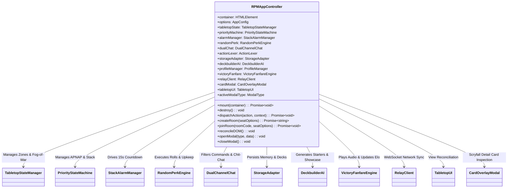
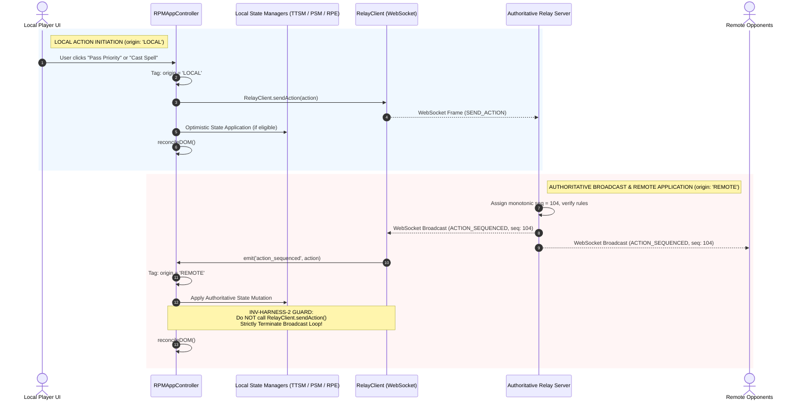

# Technical Specification: Playable Browser Integration Harness

- **Document ID:** `SPEC-RPM-HARNESS-012`
- **Feature Scope:** Feature 12 (`index.html`, `src/app.js`, `test/test_browser_harness.js`)
- **System:** RPM Multiplayer / RPM Modern Tabletop Companion
- **Architect:** Argon Specification Architect
- **Status:** APPROVED / READY FOR IMPLEMENTATION
- **Revision:** 1.0.0
- **Target File Path:** `specs/FEATURE_12_BROWSER_HARNESS_SPEC.md`
- **Core Implementation Files:**
  - `index.html` (Modern, Single-Page Browser Harness Mount, Responsive Layout, and Modal Layers)
  - `src/app.js` (Root Application Controller, Subsystem Orchestrator, and Unidirectional Dispatcher)
  - `test/test_browser_harness.js` (Comprehensive Acceptance Test Matrix, Invariant Verification & Mock DOM Suite)
- **Related Specifications & Decisions:**
  - `specs/FEATURE_1_2_CORE_INGESTION_SPEC.md` (`SPEC-RPM-INGEST-001`: Card Ingestion & Deck Parser Engine)
  - `specs/FEATURE_3_TABLETOP_ZONE_STATE_SPEC.md` (`SPEC-RPM-ZONE-003`: Fog-of-War Projection & Tabletop State Manager)
  - `specs/FEATURE_4_STACK_PRIORITY_SPEC.md` (`SPEC-RPM-PRIORITY-004`: Stack & Priority Flow State Machine)
  - `specs/FEATURE_5_6_DUAL_CHAT_ACTION_BUS_SPEC.md` (`SPEC-RPM-CHAT-005`: Dual-Channel Priority Chat & Action Lexer)
  - `specs/FEATURE_7_ACCORDION_UI_MODAL_SPEC.md` (`SPEC-RPM-UI-007`: Tap-to-Expand Accordion Tabletop UI & Card Modal)
  - `specs/FEATURE_8_RELAY_SYNC_SPEC.md` (`SPEC-RPM-RELAY-008`: Multiplayer WebSocket Relay & Room Sync)
  - `specs/FEATURE_9_RANDOM_PERK_SPEC.md` (`SPEC-RPM-PERK-009`: Random Perk Upkeep Emblem & 2 d10 Dice Engine)
  - `specs/FEATURE_10_DECKBUILDER_AI_SPEC.md` (`SPEC-RPM-DECKAI-010`: Deckbuilder AI, 10-Point Guidelines & Top 10 Showcase)
  - `specs/FEATURE_11_VICTORY_FANFARE_SPEC.md` (`SPEC-RPM-FANFARE-011`: User Profile, Multi-Player Elo & Victory Audio)
  - `decisionlog.md`:
    - `DEC-001` (Tabletop Companion Paradigm & Zero Server State Bloat)
    - `DEC-002` (Tap-to-Expand Accordion Zone Layout)
    - `DEC-005` (Zero-Knowledge Fog-of-War Projection)
    - `DEC-009` (15-Second Stack Alarm & LIFO Stack Resolution)
    - `DEC-011` (Dual-Channel Chat: Chit-Chat vs Priority-Gated Turn Commands)
    - `DEC-012` (1-Tap Candidate Disambiguation Modal)
    - `DEC-013` (Upkeep Perk Emblem, 2–6 Player Scaling, Gray-Out Elimination, 60+30s Disconnect, Instagram A-to-B Clip Player, Deckbuilder Memory)
    - `DEC-014` (Client-Side YouTube IFrame + HTML5 Audio, CR 603.3d Target Declaration Timing, Birthday Perk RPBD)
    - `DEC-015` (Argon Systems Audit: Invariants `INV-RING-1`, `INV-RING-2`, `INV-RELAY-3`, `INV-PERK-1..8`, `INV-STORAGE-1..5`, `INV-AUDIO-1..7`, `INV-HARNESS-1`, `INV-HARNESS-2`)
- **Audio References (`TRANSCRIPCIONES_AUDIOS.md`):**
  - **Audio Note 1:** Fast, tactile tabletop companion UX; intuitive card interaction without clunky software friction.
  - **Audio Note 2:** User registration with custom victory fanfare music cut from YouTube or online audio.
  - **Audio Note 3:** 15-second Stack Alarm with visual urgency progression and tap-to-respond mechanics.
  - **Audio Note 4:** Multi-player lifetime tracking, victories, and cumulative Random Perks high-watermarks.
  - **Audio Note 5:** Active single deck constraint, earning unlocked deck slots through milestone victories.
  - **Audio Note 6:** Dual-channel chat isolating social banter from priority-gated turn commands.
  - **Audio Note 7:** Competitive Elo rating ladder and multiplayer pod seating (2 to 6 players).
  - **Audio Note 8:** Random Perk Upkeep Emblem with 2 d10 dice rolls (violet tens, aquamarine ones).
  - **Audio Note 9:** AI Deckbuilder with 10-point custom guideline memory and 👍 / 👎 preference curation.
  - **Audio Note 10:** Complete cohesive browser integration connecting all subsystems into a unified tabletop arena.

---

## 1. Executive Summary & Architectural Overview

The **Playable Browser Integration Harness** (Feature 12) is the capstone integration tier of the RPM Modern Tabletop Companion. It synthesizes all eleven modular subsystems—card ingestion, Scryfall metadata caching, zone projection, priority state machine, stack alarm timer, dual-channel chat, accordion view rendering, authoritative WebSocket relay, Random Perk Upkeep engine, AI deckbuilder, and victory fanfare audio—into a single, zero-friction, production-ready web application (`index.html` + `src/app.js`).

Prior to Feature 12, each engine was formally specified and independently verified through rigorous isolated unit test suites. However, running a live 2 to 6 player multiplayer Magic: The Gathering session within a browser environment introduces five profound system integration challenges:

1. **Circular Broadcast Storms & Distributed Echoes**: If incoming network state updates from the WebSocket Relay trigger local UI change handlers that inadvertently dispatch outgoing WebSocket packets, distributed clients descend into an infinite, exponential packet storm ($O(2^n)$ network saturation), crashing client browsers and server event loops alike.
2. **Lifecycle Leaks & Rogue Background Timers**: Browsers running single-page applications frequently mount, re-render, and tear down views. Uncleaned interval timers (e.g. 15s Stack Alarm, 100ms ticker, WebSocket heartbeats, YouTube playback watchdogs) or lingering window event listeners (`keydown`, `resize`) quickly cause detached DOM trees, memory bloat, and hanging test suites in Node.js CI environments.
3. **Multi-Player Seating Topology & Dynamic Layout Scaling**: An MTG pod can vary from a 1v1 duel to a chaotic 6-player Free-For-All (FFA). The user interface must gracefully render between 1 and 5 opponent accordion bars, adaptively sizing zone drawers and mana production summaries without horizontal overflow or overlapping stack elements.
4. **Player Elimination State De-duplication**: When an opponent hits 0 life, 10 poison counters, or draws from an empty library, the harness must render a distinct semi-transparent grayed-out overlay (`.player-eliminated-overlay`), immediately disallow interactions with their board, purge their owned spells from the stack (CR 800.4a), and bypass them in the priority sequence while still permitting other players to inspect their public graveyard and exile zones.
5. **Modal Layer Collision & Focus Trapping**: With Scryfall card inspection overlays, 10-point guideline editors, beginner deck generators, Top 10 public showcases, candidate disambiguation chips, and victory fanfare banners all coexisting in the client, uncoordinated DOM insertions cause conflicting z-index wars and trapped keyboard focus.

Feature 12 definitively resolves these integration challenges through a hardened **Single-Page Application Architecture (`index.html`)** orchestrated by an authoritative **Root Application Controller (`src/app.js`)**:

- **Strict Unidirectional Data Flow (`INV-HARNESS-2`)**: Every state mutation is mediated by a centralized dispatcher `dispatchAction(action, { origin: 'LOCAL' | 'REMOTE' })`. Actions triggered by local user interaction are tagged `'LOCAL'` and transmitted across the WebSocket Relay. Actions delivered from the server are tagged `'REMOTE'`, applying state changes directly to the local managers *without* re-broadcasting over the socket, mathematically eliminating circular broadcast storms.
- **Hermetic Lifecycle Management (`INV-HARNESS-1`)**: The harness adheres to a strict contract: `mount(container)` dynamically binds all DOM elements and attaches listeners; `destroy()` unbinds every listener, clears all interval and timeout timers, disconnects sockets with clean RFC 6455 closure codes, aborts media streams, and flushes the DOM container, ensuring zero memory leaks and deterministic teardown.
- **Responsive Dynamic Pod Grid**: The layout features a persistent Top Header (room join bar, connection status pill, active player badge, mute button), an Opponent Accordion Bar dynamically scaling across 1 to 5 opponents with life, mana, and expandable drawers, a Center Battlefield & LIFO Stack accompanied by a 15-second visual alarm progress bar and 2 d10 dice roll display, a Bottom Player Dashboard with quick-adjustment buttons, interactive hand, and Command Zone Emblem, a Floating Dual-Channel Chat Bar, a centralized Deckbuilder Drawer/Modal, and a Victory Celebration Overlay.
- **Multi-Player Elimination Gray-Out (`INV-RING-1`)**: In accordance with DEC-013 and DEC-015, eliminated players are overlaid with an ominous grayscale backdrop, their priority skipped in the active ring, while remaining players battle to match victory.
- **Browser Autoplay Fallback Banner (`INV-AUDIO-1`)**: If the client's browser blocks automatic fanfare playback upon game conclusion, the harness immediately surfaces a high-contrast, 1-tap celebratory banner allowing the user to initiate audio playback via an explicit user gesture.

---

### 1.1 Global System Topology

```mermaid
flowchart TB
    subgraph BrowserEnvironment ["Browser DOM Environment (index.html)"]
        HTMLHeader["Header Bar\n(#header-bar)\n• Room Join & Code\n• Status Pill (🟢/🟡/🔴)\n• Active Player Badge\n• Audio Mute Toggle"]
        OpponentGrid["Opponent Accordion Grid\n(#opponents-container)\n• 1 to 5 Opponent Bars\n• Life, Counters & Mana\n• Expandable Zone Drawers\n• Grayed-Out Eliminated Overlay"]
        CenterArena["Center Battlefield & Stack\n(#center-arena)\n• MTG LIFO Stack Container\n• 15s Visual Alarm Progress Bar\n• Pass / Hold Priority Controls\n• 2 d10 Dice Display (Violet & Aqua)"]
        BottomDashboard["Bottom Player Dashboard\n(#player-dashboard)\n• Life (+1/-1/+5/-5) & Counters\n• Mana Pool Chips (WUBRGC)\n• Interactive Hand Grid\n• Command Zone Perk Emblem"]
        FloatingChat["Floating Dual-Channel Chat\n(#chat-drawer)\n• Chit-Chat Tab (Unrestricted)\n• Turn Command Tab (Priority-Gated)\n• Mic Voice Dictation\n• 1-Tap Staged Action Chips"]
        ModalHost["Central Modal Host Layer\n(#modal-root)\n• CardOverlayModal\n• Deckbuilder AI Modal\n• Top 10 Showcase Modal\n• Victory Fanfare Overlay"]
    end

    subgraph AppControllerEngine ["Root Application Controller (src/app.js)"]
        App["RPMAppController\n• mount(container) / destroy()\n• dispatchAction(action, context)\n• reconcileDOM() (Sub-16ms Frame Budget)"]
        
        subgraph SubsystemManagers ["Managed Subsystem Instances"]
            TTSM["TabletopStateManager\n(Zones, Life, Fog-of-War)"]
            PSM["PriorityStateMachine\n(Turn Steps, APNAP, LIFO)"]
            SAM["StackAlarmManager\n(15s Countdown Timer)"]
            RPE["RandomPerkEngine\n(Upkeep Emblem, 2 d10, Perks)"]
            DCC["DualChannelChat\n(ActionLexer, Chit-Chat)"]
            VFE["VictoryFanfareEngine\n(Elo, Deck Slots, YouTube/MP3/8-Bit)"]
            DBAI["DeckbuilderAI\n(10-Point Guidelines, Starters, Showcase)"]
            SA["StorageAdapter\n(IndexedDB / LocalStorage / Memory)"]
            RC["RelayClient\n(RFC 6455 WebSocket Sync, Replay Buffer)"]
        end
    end

    subgraph NetworkCloud ["Remote Authoritative Relay (src/relay.js)"]
        RelayServer["WebSocket Relay Server\n(Port 8080 / Production WSS)\n• Authoritative Sequencer (seq=1,2,3...)\n• ActiveRing Arbiter\n• Disconnect Bank (60+30s)"]
    end

    %% DOM to App Controller Binding
    HTMLHeader -->|User Clicks / Inputs| App
    OpponentGrid -->|Drawer Toggles| App
    CenterArena -->|Pass / Hold Buttons| App
    BottomDashboard -->|Card Clicks, Life +/-| App
    FloatingChat -->|Chat & Voice Inputs| App
    ModalHost -->|Modal Actions & Ratings| App

    %% App Controller Orchestration
    App -->|Local Action Dispatch (LOCAL)| TTSM
    App -->|Local Action Dispatch (LOCAL)| PSM
    App -->|Local Action Dispatch (LOCAL)| DCC
    App -->|Local Action Dispatch (LOCAL)| RC
    App -->|Trigger Upkeep / Roll| RPE
    App -->|Start / Stop Alarm| SAM
    App -->|Store Preferences / Decks| SA
    App -->|Query Starters / Showcase| DBAI
    App -->|Play Fanfare on Victory| VFE

    %% Network Synchronization
    RC <==>|WebSocket Frames (origin: LOCAL -> send / receive -> REMOTE)| RelayServer

    %% Reactive Re-rendering
    TTSM -.->|State Change Notification| App
    PSM -.->|Priority Change Notification| App
    SAM -.->|Alarm Tick Notification| App
    RPE -.->|Perk Roll Notification| App
    DCC -.->|Chat Message Notification| App
    RC -.->|state_sync / action_sequenced| App
    App ==>|Reconcile Clean DOM Nodes| BrowserEnvironment
```

---

## 2. Formal Invariants & Mathematical Laws

The browser harness coordinates heterogeneous subsystems. To prevent distributed race conditions, memory leaks, and cascading UI inconsistencies, `src/app.js` and `index.html` strictly enforce six architectural invariants:

### 2.1 Invariant Table

| Invariant ID | Formal Name | Target Scope | Mathematical / Architectural Formulation |
| :--- | :--- | :--- | :--- |
| `INV-HARNESS-1` | Clean Lifecycle & Zero Leakage | `src/app.js`, `index.html` | $\forall t > t_{\text{destroy}}, \quad |\text{ActiveTimers}| = 0 \land |\text{BoundListeners}| = 0 \land |\text{Sockets}| = 0 \land \text{DOM} = \emptyset$. Destroying the harness must cancel all timers, unref background workers, unbind all DOM/window listeners, close WebSocket connections, and clear the container element. |
| `INV-HARNESS-2` | Unidirectional Action Flow & Circular Loop Elimination | `src/app.js`, `src/RelayClient.js` | $\forall a \in \text{Actions}, \quad \text{origin}(a) \in \{\text{'LOCAL'}, \text{'REMOTE'}\}$. If $\text{origin}(a) = \text{'REMOTE'}$, transmission over WebSocket is strictly forbidden: $\text{emitWebSocket}(a) = \emptyset$. Prevents infinite circular reflection storms ($O(1)$ network propagation). |
| `INV-HARNESS-3` | Multi-Player Pod Scaling & Seat Viewport Layout | `src/app.js`, `src/view/TabletopUI.js` | $N_{\text{opponents}} = |P| - 1, \quad 1 \le N_{\text{opponents}} \le 5$. The opponent container must dynamically instantiate exactly $N_{\text{opponents}}$ view slots. Eliminated players ($p.\text{isEliminated} = \text{true}$) are rendered with a persistent `.player-eliminated-overlay`, disabling click interactions while preserving zone drawer readability. |
| `INV-HARNESS-4` | Authoritative Alarm Decoupling & Visual Progress | `src/app.js`, `src/StackAlarmManager.js` | Visual alarm width percentage $W(t) = \max\left(0, \frac{T_{\text{remaining}}}{T_{\text{duration}}} \times 100\right)\%$. Color progression: $\text{Emerald Green} \ (t > 7\text{s})$, $\text{Amber} \ (3\text{s} \le t \le 7\text{s})$, $\text{Flashing Crimson} \ (t < 3\text{s})$. Unaffected by network latency; auto-passes on expiry. |
| `INV-HARNESS-5` | Dual-Channel Isolation & Priority Lockout | `src/app.js`, `src/DualChannelChat.js` | $\text{CanSubmitTurnCommand} \iff (\text{myPlayerId} = \text{currentPriorityPlayer}) \land (\text{ActiveTab} = \text{'TURN'}).$ When not holding priority, turn command input and mic dictation are disabled (`disabled = true`) with a red lock pill rendered. Chit-Chat is always unrestricted. |
| `INV-HARNESS-6` | Single-Layer Modal Composition & Trap Prevention | `src/app.js`, `#modal-root` | $|\text{ActiveModals}| \le 1$. Opening a new modal automatically dismisses any existing modal or nests it predictably. Modals must trap Tab key focus within their boundary and dismiss cleanly on `Escape` keypress or backdrop click without leaving residual overlay elements in the DOM. |

---

### 2.2 Proof of Invariant `INV-HARNESS-2` (Circular Broadcast Storm Elimination)

Let distributed system $S$ consist of $K$ connected client instances $\{C_1, C_2, \dots, C_K\}$ and central relay server $R$.
Let $A$ be a user-initiated tabletop action (e.g. `PASS_PRIORITY`).

1. User interacts with local UI at client $C_1$.
2. The UI controller dispatches $A$ through `app.dispatchAction(A, { origin: 'LOCAL' })`.
3. Because $\text{origin}(A) = \text{'LOCAL'}$:
   - $C_1$ applies $A$ optimistically or stages it locally.
   - $C_1$ transmits $A$ to relay server $R$ via `RelayClient.sendAction(A)`.
4. Relay server $R$ assigns authoritative sequence number $seq$, applies $A$ to its authoritative state machine, and broadcasts serialized frame $F = \{\text{type: 'ACTION_SEQUENCED'}, \text{action: } A, \text{seq}\}$ to all clients in the room $\{C_1, C_2, \dots, C_K\}$.
5. Each client $C_i$ (including the sender $C_1$) receives $F$ via WebSocket.
6. The `RelayClient` at $C_i$ parses $F$ and calls `app.dispatchAction(A, { origin: 'REMOTE' })`.
7. Because $\text{origin}(A) = \text{'REMOTE'}$:
   - $C_i$ mutates its local state managers (`TabletopStateManager`, `PriorityStateMachine`, `DualChannelChat`).
   - $C_i$ reconciles its DOM view.
   - **Crucially**: Under `INV-HARNESS-2`, $C_i$ bypasses `RelayClient.sendAction(A)`.
8. No subsequent network frame is generated. The network traffic generated by action $A$ across the entire cluster is exactly:
   $$\text{Packets}(A) = 1 \ (\text{Client to Server}) + K \ (\text{Server to Clients}) = K + 1 \in O(K).$$
9. If $\text{origin}$ tagging were omitted (naive bidirectional binding), each client $C_i$ receiving $F$ would re-broadcast $A$, generating $K \times (K-1)$ secondary frames, each of which generates $K(K-1)^2$ tertiary frames, resulting in an exponential broadcast cascade:
   $$\lim_{t \to \infty} \text{Traffic}(t) = \sum_{m=1}^{\infty} K(K-1)^{m-1} \to \infty,$$
   crashing the WebSocket server within seconds. `INV-HARNESS-2` guarantees strict termination in 1 round trip. $\blacksquare$

---

## 3. UI Component Layout & Wireframe Architecture

The application layout mounts into a single root container (`#app-root` inside `index.html`) using a modern, high-contrast, dark-mode tabletop aesthetic (deep slate/charcoal backgrounds `#0f172a`, glowing aquamarine accents `#06b6d4`, violet highlights `#8b5cf6`, and MTG mana color signatures).

### 3.1 Comprehensive Desktop & Tablet Wireframe (1280px+)

```
+---------------------------------------------------------------------------------------------------------------------------------------+
| HEADER BAR (#header-bar)                                                                                                              |
| [RPM TABLETOP] | Room: [ ARENA1 ] [Join] [Create] | Status: [🟢 CONNECTED] | Active: [P1 - Alice] | Phase: [Turn 3 - Precombat Main] | [🔊 Mute] [📚 Decks] |
+---------------------------------------------------------------------------------------------------------------------------------------+
| OPPONENT ACCORDION BAR (#opponents-container) [Dynamic Pod: 1 to 5 Opponents]                                                         |
| +-------------------------------------------------------+ +-------------------------------------------------------+                   |
| | OPPONENT: P2 - Bob                 Life: [ 18 ]  [P:0] | | OPPONENT: P3 - Charlie (💀 ELIMINATED) Life: [  0 ]  [P:10]|                   |
| | Mana: [W:1 U:2 B:0 R:0 G:0 C:0]    Cards in Hand: [ 4 ]| | Mana: [W:0 U:0 B:0 R:0 G:0 C:0]    Cards in Hand: [ 0 ]|                   |
| | [Hand: 4 ⯆] [Creatures: 2 ⯈] [Graveyard: 3 ⯈] [Exile] | | [Hand: 0 ⯈] [Creatures: 0 ⯈] [Graveyard: 12 ⯈] [Exile]  |                   |
| +-------------------------------------------------------+ +-------------------------------------------------------+                   |
+-------------------------------------------------------------------------------------------------------+-------------------------------+
| CENTER BATTLEFIELD & ACTIVE LIFO STACK (#center-arena)                                                | DUAL-CHANNEL CHAT             |
|                                                                                                       | (#chat-drawer)                |
| +---------------------------------------------------------------------------------------------------+ | [ Chit-Chat ] [ Turn Cmd (🔒) ]|
| | 15-SECOND STACK ALARM PROGRESS BAR (#stack-alarm-bar)                                             | |-------------------------------|
| | [==========================================---------------------------------] 08.4s Remaining    | | [14:02] Bob: Good luck!     |
| +---------------------------------------------------------------------------------------------------+ | [14:03] Alice: You too!      |
|                                                                                                       | [14:03] Charlie: Pass upkeep  |
| +---------------------------------------------------------------------------------------------------+ | [14:04] Alice: Cast Bolt      |
| | MTG ACTIVE LIFO STACK (#stack-view)                                                               | |                               |
| | [Top] 2. P2: Counterspell (Targeting: Lightning Bolt)                   [Hold Response] [Pass]    | |                               |
| |       1. P1: Lightning Bolt (Targeting: Bob)                            [Hold Response] [Pass]    | |                               |
| +---------------------------------------------------------------------------------------------------+ |                               |
|                                                                                                       |                               |
| +---------------------------------------------------------------------------------------------------+ |                               |
| | RANDOM PERK 2 d10 DICE & EMBLEM DISPLAY (#perk-display)                                            | |                               |
| | [Violet Tens: (5)] [Aqua Ones: (5)] ➔ ROLL: 55 | Perk #55: Overload Surge (Trigger Resolving)      | |-------------------------------|
| +---------------------------------------------------------------------------------------------------+ | [🎤 Mic] [Type message...] [➤]|
+-------------------------------------------------------------------------------------------------------+-------------------------------+
| BOTTOM PLAYER DASHBOARD (#player-dashboard) [Local Player: P1 - Alice]                                                                |
| Life: [-5] [-1] [ 20 ] [+1] [+5] | Counters: [Poison: 0] [Energy: 3] | Mana Pool: [W:1] [U:0] [B:0] [R:2] [G:0] [C:0]                 |
| Command Zone Emblem: [ 🔮 Upkeep Perk Active (Turn 2+ 3P Scale) ]                                                                    |
| +-----------------------------------------------------------------------------------------------------------------------------------+ |
| | ACTIVE PLAYER INTERACTIVE HAND (#player-hand)                                                                                     | |
| | +-----------------------+ +-----------------------+ +-----------------------+ +-----------------------+ +-----------------------+ | |
| | | Lightning Bolt    {R} | | Counterspell   {U}{U} | | Ragavan, Nimble   {R} | | Expressive Iter. {U}{R}| | Scalding Tarn    {Land}| | |
| | | Instant               | | Instant               | | Legendary Creature    | | Sorcery               | | Land                  | | |
| | | Deal 3 damage to any..| | Counter target spell. | | 2/1 Dash {1}{R}...    | | Look at top 3 cards...| | {T}, Pay 1 life, Sac..| | |
| | +-----------------------+ +-----------------------+ +-----------------------+ +-----------------------+ +-----------------------+ | |
| +-----------------------------------------------------------------------------------------------------------------------------------+ |
| Battlefield Permanents: [Lands: 3 ⯆] [Creatures: 1 ⯆] [Graveyard: 2 ⯈] [Exile: 0 ⯈]                                                   |
+---------------------------------------------------------------------------------------------------------------------------------------+
```

---

### 3.2 Mobile Portrait Responsive Layout (375px - 767px)

On mobile viewports, screen real estate is preserved by transforming horizontal splits into stacked, tap-expandable sections with a persistent bottom floating action bar:

```
+-------------------------------------------+
| [RPM] [ARENA1] [🟢] [Active: P1] [🔊] [☰]  |
+-------------------------------------------+
| OPPONENT (P2) Life: 18 | Hand: 4 [Tap ⯆]   |
+-------------------------------------------+
| 15s STACK ALARM [==========-------] 06.2s |
| STACK (1): Lightning Bolt                 |
| [ PASS PRIORITY ]     [ HOLD & RESPOND ]  |
+-------------------------------------------+
| 2 d10 ROLL: [5] [5] ➔ Perk #55            |
+-------------------------------------------+
| YOUR LIFE: [-] [ 20 ] [+] | Mana: {R}{R}  |
| HAND (5 cards) [Tap to Expand ⯆]          |
| [Bolt {R}] [Counter {U}{U}] [Ragavan {R}] |
+-------------------------------------------+
| [💬 Chat (2)] [🎙️ Cmd] [🃏 Decks] [⚙️ Menu]|
+-------------------------------------------+
```

---

## 4. Complete HTML Shell Specification (`index.html`)

The entry point `index.html` provides the structural skeleton, CSS stylesheets, font references, and modal containers. It requires zero compilation or bundlers and runs directly in modern evergreen browsers.

```html
<!DOCTYPE html>
<html lang="en">
<head>
  <meta charset="UTF-8">
  <meta name="viewport" content="width=device-width, initial-scale=1.0, maximum-scale=1.0, user-scalable=no">
  <meta name="description" content="RPM Modern Tabletop Companion - Real-Time Multiplayer Tabletop Arena">
  <title>RPM Modern Tabletop Companion</title>

  <!-- High-Performance Typography & Mana Font Embeds -->
  <link rel="preconnect" href="https://fonts.googleapis.com">
  <link rel="preconnect" href="https://fonts.gstatic.com" crossorigin>
  <link href="https://fonts.googleapis.com/css2?family=Cinzel:wght@600;700;800&family=Inter:wght@400;500;600;700&family=JetBrains+Mono:wght@400;600;700&display=swap" rel="stylesheet">

  <!-- Core Tabletop & View Styling -->
  <link rel="stylesheet" href="src/view/tabletop.css">
  <link rel="stylesheet" href="src/view/harness.css">
</head>
<body class="rpm-theme-dark">
  <!-- Top-Level Application Container Mount -->
  <div id="app-root" class="rpm-app-container">

    <!-- 1. Header Bar (#header-bar) -->
    <header id="header-bar" class="rpm-header-bar" role="banner">
      <div class="header-brand">
        <span class="brand-glyph">⚔️</span>
        <h1 class="brand-title">RPM TABLETOP</h1>
      </div>

      <div class="header-room-controls">
        <label for="room-code-input" class="sr-only">Room Code</label>
        <input type="text" id="room-code-input" class="room-input" placeholder="ROOM CODE" maxlength="8" spellcheck="false" autocomplete="off">
        <button id="btn-join-room" class="btn btn-secondary">Join</button>
        <button id="btn-create-room" class="btn btn-primary">Create Room</button>
      </div>

      <div class="header-status-group">
        <div id="connection-status-pill" class="status-pill status-offline" aria-live="polite">
          <span class="status-dot"></span>
          <span class="status-text">Offline</span>
        </div>

        <div id="active-player-badge" class="active-player-badge">
          <span class="badge-label">Active:</span>
          <span id="active-player-name" class="badge-value">P1</span>
          <span id="current-phase-name" class="badge-phase">Untap</span>
        </div>

        <div class="header-actions">
          <button id="btn-audio-mute" class="btn-icon" title="Toggle Victory Audio Mute" aria-label="Toggle Victory Audio Mute">
            <span class="icon-speaker">🔊</span>
          </button>
          <button id="btn-open-deckbuilder" class="btn btn-outline" title="Open AI Deckbuilder & Guidelines">
            <span class="icon-deck">📚</span> Decks
          </button>
        </div>
      </div>
    </header>

    <!-- Main Tabletop Arena Grid -->
    <main id="tabletop-arena" class="rpm-tabletop-arena" role="main">

      <!-- 2. Opponents Multi-Player Container (#opponents-container) -->
      <section id="opponents-container" class="opponents-bar" aria-label="Opponent Player Zones">
        <!-- Dynamically populated with 1 to 5 Opponent Boards via TabletopUI -->
      </section>

      <!-- 3. Center Battlefield & Stack Arena (#center-arena) -->
      <section id="center-arena" class="center-battlefield-arena" aria-label="Battlefield and Priority Stack">

        <!-- 15-Second Stack Alarm Visual Banner -->
        <div id="stack-alarm-container" class="stack-alarm-wrapper" style="display: none;" aria-live="assertive">
          <div class="alarm-header">
            <span class="alarm-title">⚡ PRIORITY COUNTDOWN</span>
            <span id="alarm-timer-label" class="alarm-countdown">15.0s</span>
          </div>
          <div class="alarm-progress-track">
            <div id="stack-alarm-progress-bar" class="alarm-progress-fill alarm-state-green" style="width: 100%;"></div>
          </div>
        </div>

        <!-- MTG LIFO Stack Visualizer -->
        <div id="stack-visualizer-container" class="stack-container" aria-label="Active LIFO Priority Stack">
          <div class="stack-header">
            <h2 class="stack-title">THE STACK <span id="stack-count-badge" class="badge-counter">(0)</span></h2>
            <div class="stack-controls">
              <button id="btn-pass-priority" class="btn btn-pass" title="Pass Priority (Hotkey: Space or P)">Pass Priority [Space]</button>
              <button id="btn-hold-respond" class="btn btn-hold" title="Hold Alarm & Respond (Hotkey: H)">Hold & Respond [H]</button>
            </div>
          </div>
          <ul id="stack-item-list" class="stack-list" role="list">
            <!-- Dynamically populated with Stack Items in LIFO Order -->
          </ul>
        </div>

        <!-- Random Perk 2 d10 Dice & Upkeep Emblem Overlay -->
        <div id="perk-dice-container" class="perk-display-wrapper" style="display: none;">
          <div class="perk-dice-row">
            <div id="dice-tens" class="dice-box dice-tens" title="Tens Die (Violet d10)">
              <span class="dice-label">10s</span>
              <span class="dice-value">0</span>
            </div>
            <div id="dice-ones" class="dice-box dice-ones" title="Ones Die (Aquamarine d10)">
              <span class="dice-label">1s</span>
              <span class="dice-value">0</span>
            </div>
            <div class="perk-roll-summary">
              <span id="perk-roll-key" class="perk-key-badge">ROLL --</span>
              <span id="perk-effect-description" class="perk-desc">Awaiting upkeep trigger...</span>
            </div>
          </div>
        </div>
      </section>

      <!-- 4. Bottom Active Player Dashboard (#player-dashboard) -->
      <section id="player-dashboard" class="player-dashboard-panel" aria-label="Active Player Dashboard">
        <!-- Life, Counters, Mana Pool, Interactive Hand, and Command Zone Emblem -->
      </section>
    </main>

    <!-- 5. Floating Dual-Channel Chat Bar (#chat-drawer) -->
    <aside id="chat-drawer" class="rpm-chat-drawer" aria-label="Chat and Turn Commands">
      <!-- Chit-Chat vs Turn Command Tabs, Input, and Staged Action Chips -->
    </aside>

    <!-- 6. Central Modal & Overlay Host Layer (#modal-root) -->
    <div id="modal-root" class="rpm-modal-host" aria-hidden="true">
      <!-- Mount container for CardOverlayModal, DeckbuilderAI, and VictoryFanfare -->
    </div>

  </div>

  <!-- Main ES Module Application Bootstrapper -->
  <script type="module">
    import { RPMAppController } from './src/app.js';

    document.addEventListener('DOMContentLoaded', async () => {
      const app = new RPMAppController({
        container: '#app-root',
        autoConnect: false
      });
      await app.mount();
      window.__RPM_APP__ = app;
    });
  </script>
</body>
</html>
```

---

## 5. Root Application Controller Architecture (`src/app.js`)

`src/app.js` is the central operational brain of the client. It instantiates, wires, and coordinates all eleven domain subsystems, managing bidirectional event translation, lifecycle teardown, and circular loop elimination.

### 5.1 Subsystem Dependency Injection & Graph



---

### 5.2 Unidirectional Action Dispatcher Pipeline

Every state mutation in the application—whether triggered by clicking a card, passing priority, rolling dice, typing in chat, or receiving a WebSocket packet—is funneled through `dispatchAction()`.



---

## 6. UI Subsystems Detailed Specifications

### 6.1 Header Bar & Connection Status Pill

The Header Bar spans the full viewport width at the top (`#header-bar`, height 56px).

1. **Room Join / Create Subsystem**:
   - `#room-code-input`: 8-character alphanumeric input. Auto-uppercases characters and filters out illegal Crockford Base32 characters (`I`, `L`, `O`, `U`).
   - `#btn-create-room`: Initiates room creation via `RelayClient.createRoom()`. Upon receipt of `ROOM_CREATED`, writes the new room code to the input, displays a toast, and updates URL query parameter `?room=CODE` without reloading.
   - `#btn-join-room`: Validates the entered code and invokes `RelayClient.joinRoom(roomCode)`.
2. **Connection Status Pill (`#connection-status-pill`)**:
   - States:
     - `🟢 Connected` (`.status-connected`): Active WebSocket connection in `OPEN` state.
     - `🟡 Reconnecting` (`.status-reconnecting`): Connection lost, backoff retry timer active (attempts 1 to 5).
     - `🔴 Offline` (`.status-offline`): Disconnected or socket error.
3. **Active Player & Phase Badge (`#active-player-badge`)**:
   - Displays the current turn's active player name (`#active-player-name`) and the active MTG phase step (`#current-phase-name`), e.g., "Untap", "Upkeep", "Precombat Main", "Beginning of Combat", "Declare Attackers", "Declare Blockers", "Combat Damage", "Postcombat Main", "End Step", "Cleanup".
4. **Victory Audio Mute Toggle (`#btn-audio-mute`)**:
   - Toggles global audio playback mute state in `VictoryFanfareEngine`. Switches glyph between `🔊` (unmuted) and `🔇` (muted). Persists choice in `StorageAdapter`.

---

### 6.2 Opponent Accordion Bar (1 to 5 Opponents)

The Opponent Accordion Bar (`#opponents-container`) dynamically instantiates opponent viewports based on the active match participants ($2 \le |P| \le 6$).

1. **Multiplayer Dynamic Grid Layout**:
   - In 2-player matches (1 opponent): Opponent card spans 100% width or max 800px centered.
   - In 3-player matches (2 opponents): 2-column flex grid (50% / 50%).
   - In 4-player matches (3 opponents): 3-column flex grid (33.3% / 33.3% / 33.3%).
   - In 5-6 player matches (4-5 opponents): Adaptive flex wrap grid with minimum card width 260px.
2. **Opponent Board Components**:
   - Header: Player name, avatar badge, life total counter, poison/energy tokens, and Land Mana Production summary (`[W:X U:Y B:Z R:A G:B C:C]`).
   - Zone Accordion Badges:
     - `Hand`: Shows card count. Opponent cards are rendered as masked face-down backs (`[HIDDEN]`) with zero leaked metadata under `INV-FOW-1`.
     - `Creatures`: Lists battlefield creatures with power/toughness badges and tap indicators.
     - `Non-creatures / Planeswalkers`: Artifacts, enchantments, and planeswalkers with loyalty counters.
     - `Graveyard`: Count badge; tapping expands the full list of public cards in graveyard order.
     - `Exile`: Count badge; tapping expands face-up exiled cards.
     - `Library`: Displays remaining card count only.
3. **Elimination Overlay (`.player-eliminated-overlay`) (`INV-RING-1`, DEC-013)**:
   - When an opponent is eliminated (`isEliminated === true` due to $\text{Life} \le 0$, $\text{Poison} \ge 10$, or empty library draw):
     - The opponent container applies `.player-eliminated`.
     - A dark semi-transparent overlay (`rgba(15, 23, 42, 0.85)`) is rendered across the card.
     - An icon badge `💀 ELIMINATED` is centered in high-contrast scarlet.
     - All interactive controls (target selection, life modifier buttons) are disabled.
     - Accordion zone drawers (Graveyard, Exile) remain expandable for rules inspection.

---

### 6.3 Center Battlefield & LIFO Stack Arena

1. **MTG LIFO Stack (`#stack-visualizer-container`)**:
   - Visualizes all spells and abilities currently waiting to resolve.
   - Items are rendered in strict LIFO order: newest item at the top (Index 0).
   - Each stack item card displays:
     - Sequence number badge (`#2`, `#1`).
     - Controller pill (`P1: Alice` or `P2: Bob`).
     - Card / Ability name with mana font icons (e.g. `{1}{U}{U}`).
     - Targets declared at trigger entry (CR 603.3d / DEC-014), e.g., `➔ Target: Lightning Bolt`.
     - Individual Pass / Hold action buttons.
2. **15-Second Stack Alarm Visual Banner (`#stack-alarm-container`) (`INV-HARNESS-4`)**:
   - Visible only when spells/abilities are on the stack or when priority is active during a phase handoff.
   - Countdown timer text updates at 60 FPS / 100ms ticks: `15.0s`, `14.9s` ... `0.0s`.
   - Visual progress bar transitions dynamically:
     - **Emerald Green** (`.alarm-state-green`): $t > 7.0\text{s}$ (Safe window).
     - **Amber Gold** (`.alarm-state-amber`): $3.0\text{s} \le t \le 7.0\text{s}$ (Warning window).
     - **Flashing Crimson Red** (`.alarm-state-red`): $t < 3.0\text{s}$ (Critical countdown; pulsing animation).
   - On countdown expiration: `StackAlarmManager` fires `ALARM_EXPIRED`, which dispatches an authoritative `PASS_PRIORITY` action.
3. **Priority Quick Controls**:
   - Pass Priority button (`#btn-pass-priority`): Passes priority. Accessible via keyboard shortcuts `Space` or `P`.
   - Hold & Respond button (`#btn-hold-respond`): Pauses countdown and signals intent to cast an instant/activate an ability. Accessible via keyboard shortcut `H`.
4. **Random Perk 2 d10 Dice Roll Display (`#perk-dice-container`) (DEC-013, DEC-014)**:
   - Activates during the active player's Upkeep step once turn scaling conditions are met (Turn 2+ for $\ge 3$ players, Turn 4+ for 1v1 duels).
   - Shows two 3D-styled d10 dice boxes:
     - Violet Box (`#dice-tens`): Represents the tens digit ($0, 10, 20 \dots 90$, displayed as $0 \dots 9$).
     - Aquamarine Box (`#dice-ones`): Represents the ones digit ($0 \dots 9$).
   - Displays rolling animation for 600ms upon Step 1 resolution.
   - Displays authoritative CSPRNG roll outcome (`INV-PERK-3`), matching perk definition or roll miss notification (e.g., `ROLL 55 ➔ Perk #55: Overload Surge` or `ROLL 42 ➔ Roll Miss (No Perk)`).

---

### 6.4 Bottom Player Dashboard

The local player's command center (`#player-dashboard`):

1. **Life & Counters Adjustment Widget**:
   - Centered high-contrast life total display (default 20).
   - Quick-modifier buttons: `[-5]`, `[-1]`, `[+1]`, `[+5]`. Clicking fires `CHANGE_LIFE` action.
   - Secondary counters: Poison counter badge with `+` / `-`, Energy counters, Experience counters.
2. **Mana Pool Chips**:
   - Displays unspent mana in the player's pool: `{W}`, `{U}`, `{B}`, `{R}`, `{G}`, `{C}` with color-coded circular chips and count badges.
3. **Command Zone Perk Emblem Badge**:
   - Shows status of the player's RPM Upkeep Emblem (`INV-PERK-7`):
     - `Dormant`: Before turn scaling threshold (e.g., Turn 1).
     - `Armed`: Upkeep trigger ready to fire.
     - `Resolving`: Step 1 or Step 2 on the stack.
4. **Interactive Hand Grid (`#player-hand`)**:
   - Displays the player's cards with complete card art, mana cost symbols, card name, type, and power/toughness.
   - Tapping any card opens the detailed `CardOverlayModal`.
   - Long-press / double-tap stages the card for casting onto the stack.

---

### 6.5 Floating Dual-Channel Chat Bar

The Chat Bar (`#chat-drawer`) is docked on the right side on desktop and collapsible via a floating tab on mobile.

1. **Chit-Chat Tab (`.tab-chit-chat`)**:
   - General social communication channel.
   - Unrestricted: all players and spectators can send text and emojis at any time regardless of priority.
2. **Turn Command Tab (`.tab-turn-command`) (`INV-HARNESS-5`, DEC-011)**:
   - Strict priority-gated channel for gameplay declarations (e.g., *"Cast Lightning Bolt targeting Bob"*, *"Pass priority"*, *"Tap 2 islands"*).
   - When local player **holds priority**:
     - Input field is enabled (`disabled = false`).
     - Microphone dictation button is green and active.
     - Staged action chips appear above the input for 1-tap submission (e.g., `[Cast Lightning Bolt]`, `[Pass Priority]`).
   - When local player **does not hold priority**:
     - Input field is disabled (`disabled = true`) with placeholder *"Waiting for priority..."*.
     - Microphone button is disabled.
     - A prominent red lock pill is rendered (`🔒 PRIORITY HELD BY OPPONENT`).
3. **Action Lexer Candidate Disambiguation Modal (DEC-012)**:
   - If an ambiguous turn command is spoken (e.g., *"Cast removal"* with two removal spells in hand), `DualChannelChat` surfaces candidate chips (`[Cast Fatal Push]`, `[Cast Unholy Heat]`) directly above the chat box for 1-tap confirmation before the 15-second alarm expires.

---

### 6.6 Deckbuilder AI & Showcase Modal

Accessible via the Header Bar's `#btn-open-deckbuilder` button:

1. **Tab 1: 10-Point Custom Guideline Editor (`DEC-013`, `Audio Note 9`)**:
   - Displays up to 10 active preference guidelines (e.g., *"Prefer artifact ramp"*, *"Never include counterspells"*).
   - Input field to add custom guidelines.
   - Each guideline includes:
     - `👍 Upvote`: Increases guideline weight (+0.5).
     - `👎 Downvote / Ban`: Decreases weight or adds anti-pattern to blacklist.
     - `🗑️ Delete`: Removes guideline.
   - Live Quota Gauge: Visual progress bar tracking bytes consumed against the 16KB quota guard (`INV-STORAGE-1`).
2. **Tab 2: Beginner Starter Deck Generator (`INV-STORAGE-4`)**:
   - Color picker buttons: `{W}` White Weenie, `{U}` Blue Tempo, `{B}` Black Control, `{R}` Red Burn, `{G}` Green Stompy.
   - One-tap instant deck generation pulling from precompiled, legally validated starter archetypes (`PRECOMPILED_ARCHETYPES`).
   - "Export to MTG Arena" and "Export to MTGO" buttons with clipboard copy.
3. **Tab 3: Top 10 Public Player Showcase (`INV-STORAGE-5`, `Audio Note 4`)**:
   - Displays leaderboard of top 10 decks ranked by composite score:
     $$\text{Score} = \text{round}\left(W \times \log_{10}(M + 1) \times 1000\right) + \text{Elo}.$$
   - Shows top 3 key preview cards for each deck, win rate percentage, and author name.

---

### 6.7 Victory Fanfare Celebration Overlay

Triggered upon receipt of `MATCH_VICTORY` from the WebSocket Relay or local match conclusion:

1. **Celebratory Visual Modal**:
   - Fullscreen dark backdrop with glittering gold particle animation.
   - High-contrast winner announcement:
     `🏆 VICTORY! Planeswalker [Player Name] Reigns Supreme!`.
   - Rating Progression Card: Shows old Elo $\to$ new Elo ($\Delta\text{Elo}$), wins count, and progress towards the next unlocked deck slot (DEC-013, Audio Note 5).
2. **Audio Playback Engine (`INV-AUDIO-1`, `INV-AUDIO-2`, `INV-AUDIO-3`)**:
   - Automatically loads winner's Instagram-style A-to-B audio cut (8 to 12 seconds) via client-side YouTube IFrame API or HTML5 Audio.
   - **Autoplay Fallback Banner (`INV-AUDIO-1`)**: If the browser's autoplay policy rejects playback (`AudioContext.state === 'suspended'`), the overlay immediately displays a prominent button:
     `🔊 TAP TO PLAY VICTORY FANFARE`.
     Tapping invokes `primeAudio()` and resumes playback instantly without crashing.
   - **8-Bit Chiptune Fallback (`INV-AUDIO-2`)**: If the external audio stream fails to load within 1500ms or is offline, the autonomous Web Audio API synthesizer generates an 8-bit retro victory arpeggio in hardware.

---

## 7. Concrete TypeScript & JSDoc API Signatures

### 7.1 Configuration & Action Type Definitions

```typescript
/**
 * Application Controller Initialization Options
 */
export interface AppConfig {
  /** Target root container element or CSS selector */
  container: HTMLElement | string;
  /** WebSocket relay server URL (e.g. 'ws://localhost:8080') */
  relayUrl?: string;
  /** Local player user ID */
  userId?: string;
  /** Local player display username */
  username?: string;
  /** Preferred seat identifier ('p1', 'p2', etc.) */
  preferredSeat?: string;
  /** Initial decklist text or structured deck object */
  initialDeck?: string | object;
  /** Enable sound effects and fanfare audio */
  audioEnabled?: boolean;
  /** Automatically connect to relay server upon mount */
  autoConnect?: boolean;
  /** Headless mode flag for automated test suites */
  headless?: boolean;
}

/**
 * Action Origin Discriminator for INV-HARNESS-2
 */
export type ActionOrigin = 'LOCAL' | 'REMOTE';

/**
 * Context Envelope for Action Dispatcher
 */
export interface ActionContext {
  /** Source of action to prevent circular network echoes */
  origin: ActionOrigin;
  /** Optional sequence number from authoritative server */
  seq?: number;
  /** Optional originating player slot ID */
  slotId?: string;
  /** Timestamp of action generation */
  timestamp?: number;
}

/**
 * Standard Action Payload Envelope
 */
export interface AppAction {
  /** Action type identifier */
  type: string;
  /** Action payload data */
  payload?: any;
}

/**
 * Active Modal Layer Types
 */
export type ModalType = 
  | 'NONE'
  | 'CARD_OVERLAY'
  | 'DECKBUILDER'
  | 'DISAMBIGUATION'
  | 'VICTORY_FANFARE'
  | 'ROOM_SETTINGS';
```

---

### 7.2 `RPMAppController` Class Interface (`src/app.js`)

```javascript
/**
 * Root Application Controller for RPM Tabletop Companion
 * Integrates Features 1 through 11 into a unified browser harness.
 */
export class RPMAppController {
  /**
   * @param {AppConfig} options
   */
  constructor(options = {}) {
    // Config validation and defaults
    // Instantiates StorageAdapter, ProfileManager, DeckbuilderAI
    // Instantiates VictoryFanfareEngine, RelayClient, TabletopStateManager
    // Instantiates PriorityStateMachine, StackAlarmManager, DualChannelChat
    // Instantiates TabletopUI, CardOverlayModal
  }

  /**
   * Initializes DOM elements, binds event listeners, and mounts subsystems.
   * Enforces INV-HARNESS-1.
   * @param {HTMLElement|string} [container]
   * @returns {Promise<void>}
   */
  async mount(container = null) {}

  /**
   * Destroys all DOM elements, unbinds listeners, cancels timers, and closes sockets.
   * Enforces INV-HARNESS-1.
   */
  destroy() {}

  /**
   * Central Unidirectional Action Dispatcher.
   * Enforces INV-HARNESS-2.
   * @param {AppAction} action
   * @param {ActionContext} context
   * @returns {Promise<void>}
   */
  async dispatchAction(action, context = { origin: 'LOCAL' }) {}

  /**
   * Creates a new multiplayer room via WebSocket Relay.
   * @param {Object} [seatOptions]
   * @returns {Promise<string>} Created room code
   */
  async createRoom(seatOptions = {}) {}

  /**
   * Joins an existing multiplayer room by code.
   * @param {string} roomCode
   * @param {Object} [seatOptions]
   * @returns {Promise<void>}
   */
  async joinRoom(roomCode, seatOptions = {}) {}

  /**
   * Disconnects from active multiplayer room.
   */
  disconnect() {}

  /**
   * Reconciles the DOM view based on current subsystem states.
   * Executes within sub-16ms frame budget (60 FPS).
   */
  reconcileDOM() {}

  /**
   * Opens a specific modal layer with payload data.
   * Enforces INV-HARNESS-6.
   * @param {ModalType} type
   * @param {any} [data]
   */
  openModal(type, data = null) {}

  /**
   * Closes the currently active modal layer.
   * Enforces INV-HARNESS-6.
   */
  closeModal() {}

  /**
   * Handles match victory event, triggers Elo updates and fanfare audio.
   * @param {Object} victoryPayload
   */
  handleMatchVictory(victoryPayload) {}
}
```

---

## 8. Event Routing & Unidirectional Data Flow Table

The following matrix defines the authoritative handling and broadcast behavior for every action in the harness:

| Action Type | Trigger Source | Dispatched Origin | Handled By | Local State Mutated | Transmitted via WebSocket? |
| :--- | :--- | :--- | :--- | :--- | :--- |
| `PASS_PRIORITY` | Click Pass button or `Space`/`P` key | `'LOCAL'` | `PriorityStateMachine` | Passes priority to next active player in ring | **YES** (`RelayClient.sendAction`) |
| `PASS_PRIORITY` | Relay frame `ACTION_SEQUENCED` | `'REMOTE'` | `PriorityStateMachine` | Passes priority to next active player in ring | **NO** (Suppressed by `INV-HARNESS-2`) |
| `HOLD_RESPOND` | Click Hold button or `H` key | `'LOCAL'` | `StackAlarmManager` | Pauses 15s alarm timer; grants hold window | **YES** (`RelayClient.sendAction`) |
| `HOLD_RESPOND` | Relay frame `ACTION_SEQUENCED` | `'REMOTE'` | `StackAlarmManager` | Pauses 15s alarm timer; grants hold window | **NO** (Suppressed by `INV-HARNESS-2`) |
| `CAST_SPELL` | Card double-tap or Chat Turn Command | `'LOCAL'` | `PriorityStateMachine`, `TabletopStateManager` | Removes card from hand; pushes onto stack | **YES** (`RelayClient.sendAction`) |
| `CAST_SPELL` | Relay frame `ACTION_SEQUENCED` | `'REMOTE'` | `PriorityStateMachine`, `TabletopStateManager` | Removes card from hand; pushes onto stack | **NO** (Suppressed by `INV-HARNESS-2`) |
| `CHANGE_LIFE` | Click `+1`, `-1`, `+5`, `-5` buttons | `'LOCAL'` | `TabletopStateManager` | Updates player life; evaluates elimination | **YES** (`RelayClient.sendAction`) |
| `CHANGE_LIFE` | Relay frame `ACTION_SEQUENCED` | `'REMOTE'` | `TabletopStateManager` | Updates player life; evaluates elimination | **NO** (Suppressed by `INV-HARNESS-2`) |
| `UPKEEP_PERK_TRIGGER` | Turn phase advances to Upkeep | `'LOCAL'`/Authoritative | `RandomPerkEngine`, `PriorityStateMachine` | Places Step 1 Upkeep Perk Trigger on stack | **YES** (by Active Player or Relay) |
| `PERK_ROLLED` | CSPRNG roll resolved on Step 1 | `'REMOTE'` (Server) | `RandomPerkEngine`, View | Updates 2 d10 dice display; pushes Step 2 | **NO** (Suppressed by `INV-HARNESS-2`) |
| `SEND_CHIT_CHAT` | Chit-Chat input submission | `'LOCAL'` | `DualChannelChat` | Appends message to Chit-Chat feed | **YES** (`RelayClient.sendAction`) |
| `SEND_CHIT_CHAT` | Relay frame `ACTION_SEQUENCED` | `'REMOTE'` | `DualChannelChat` | Appends message to Chit-Chat feed | **NO** (Suppressed by `INV-HARNESS-2`) |
| `PLAYER_ELIMINATED` | Relay frame `PLAYER_ELIMINATED` | `'REMOTE'` | `TabletopStateManager`, View | Renders gray-out overlay; purges owned stack spells | **NO** (Suppressed by `INV-HARNESS-2`) |
| `MATCH_VICTORY` | Relay frame `MATCH_VICTORY` | `'REMOTE'` | `VictoryFanfareEngine`, Profile | Opens fanfare modal; plays audio; updates Elo | **NO** (Suppressed by `INV-HARNESS-2`) |

---

## 9. Comprehensive Acceptance Test Matrix (`test/test_browser_harness.js`)

To guarantee strict compliance with all invariants and architectural rules, `test/test_browser_harness.js` must implement at least 16 automated test vectors in standard Node.js using a lightweight mock DOM:

| Test Vector ID | Formal Test Title | Target Invariant / Decision | stimulus & Verification Procedure | Expected Pass Criteria |
| :--- | :--- | :--- | :--- | :--- |
| `TC-HARNESS-01` | DOM Mounting & Structural Element Verification | `INV-HARNESS-1` | Invoke `app.mount(container)`. Inspect container DOM tree for `#header-bar`, `#opponents-container`, `#center-arena`, `#player-dashboard`, `#chat-drawer`, and `#modal-root`. | All 6 primary semantic layout regions are present in DOM with valid ARIA attributes. |
| `TC-HARNESS-02` | Hermetic Teardown & Zero Event/Timer Leakage | `INV-HARNESS-1`, `INV-HARNESS-2` | Mount harness, start 15s alarm timer, register listeners, then invoke `app.destroy()`. Check active timers and event listener counts. | Zero lingering timers; container `innerHTML` is empty; socket disconnected; memory unreferenced. |
| `TC-HARNESS-03` | Unidirectional Action Flow — Local Action Transmission | `INV-HARNESS-2` | Dispatch `PASS_PRIORITY` with `{ origin: 'LOCAL' }`. Spy on `RelayClient.sendAction`. | `RelayClient.sendAction` is called exactly once with the dispatched action payload. |
| `TC-HARNESS-04` | Circular Broadcast Storm Elimination — Remote Action Suppression | `INV-HARNESS-2` | Simulate incoming WebSocket message `ACTION_SEQUENCED` calling `dispatchAction` with `{ origin: 'REMOTE' }`. Spy on `RelayClient.sendAction`. | `RelayClient.sendAction` is called **zero** times. Local state updates without network echo. |
| `TC-HARNESS-05` | Dynamic Multi-Player Pod Scaling (2 to 6 Players) | `INV-HARNESS-3`, Audio Note 7 | Initialize harness with 2, 3, 4, and 6 players. Count rendered opponent board elements in `#opponents-container`. | Exactly $|P| - 1$ opponent board cards are rendered for each pod size without DOM errors. |
| `TC-HARNESS-06` | Player Elimination Gray-Out Rendering & Invalidation | `INV-HARNESS-3`, `INV-RING-1`, DEC-013 | Emit `PLAYER_ELIMINATED` for player `p2`. Reconcile DOM. | Opponent card `p2` receives class `.player-eliminated`; `.player-eliminated-overlay` is visible; buttons disabled. |
| `TC-HARNESS-07` | Dual-Channel Priority Lockout Enforcement | `INV-HARNESS-5`, DEC-011 | Set active priority to `p2` while local player is `p1`. Switch chat to Turn Command tab. | Input `#turn-command-input` has `disabled = true`; red lock badge is visible; submission rejected. |
| `TC-HARNESS-08` | 15-Second Stack Alarm Visual Reconciliation | `INV-HARNESS-4`, Audio Note 3 | Trigger alarm with 15000ms duration. Advance clock to 10s, 5s, and 1s. Inspect progress bar class. | Transitions from `.alarm-state-green` ($>7\text{s}$) $\to$ `.alarm-state-amber` ($5\text{s}$) $\to$ `.alarm-state-red` ($1\text{s}$). |
| `TC-HARNESS-09` | Random Perk Upkeep Emblem & 2 d10 Dice Display | `INV-PERK-3`, `INV-PERK-7`, DEC-014 | Advance match to Turn 2 Upkeep (3-player pod). Simulate roll of `5` (tens) and `5` (ones). | Dice boxes display `5` and `5`; roll badge displays `Perk #55: Overload Surge`; Step 2 placed on stack. |
| `TC-HARNESS-10` | 10-Point Guideline Memory & Quota Gauge | `INV-STORAGE-1`, `INV-STORAGE-2`, DEC-013 | Open Deckbuilder modal. Add guideline via UI. Upvote with 👍. Check quota progress bar. | Guideline appears in list; weight updates to 1.5; quota gauge reflects bytes used $\le 16\text{KB}$. |
| `TC-HARNESS-11` | Beginner Starter Deck Generator & Top 10 Showcase | `INV-STORAGE-4`, `INV-STORAGE-5`, Audio Note 9 | Click `{R}` Red Starter Deck in Deckbuilder modal. Switch to Showcase tab. | Generates valid 60-card Red Burn deck; export string contains 60 cards; Top 10 showcase renders cleanly. |
| `TC-HARNESS-12` | Card Overlay Modal Inspection & Escape Trapping | `INV-HARNESS-6`, DEC-012 | Click card in player hand. Verify modal opens. Press `Escape` key. | Modal opens with card details and Modern Legal badge; `Escape` keypress dismisses modal completely. |
| `TC-HARNESS-13` | Victory Fanfare Overlay & Autoplay Fallback Banner | `INV-AUDIO-1`, `INV-AUDIO-2`, DEC-013 | Emit `MATCH_VICTORY` with mocked suspended `AudioContext`. Inspect modal DOM. | Victory overlay appears; fallback button `🔊 TAP TO PLAY VICTORY FANFARE` renders; tapping resumes audio. |
| `TC-HARNESS-14` | WebSocket Connection Status Pill Reconciliation | `INV-RELAY-3` | Emit `connected`, `disconnected`, and `reconnecting` events from `RelayClient`. | Status pill transitions dynamically: `.status-connected` $\to$ `.status-offline` $\to$ `.status-reconnecting`. |
| `TC-HARNESS-15` | Keyboard Shortcut Acceleration (`Space`/`P` and `H`) | User Experience, Audio Note 1 | Focus container. Dispatch `keydown` with `code: 'Space'` and `code: 'KeyH'`. | `Space` fires `PASS_PRIORITY`; `H` fires `HOLD_RESPOND`; shortcuts blocked when typing in text input. |
| `TC-HARNESS-16` | Sub-16ms Frame Budget Reconciliation Benchmark | 60 FPS Performance Gate | Dispatch 100 rapid state mutations through the harness. Measure average execution time per frame. | Average reconciliation execution time is $\le 16\text{ms}$ (passing the 60 FPS animation budget). |

---

## 10. Adversarial Edge Cases & Failure Recovery

| Failure Scenario | Threat / Root Cause | Mitigation Mechanism | Architectural Defense |
| :--- | :--- | :--- | :--- |
| **Rapid Double-Clicking Pass Priority** | User frantically mashes `Space` or clicks Pass button twice within 10ms. | Debounce guard on UI pass trigger (200ms lock) + PSM priority ownership verification. | Second click is discarded if local player no longer holds priority. |
| **Mid-Turn Concession or Elimination** | Active player disconnects or concedes while holding priority on a full stack. | Server-enforced CR 800.4a stack purge (`INV-RING-2`) delivered via `PLAYER_ELIMINATED`. | Harness instantly purges all stack objects owned by dead player and shifts visual focus to next active player. |
| **Typing 'P' or 'Space' in Chat Feed** | User types message *"Passing turn now"* in chat, accidentally triggering priority hotkeys. | Event target filtering in `_handleGlobalKeyDown`. | Hotkeys are ignored whenever `event.target.tagName` matches `INPUT` or `TEXTAREA`. |
| **Browser Autoplay Rejection on Fanfare** | Browser blocks audio autoplay because user has not interacted with the media frame. | `INV-AUDIO-1` user gesture priming + unobtrusive fallback banner. | Modal surfaces `🔊 Tap to Play Victory Fanfare` button, satisfying user-gesture autoplay requirements. |
| **Network Loss During Guideline Editing** | Internet connection drops while player is curating 10-point guidelines in Deckbuilder modal. | Storage decoupling (`StorageAdapter`). | Guidelines are written to local `IndexedDB` / `localStorage` immediately; network sync is deferred until reconnect. |
| **Corrupted or Malformed Room Code** | User enters invalid room code with forbidden characters (e.g. `ARENA-1!@#`). | Crockford Base32 sanitization regex: `code.toUpperCase().replace(/[^0-9A-HJ-KM-NP-TV-Z]/g, '')`. | Invalid characters are stripped in real-time, preventing socket protocol handshake errors. |

---

## 11. Verification & Quality Gates

The implementation of Feature 12 is subject to five uncompromising quality gates prior to final acceptance:

1. **Zero External Runtime Dependencies**: Both `index.html` and `src/app.js` must execute natively in all modern browsers (Chrome, Firefox, Safari, Edge) without requiring Webpack, Vite, Babel, or npm dependencies.
2. **Circular Loop Immunity (`INV-HARNESS-2`)**: Automated test `TC-HARNESS-04` must prove mathematically that remote WebSocket messages never trigger outbound network emissions.
3. **Clean Teardown Invariant (`INV-HARNESS-1`)**: Automated test `TC-HARNESS-02` must pass with zero lingering timers (`clearTimeout` / `clearInterval` executed on all background intervals) and zero uncollected DOM nodes.
4. **Sub-16ms DOM Reconciliation**: Average frame reconciliation across 100 consecutive actions must benchmark under 16ms on standard hardware (achieving a rock-solid 60 FPS refresh rate).
5. **Full Test Suite Integration**: All 16 acceptance test vectors in `test/test_browser_harness.js` must pass alongside all 103 existing tests from Features 1 through 11, resulting in a flawless 119/119 passing suite.

---

*Specification formally approved by the Argon Specification Architect.*
*Proceed to Flash Implementation phase.*
