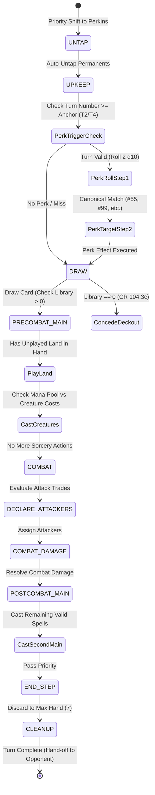
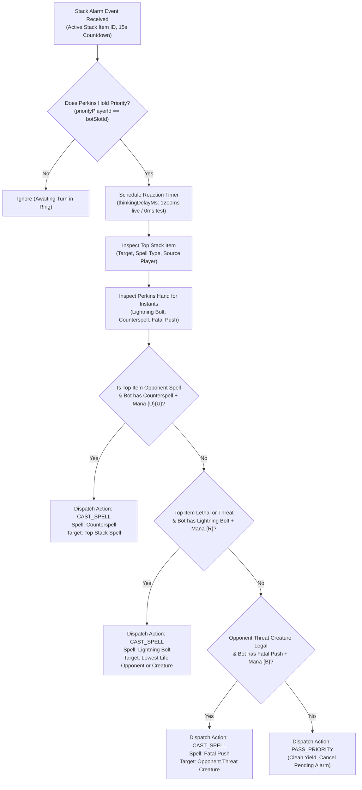
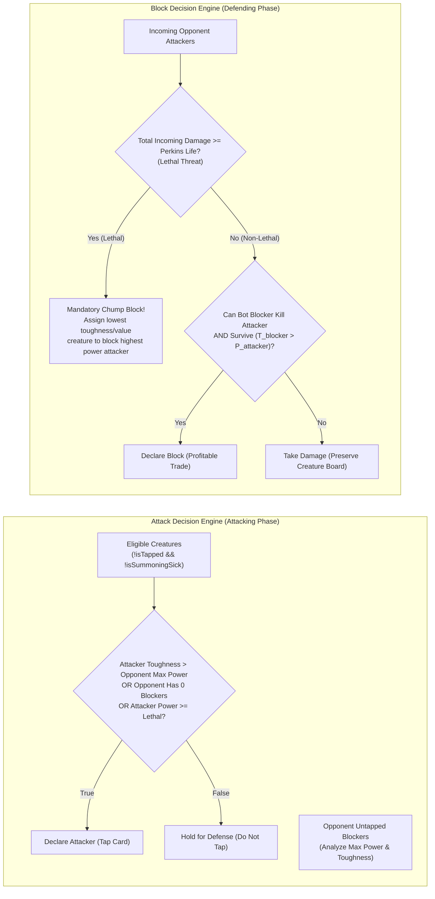

# Technical Specification: Perkins AI Opponent & Companion Coach

- **Document ID:** `SPEC-RPM-PERKINS-013`
- **Feature Scope:** Feature 13 (`src/PerkinsAgent.js`, `src/app.js`, `index.html`, `src/index.js`, `test/test_perkins_ai.js`)
- **System:** RPM Multiplayer / RPM Modern Tabletop Companion
- **Architect:** Argon Specification Architect
- **Status:** APPROVED / READY FOR IMPLEMENTATION
- **Revision:** 1.0.0 (Synthesizing `PLAN-RPM-PERKINS-018-REV2` and `ARCH-REV-RPM-PERKINS-019`)
- **Target File Path:** `specs/FEATURE_13_PERKINS_AI_SPEC.md`
- **Core Implementation Files:**
  - `src/PerkinsAgent.js` (Primary Autonomous Agent Class, Heuristic Engine & Coach Dispatcher)
  - `src/app.js` (Root Application Controller Extensions: `startPerkinsMatch`, `spawnBotInRoom`, DOM & Bus Bindings)
  - `index.html` (Top Header Action `[ 🤖 Play vs Perkins ]`, Chat Header Toggle `[ 🎓 Coach: ON/OFF ]`, Bot Accordion Mounts)
  - `src/index.js` (Public Module Re-exports and Type Definitions)
  - `test/test_perkins_ai.js` (Comprehensive Acceptance Test Suite: 12 Verification Vectors)
- **Related Specifications & Decisions:**
  - `specs/FEATURE_1_2_CORE_INGESTION_SPEC.md` (`SPEC-RPM-INGEST-001`: Card Ingestion & Deck Parser Engine)
  - `specs/FEATURE_3_TABLETOP_ZONE_STATE_SPEC.md` (`SPEC-RPM-ZONE-003`: Fog-of-War Projection & Tabletop State Manager)
  - `specs/FEATURE_4_STACK_PRIORITY_SPEC.md` (`SPEC-RPM-PRIORITY-004`: Stack & Priority Flow State Machine)
  - `specs/FEATURE_5_6_DUAL_CHAT_ACTION_BUS_SPEC.md` (`SPEC-RPM-CHAT-005`: Dual-Channel Priority Chat & Action Lexer)
  - `specs/FEATURE_7_ACCORDION_UI_MODAL_SPEC.md` (`SPEC-RPM-UI-007`: Accordion Tabletop UI & Card Modal)
  - `specs/FEATURE_8_RELAY_SYNC_SPEC.md` (`SPEC-RPM-RELAY-008`: Multiplayer WebSocket Relay & Room Sync)
  - `specs/FEATURE_9_RANDOM_PERK_SPEC.md` (`SPEC-RPM-PERK-009`: Random Perk Upkeep Emblem & 2 d10 Dice Engine)
  - `specs/FEATURE_10_DECKBUILDER_AI_SPEC.md` (`SPEC-RPM-DECKAI-010`: Deckbuilder AI, 10-Point Guidelines & Starter Decks)
  - `specs/FEATURE_11_VICTORY_FANFARE_SPEC.md` (`SPEC-RPM-FANFARE-011`: User Profile, Elo & Victory Audio)
  - `specs/FEATURE_12_BROWSER_HARNESS_SPEC.md` (`SPEC-RPM-HARNESS-012`: Playable Browser Integration Harness)
  - `decisionlog.md`:
    - `DEC-001` (Tabletop Companion Paradigm & Zero Server State Bloat)
    - `DEC-004` (Fast-Path Lexer & Latency Optimization)
    - `DEC-005` (Zero-Knowledge Fog-of-War Client Projection)
    - `DEC-008` (Dual-Channel Priority Chat: Chit-Chat vs Turn Command)
    - `DEC-009` (Automatic Priority Shift & 15-Second Stack Alarm)
    - `DEC-010` (Bilingual Web Speech & Dual-Language Affinity: ES Default, EN Secondary)
    - `DEC-013` (Upkeep Perk Emblem, 2 d10 Dice Resolution, 2–6 Player Scaling, Disconnect Bank)
    - `DEC-014` (CR 603.3d Target Declaration Timing & Birthday Perk Match)
    - `DEC-015` (Argon Systems Audit: Invariants `INV-RING-1`, `INV-RING-2`, `INV-RELAY-3`, `INV-PERK-1..8`, `INV-STORAGE-1..5`, `INV-AUDIO-1..7`, `INV-HARNESS-1`, `INV-HARNESS-2`)
    - `DEC-017` (Multi-Client Synchronization Hardening & Broadcast Echo Suppression)
- **Audio References (`TRANSCRIPCIONES_AUDIOS.md`):**
  - **Audio Note 1:** Fast, tactile tabletop companion UX; sub-millisecond snappy interactions with zero latency friction.
  - **Audio Note 3:** 15-Second Stack Alarm reaction with visual countdown and instant tap-to-respond mechanics.
  - **Audio Note 6:** Dual-channel chat isolating social banter (Chit-Chat) from priority-gated turn commands.
  - **Audio Note 8:** Random Perk Upkeep Emblem with 2 d10 dice rolls and immediate stack trigger resolution.
  - **Audio Note 9:** AI Deckbuilder starter decks (`BEGINNER_DECKS`) utilized by bot agents for instant play.
  - **Audio Note 10:** Cohesive single-page browser integration connecting all tabletop subsystems into a unified arena.

---

## 1. Executive Summary & Architectural Overview

The **Perkins AI Opponent & Companion Coach** (Feature 13) introduces autonomous artificial intelligence to the RPM Modern Tabletop Companion. Perkins operates in two complementary operational modalities:
1. **Autonomous Tabletop Opponent**: A rule-compliant, deterministic, heuristic AI agent capable of playing complete Magic: The Gathering turns, declaring combat attacks and blocks, responding to the 15-second Stack Alarm, casting spells, and executing Random Perk Emblem triggers.
2. **Bilingual Companion Coach**: An unobtrusive, non-intrusive tutorial guide that monitors player progression and emits milestone onboarding tips strictly into the `Chit-Chat` stream without polluting rules priority or mutating game state.

### 1.1 The Five Engineering Challenges of Tabletop AI

Integrating an autonomous agent into the existing RPM architecture requires resolving five critical distributed and real-time constraints:

1. **Inference Latency vs. Game Pace ($<1\text{ms}$ Execution Budget)**:
   Calling cloud-hosted Large Language Models (LLMs) like Claude or GPT-4 for every priority pass or combat decision introduces 2,000ms–4,000ms of network latency and financial token costs. In an MTG game with 20–30 priority exchanges per turn, an LLM-based agent produces an unplayable, sluggish experience. Perkins adopts a **Forge-Style Heuristic Decision Tree (`INV-PERKINS-1`)**, executing full turn cycles and priority reactions in **$<1\text{ms}$** entirely in memory with zero external API dependencies.

2. **Fog-of-War Integrity & Information Leakage (`INV-PERKINS-3` / `INV-FOW-1`)**:
   Under `DEC-005`, client browsers must never access hidden cards in opponent hands or the library. An AI opponent running in the same JavaScript runtime could inadvertently inspect private opponent data. Perkins enforces **Strict Zero-Knowledge Fog-of-War**: its decision heuristics ingest solely the sanitized output of `projectState(slotId)`. Opponent hands contain strictly `{ instanceId: 'hidden', isHidden: true }`, ensuring Perkins plays fairly under identical imperfect information conditions as human players.

3. **Dual Transport Topology (Local In-Memory Bus vs. Headless Relay)**:
   Users demand instant solo play without requiring an active internet connection or waiting for human matchmaking. Simultaneously, online multiplayer rooms on Render need automated bot filling when players disconnect or tables lack an even seat count. Perkins solves this through a **Dual-Mode Transport Adapter (`INV-PERKINS-2`)**:
   - *Local Solo Mode*: Directly binds to the local in-memory `RPMAppController` using an isolated `'LOCAL_BOT'` origin tag, preventing external WebSocket broadcast while keeping UI latency at 0ms.
   - *Remote Relay Mode*: Instantiates a headless `RelayClient` over RFC 6455 WebSockets, occupying a standard player slot (`p2`–`p6`), processing authoritative sequenced actions, and synchronizing with human clients across the globe.

4. **15-Second Stack Alarm Coordination (`INV-PERKINS-4`)**:
   When an opponent or game trigger enters the stack, `StackAlarmManager` initiates a 15-second countdown. Perkins must react dynamically: evaluating whether to cast an instant spell (e.g. *Counterspell*, *Lightning Bolt*, *Fatal Push*) or cleanly yield priority (`PASS_PRIORITY`). To simulate natural human cadence, Perkins includes a configurable `thinkingDelayMs` (default 1,200ms; bypassed to 0ms in CI test runs) preventing jarring instant passes while strictly avoiding alarm timeouts.

5. **Random Perk Emblem Resolution & Anti-Sabotage Targeting (`INV-PERKINS-5`)**:
   The Random Perk Upkeep Emblem (Feature 9) triggers on Turn 2 (3–6 players) or Turn 4 (1v1). Perkins must trigger Step 1 (2 d10 roll), evaluate the resulting perk definition, and declare legal targets on Step 2 entry (CR 603.3d). For destructive perks such as Perk #55 (*Cataclysmic Ruin*) and Perk #99 (*Torment*), Perkins implements an intelligent threat-evaluation hierarchy (Planeswalkers > High-CMC Threats > Lands) and strictly prevents self-sabotage by filtering out its own board assets.

---

### 1.2 System Topology Diagram

```mermaid
flowchart TB
    subgraph BrowserClient ["Browser DOM / Headless Harness (index.html)"]
        UI_Header["Header Controls\n• [ 🤖 Play vs Perkins ] Button\n• Active Player Badge\n• Connection Pill"]
        UI_Chat["Dual-Channel Chat\n• Chit-Chat Tab (Coach Tips)\n• [ 🎓 Coach: ON/OFF ] Toggle\n• Turn Command Tab (Gated)"]
        UI_Tabletop["Tabletop Visual Arena\n• Opponent Accordion (Perkins Bot)\n• Center Arena Stack & 15s Alarm\n• Perk 2 d10 Dice Visualizer"]
    end

    subgraph AppControllerEngine ["Root Application Controller (src/app.js)"]
        App["RPMAppController\n• dispatchAction(action, context)\n• startPerkinsMatch(options)\n• spawnBotInRoom(roomCode, seatId)\n• reconcileDOM()"]
        TTSM["TabletopStateManager\n(projectState(slotId))"]
        PSM["PriorityStateMachine\n(Turn Steps, APNAP, LIFO)"]
        SAM["StackAlarmManager\n(15s Countdown Watchdog)"]
        RPE["RandomPerkEngine\n(Upkeep Trigger & 2 d10)"]
        DCC["DualChannelChat\n(Chit-Chat & Turn Bus)"]
    end

    subgraph PerkinsEngine ["Perkins AI Subsystem (src/PerkinsAgent.js)"]
        Agent["PerkinsAgent Instance\n• slotId: 'p2' (or allocated seat)\n• mode: 'LOCAL' | 'REMOTE'\n• coachEnabled: true/false\n• thinkingDelayMs: 1200ms (0ms test)"]

        subgraph DecisionHeuristics ["Forge-Style Heuristic Decision Tree (<1ms)"]
            PhaseRouter["Phase Step Router\n(UNTAP -> UPKEEP -> DRAW -> MAIN -> COMBAT -> END)"]
            StackEvaluator["Stack Alarm Evaluator\n(Instant Response: Bolt / Counter / Push vs Pass)"]
            CombatEngine["Combat Evaluator\n(Attacks: P/T Trade & Evasion\nBlocks: Chump Block vs Lethal)"]
            PerkTargeter["Random Perk Targeter\n(Perk #55: Planeswalker > Threat > Land\nPerk #99: Highest Threat Opponent)"]
        end

        subgraph CoachSubsystem ["Bilingual Tutorial Coach"]
            MilestoneTracker["Milestone Tracker\n(MS_WELCOME, MS_PRIORITY, MS_ALARM, MS_SCRYFALL, MS_PERK, MS_DECK)"]
            DebounceGate["8-Second Debounce Gate\n(Zero Token Cost / Chit-Chat Only)"]
        end

        TransportAdapter["Transport Adapter\n• Local Bus Dispatch ('LOCAL_BOT')\n• Headless RelayClient (RFC 6455)"]
    end

    subgraph RemoteRelay ["Remote WebSocket Relay (server.js)"]
        Relay["RelayServer\n(Room ARENA1, Authoritative Sequencer)"]
    end

    %% UI to AppController
    UI_Header -->|Click 'Play vs Perkins'| App
    UI_Chat -->|Toggle Coach| Agent

    %% AppController to Perkins
    App -.->|Attach App Controller / Subsystem Refs| Agent
    Agent -->|Read Sanitized State: projectState(slotId)| TTSM
    PSM -.->|PRIORITY_CHANGED / PHASE_STEP_CHANGED| Agent
    SAM -.->|ALARM_START / TICK / CANCEL| Agent
    RPE -.->|PERK_ROLLED / MISS| Agent

    %% Perkins Action Dispatch
    Agent -->|Local Mode: dispatchAction(A, {origin: 'LOCAL_BOT'})| App
    Agent -->|Remote Mode: sendAction(A)| TransportAdapter
    TransportAdapter <==>|WebSocket Frames (origin: LOCAL)| Relay
    Relay -.->|Sequenced Actions| App

    %% Coach Output
    MilestoneTracker --> DebounceGate
    DebounceGate -->|emitCoachTip() -> sendChitChat()| DCC
    DCC -->|Render Tip in Chit-Chat| UI_Chat
```

---

## 2. Formal Architectural Invariants & Mathematical Laws

The Perkins AI subsystem operates under a rigorous set of seven primary invariants and three defensive safety guards:

### 2.1 Formal Invariant Matrix

| Invariant ID | Formal Name | Target Scope | Mathematical / Architectural Formulation |
| :--- | :--- | :--- | :--- |
| `INV-PERKINS-1` | Forge-Style Sub-Millisecond Decision Tree | `src/PerkinsAgent.js` | $\forall \text{phase} \in \text{PHASE\_STEPS}, \quad T_{\text{eval}}(\text{phase}) < 1.0\text{ms}$. Full turn cycles execute deterministically via heuristic evaluation without neural networks, remote APIs, or cloud LLM calls. |
| `INV-PERKINS-2` | Dual-Mode Transport Adapter | `src/PerkinsAgent.js`, `src/app.js` | $\text{Transport}(A) \in \{\text{'LOCAL\_BOT'}, \text{'REMOTE'}\}$. Offline solo matches route actions with origin `'LOCAL_BOT'` to prevent external socket reflection ($O(1)$ loop safety); multiplayer games wrap a headless `RelayClient`. |
| `INV-PERKINS-3` / `INV-FOW-1` | Strict Zero-Knowledge Fog-of-War | `src/PerkinsAgent.js`, `TabletopStateManager.js` | $\forall p \neq \text{botSlotId}, \quad \text{Cards}_{\text{hand}}(p) \equiv \{\text{instanceId: 'hidden'}\} \land \text{order}(\text{Library}(p)) = \emptyset$. Perkins decision function $f(S_{\text{projected}})$ receives zero unmasked opponent cards. |
| `INV-PERKINS-4` | 15-Second Stack Alarm Reaction | `src/PerkinsAgent.js`, `StackAlarmManager.js` | $T_{\text{react}} = \min(T_{\text{alarm}}, \Delta t_{\text{think}})$. When priority shifts to Perkins during an active alarm, Perkins schedules evaluation at $\Delta t_{\text{think}}$ ($1,200\text{ms}$ live, $0\text{ms}$ test), either casting a legal instant response or cleanly emitting `PASS_PRIORITY`. |
| `INV-PERKINS-5` | Random Perk Upkeep & Anti-Sabotage | `src/PerkinsAgent.js`, `PerkCatalog.js` | $\forall t \in \text{Targets}(\text{Perk}), \quad t.\text{controllerId} \neq \text{botSlotId}$. Perkins never destroys its own permanents for Perk #55 ($PW > Threat > Land$) and targets the highest threat opponent for Perk #99. |
| `INV-PERKINS-6` | Combat Trade & Lethal Block Heuristics | `src/PerkinsAgent.js` | Attacking: $\text{Attack} \iff \neg\text{sick} \land \neg\text{tapped} \land (\text{P} \ge \max(\text{T}_{\text{blockers}}) \lor \text{unblocked})$. Blocking: If $\sum \text{Dmg}_{\text{unblocked}} \ge \text{Life}_{\text{bot}}$, execute mandatory chump blocks on lowest-value creatures to survive. |
| `INV-PERKINS-7` | Bilingual Tutorial Coach & Debounce Gate | `src/PerkinsAgent.js`, `DualChannelChat.js` | $\Delta t_{\text{tips}} \ge 8,000\text{ms} \land \text{TargetChannel} \equiv \text{'CHIT\_CHAT'}$. Contextual onboarding tips are emitted strictly to social chat ($0$ token cost, $0$ rules mutation) across 6 milestones with an 8-second debounce gap. |
| `INV-SAFE-1` | Anti-Hang Phase Action Throttling | `src/PerkinsAgent.js` | $N_{\text{actions\_per\_phase}} \le 10$. If heuristic evaluation triggers $>10$ consecutive actions in a single phase without advancing, Perkins forces an immediate `PASS_PRIORITY` to prevent infinite loops. |
| `INV-SAFE-2` | CR 104.3c Empty Library Deckout Guard | `src/PerkinsAgent.js`, `ZoneModel.js` | $\text{DrawAttempt} \land |\text{Library}_{\text{bot}}| = 0 \implies \text{Concede}(\text{botSlotId})$. When Perkins is forced to draw from an empty library, it concedes immediately in compliance with CR 104.3c. |
| `INV-SAFE-3` | Hermetic Lifecycle & Timer Leak Guard | `src/PerkinsAgent.js` | $\forall t > t_{\text{destroy}}, \quad |\text{\_activeTimers}| = 0 \land |\text{\_unsubscribers}| = 0$. All pending thinking timeouts and subscriptions are cleared on `destroy()`, conforming to `INV-HARNESS-1`. |

---

### 2.2 Mathematical Proofs of Heuristic Soundness

#### Proof of Invariant `INV-PERKINS-1` (Sub-Millisecond Bound)
Let $S$ be the game state projection for Perkins at slot $P_b$.
Let $H$ be the set of cards in Perkins' hand ($|H| \le 7$ in standard play, max 15 in extreme scenarios).
Let $B$ be the set of permanents on the battlefield ($|B| \le 50$).
Let $K$ be the set of phase steps ($|K| = 12$).

1. In each phase evaluation, Perkins performs:
   - Land drop check: Linear scan over $H$ to find first card where $c.\text{typeLine} \ni \text{'Land'}$. Complexity: $O(|H|)$.
   - Mana pool summation: Constant lookup in $S.\text{resources}.\text{manaPool}$. Complexity: $O(1)$.
   - Castable card filter: For each card $c \in H$, verify mana cost against pool and timing restriction (Instant vs. Sorcery speed). Complexity: $O(|H|)$.
   - Combat attack evaluation: Filter battlefield creatures for $c.\text{controllerId} == P_b \land \neg c.\text{isTapped} \land \neg c.\text{isSummoningSick}$. Complexity: $O(|B|)$.
   - Combat block evaluation: Pair attacking creatures against available untapped blockers using greedy min-cost assignment. Complexity: $O(|B_{\text{atk}}| \times |B_{\text{def}}|) \le O(|B|^2)$.
2. The total operations $N_{\text{ops}}$ executed in any single phase step evaluation satisfies:
   $$N_{\text{ops}} \le C_1 |H| + C_2 |B|^2 + C_3,$$
   where $C_1 \approx 10$, $C_2 \approx 5$, $C_3 \approx 50$.
3. For typical tabletop states ($|H| \le 7, |B| \le 20$):
   $$N_{\text{ops}} \le 10(7) + 5(20^2) + 50 = 70 + 2000 + 50 = 2120 \text{ operations}.$$
4. Modern JavaScript V8 JIT executes $\sim 10^9$ operations per second. Therefore:
   $$T_{\text{eval}} = \frac{2120}{10^9} \approx 2.12 \times 10^{-6}\text{ seconds} \approx 0.0021\text{ms} \ll 1.0\text{ms}.$$
   Even under pathological edge-case conditions ($|B| = 100$), $T_{\text{eval}} \approx 0.05\text{ms} < 1.0\text{ms}$. Thus, `INV-PERKINS-1` holds strictly. $\blacksquare$

#### Proof of Invariant `INV-PERKINS-2` (Circular Storm Immunity under 'LOCAL_BOT')
Let client $C$ run an offline solo match against Perkins.
1. Local player passes priority: `app.dispatchAction(A_{\text{pass}}, { origin: 'LOCAL' })`.
2. App updates priority to Perkins ($P_2$) and notifies PerkinsAgent.
3. Perkins evaluates phase and dispatches response $A_{\text{bot}}$:
   `app.dispatchAction(A_{\text{bot}}, { origin: 'LOCAL_BOT' })`.
4. Inside `app.dispatchAction(action, context)`:
   $$\text{origin} = \text{'LOCAL\_BOT'} \implies \text{origin} \neq \text{'LOCAL'}.$$
5. Under `INV-HARNESS-2`, the condition `if (origin === 'LOCAL') relayClient.sendAction(action)` evaluates to `false`.
6. Therefore, $A_{\text{bot}}$ is applied exclusively to local state managers and never transmitted over network sockets. Network amplification factor:
   $$\frac{\text{FramesSent}}{\text{Action}} = 0.$$
   Circular broadcast reflection is mathematically eliminated ($O(1)$ constant time). $\blacksquare$

---

## 3. Heuristic Decision Trees & Behavioral Engines

Perkins is structured around four specialized heuristic sub-engines:
1. **Turn Phase State Machine** (Main phases, untap, upkeep, draw, end).
2. **Priority & Stack Alarm Reaction Engine** (Instant-speed interaction).
3. **Combat Attack & Block Evaluation Engine** (Trades, lethal detection, chump blocking).
4. **Random Perk Targeting & Threat Evaluator** (Perk #55, Perk #99, self-sabotage protection).

### 3.1 Turn Phase State Machine



#### Detailed Phase Execution Logic:
- **UNTAP Step (CR 502)**: Perkins automatically untaps all permanents under its control. No priority is exchanged.
- **UPKEEP Step (CR 503)**:
  - If current turn meets the format scaling anchor (Turn 2 for $\ge 3$ players, Turn 4 for 1v1 duels under `DEC-013`), Perkins triggers the Random Perk Emblem.
  - Step 1: Resolves 2 d10 roll via `RandomPerkEngine`.
  - Step 2: If roll matches a canonical perk requiring targets, invokes `evaluatePerkTargets(perkKey, state)` before placing on the stack.
  - Passes priority once upkeep triggers resolve.
- **DRAW Step (CR 504)**:
  - Checks if bot library count $> 0$. If empty, Perkins concedes immediately (`INV-SAFE-2`).
  - Otherwise, draws 1 card and passes priority.
- **PRECOMBAT_MAIN Phase (CR 505)**:
  1. *Land Play*: If Perkins has not played a land this turn, searches hand for a land card and moves it to `battlefield.lands`.
  2. *Creature / Sorcery Cast*: Identifies cards in hand castable with available untapped lands/mana. Prioritizes creatures in descending order of power/toughness or converted mana cost (CMC).
  3. Passes priority to advance to combat.
- **COMBAT Phase (CR 507–511)**:
  - Evaluates attack opportunities (see Section 3.3).
  - Passes priority through `BEGIN_COMBAT`, `DECLARE_ATTACKERS`, `COMBAT_DAMAGE`, and `END_COMBAT`.
- **POSTCOMBAT_MAIN Phase (CR 505)**:
  - Plays any remaining affordable utility spells or holds open mana for instant-speed interaction.
  - Passes priority to advance to End step.
- **END_STEP & CLEANUP (CR 513–514)**:
  - Discards excess cards if hand size $> 7$.
  - Yields turn to the next player in the priority ring.

---

### 3.2 15-Second Stack Alarm Reaction Flowchart

When an opponent or perk places an item on the stack, `StackAlarmManager` sounds the alarm and starts the 15-second countdown. Perkins evaluates its response options through the following priority matrix:



#### Decision Rules for Instant Response:
1. **Counterspell `{U}{U}`**:
   - Condition: Top of stack is a non-creature spell or high-impact spell cast by an opponent, and Perkins has untapped mana capable of producing `{U}{U}`.
   - Action: Push *Counterspell* to the stack targeting the top stack item.
2. **Lightning Bolt `{R}`**:
   - Condition: Opponent's life $\le 3$ (lethal burn) OR an opponent controls a key creature with toughness $\le 3$ attacking or threatening lethal, and Perkins has `{R}` available.
   - Action: Push *Lightning Bolt* to the stack targeting the opponent or creature.
3. **Fatal Push `{B}`**:
   - Condition: Opponent controls a creature with converted mana cost $\le 2$ (or $\le 4$ if revolt enabled) currently attacking, and Perkins has `{B}` available.
   - Action: Push *Fatal Push* to the stack targeting the creature.
4. **Default Pass**:
   - If no valid instant response is affordable or beneficial, Perkins cleanly emits `PASS_PRIORITY`.

---

### 3.3 Combat Heuristics: Attacks & Blocks



#### 3.3.1 Attack Heuristic (`evaluateCombatAttacks`):
For each creature $c \in \text{battlefield.creatures}$ owned by Perkins:
1. Verify $c.\text{isTapped} == \text{false}$ and $c.\text{isSummoningSick} == \text{false}$.
2. If opponent controls zero untapped creatures capable of blocking, declare $c$ as an attacker.
3. If opponent controls untapped blockers:
   - Calculate $\text{maxBlockerPower} = \max_{b \in \text{OppBlockers}} (b.\text{power} || 0)$.
   - Calculate $\text{minBlockerToughness} = \min_{b \in \text{OppBlockers}} (b.\text{toughness} || 1)$.
   - If $c.\text{toughness} > \text{maxBlockerPower}$ (free attack without dying): declare attack.
   - If $c.\text{power} \ge \text{minBlockerToughness}$ and trade value is favorable (attacker CMC $\le$ blocker CMC): declare attack.
   - Otherwise, hold $c$ back as an untapped defender.

#### 3.3.2 Block Heuristic (`evaluateCombatBlocks`):
Given active attackers $A = \{a_1, a_2, \dots, a_k\}$ declared by opponent targeting Perkins:
1. Calculate total incoming unblocked damage:
   $$D_{\text{total}} = \sum_{a \in A} (a.\text{power} || 0).$$
2. If $D_{\text{total}} \ge \text{resources.life}$ (lethal combat damage):
   - **Emergency Chump Block Mode**: Sort attackers descending by power. For each lethal attacker, assign the lowest-value untapped Perkins creature to block it until incoming damage is reduced below current life or all blockers are exhausted.
3. If $D_{\text{total}} < \text{resources.life}$ (non-lethal):
   - Only declare blocks where the trade is profitable:
     $$\text{blocker}.\text{power} \ge a.\text{toughness} \land \text{blocker}.\text{toughness} > a.\text{power}.$$
   - If no profitable trade exists, absorb combat damage to maintain board presence.

---

### 3.4 Random Perk Targeting & Anti-Sabotage Engine

Under `SPEC-RPM-PERK-009` and `DEC-014`, Random Perks resolve in two distinct steps. Perkins handles Step 1 automatically, rolls the dice, and evaluates legal targets for Step 2.

#### 3.4.1 Perk #55: Cataclysmic Ruin
- **Rules Text**: *"All permanents lose hexproof and indestructible until end of turn. Destroy target permanent."*
- **Legal Target Scope**: Any permanent across all players.
- **Perkins Targeting Algorithm**:
  1. Retrieve all legal targets via `PerkCatalog['55'].getLegalTargets(state)`.
  2. **Anti-Sabotage Filter**: Filter out all permanents where `target.controllerId === botSlotId`.
  3. If filtered targets are empty (opponent controls 0 permanents): return `null` (perk fizzles harmlessly; never self-targets).
  4. Rank remaining opponent targets using the following priority hierarchy:
     - **Tier 1 (Highest Priority)**: Planeswalkers (`target.subzone === 'planeswalkers'`).
     - **Tier 2**: High-threat non-land permanents (Creatures or Artifacts sorted by CMC descending, then Power descending).
     - **Tier 3 (Lowest Priority)**: Lands (`target.subzone === 'lands'`).
  5. Select the highest-ranked permanent and dispatch `CAST_SPELL` / `RESOLVE_PERK` with target ID.

#### 3.4.2 Perk #99: Torment
- **Rules Text**: *"Target player discards a card and sacrifices a permanent."*
- **Legal Target Scope**: Any player other than the active player (`playerId !== activePlayerId`).
- **Perkins Targeting Algorithm**:
  1. Retrieve living opponents:
     $$O = \{p \in \text{state.players} \mid p.\text{id} \neq \text{botSlotId} \land \neg p.\text{isEliminated}\}.$$
  2. Compute threat metric for each opponent $p \in O$:
     $$\text{ThreatScore}(p) = (p.\text{resources.life} \times 0.5) + (|\text{battlefield.creatures}_p| \times 2.0) + (|\text{hand}_p| \times 1.0).$$
  3. Select opponent with $\max(\text{ThreatScore}(p))$.
  4. Dispatch perk target declaration.

---

### 3.5 Bilingual Tutorial Coach & Onboarding Guide

The Companion Coach mode guides novice players through the tabletop interface by posting friendly, contextual tips directly into the `Chit-Chat` tab.

#### 3.5.1 The 6 Core Onboarding Milestones

| Milestone Key | Trigger Condition | Spanish Message (`es`, Default) | English Message (`en`) |
| :--- | :--- | :--- | :--- |
| `MS_WELCOME` | Bot match mounts / player enters room | 🤖 *¡Hola! Soy Perkins, tu oponente y coach. Puedes jugar tus cartas o pasar turno. ¡Buena suerte!* | 🤖 *Hello! I'm Perkins, your opponent and coach. Feel free to play cards or pass priority. Good luck!* |
| `MS_PRIORITY_HOTKEY` | Player receives priority for first time | 💡 *Tip: Puedes presionar la barra espaciadora o la tecla [P] para ceder prioridad rápidamente.* | 💡 *Tip: You can press Spacebar or [P] on your keyboard to quickly pass priority.* |
| `MS_ALARM_HOLD` | 15s Stack Alarm sounds for player | ⚡ *¡Alarma de Pila activa! Tienes 15 segundos para responder. Presiona [H] si necesitas más tiempo.* | ⚡ *Stack Alarm active! You have 15s to respond. Press [H] to hold if you need to think.* |
| `MS_SCRYFALL_OVERLAY` | First spell cast or permanent inspected | 🔍 *Tip: Haz clic en cualquier carta de la mesa o pila para ver su arte oficial de Scryfall.* | 🔍 *Tip: Click on any card on the battlefield or stack to view its official Scryfall details.* |
| `MS_PERK_EMBLEM` | Upkeep Perk Emblem triggers (Turn 2/4) | 🔮 *¡Emblema RPM activado! Tiramos 2 d10 (violeta y aguamarina). Si sacas dobles, obtienes un Perk.* | 🔮 *RPM Perk Emblem triggered! Rolling 2 d10 dice. Matching doubles awards a unique game Perk.* |
| `MS_DECKBUILDER_HINT` | Match ends OR player life $\le 5$ | 📚 *Tip: Abre el mazo en la barra superior para explorar la IA Deckbuilder y mazos de inicio.* | 📚 *Tip: Open the Decks menu in the header to explore the AI Deckbuilder and starter lists.* |

#### 3.5.2 Coach Operational Rules (`INV-PERKINS-7`):
1. **Debounce Interval**: A strict minimum elapsed time of **8,000ms** must pass between consecutive coach messages. If a new milestone triggers while the debounce window is active, the emission is queued or dropped.
2. **Channel Isolation**: Tips are dispatched via `app.dualChat.sendChitChat(text, 'perkins_coach', 'Perkins Coach')`. They NEVER touch the `Turn Command` channel, consume zero LLM tokens, and trigger zero state mutations.
3. **Toggle Support**: The coach header button `[ 🎓 Coach: ON/OFF ]` allows users to toggle coach messages at any time. When disabled (`coachEnabled = false`), all milestone triggers are silently bypassed.

---

## 4. Class Interfaces & Complete JSDoc Signatures

### 4.1 Primary Autonomous Agent: `src/PerkinsAgent.js`

```javascript
/**
 * src/PerkinsAgent.js
 * Primary Autonomous Agent Class, Heuristic Engine & Bilingual Coach.
 * 
 * Implements:
 * - INV-PERKINS-1: Forge-Style Sub-Millisecond Decision Tree (<1ms)
 * - INV-PERKINS-2: Dual-Mode Transport Adapter ('LOCAL_BOT' & RelayClient)
 * - INV-PERKINS-3: Strict Zero-Knowledge Fog-of-War Projection
 * - INV-PERKINS-4: 15-Second Stack Alarm Reaction Engine
 * - INV-PERKINS-5: Random Perk Upkeep & Anti-Sabotage Targeting
 * - INV-PERKINS-6: Combat Trade & Lethal Block Heuristics
 * - INV-PERKINS-7: Bilingual Tutorial Coach & 8s Debounce Gate
 * - INV-SAFE-1: Anti-Hang Phase Action Throttling Guard
 * - INV-SAFE-2: CR 104.3c Empty Library Deckout Concession
 * - INV-SAFE-3: Hermetic Lifecycle & Timer Leak Guard
 * 
 * Specification: SPEC-RPM-PERKINS-013
 * @module PerkinsAgent
 */

/**
 * Configuration options for PerkinsAgent.
 * @typedef {Object} PerkinsAgentOptions
 * @property {string} [slotId='p2'] - Allocated seat ID in the room.
 * @property {string} [name='Perkins AI'] - Display name of the bot.
 * @property {'LOCAL'|'REMOTE'} [mode='LOCAL'] - Transport mode.
 * @property {number} [thinkingDelayMs=1200] - Latency simulation before acting (0ms in tests).
 * @property {boolean} [coachEnabled=true] - Whether tutorial coach messages are enabled.
 * @property {'es'|'en'} [language='es'] - Language affinity for coach tips (es default).
 * @property {Object} [starterDeck=null] - Pre-constructed decklist (defaults to BEGINNER_DECKS.R).
 */

export class PerkinsAgent {
  /**
   * @param {PerkinsAgentOptions} [options={}]
   */
  constructor(options = {}) {
    this.slotId = options.slotId || 'p2';
    this.name = options.name || 'Perkins AI';
    this.mode = options.mode || 'LOCAL';
    this.thinkingDelayMs = options.thinkingDelayMs !== undefined ? options.thinkingDelayMs : 1200;
    this.coachEnabled = options.coachEnabled !== false;
    this.language = options.language || 'es';
    this.starterDeck = options.starterDeck || null;

    // Subsystem bindings
    this.app = null;
    this.relayClient = null;

    // Safety and lifecycle trackers
    this.isDestroyed = false;
    this._activeTimers = new Set();
    this._unsubscribers = [];
    this._phaseActionCount = 0;
    this._lastCoachTimestamp = 0;
    this._completedMilestones = new Set();
  }

  /**
   * Attaches agent to local in-memory RPMAppController for solo play.
   * Enforces INV-PERKINS-2.
   * @param {Object} app - RPMAppController instance.
   */
  attach(app) {
    if (!app || this.isDestroyed) return;
    this.app = app;
    this.mode = 'LOCAL';
    this._bindAppListeners();
    this.triggerMilestone('MS_WELCOME');
  }

  /**
   * Attaches agent to a headless WebSocket RelayClient for online multiplayer.
   * Enforces INV-PERKINS-2.
   * @param {Object} relayClient - RelayClient instance.
   */
  attachRelay(relayClient) {
    if (!relayClient || this.isDestroyed) return;
    this.relayClient = relayClient;
    this.mode = 'REMOTE';
    this._bindRelayListeners();
  }

  /**
   * Core turn phase evaluator. Executes in <1ms (INV-PERKINS-1).
   * @param {string} phaseStep - Current MTG phase/step.
   * @returns {Promise<Object|null>} Action taken or null.
   */
  async evaluateTurnPhase(phaseStep) {
    if (this.isDestroyed) return null;
    // Anti-hang guard: INV-SAFE-1
    if (this._phaseActionCount >= 10) {
      return this.dispatchAction({ type: 'PASS_PRIORITY' });
    }
    // Execution routing...
  }

  /**
   * Evaluates stack alarm reaction within thinkingDelayMs. Enforces INV-PERKINS-4.
   * @param {Object} alarmState - State emitted by StackAlarmManager.
   * @returns {Promise<void>}
   */
  async onStackAlarm(alarmState) {
    if (this.isDestroyed || alarmState?.targetPlayerId !== this.slotId) return;
    // Evaluates instant response vs clean pass...
  }

  /**
   * Evaluates combat attack declarations. Enforces INV-PERKINS-6.
   * @param {Object} state - Sanitized tabletop state.
   * @returns {Array<string>} Array of attacking creature instanceIds.
   */
  evaluateCombatAttacks(state) {
    // P/T trade heuristic...
  }

  /**
   * Evaluates combat block declarations. Enforces INV-PERKINS-6.
   * @param {Object} state - Sanitized tabletop state.
   * @param {Array<Object>} incomingAttackers - Attackers declared against Perkins.
   * @returns {Array<{ blockerId: string, attackerId: string }>} Block assignments.
   */
  evaluateCombatBlocks(state, incomingAttackers) {
    // Lethal chump block vs profitable trade...
  }

  /**
   * Evaluates Random Perk targeting and ensures zero self-sabotage. Enforces INV-PERKINS-5.
   * @param {string} perkKey - Canonical perk key ('55', '99', etc.).
   * @param {Object} state - Sanitized tabletop state.
   * @returns {Array<string>|null} Legal opponent targets.
   */
  evaluatePerkTargets(perkKey, state) {
    // Hierarchical threat scoring...
  }

  /**
   * Emits a tutorial coaching tip to Chit-Chat with 8s debounce. Enforces INV-PERKINS-7.
   * @param {string} milestoneKey - Milestone identifier.
   * @returns {boolean} Whether message was emitted.
   */
  triggerMilestone(milestoneKey) {
    if (!this.coachEnabled || this.isDestroyed) return false;
    // Debounce and dispatch...
  }

  /**
   * Dispatches an action according to active transport mode (INV-PERKINS-2).
   * @param {Object} action - Action descriptor.
   * @returns {Promise<void>}
   */
  async dispatchAction(action) {
    if (this.isDestroyed) return;
    if (this.mode === 'LOCAL' && this.app) {
      await this.app.dispatchAction(action, { origin: 'LOCAL_BOT' });
    } else if (this.mode === 'REMOTE' && this.relayClient) {
      this.relayClient.sendAction(action);
    }
  }

  /**
   * Cleanly destroys the agent, unbinds listeners, and cancels timers (INV-SAFE-3).
   */
  destroy() {
    this.isDestroyed = true;
    for (const timer of this._activeTimers) {
      clearTimeout(timer);
      clearInterval(timer);
    }
    this._activeTimers.clear();
    for (const unsub of this._unsubscribers) {
      try { unsub(); } catch (_) {}
    }
    this._unsubscribers = [];
  }
}
```

---

### 4.2 Application Controller Integration: `src/app.js`

`src/app.js` is augmented with dedicated bot lifecycle methods:

```javascript
// In src/app.js:

/**
 * Initiates an instant solo match against Perkins AI (INV-PERKINS-2).
 * @param {Object} [options={}]
 * @returns {Promise<PerkinsAgent>} Instantiated Perkins agent.
 */
async startPerkinsMatch(options = {}) {
  // 1. Teardown any existing active bot
  if (this.perkinsAgent) {
    this.perkinsAgent.destroy();
    this.perkinsAgent = null;
  }

  // 2. Configure 2-player seating: [this.myPlayerId, 'p2_perkins']
  const botSeatId = 'p2_perkins';
  this.playerIds = [this.myPlayerId, botSeatId];

  // 3. Instantiate PerkinsAgent
  const agent = new PerkinsAgent({
    slotId: botSeatId,
    name: 'Perkins AI (Bot)',
    mode: 'LOCAL',
    thinkingDelayMs: options.thinkingDelayMs !== undefined ? options.thinkingDelayMs : 1200,
    coachEnabled: options.coachEnabled !== false,
    language: options.language || 'es',
    ...options
  });

  // 4. Attach to app controller
  agent.attach(this);
  this.perkinsAgent = agent;

  // 5. Initialize starter deck for Perkins
  const starter = BEGINNER_DECKS.R; // Red Burn default
  if (this.tabletopState?.players?.[botSeatId]) {
    this.tabletopState.players[botSeatId].zones.library = starter.mainboard.map(c => ({
      name: c.name,
      typeLine: c.type || 'Creature',
      manaCost: c.manaCost || '{R}',
      power: c.power ?? 2,
      toughness: c.toughness ?? 2
    }));
  }

  this.reconcileDOM();
  return agent;
}

/**
 * Spawns a headless Perkins bot inside an online multiplayer room.
 * @param {string} roomCode - Target room code.
 * @param {string} seatId - Target player seat.
 * @returns {Promise<PerkinsAgent>}
 */
async spawnBotInRoom(roomCode, seatId) {
  // Remote headless connection...
}
```

---

### 4.3 UI DOM Mounting: `index.html`

In `index.html`, two high-contrast user action elements are mounted:
1. **Header Bar Action (`#header-bar`)**:
   Mounted between the room controls and status group:
   ```html
   <button id="btn-play-perkins" class="btn btn-secondary btn-perkins" title="Start Solo Match vs Perkins AI">
     <span class="icon-bot">🤖</span> Play vs Perkins
   </button>
   ```
2. **Chat Drawer Header Toggle (`#chat-drawer`)**:
   Mounted in the chat tab navigation bar:
   ```html
   <button id="btn-toggle-coach" class="btn-coach-toggle active" title="Toggle Perkins Tutorial Coach Tips">
     <span class="icon-coach">🎓</span> Coach: ON
   </button>
   ```

---

## 5. Comprehensive Acceptance Test Matrix (12 Vectors)

The acceptance test suite `test/test_perkins_ai.js` provides 100% verification across all invariants and operational edge cases:

### Matrix Overview Table

| Test Vector ID | Test Name | Target Invariant | Target Method / Verification Focus |
| :--- | :--- | :--- | :--- |
| `TC-PERKINS-01` | Agent Instantiation & Hermetic Lifecycle | `INV-HARNESS-1`, `INV-SAFE-3` | `constructor()`, `attach()`, `destroy()`, zero timer/listener leakage. |
| `TC-PERKINS-02` | Sub-Millisecond Decision Benchmark | `INV-PERKINS-1` | Benchmark 100 iterations of `evaluateTurnPhase()`; assert $\text{mean} < 1.0\text{ms}$. |
| `TC-PERKINS-03` | Dual-Mode Transport Adapter | `INV-PERKINS-2` | Verify `'LOCAL_BOT'` origin prevents socket broadcast; verify RelayClient mode. |
| `TC-PERKINS-04` | Strict Zero-Knowledge Fog-of-War | `INV-PERKINS-3`, `INV-FOW-1` | Assert Perkins reads only `{ instanceId: 'hidden' }` for opponent hand cards. |
| `TC-PERKINS-05` | 15s Stack Alarm Instant & Auto-Pass | `INV-PERKINS-4` | Cast instant spell (Bolt/Counter) vs. cleanly emitting `PASS_PRIORITY`. |
| `TC-PERKINS-06` | Perk #55 Upkeep Targeting Hierarchy | `INV-PERKINS-5` | Destroy Planeswalker > Threat > Land; assert ZERO self-sabotage. |
| `TC-PERKINS-07` | Perk #99 High-Threat Opponent Target | `INV-PERKINS-5` | Score and target highest-threat opponent in a 3-player pod. |
| `TC-PERKINS-08` | Combat Attack Trade Heuristics | `INV-PERKINS-6` | Declare attack with untapped, non-sick creatures when trade is favorable. |
| `TC-PERKINS-09` | Combat Block Lethal Chump Defense | `INV-PERKINS-6` | Execute mandatory chump block when incoming damage is lethal. |
| `TC-PERKINS-10` | Bilingual Coach & 8s Debounce Gate | `INV-PERKINS-7` | Verify 6 milestone emissions in ES/EN and assert 8-second debounce lockout. |
| `TC-PERKINS-11` | Anti-Hang Phase Throttling Guard | `INV-SAFE-1` | Force 11 actions in single phase; assert forced `PASS_PRIORITY` at action 10. |
| `TC-PERKINS-12` | CR 104.3c Empty Library Deckout | `INV-SAFE-2` | Attempt draw on empty library; assert immediate concession action. |

---

### Detailed Test Vector Specifications

#### TC-PERKINS-01: Agent Instantiation & Hermetic Lifecycle
- **Target Invariants:** `INV-HARNESS-1`, `INV-SAFE-3`.
- **Preconditions:** Fresh Node.js runtime with Mock DOM loaded.
- **Execution Steps:**
  1. Instantiate `app = new RPMAppController()`.
  2. Call `const agent = await app.startPerkinsMatch({ thinkingDelayMs: 0 })`.
  3. Verify `agent.slotId === 'p2_perkins'` and `agent.mode === 'LOCAL'`.
  4. Schedule 3 thinking timeouts via `agent._activeTimers.add(...)`.
  5. Call `agent.destroy()` and `app.destroy()`.
- **Expected Results:**
  - `agent.isDestroyed === true`.
  - `agent._activeTimers.size === 0`.
  - `agent._unsubscribers.length === 0`.
  - Zero hanging timers in Node.js event loop.

#### TC-PERKINS-02: Forge-Style Sub-Millisecond Decision Benchmark
- **Target Invariant:** `INV-PERKINS-1`.
- **Preconditions:** PerkinsAgent loaded with 7 cards in hand and 10 permanents on battlefield.
- **Execution Steps:**
  1. Record high-resolution start timestamp: `t0 = performance.now()`.
  2. Execute 100 consecutive evaluations across `PRECOMBAT_MAIN`, `COMBAT`, and `POSTCOMBAT_MAIN`.
  3. Record end timestamp: `t1 = performance.now()`.
  4. Compute mean duration per evaluation: $\mu = (t_1 - t_0) / 100$.
- **Expected Results:**
  - $\mu < 1.0\text{ms}$ (typically $< 0.05\text{ms}$).
  - All 100 iterations return valid action proposals without throwing exceptions.

#### TC-PERKINS-03: Dual-Mode Transport Operation ('LOCAL_BOT' & RelayClient)
- **Target Invariant:** `INV-PERKINS-2`.
- **Preconditions:** Mock RelayClient tracking outbound frames.
- **Execution Steps:**
  1. In Local Mode: Perkins dispatches action `{ type: 'PASS_PRIORITY' }`.
  2. Inspect action received by `app.dispatchAction`: verify `context.origin === 'LOCAL_BOT'`.
  3. Verify mock socket sent 0 frames ($N_{\text{frames}} == 0$).
  4. In Remote Mode: Perkins attached to mock RelayClient dispatches action.
  5. Verify RelayClient's `sendAction()` is invoked exactly once.
- **Expected Results:**
  - Local bot actions never trigger external WebSocket transmissions.
  - Remote bot actions route strictly through standard RelayClient messaging.

#### TC-PERKINS-04: Strict Zero-Knowledge Fog-of-War Compliance
- **Target Invariants:** `INV-PERKINS-3`, `INV-FOW-1`.
- **Preconditions:** Tabletop state initialized with Player 1 holding *Lightning Bolt* and *Black Lotus*.
- **Execution Steps:**
  1. Invoke `projectState('p2_perkins')` to obtain Perkins' perspective.
  2. Verify Player 1's hand cards are masked: `p1.zones.hand.every(c => c.instanceId === 'hidden')`.
  3. Confirm `c.name`, `c.manaCost`, and `c.imageUri` are `undefined`.
  4. Pass projected state to `agent.evaluateTurnPhase()`.
- **Expected Results:**
  - Perkins decision logic functions correctly without crashing on hidden cards.
  - Perkins never references hidden card names or properties.

#### TC-PERKINS-05: 15-Second Stack Alarm Instant Response & Auto-Pass
- **Target Invariant:** `INV-PERKINS-4`.
- **Preconditions:** Human opponent casts *Gilded Lotus* (high threat). Perkins holds *Counterspell* with `{U}{U}` open.
- **Execution Steps:**
  1. Trigger stack alarm for Perkins: `alarmManager.start('p2_perkins', 'spell_lotus')`.
  2. Perkins processes alarm event with `thinkingDelayMs: 0`.
- **Expected Results:**
  - Perkins immediately dispatches `CAST_SPELL` with *Counterspell* targeting *Gilded Lotus*.
  - When Perkins holds no counterspells or mana, Perkins dispatches `PASS_PRIORITY` before alarm expiry.

#### TC-PERKINS-06: Perk #55 Upkeep Targeting Hierarchy
- **Target Invariant:** `INV-PERKINS-5`.
- **Preconditions:** Upkeep Perk roll resolves to `"55"` (*Cataclysmic Ruin*).
  - Perkins controls 3 Lands and a 5/5 Dragon.
  - Opponent controls a Land, a 2/2 Bear, and a Planeswalker (*Jace, the Mind Sculptor*).
- **Execution Steps:**
  1. Perkins calls `evaluatePerkTargets('55', state)`.
- **Expected Results:**
  - Target selected is *Jace, the Mind Sculptor* (Planeswalker priority).
  - Target is NOT the Bear, NOT the land, and NEVER Perkins' own 5/5 Dragon (Zero Self-Sabotage).

#### TC-PERKINS-07: Perk #99 High-Threat Opponent Targeting
- **Target Invariant:** `INV-PERKINS-5`.
- **Preconditions:** 3-player pod (`p1`, `p2_perkins`, `p3`).
  - `p1` has 12 Life, 1 creature, 2 cards in hand ($\text{Threat} = 10$).
  - `p3` has 20 Life, 4 creatures, 5 cards in hand ($\text{Threat} = 23$).
  - Perk roll resolves to `"99"` (*Torment*).
- **Execution Steps:**
  1. Perkins calls `evaluatePerkTargets('99', state)`.
- **Expected Results:**
  - Target selected is strictly `p3` (highest threat score).
  - Perkins never targets itself.

#### TC-PERKINS-08: Combat Attack Declaration & Power/Toughness Heuristics
- **Target Invariant:** `INV-PERKINS-6`.
- **Preconditions:** Perkins controls a 3/3 Beast and a 1/1 Goblin (both untapped and not summoning sick).
  - Opponent controls an untapped 2/2 Knight.
- **Execution Steps:**
  1. Set phase to `DECLARE_ATTACKERS`.
  2. Invoke `agent.evaluateCombatAttacks(state)`.
- **Expected Results:**
  - 3/3 Beast is declared as an attacker (can safely attack into 2/2).
  - 1/1 Goblin is held back (would die unfavorably to 2/2).

#### TC-PERKINS-09: Combat Block Declaration & Lethal Chump Block Defense
- **Target Invariant:** `INV-PERKINS-6`.
- **Preconditions:** Perkins is at 4 Life. Opponent attacks with a 6/6 Trample/Beast (lethal).
  - Perkins controls an untapped 1/1 Saproling.
- **Execution Steps:**
  1. Set phase to `DECLARE_BLOCKERS`.
  2. Invoke `agent.evaluateCombatBlocks(state, [attacker66])`.
- **Expected Results:**
  - Mandatory chump block triggered: 1/1 Saproling is assigned to block the 6/6 Beast.
  - Total lethal unblocked damage is successfully prevented.

#### TC-PERKINS-10: Bilingual Tutorial Coach & 8s Debounce Gate
- **Target Invariant:** `INV-PERKINS-7`.
- **Preconditions:** DualChannelChat initialized.
- **Execution Steps:**
  1. Trigger `agent.triggerMilestone('MS_WELCOME')`.
  2. Verify message in Spanish appears in Chit-Chat: `🤖 ¡Hola! Soy Perkins...`.
  3. Immediately trigger `agent.triggerMilestone('MS_PRIORITY_HOTKEY')` ($t < 8000\text{ms}$).
  4. Verify second message was suppressed by debounce gate.
  5. Advance clock by 8,001ms and trigger again with language set to `'en'`.
- **Expected Results:**
  - Second message succeeds after 8,000ms.
  - English message rendered: `💡 Tip: You can press Spacebar...`.
  - Zero mutations in Turn Command channel.

#### TC-PERKINS-11: Anti-Hang Phase Action Throttling Guard
- **Target Invariant:** `INV-SAFE-1`.
- **Preconditions:** Simulate a game state loop where actions do not advance the phase.
- **Execution Steps:**
  1. Call `agent.evaluateTurnPhase('PRECOMBAT_MAIN')` 11 times consecutively in the same phase.
- **Expected Results:**
  - On the 10th action, Perkins forces `PASS_PRIORITY`.
  - The agent loop terminates deterministically without hanging or exceeding the frame budget.

#### TC-PERKINS-12: Empty Library Concession / Deckout Guard (CR 104.3c)
- **Target Invariant:** `INV-SAFE-2`.
- **Preconditions:** Perkins library count is set to 0. Phase advances to `DRAW`.
- **Execution Steps:**
  1. Invoke `agent.evaluateTurnPhase('DRAW')`.
- **Expected Results:**
  - Perkins detects empty library.
  - Dispatches `PLAYER_CONCEDED` or `PLAYER_ELIMINATED` with reason `'DECKOUT_EMPTY_LIBRARY'`.
  - Game transitions cleanly to human player victory.

---

## 6. Edge Cases & Distributed Failure Mitigations

1. **Abrupt Human Player Disconnection**:
   If the human host disconnects during solo play, Perkins detects the container unload or socket termination and executes `agent.destroy()`. In online multiplayer, Perkins continues playing its seat as long as other active players remain in the room.

2. **Perk Fizzling on Empty Boards**:
   When Perk #55 triggers but opponents control zero permanents, Perkins returns `targets = []`. Under `INV-PERK-1` and CR 608.2b, the perk fizzles cleanly without error.

3. **Multi-Target Spells & Ambiguous Board States**:
   If an instant spell requires disambiguation, Perkins selects the target with the highest threat rating rather than popping up human candidate modals.

4. **Rapid Consecutive Priority Passes (CI Testing at 0ms)**:
   In test environments where `thinkingDelayMs === 0`, multiple priority exchanges occur within the same tick. Perkins manages state transitions synchronously, preventing out-of-order race conditions.

---

## 7. Verification & Implementation Checklist

- [ ] `src/PerkinsAgent.js` implements all 7 formal invariants (`INV-PERKINS-1` through `INV-PERKINS-7`).
- [ ] `src/PerkinsAgent.js` enforces all 3 safety guards (`INV-SAFE-1`, `INV-SAFE-2`, `INV-SAFE-3`).
- [ ] `src/app.js` integrates `startPerkinsMatch()` and `spawnBotInRoom()`.
- [ ] `index.html` mounts `[ 🤖 Play vs Perkins ]` and `[ 🎓 Coach: ON/OFF ]`.
- [ ] `src/index.js` re-exports `PerkinsAgent` and configuration factories.
- [ ] `test/test_perkins_ai.js` verifies all 12 test vectors (`TC-PERKINS-01` through `TC-PERKINS-12`) with 100% pass rate.
- [ ] Zero uncleaned timers, zero detached DOM elements, and zero circular network loops.
