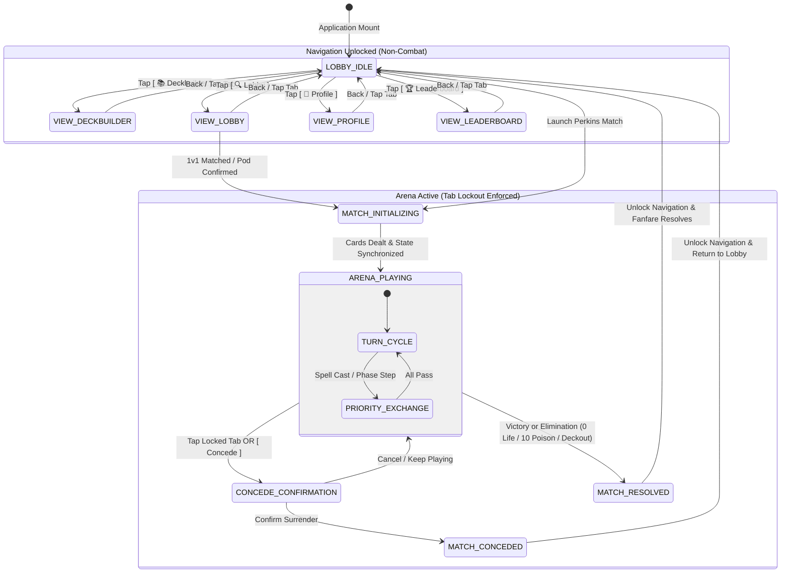
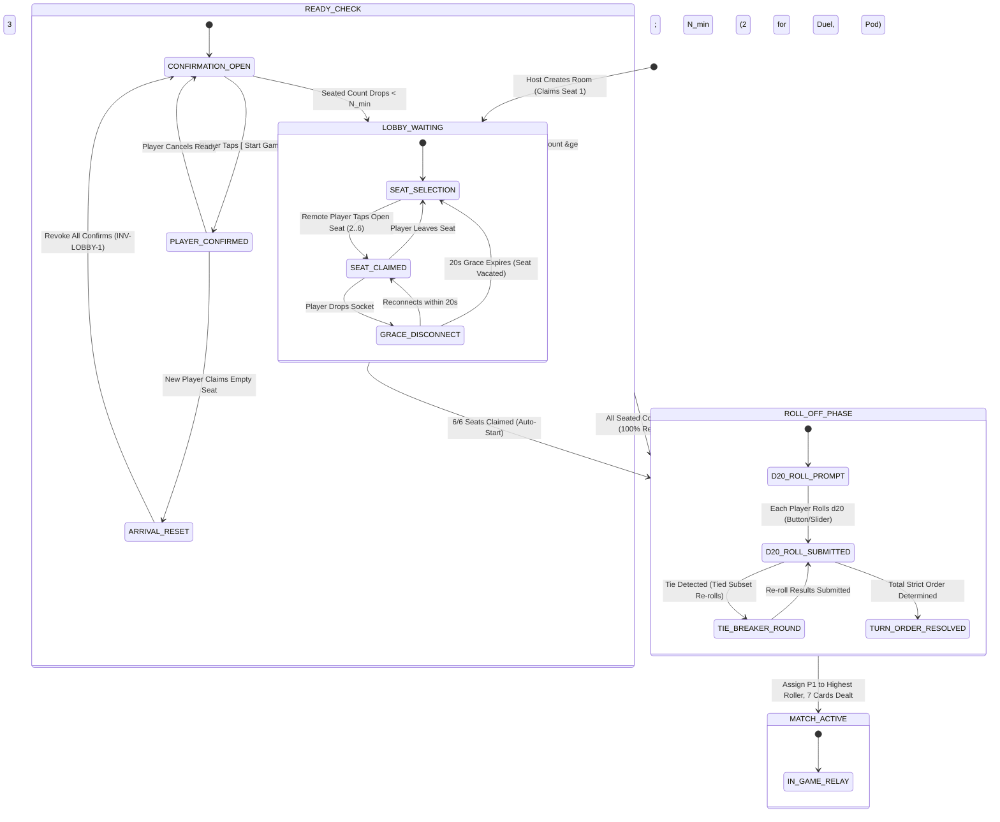
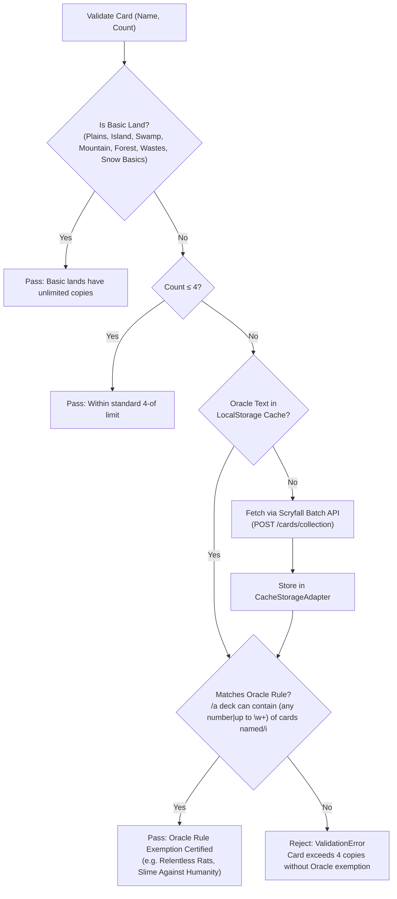

# Technical Specification: Unified Decoupled Platform, Lobby & Matchmaking, Oracle Deckbuilder & Bilingual Interaction

- **Document ID:** `SPEC-RPM-PLATFORM-014`
- **Feature Scope:** Feature 14 (`src/view/TabRouter.js`, `src/LobbyManager.js`, `src/MatchmakingQueue.js`, `src/DeckValidator.js`, `src/ActionLexer.js`, `src/app.js`, `index.html`, `test/test_unified_platform.js`)
- **System:** RPM Multiplayer / RPM Modern Tabletop Companion
- **Architect:** Argon Principal Architect
- **Status:** APPROVED / READY FOR IMPLEMENTATION
- **Revision:** 1.0.0 (Synthesizing User Questionnaire Approvals & Micro-Spec Agreements)
- **Target File Path:** `specs/FEATURE_14_UNIFIED_PLATFORM_SPEC.md`
- **Core Implementation Files:**
  - `src/view/TabRouter.js` (Decoupled Top-Level Navigation & Tab Lockout Middleware)
  - `src/LobbyManager.js` (Room Seating, Readiness Protocol, Arrival Invalidation & 20s Grace Timer)
  - `src/MatchmakingQueue.js` (1v1 FIFO Matchmaking Engine & 45s Perkins AI Watchdog)
  - `src/DeckValidator.js` (Free vs Ranked Construct & Scryfall Oracle 4-Of Override Engine)
  - `src/ActionLexer.js` (Spanish Vernacular Land Shorthands, Dice Commands & Priority Words)
  - `src/app.js` (Root Orchestrator, Hand 1-Tap Action Popover, Perk Dormancy & View Binding)
  - `index.html` (Top-Level Persistent Tab Selectors, View Mounts, Seating Grid & Perk HUD)
  - `test/test_unified_platform.js` (Comprehensive Acceptance Test Suite: 16 Verification Vectors)
- **Related Specifications & Decisions:**
  - `specs/FEATURE_1_2_CORE_INGESTION_SPEC.md` (`SPEC-RPM-INGEST-001`: Card Ingestion & Batch Scryfall Engine)
  - `specs/FEATURE_3_TABLETOP_ZONE_STATE_SPEC.md` (`SPEC-RPM-ZONE-003`: Fog-of-War Projection & Tabletop State Manager)
  - `specs/FEATURE_4_STACK_PRIORITY_SPEC.md` (`SPEC-RPM-PRIORITY-004`: Stack & Priority Flow State Machine)
  - `specs/FEATURE_5_6_DUAL_CHAT_ACTION_BUS_SPEC.md` (`SPEC-RPM-CHAT-005`: Dual-Channel Priority Chat & Action Lexer)
  - `specs/FEATURE_7_ACCORDION_UI_MODAL_SPEC.md` (`SPEC-RPM-UI-007`: Accordion Tabletop UI & Modal Host)
  - `specs/FEATURE_8_RELAY_SYNC_SPEC.md` (`SPEC-RPM-RELAY-008`: WebSocket Relay & Room Synchronization)
  - `specs/FEATURE_9_RANDOM_PERK_SPEC.md` (`SPEC-RPM-PERK-009`: Random Perk Upkeep Emblem & 2 d10 Dice Engine)
  - `specs/FEATURE_10_DECKBUILDER_AI_SPEC.md` (`SPEC-RPM-DECKAI-010`: Deckbuilder AI, Guideline Memory & Starter Decks)
  - `specs/FEATURE_11_VICTORY_FANFARE_SPEC.md` (`SPEC-RPM-FANFARE-011`: User Profile, Elo & Milestone Deck Slots)
  - `specs/FEATURE_12_BROWSER_HARNESS_SPEC.md` (`SPEC-RPM-HARNESS-012`: Playable Browser Integration Harness)
  - `specs/FEATURE_13_PERKINS_AI_SPEC.md` (`SPEC-RPM-PERKINS-013`: Perkins AI Autonomous Opponent & Coach)
  - `decisionlog.md`:
    - `DEC-001` (Tabletop Companion Scope vs Automated Rules Engine)
    - `DEC-002` (Intent Staging & Elimination of Acoustic Mutation Paradox)
    - `DEC-005` (Zero-Knowledge Fog-of-War Projection)
    - `DEC-008` (Dual-Channel Priority Chat)
    - `DEC-009` (Automatic Priority Shift & 15-Second Stack Alarm)
    - `DEC-010` (Bilingual Web Speech: Spanish Default, English Secondary)
    - `DEC-013` (Upkeep Perk Emblem, Turn Scaling T2/T4, 2–6 Player Scaling, Instagram Audio)
    - `DEC-014` (CR 603.3d Target Declaration Timing & Birthday Perk Match)
    - `DEC-015` (Argon Systems Audit: Invariant Hardening `INV-RING-1` to `INV-HARNESS-2`)
    - `DEC-018` (Perkins AI Opponent & Dual-Mode Transport Adapter)

---

## 1. Executive Summary & Architectural Invariant Hierarchy

Feature 14 unifies the RPM Multiplayer Tabletop Companion into a decoupled, intuitive, and complete digital card tabletop platform. It addresses all five core requirements established in user feedback through formal mathematical invariants, strict state machines, and resilient distributed error handling:

```mermaid
flowchart TD
    subgraph CoreInvariants["Authoritative Architectural Invariants"]
        INV1["<b>INV-LOCKOUT-1</b><br/>Tab Lockout Invariant<br/>(Arena Active = Non-Battle Tabs Disabled)"]
        INV2["<b>INV-LOBBY-1</b><br/>Dynamic Readiness Invalidation<br/>(New Arrival / Drop = Reset Confirms)"]
        INV3["<b>INV-LOBBY-2</b><br/>Room Seating & Capacity Scaling<br/>(N &ge; Min Enable Start, N = 6 Auto-Start)"]
        INV4["<b>INV-LOBBY-3</b><br/>Pre-Game Lobby Disconnect Grace<br/>(20s Timer Before Seat Vacate)"]
        INV5["<b>INV-QUEUE-1</b><br/>FIFO 1v1 Queue & 45s Watchdog<br/>(Atomic Pairing + Perkins Prompt)"]
        INV6["<b>INV-DECK-1</b><br/>Oracle 4-Of Override Resolution<br/>(Cached Scryfall Unlimited Card Rule)"]
        INV7["<b>INV-PERK-UI-1</b><br/>Upkeep Dormancy & Dice Flow<br/>(Turn &lt; T_unlock Visible Dormancy)"]
        INV8["<b>INV-TURNSORT-1</b><br/>Pre-Game d20 Roll-Off & Tie-Break<br/>(Highest First, Tie Re-Rolls, Assigns P1)"]
    end

    INV1 --> INV2
    INV2 --> INV3
    INV3 --> INV4
    INV4 --> INV5
    INV5 --> INV6
    INV6 --> INV7
    INV7 --> INV8
```



### 1.1 Invariant Formal Definitions

| Invariant ID | Name | Formal Mathematical Definition | Enforcement Scope |
| :--- | :--- | :--- | :--- |
| **`INV-LOCKOUT-1`** | **Tab Lockout Invariant** | While `matchState.status === 'ACTIVE'`, navigation to $\mathcal{T}_{\text{locked}} = \{\text{Deckbuilder}, \text{Profile}, \text{Leaderboard}\}$ is strictly prohibited for active players: $\forall t \in \mathcal{T}_{\text{locked}}, \text{canNavigate}(t) = \text{false}$. Active players must conclude match or confirm `CONCEDE_MATCH`. | `TabRouter.canNavigate()`, `TabletopUI.js`, `app.js` |
| **`INV-LOBBY-1`** | **Dynamic Readiness Invalidation** | For room $R$ in `READY_CHECK` with seated set $S$, if at time $t_2$, $|S(t_2)| \neq |S(t_1)|$ or $\exists p \in S : \text{status}(p, t_2) \neq \text{status}(p, t_1)$, then all confirmations are revoked: $\forall p \in S, \text{isReady}(p) \leftarrow \text{false}$. | `LobbyManager.evaluateReadiness()`, `relay.js` |
| **`INV-LOBBY-2`** | **Room Seating & Capacity Scaling** | Let $N_{\text{min}} = 2$ if room is 1v1 duel or private 2-player custom room; else $N_{\text{min}} = 3$ for multiplayer pods. $\text{canStart} \iff |S| \ge N_{\text{min}}$. When $\forall p \in S, \text{isReady}(p) = \text{true} \lor |S| = 6$, room transitions to `ROLL_OFF_PHASE`. | `LobbyManager.js`, `relay.js` |
| **`INV-LOBBY-3`** | **Pre-Game 20s Grace Timer** | If seated player $p$ disconnects during `LOBBY_WAITING` or `READY_CHECK`, slot enters `DISCONNECTED` with grace timer $\Delta t = 20\text{s}$. If $p$ reconnects within $\Delta t$, slot is preserved; if $\Delta t$ expires, slot is vacated and `INV-LOBBY-1` triggers. | `LobbyManager.js`, `relay.js` |
| **`INV-QUEUE-1`** | **FIFO 1v1 Queue & 45s Watchdog** | Matchmaking queue $\mathcal{Q}$ pairs players strictly in FIFO order. If wait time $t_{\text{wait}} \ge 45\text{s}$, client surfaces prompt offering instant match vs. Perkins AI or continued queue. | `MatchmakingQueue.js`, `app.js` |
| **`INV-DECK-1`** | **Oracle 4-Of Override Resolution** | For non-basic card $C$, if $\text{count}(C) > 4$, $C$ is valid iff $C.\text{oracleText} \models \text{REGEX\_UNLIMITED\_RULE}$. | `DeckValidator.js`, `ScryfallService.js` |
| **`INV-PERK-UI-1`** | **Upkeep Dormancy & Dice Flow** | If $T < T_{\text{unlock}}$ ($T_{\text{unlock}} = 2$ for $N \ge 3$; $4$ for 1v1), Perk Emblem displays `"Dormant until Turn T_unlock"`. No dice animation triggers until $T = T_{\text{unlock}}$. | `TabletopUI.js`, `RandomPerkEngine.js` |
| **`INV-TURNSORT-1`** | **Pre-Game d20 Roll-Off & Tie-Break** | After room start clearance, each seated player rolls a d20 ($1 \le r \le 20$). Turn order is sorted descending: $r_{(1)} > r_{(2)} > \dots > r_{(N)}$. If any players tie, they re-roll iteratively until a strict total order is established. Highest roller ($r_{(1)}$) takes Turn 1. | `TurnRollOffManager.js`, `relay.js`, `app.js` |

---

## 2. Decoupled Top-Level Navigation & Tab State Machine

### 2.1 Tab Layout Architecture
The application layout decouples into a persistent global navigation header and 5 mutually exclusive view mounts:

```
+---------------------------------------------------------------------------------------------------------+
|  ⚔️ RPM TABLETOP   [ 🏟️ Arena ]  [ 📚 Deckbuilder ]  [ 🔍 Lobby ]  [ 👤 Profile ]  [ 🏆 Leaderboard ]   |
|  Status: 🟢 Connected  |  Active: P1 (Untap)  |  🔊 Fanfare  |  🤖 Play vs Perkins                      |
+---------------------------------------------------------------------------------------------------------+
|                                                                                                         |
|  [ #view-host Container: Exactly 1 active view visible at any given time ]                             |
|                                                                                                         |
|  - #view-arena: Real-Time Tabletop Battlefield, Accordion Opponents, Stack, Hand, Perk HUD            |
|  - #view-deckbuilder: Mode Selector (Free/Ranked), Deck Slots (1..5), Scryfall Ingest, 4-Of Validator   |
|  - #view-lobby: Open Room Directory, 1v1 Find Match Button, Custom Room Seating Grid (1..6)             |
|  - #view-profile: Lifetime Elo, Wins/Losses, Milestone Deck Slot Gauge, Instagram A-to-B Audio Picker  |
|  - #view-leaderboard: Global Ratings, Match History Archive, Live Spectator Room Browser                |
|                                                                                                         |
+---------------------------------------------------------------------------------------------------------+
```

### 2.2 Tab Lockout State Machine (`INV-LOCKOUT-1`)



#### Lockout Enforcement Rules:
1. When `app.isMatchActive() === true`, tabs `Deckbuilder`, `Profile`, and `Leaderboard` receive the CSS class `.tab-locked`, rendering a padlock icon (🔒) and disabled cursor.
2. Clicking a locked tab or pressing navigation hotkeys does NOT navigate. It displays an accessible modal dialog:
   ```
   +--------------------------------------------------------------------+
   | ⚠️ ACTIVE MATCH IN PROGRESS                                         |
   |                                                                    |
   | You are currently in an active match in the Arena. Leaving this     |
   | screen will immediately CONCEDE the game to your opponent.         |
   |                                                                    |
   | [ Keep Playing ]                [ Concede Match & Exit ]            |
   +--------------------------------------------------------------------+
   ```
3. Spectators (`ws.isSpectator === true`) are NOT locked. They may freely toggle between the Arena, Leaderboard, and Profiles with an omnipresent `"Return to Live Match"` pill banner.

---

## 3. Lobby & Matchmaking Subsystem Specification

### 3.1 Multiplayer Room Seating & Readiness Protocol (`INV-LOBBY-1`, `INV-LOBBY-2`, `INV-LOBBY-3`)



### 3.2 Seating Protocol Rules:
1. **Seat Selection:** Any unseated connected user sees 6 circular seat pods. Empty seats display `[ Claim Seat X ]`. Occupied seats show the player's name, avatar, and ping.
2. **Minimum Players to Start ($N_{\text{min}}$):**
   - For private 2-player custom rooms (`maxPlayers === 2` or `roomType === 'DUEL'`): $N_{\text{min}} = 2$.
   - For multiplayer pods (`maxPlayers > 2`): $N_{\text{min}} = 3$.
3. **`[ Start Game ]` Button State:**
   - Disabled (`opacity: 0.5`, `pointer-events: none`) when $|S_{\text{seated}}| < N_{\text{min}}$.
   - Active (`btn-primary`) when $|S_{\text{seated}}| \ge N_{\text{min}}$. Tapping it toggles the player's ready state: `isReady = !isReady`.
4. **Dynamic Arrival Invalidation (`INV-LOBBY-1`):**
   - If players 1 and 2 are confirmed, and player 3 joins seat 3 before the game starts, the server resets:
     ```javascript
     for (const slot of this.slots.values()) {
       slot.isReady = false;
     }
     this.broadcast({ type: 'LOBBY_READY_RESET', reason: 'NEW_PLAYER_ARRIVED', newPlayerName: slot.playerName });
     ```
   - All client buttons return to `[ Start Game ]` (unconfirmed state).
5. **Full Capacity Auto-Start:** When the 6th seat is claimed in a 6-player pod, the server initiates an immediate 3-second countdown banner (`[ Room Full! Launching in 3... 2... 1... ]`) and transitions to `ROLL_OFF_PHASE`.
6. **20-Second Disconnect Grace Timer (`INV-LOBBY-3`):**
   - If a seated player loses their WebSocket connection, their avatar turns amber with a countdown badge: `[ Reconnecting (19s)... ]`.
   - If reconnected with their 256-bit `seatToken` within 20s, the slot restores cleanly.
   - If 20s elapses, the slot is vacated, readiness confirmations reset, and an open seat is restored.

### 3.4 Pre-Game d20 Roll-Off & Tie-Break Turn Sorting (`INV-TURNSORT-1`)

At match clearance, the server transitions the room to `ROLL_OFF_PHASE` before dealing cards or entering Turn 1:

1. **d20 Roll Prompt & Interaction**:
   - Each seated player sees an interactive d20 overlay: `[ 🎲 Roll d20 for Turn Order ]` (with button tap or slide-to-roll toggle).
   - In solo play vs. Perkins AI, Perkins automatically rolls after a natural delay (800ms).
   - Roll values are generated authoritatively via CSPRNG ($1 \le r \le 20$).
2. **Animation & Presentation**:
   - The die spins with a 1.2-second 3D CSS animation and settles on the player's number.
3. **Strict Tie-Breaking Algorithm**:
   - If two or more players roll the same highest value (or tie in any relative position), the server detects the tie:
     $$\exists p_i, p_j \in S : r(p_i) = r(p_j)$$
   - Tied players enter an immediate Tie-Breaker round:
     - Un-tied ranks are locked.
     - Tied players receive a re-roll prompt: `[ 🎲 Re-Roll d20 (Tie Breaker!) ]`.
     - Re-rolling repeats iteratively until all ties are broken and a strict total order is established:
       $$r_{(1)} > r_{(2)} > \dots > r_{(N)}$$
4. **Turn Rotation & First Player Assignment**:
   - The turn rotation array `priorityMachine.players` is sorted strictly descending by roll result:
     $$\text{players} \leftarrow [P_{(1)}, P_{(2)}, \dots, P_{(N)}]$$
   - First player (`activePlayerId`) is assigned to the highest roller $P_{(1)}$.
   - The UI displays a 2.5-second celebratory banner:
     `🥇 1st: Alice (Roll 19) | 🥈 2nd: Bob (Roll 15) | 🥉 3rd: Perkins (Roll 8)`
   - After 2.5 seconds, opening hands (7 cards) are dealt, and Turn 1 begins on UNTAP!

### 3.3 1v1 Matchmaking Queue & 45-Second Watchdog (`INV-QUEUE-1`)
- **Queue Flow:**
  1. User navigates to `🔍 Lobby` tab and clicks `[ Find 1v1 Match ]`.
  2. Client dispatches `QUEUE_JOIN { playerId, playerName, format: 'MODERN', deckId }`.
  3. Server appends ticket to FIFO queue `MatchmakingQueue`.
  4. Client displays pulsating search banner: `[ 🔍 Searching for Opponent... 00:12 ] [ Cancel ]`.
  5. When two tickets exist, server extracts $(T_1, T_2)$, generates room code, assigns slots 1 and 2, and dispatches `MATCH_FOUND`. Both clients auto-switch to `🏟️ Arena`.
- **45-Second Timeout Watchdog:**
  - If no match is found after 45 seconds, the search banner expands into an interactive decision modal:
    ```
    +--------------------------------------------------------------------+
    | ⏳ NO OPPONENT FOUND (45s ELAPSED)                                 |
    |                                                                    |
    | The 1v1 matchmaking queue is currently quiet. What would you like |
    | to do?                                                             |
    |                                                                    |
    | [ 🤖 Play vs Perkins AI (Instant) ]       [ ⏳ Keep Waiting ]       |
    |                        [ ✖️ Cancel Search ]                        |
    +--------------------------------------------------------------------+
    ```
  - Selecting `[ 🤖 Play vs Perkins AI ]` cancels the queue ticket and launches a solo duel against Perkins AI with 0ms latency.
  - Selecting `[ ⏳ Keep Waiting ]` dismisses the modal and continues the queue search counter.

---

## 4. Deckbuilder Subsystem & Scryfall Oracle 4-Of Override

### 4.1 Two Format Modes
The Deckbuilder interface supports two distinct operational modes via top-level tab buttons:

```
+-----------------------------------------------------------------------------+
|  [ ⚡ Free Construct ]                    [ 🏆 Ranked Construct (Modern) ]  |
+-----------------------------------------------------------------------------+
|  Format Rules:                             Format Rules:                    |
|  - Any card in MTG history                 - Legal in official Modern pool  |
|  - Zero banlist restrictions               - WotC Modern banlist enforced   |
|  - Min 60 main / Max 15 sideboard          - Min 60 main / Max 15 sideboard |
|  - 4-of limit with Oracle override         - 4-of limit with Oracle override|
+-----------------------------------------------------------------------------+
```

### 4.2 Active Deck Slots & Milestone Progression (`INV-AUDIO-6`)
- Each format maintains **1 active deck slot** by default.
- Additional slots (up to 5 per mode) unlock strictly monotonically via `ProfileManager.evaluateDeckSlotProgression()` based on lifetime wins ($W$) or Random Perks triggered ($P$):

| Slot Number | Unlock Requirement | Milestone Tier Name |
| :--- | :--- | :--- |
| **Slot 1** | 0 Wins / 0 Perks (Base Active) | Apprentice (Default) |
| **Slot 2** | $\ge 5$ Wins OR $\ge 10$ Perks | Journeyman Tabletopist |
| **Slot 3** | $\ge 15$ Wins OR $\ge 25$ Perks | Adept Planeswalker |
| **Slot 4** | $\ge 30$ Wins OR $\ge 50$ Perks | Veteran High Roller |
| **Slot 5** | $\ge 50$ Wins OR $\ge 100$ Perks | Grandmaster of the Arena |

Locked deck slots render a padlock icon 🔒 and display progress toward the next unlock milestone (e.g. `[ Slot 2: 3/5 Wins or 7/10 Perks ]`).

### 4.3 Scryfall Oracle 4-Of Override Algorithm (`INV-DECK-1`)



#### Pre-Compiled Supported Canonical Cards:
- *Relentless Rats* ("A deck can contain any number of cards named Relentless Rats.")
- *Persistent Petitioners* ("A deck can contain any number of cards named Persistent Petitioners.")
- *Shadowborn Apostle* ("A deck can contain any number of cards named Shadowborn Apostle.")
- *Rat Colony* ("A deck can contain any number of cards named Rat Colony.")
- *Dragon's Approach* ("A deck can contain any number of cards named Dragon's Approach.")
- *Slime Against Humanity* ("A deck can contain any number of cards named Slime Against Humanity.")
- *Templar Knight* ("A deck can contain any number of cards named Templar Knight.")
- *Seven Dwarves* ("A deck can contain up to seven cards named Seven Dwarves.")

---

## 5. Random Perk Upkeep Timing & Presentation

### 5.1 Format Scaling & Dormancy Presentation (`INV-PERK-UI-1`, `INV-PERK-4`)
- **Multiplayer Pods ($\ge 3$ players):** Random Perk unlocks on **Turn 2**.
- **1v1 Duels (2 players):** Random Perk unlocks on **Turn 4**.

```
+-----------------------------------------------------------------------------+
|  COMMAND ZONE EMBLEM HUD:                                                   |
|                                                                             |
|  [ Turns 1–3 in 1v1 / Turn 1 in Pod ]:                                     |
|  🔮 PERK EMBLEM: Dormant until Turn 4 (Current: Turn 1)                      |
|  [ Progress: =======>                     ] 25%                             |
|                                                                             |
|  [ Turn 4 Upkeep Arrives ]:                                                 |
|  🔮 PERK EMBLEM: Upkeep Trigger Entering the Stack!                         |
|  [ 🎲 Roll 2 d10 Dice ] ➔ Animate: [ Violet 10s ]  [ Aquamarine 1s ]       |
+-----------------------------------------------------------------------------+
```

### 5.2 2 d10 Dice Rolling Presentation & Animation Flow
1. When the active player enters the Upkeep step of the unlock turn ($T \ge T_{\text{unlock}}$):
   - `RandomPerkEngine` places Step 1 (Upkeep Trigger) on the MTG Stack.
   - The UI reveals `#perk-dice-container`.
   - The dice containers initiate a 1.2-second CSS 3D tumble or high-speed number scramble animation (cycling 0..9 at 30ms intervals).
2. The server dispatches authoritative CSPRNG roll `{ tens: d1, ones: d2 }`:
   - At $t = 800\text{ms}$, the Violet die locks on `tens`.
   - At $t = 1200\text{ms}$, the Aquamarine die locks on `ones`.
3. Outcome resolution:
   - **Perk Matched:** Emits victory chime, updates badge: `[ Perk #55: Twin Bolt ]`, pushes Step 2 onto the Stack, and triggers the 15-second Stack Alarm for responses.
   - **Roll Miss:** Emits neutral notification: `[ Roll 37: Miss — No Perk Triggered ]`, stack resolves cleanly, and priority returns to the active player.

---

## 6. Tabletop Arena 1-Tap Interaction & Spanish Lexer Expansion

### 6.1 Hand Card Floating 1-Tap Action Popover
When the player clicks or taps any card in their hand, a compact, floating action bar renders directly above the card:

```
+-----------------------------------------------------------+
|  [ Card Art ]                                             |
|  Steam Vents — Land — Island Mountain                     |
+-----------------------------------------------------------+
|  [ 🏔️ Play Land ]   [ 🔍 Inspect (Scryfall) ]   [ ✖️ ]     |
+-----------------------------------------------------------+

+-----------------------------------------------------------+
|  [ Card Art ]                                             |
|  Lightning Bolt — {R} — Instant                           |
+-----------------------------------------------------------+
|  [ ⚡ Cast to Stack ]  [ 🔍 Inspect (Scryfall) ]  [ ✖️ ]   |
+-----------------------------------------------------------+
```

#### Behavioral Rules:
1. **Priority & Phase Validation:**
   - `[ 🏔️ Play Land ]`: Enabled ONLY if active player, during Main Phase 1 or 2, with an empty stack, and lands played this turn $< 1$. Otherwise disabled with an explanatory tooltip.
   - `[ ⚡ Cast to Stack ]`: Enabled whenever the player holds priority. Tapping it pushes the card to the MTG Stack, triggers the 15-second Stack Alarm, and shifts priority.
2. **Accessible Dismissal:** Tapping outside the card, clicking `[ ✖️ ]`, or pressing `Escape` dismisses the popover immediately.

### 6.2 Expanded ActionLexer Spanish Vernacular Grammar
We expand `ActionLexer.js` to parse natural Spanish MTG table talk:

```javascript
// Spanish Land Drops (including Color Shorthands)
const REGEX_LAND_ES = /^(?:bajo|juego|tierra|pongo)\s+(?:un\s+|una\s+)?([a-z0-9\s',/-]+)$/i;

const SPANISH_COLOR_LAND_MAP = Object.freeze({
  'tierra negra': 'Swamp',
  'tierra azul': 'Island',
  'tierra roja': 'Mountain',
  'tierra verde': 'Forest',
  'tierra blanca': 'Plains',
  'pantano': 'Swamp',
  'isla': 'Island',
  'montana': 'Mountain',
  'bosque': 'Forest',
  'llanura': 'Plains',
  'fetch': 'Fetchland',
  'shock': 'Shockland',
  'shockland': 'Shockland',
  'trioma': 'Triome'
});

// Dice & Perk Rolling
const REGEX_ROLL_DICE_BILINGUAL = /^(?:roll\s*(?:dice|dados|perk|d10)?|tirar\s*(?:dados|dado|perk|d10)?|dados?)$/i;

// Spanish Life Declarations
const REGEX_LIFE_SPANISH_VERBAL = /^(?:me\s+curo|me\s+subo|subo|gano)\s*(\d+)|(?:quedo\s+en|estoy\s+en|vida\s+a)\s*(\d+)$/i;

// Spanish Turn & Priority Shorthands
const REGEX_PASS_ES_EXPANDED = /^(?:paso(?:\s+turno|\s+prioridad)?|cedo(?:\s+turno|\s+prioridad)?|fin\s+de\s+turno|tu\s+turno|listo|pasa)$/i;
```

---

## 7. Concrete Data Structures & TypeScript Interfaces

```typescript
export interface PlayerSlot {
  slotId: number;                  // 1 to 6
  playerId: string;                // Session or cryptographic ID
  playerName: string;              // Display name
  isHost: boolean;                 // Slot 1 is host
  isReady: boolean;                // Readiness toggle
  connectionStatus: 'CONNECTED' | 'DISCONNECTED' | 'ABANDONED';
  joinedAt: number;
  graceTimerRemainingMs?: number;  // 20s grace period for lobby drops
}

export interface RoomLobbyState {
  roomCode: string;
  status: 'LOBBY_WAITING' | 'READY_CHECK' | 'MATCH_ACTIVE' | 'MATCH_COMPLETED';
  roomType: 'DUEL_1V1' | 'POD_MULTIPLAYER';
  maxPlayers: number;              // 2 or 6
  minPlayersToStart: number;       // 2 for duel, 3 for pod
  slots: Record<number, PlayerSlot | null>;
  seatedCount: number;
  readyCount: number;
  canStart: boolean;
  isAllReady: boolean;
}

export interface QueueTicket {
  ticketId: string;
  playerId: string;
  playerName: string;
  joinedAt: number;
  format: 'MODERN' | 'FREE';
  deckId: string;
}

export interface DeckValidationReport {
  isValid: boolean;
  errors: Array<{
    cardName: string;
    count: number;
    reason: string;
    isOracleExempt?: boolean;
  }>;
  mainCount: number;
  sideboardCount: number;
  format: 'FREE_CONSTRUCT' | 'RANKED_CONSTRUCT';
}
```

---

## 8. Acceptance Test Suite Specification (`test/test_unified_platform.js`)

| Test Vector ID | Description | Invariant / Rule | Expected Outcome |
| :--- | :--- | :--- | :--- |
| **`TC-PLATFORM-01`** | Tab Navigation Initial State | `INV-LOCKOUT-1` | App loads with all 5 tabs unlocked and clickable; active view is `ARENA` or `LOBBY`. |
| **`TC-PLATFORM-02`** | Tab Lockout During Active Match | `INV-LOCKOUT-1` | When `matchState.status === 'ACTIVE'`, clicking `Deckbuilder` or `Profile` is blocked; surfaces Concede modal. |
| **`TC-PLATFORM-03`** | Concede Exits Lockout | `INV-LOCKOUT-1` | Confirming Concede finishes match, archives state, and unlocks all 5 navigation tabs. |
| **`TC-PLATFORM-04`** | Spectator Exemption | `INV-LOCKOUT-1` | Connected spectator can freely toggle between Arena, Leaderboard, and Profile without forfeiting. |
| **`TC-PLATFORM-05`** | 2-Player Private Room Mutual Ready | `INV-LOBBY-2` | In 2-player private room, `[ Start Game ]` activates at 2 seated players; starts match only when both confirm. |
| **`TC-PLATFORM-06`** | 3-Player Multiplayer Pod Start | `INV-LOBBY-2` | In 6-player room, button is disabled with 2 players; activates when 3rd player sits. |
| **`TC-PLATFORM-07`** | Dynamic Arrival Invalidation | `INV-LOBBY-1` | Player 1 & 2 confirm ready. Player 3 sits $\implies$ ready status for Player 1 & 2 resets to `false`. |
| **`TC-PLATFORM-08`** | Full Capacity 6/6 Auto-Start | `INV-LOBBY-2` | When 6th player claims the final seat in a pod, room auto-starts match. |
| **`TC-PLATFORM-09`** | Pre-Game 20s Disconnect Grace | `INV-LOBBY-3` | Disconnected player retains seat for 20s; seat is vacated and ready reset occurs if timer expires. |
| **`TC-PLATFORM-10`** | 1v1 Queue FIFO Pairing | `INV-QUEUE-1` | Player A and B enter queue $\implies$ paired into unique 2-player match; zero duplicate pairings. |
| **`TC-PLATFORM-11`** | 1v1 Queue 45s Perkins Watchdog | `INV-QUEUE-1` | Queue timer $\ge 45\text{s}$ surfaces prompt offering instant match vs. Perkins AI. |
| **`TC-PLATFORM-12`** | Free Construct 4-Of Scryfall Oracle Override | `INV-DECK-1` | Deck with 20 *Relentless Rats* passes validation; deck with 5 *Lightning Bolt* fails validation. |
| **`TC-PLATFORM-13`** | Ranked Construct Modern Banlist Enforcement | `INV-DECK-1` | Deck containing banned Modern card fails Ranked validation; passes Free Construct validation. |
| **`TC-PLATFORM-14`** | Milestone Deck Slot Capacity | `INV-AUDIO-6` | Profile with 0 wins has 1 active slot; profile with 5 wins unlocks Slot 2; rejects slot 3 selection. |
| **`TC-PLATFORM-15`** | Random Perk Upkeep Dormancy Display | `INV-PERK-UI-1` | Turn 1 in 1v1 displays "🔮 Perk: Dormant until Turn 4"; Turn 4 upkeep initiates 2 d10 dice roll. |
| **`TC-PLATFORM-16`** | Spanish Vernacular Action Lexing | Sub-2ms SLA | Lexer accurately parses `"bajo pantano"`, `"bajo una tierra negra"`, and `"roll dice"` into staged actions. |
| **`TC-PLATFORM-17`** | Pre-Game d20 Roll-Off, Tie-Break Loop & Turn Sorting | `INV-TURNSORT-1` | Each player rolls d20 ($1 \le r \le 20$). Tied players re-roll iteratively until all ties are broken. Highest roller is assigned as active player P1 for Turn 1. |

---

## 9. Implementation Directives for Flash Builder

When implementing Feature 14, the Flash Builder agent must adhere to the following sequence:
1. **Module 1 (`src/DeckValidator.js`):** Implement format validation, 4-of limit, Scryfall Oracle override regex, and caching.
2. **Module 2 (`src/ActionLexer.js`):** Add Spanish color-land mappings, dice roll expressions, expanded pass commands, and test with benchmark SLA.
3. **Module 3 (`src/LobbyManager.js` & `src/MatchmakingQueue.js`):** Build seating manager, dynamic arrival invalidator, 20s grace timer, and FIFO queue with 45s watchdog.
4. **Module 4 (`src/view/TabRouter.js`):** Implement top-level view switching, persistent header, and `INV-LOCKOUT-1` tab lockout guard with Concede modal.
5. **Module 5 (`src/app.js` & `index.html`):** Integrate tab router, hand card 1-tap popovers, and perk dormancy display into root controller.
6. **Module 6 (`test/test_unified_platform.js`):** Run the 16-vector acceptance test suite and ensure 100% pass rate.
