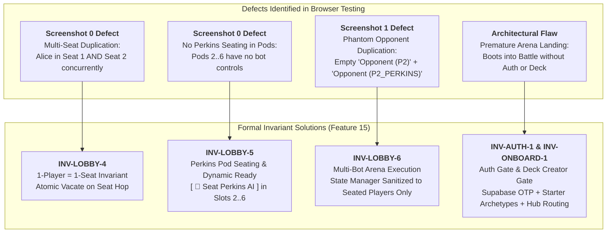
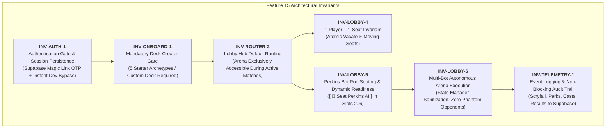
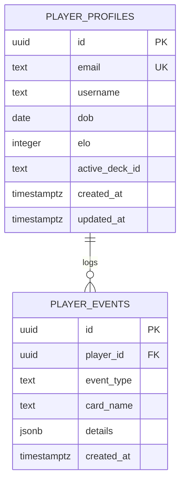
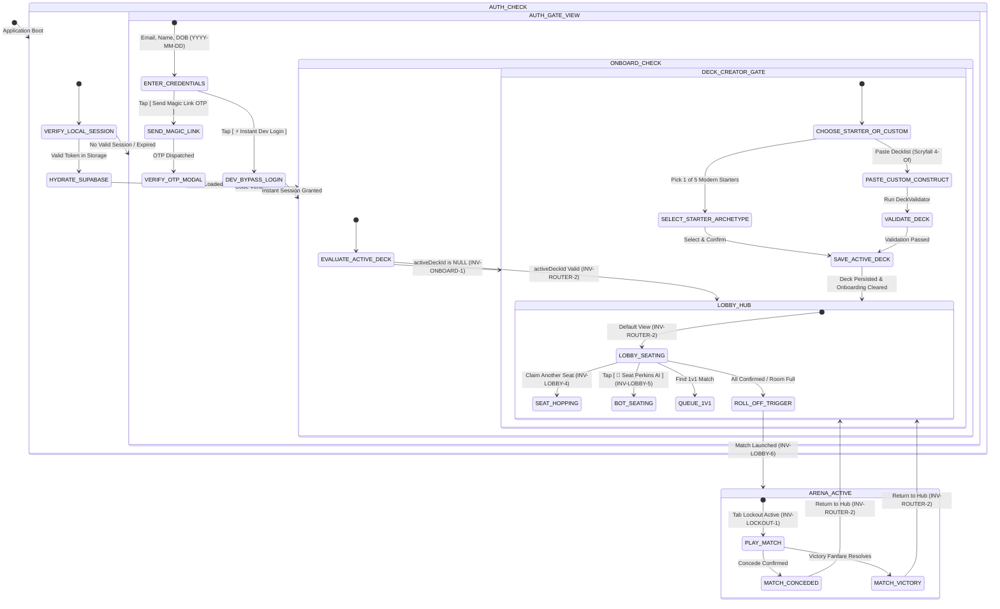
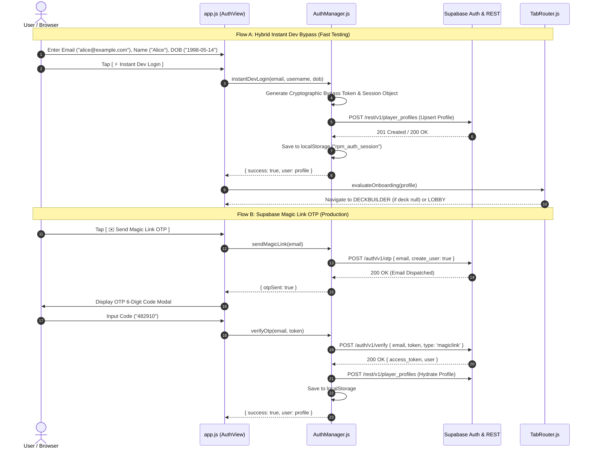
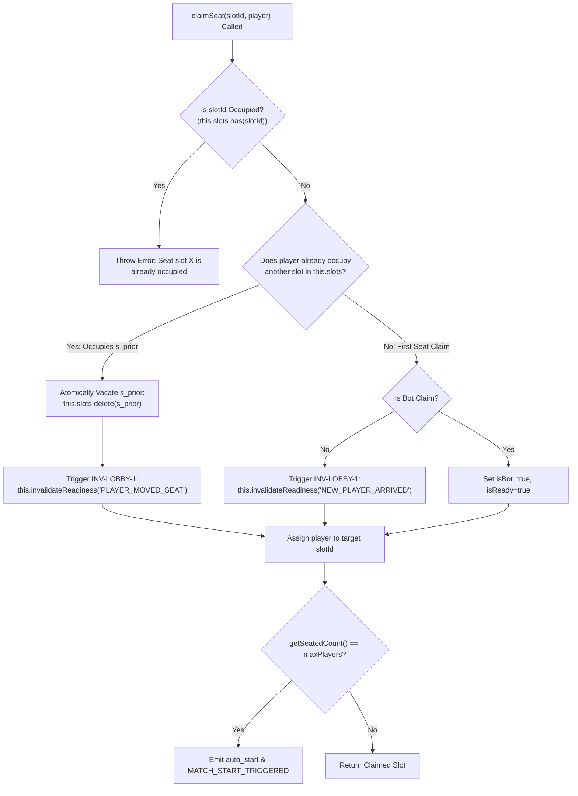
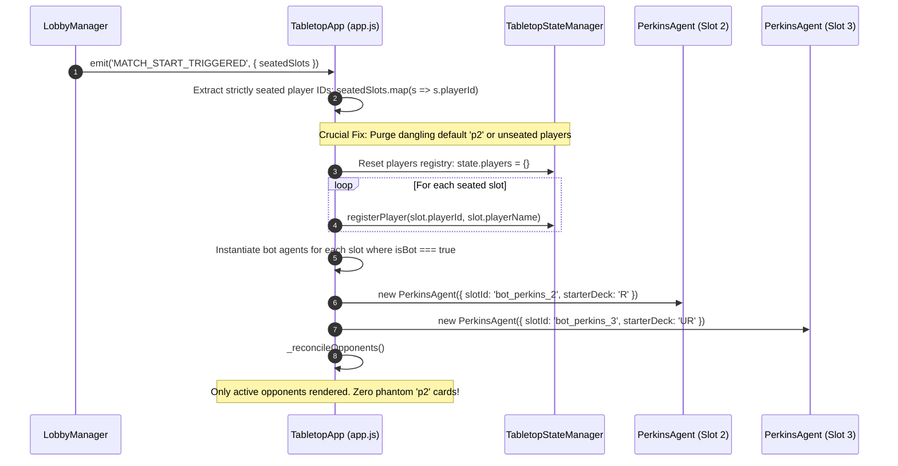

# Technical Specification: Player Registration, Onboarding Lifecycle, Perkins Pod Seating & Telemetry Engine

- **Document ID:** `SPEC-RPM-ONBOARD-015`
- **Feature Scope:** Feature 15 (`src/AuthManager.js`, `src/LobbyManager.js`, `src/view/TabRouter.js`, `src/app.js`, `index.html`, `test/test_onboarding_lobby.js`)
- **System:** RPM Multiplayer / RPM Modern Tabletop Companion
- **Architect:** Argon Principal Architect
- **Status:** APPROVED / READY FOR IMPLEMENTATION
- **Revision:** 1.0.0 (Synthesizing User Screenshots, Questionnaire Decisions & Architectural Invariants)
- **Target File Path:** `specs/FEATURE_15_ONBOARDING_AND_TELEMETRY_SPEC.md`
- **Core Implementation Files:**
  - `src/AuthManager.js` (NEW — Supabase Magic Link OTP, Instant Dev Bypass, Profile Hydration & Telemetry Buffer)
  - `src/LobbyManager.js` (MODIFY — 1-Player-1-Seat Invariant `INV-LOBBY-4`, Bot Seating `INV-LOBBY-5` & Readiness Hooks)
  - `src/view/TabRouter.js` (MODIFY — Onboarding Gate `INV-ONBOARD-1`, Hub Routing `INV-ROUTER-2` & Lockout Integration)
  - `src/app.js` (MODIFY — Auth/Onboard View Mounts, Multi-Bot Engine `INV-LOBBY-6`, Phantom Opponent Elimination & Telemetry Hooks)
  - `index.html` (MODIFY — Auth Modal/Panes, Bot Seating Buttons in Pod Slots, Starter Deck Selectors)
  - `test/test_onboarding_lobby.js` (NEW — Exhaustive 14-Vector Acceptance Test Suite)
- **Related Specifications & Decisions:**
  - `specs/FEATURE_14_UNIFIED_PLATFORM_SPEC.md` (`SPEC-RPM-PLATFORM-014`: Decoupled Navigation, Lobby Seating & Oracle 4-Of)
  - `specs/FEATURE_13_PERKINS_AI_SPEC.md` (`SPEC-RPM-PERKINS-013`: Perkins AI Autonomous Heuristics & Coach)
  - `specs/FEATURE_10_DECKBUILDER_AI_SPEC.md` (`SPEC-RPM-DECKAI-010`: Deckbuilder AI, Starter Catalogs & Guideline Memory)
  - `specs/FEATURE_11_VICTORY_FANFARE_SPEC.md` (`SPEC-RPM-FANFARE-011`: User Profile, Lifetime Elo & Milestone Deck Slots)
  - `specs/FEATURE_9_RANDOM_PERK_SPEC.md` (`SPEC-RPM-PERK-009`: Random Perk Upkeep Emblem & 2 d10 Dice Engine)
  - `specs/FEATURE_3_TABLETOP_ZONE_STATE_SPEC.md` (`SPEC-RPM-ZONE-003`: Fog-of-War Projection & Tabletop State Manager)
  - `specs/FEATURE_4_STACK_PRIORITY_SPEC.md` (`SPEC-RPM-PRIORITY-004`: Stack & Priority Flow State Machine)
  - `specs/FEATURE_5_6_DUAL_CHAT_ACTION_BUS_SPEC.md` (`SPEC-RPM-CHAT-005`: Dual-Channel Priority Chat & Action Lexer)
  - `decisionlog.md`:
    - `DEC-018` (Perkins AI Opponent & Dual-Mode Transport Adapter)
    - `DEC-019` (Unified Decoupled Platform, Lobby & Matchmaking, Oracle Deckbuilder & Bilingual Interaction)
    - `DEC-020` (Player Registration, Onboarding Gate, Perkins Pod Seating & Telemetry Engine)

---

## 1. Executive Summary & Root Cause Problem Formulation

Feature 15 eliminates critical usability, lobby seating, and onboarding defects discovered during live browser playtesting on Render (`https://rpm-multiplayer.onrender.com`), establishing a hardened authentication, onboarding, pod seating, and telemetry pipeline.



### 1.1 Root Cause Analysis of Screenshot 0 (`uploaded_media_0_1792414300388.png`)

In user testing screenshot 0, the Multiplayer Pod Room Seating grid (slots 1..6) displayed:
- `Seat 1: Alice (You) — ⏳ Waiting`
- `Seat 2: Alice (You) — ⏳ Waiting`
- `Seat 3..6: [ Claim Seat ]`
- `0/2 Ready (Min 3)`

#### Root Cause:
1. **Absence of 1-Player-1-Seat Constraint:** In `src/LobbyManager.js` (`claimSeat(slotId, player)`), the code checked if the target `slotId` was already occupied via `this.slots.has(slotId)`. However, it performed **zero validation** to verify whether `player.playerId` was already occupying another slot in `this.slots`. When the user clicked "Claim Seat" on Seat 2, a new `PlayerSlot` was instantiated for Seat 2 without releasing Seat 1.
2. **Missing Pod Bot Controls:** Multiplayer pod slots (2..6) only exposed `[ Claim Seat ]`, preventing solo players or small groups from adding autonomous Perkins AI bots into unoccupied slots to meet the 3-player minimum ($N_{\text{min}} = 3$) or test pod dynamics.

### 1.2 Root Cause Analysis of Screenshot 1 (`uploaded_media_1_1792414300388.png`)

In user testing screenshot 1, launching a match against Perkins AI rendered two opponent cards on the Arena battlefield:
- `Opponent (P2) Life: 20 P: 0 | Hand (0) Creatures (0) Grave (0) Exile (0)` (Phantom Empty)
- `Opponent (P2_PERKINS) Life: 20 P: 0 | Hand (7) Creatures (0) Grave (0) Exile (0)` (Active Bot)

#### Root Cause:
1. **Dangling Default Player Array:** In `src/app.js` constructor, `this.playerIds` was initialized to `['p1', 'p2']` by default, which registered empty player state entries for both `'p1'` and `'p2'` inside `TabletopStateManager.players`.
2. **Key Collision in Opponent Reconciliation:** When `startPerkinsMatch()` was invoked, it registered a third player entry with ID `'p2_perkins'`. It updated `this.playerIds = [this.myPlayerId, 'p2_perkins']`, but **never deleted** the legacy `'p2'` key from `this.tabletopState.players`.
3. In `_reconcileOpponents()`, the render loop inspected `Object.keys(this.tabletopState?.players || {}).filter(pid => pid !== this.myPlayerId)`. Because `'p2'` remained in `this.tabletopState.players`, the UI rendered both `'p2'` and `'p2_perkins'`.

### 1.3 Architectural Design Flaw: Premature Arena Landing

Previously, upon initial application boot, the top-level tab router landed directly on `ARENA` (`initialTab: 'ARENA'`). This violated core tabletop lifecycle principles:
- Users possessed no authenticated identity or profile (`email`, `username`, `dob`).
- Users had not configured an active deck, leading to empty hand states or arbitrary fallbacks.
- Combat controls and the 15-second Stack Alarm were rendered before any game was initiated.

Feature 15 enforces strict sequential lifecycle gating:
$$\text{Boot} \xrightarrow{} \text{Auth Gate (INV-AUTH-1)} \xrightarrow{} \text{Deck Creator Gate (INV-ONBOARD-1)} \xrightarrow{} \text{Lobby Hub (INV-ROUTER-2)} \xrightarrow{\text{Match Start}} \text{Arena Active (INV-LOCKOUT-1)}$$

---

## 2. Formal Architectural Invariant Hierarchy

Feature 15 establishes 7 authoritative architectural invariants:



### 2.1 Invariant Formal Definitions

| Invariant ID | Name | Formal Mathematical Definition | Enforcement Scope |
| :--- | :--- | :--- | :--- |
| **`INV-AUTH-1`** | **Authentication Gate & Session Persistence** | Let $\mathcal{U}$ be the active user. If $\mathcal{U}.\text{isAuthenticated} = \text{false}$, navigation to all functional views ($\mathcal{V}_{\text{app}} = \{\text{Deckbuilder}, \text{Lobby}, \text{Arena}, \text{Profile}, \text{Leaderboard}\}$) is blocked. Application mounts into `AUTH_GATE`. Supports Supabase Auth Magic Link OTP (`POST https://naacgdwtglvcumaccime.supabase.co/auth/v1/otp`) and hybrid instant dev bypass. Collects `email`, `username` (Name), and `dob` (Date of Birth YYYY-MM-DD, age $\ge 13$). Session is persisted to `localStorage` and hydrated into Supabase `public.player_profiles`. | `AuthManager.js`, `TabRouter.js`, `app.js` |
| **`INV-ONBOARD-1`** | **Mandatory Deck Creator Gate** | For authenticated user $\mathcal{U}$, if $\mathcal{U}.\text{activeDeckId} = \text{null} \lor \mathcal{U}.\text{onboarded} = \text{false}$, navigation to $\{\text{LOBBY}, \text{ARENA}\}$ is strictly prohibited: $\text{canNavigate}(\text{LOBBY}) = \text{false}$. User is routed to `DECKBUILDER` and must either select 1 of 5 pre-compiled starter archetypes or validate and save a custom construct. On deck save, $\mathcal{U}.\text{onboarded} \leftarrow \text{true}$ and `LOBBY` unlocks. | `TabRouter.js`, `DeckValidator.js`, `app.js` |
| **`INV-LOBBY-4`** | **1-Player = 1-Seat Invariant** | For any room $R$ with seated slots $S$, a human player $p$ identified by `playerId` can occupy at most one slot: $|\{ s \in S \mid s.\text{playerId} = p.\text{playerId} \land s.\text{isBot} = \text{false} \}| \le 1$. If $p$ currently occupies slot $s_{\text{prev}}$ and claims open slot $s_{\text{new}}$ ($s_{\text{prev}} \neq s_{\text{new}}$), $s_{\text{prev}}$ is atomically vacated prior to claiming $s_{\text{new}}$, and `INV-LOBBY-1` (Dynamic Readiness Invalidation) is triggered. | `LobbyManager.claimSeat()`, `relay.js` |
| **`INV-LOBBY-5`** | **Perkins Bot Pod Seating & Dynamic Readiness** | In any multiplayer pod room ($M = 6$), unoccupied slots $k \in \{2..6\}$ expose `[ 🤖 Seat Perkins AI ]`. Seating a bot instantiates a slot with $\{ \text{isBot}: \text{true}, \text{playerId}: \text{'bot\_perkins\_'} + k, \text{playerName}: \text{'Perkins AI #' + } k, \text{isReady}: \text{true} \}$ and renders `[ ✖ Remove Bot ]`. Adding or removing a bot invokes `INV-LOBBY-1`, resetting all human confirmations ($\forall s \in S_{\text{human}}, s.\text{isReady} \leftarrow \text{false}$). | `LobbyManager.seatBot()`, `LobbyManager.removeBot()`, `app.js` |
| **`INV-LOBBY-6`** | **Multi-Bot Autonomous Arena Execution** | When a room transitions to match execution with $B \ge 1$ seated bots, the host runtime initializes exactly $B$ distinct `PerkinsAgent` instances, each bound to its assigned slot ID. The state manager's player registry contains strictly the seated players: $\text{keys}(\text{tabletopState}.\text{players}) \equiv \{ s.\text{playerId} \mid s \in S \}$. No phantom unseated players (such as legacy default `'p2'`) may exist. | `app.js`, `TabletopStateManager.js`, `PerkinsAgent.js` |
| **`INV-ROUTER-2`** | **Lobby Hub Default Routing** | Once a user is authenticated and onboarded, the default hub view is `LOBBY`. Navigation to `ARENA` is disabled unless a match is actively in progress ($\text{matchState}.\text{status} = \text{'ACTIVE'}$) or starting ($\text{ROLL\_OFF\_PHASE}$). | `TabRouter.js`, `app.js` |
| **`INV-TELEMETRY-1`** | **Event Logging & Non-Blocking Audit Trail** | The client records key game events: (1) `RULING_INSPECT` (Scryfall modal inspect), (2) `PERK_ACTIVATION` (2 d10 roll results), (3) `SPELL_CAST` / `LAND_PLAY` (priority bus commands), (4) `MATCH_START` / `MATCH_CONCEDE` / `MATCH_VICTORY` (match outcomes). Events are dispatched non-blocking to Supabase `public.player_events` via `POST /rest/v1/player_events`. In offline/error states, events fall back to a FIFO local buffer (up to 100 entries). | `AuthManager.dispatchTelemetry()`, `app.js` |

---

## 3. Database Schema Specification (Supabase PostgreSQL)

The backend data model utilizes Supabase PostgreSQL (`naacgdwtglvcumaccime`) under schema `public`.



### 3.1 SQL Migration DDL

The following DDL must be applied via Supabase migration:

```sql
-- =============================================================================
-- Migration: 20261019_feature15_player_profiles_and_telemetry.sql
-- Feature: 15 - Player Registration, Onboarding & Telemetry Engine
-- Document: SPEC-RPM-ONBOARD-015
-- =============================================================================

-- 1. Table: public.player_profiles
CREATE TABLE IF NOT EXISTS public.player_profiles (
    id UUID PRIMARY KEY DEFAULT gen_random_uuid(),
    email TEXT UNIQUE NOT NULL,
    username TEXT NOT NULL,
    dob DATE NOT NULL,
    elo INTEGER NOT NULL DEFAULT 1200,
    active_deck_id TEXT,
    created_at TIMESTAMPTZ NOT NULL DEFAULT now(),
    updated_at TIMESTAMPTZ NOT NULL DEFAULT now(),
    CONSTRAINT ck_player_username_length CHECK (char_length(username) >= 2 AND char_length(username) <= 32),
    CONSTRAINT ck_player_email_format CHECK (email ~* '^[A-Za-z0-9._%+-]+@[A-Za-z0-9.-]+\.[A-Za-z]{2,}$')
);

-- Indexes for player_profiles
CREATE INDEX IF NOT EXISTS idx_player_profiles_email ON public.player_profiles (email);
CREATE INDEX IF NOT EXISTS idx_player_profiles_elo ON public.player_profiles (elo DESC);

-- 2. Table: public.player_events (Telemetry Engine)
CREATE TABLE IF NOT EXISTS public.player_events (
    id UUID PRIMARY KEY DEFAULT gen_random_uuid(),
    player_id UUID REFERENCES public.player_profiles(id) ON DELETE SET NULL,
    event_type TEXT NOT NULL,
    card_name TEXT,
    details JSONB NOT NULL DEFAULT '{}'::jsonb,
    created_at TIMESTAMPTZ NOT NULL DEFAULT now()
);

-- Indexes for player_events
CREATE INDEX IF NOT EXISTS idx_player_events_player_id ON public.player_events (player_id);
CREATE INDEX IF NOT EXISTS idx_player_events_type_created ON public.player_events (event_type, created_at DESC);

-- 3. Automatic updated_at trigger for player_profiles
CREATE OR REPLACE FUNCTION public.handle_updated_at()
RETURNS TRIGGER AS $$
BEGIN
    NEW.updated_at = now();
    RETURN NEW;
END;
$$ LANGUAGE plpgsql;

DROP TRIGGER IF EXISTS trg_player_profiles_updated_at ON public.player_profiles;
CREATE TRIGGER trg_player_profiles_updated_at
    BEFORE UPDATE ON public.player_profiles
    FOR EACH ROW
    EXECUTE FUNCTION public.handle_updated_at();

-- =============================================================================
-- Row Level Security (RLS) Policies
-- =============================================================================

ALTER TABLE public.player_profiles ENABLE ROW LEVEL SECURITY;
ALTER TABLE public.player_events ENABLE ROW LEVEL SECURITY;

-- player_profiles RLS Policies
-- Allow anon and authenticated users to read player profiles (needed for matchmaking & leaderboards)
CREATE POLICY "Allow public read access to player profiles"
    ON public.player_profiles
    FOR SELECT
    TO anon, authenticated
    USING (true);

-- Allow authenticated or dev-bypass client to insert and update their own profile
CREATE POLICY "Allow users to insert own profile"
    ON public.player_profiles
    FOR INSERT
    TO anon, authenticated
    WITH CHECK (true);

CREATE POLICY "Allow users to update own profile"
    ON public.player_profiles
    FOR UPDATE
    TO anon, authenticated
    USING (true)
    WITH CHECK (true);

-- player_events RLS Policies
-- Telemetry events can be inserted by any active client (non-blocking audit trail)
CREATE POLICY "Allow client to insert telemetry events"
    ON public.player_events
    FOR INSERT
    TO anon, authenticated
    WITH CHECK (true);

-- Allow authenticated users and operators to query events
CREATE POLICY "Allow users to read telemetry events"
    ON public.player_events
    FOR SELECT
    TO anon, authenticated
    USING (true);
```

---

## 4. Onboarding Lifecycle & View State Machine

The top-level navigation enforces strict state transitions through `TabRouter.js` and `AuthManager.js`:



### 4.1 Sequence Diagram: Supabase Magic Link OTP & Dev Bypass Authentication (`INV-AUTH-1`)



---

## 5. Starter Archetypes Catalog (Mandatory Deck Creator Gate)

To fulfill `INV-ONBOARD-1`, the system provides **5 pre-compiled starter archetypes** covering major competitive strategies in the Modern format. If the player does not supply a custom decklist, they select one of these 5 archetypes:

```
+----------------------------------------------------------------------------------------------------+
|  MANDATORY DECK CREATOR ONBOARDING GATE (INV-ONBOARD-1)                                            |
|                                                                                                    |
|  Welcome, [ Player Name ]! Select your primary starter deck to unlock multiplayer matchmaking:    |
|                                                                                                    |
|  [ 1. 🔥 Mono-Red Burn ]       [ 2. 🐉 Izzet Murktide ]       [ 3. 🐺 Golgari Yawgmoth ]           |
|  Aggro / Direct Damage          Tempo / Counter-Burn           Combo / Sacrifice Midrange          |
|                                                                                                    |
|  [ 4. ⚙️ Mono-Green Tron ]     [ 5. 🦏 Temur Rhinos ]         [ 📋 Paste Custom Construct ]        |
|  Big Mana / Eldrazi             Cascade / Footfalls Midrange   Modern Legal Decklist               |
+----------------------------------------------------------------------------------------------------+
```

### 5.1 Starter Archetype Technical Specifications

#### Archetype 1: Mono-Red Burn (`STARTER_RED_BURN`)
- **Archetype Code:** `MODERN_BURN_R`
- **Identity:** Fast aggro dealing 20 direct damage via burn spells and haste creatures.
- **Mainboard (60 cards):**
  - Lands (20): `Mountain` (16), `Sunbaked Canyon` (4)
  - Creatures (12): `Goblin Guide` (4), `Monastery Swiftspear` (4), `Eidolon of the Great Revel` (4)
  - Spells (28): `Lightning Bolt` (4), `Lava Spike` (4), `Rift Bolt` (4), `Skewer the Critics` (4), `Boros Charm` (4), `Searing Blaze` (4), `Roiling Vortex` (4)

#### Archetype 2: Izzet Murktide (`STARTER_IZZET_MURKTIDE`)
- **Archetype Code:** `MODERN_MURKTIDE_UR`
- **Identity:** Interactive tempo utilizing cheap cantrips, counterspells, and a gigantic delve finisher.
- **Mainboard (60 cards):**
  - Lands (18): `Steam Vents` (4), `Spirebluff Canal` (4), `Island` (6), `Mountain` (4)
  - Creatures (14): `Murktide Regent` (4), `Dragon's Rage Channeler` (4), `Ragavan, Nimble Pilferer` (2), `Brazen Borrower` (4)
  - Spells (28): `Lightning Bolt` (4), `Counterspell` (4), `Expressive Iteration` (4), `Consider` (4), `Opt` (4), `Unholy Heat` (4), `Spell Pierce` (4)

#### Archetype 3: Golgari Yawgmoth (`STARTER_GOLGARI_YAWGMOTH`)
- **Archetype Code:** `MODERN_YAWGMOTH_BG`
- **Identity:** Undying creature synergy, card draw engine, and creature tutor combo.
- **Mainboard (60 cards):**
  - Lands (22): `Overgrown Tomb` (4), `Blooming Marsh` (4), `Forest` (8), `Swamp` (6)
  - Creatures (28): `Yawgmoth, Thran Physician` (4), `Young Wolf` (4), `Strangleroot Geist` (4), `Wall of Roots` (4), `Birds of Paradise` (4), `Delighted Halfling` (4), `Grist, the Hunger Tide` (4)
  - Spells (10): `Chord of Calling` (4), `Eldritch Evolution` (4), `Fatal Push` (2)

#### Archetype 4: Mono-Green Tron (`STARTER_MONO_GREEN_TRON`)
- **Archetype Code:** `MODERN_TRON_G`
- **Identity:** Assembles the Urzatron land trio to generate 7 mana on turn 3 for massive colorless threats.
- **Mainboard (60 cards):**
  - Lands (19): `Urza's Tower` (4), `Urza's Power Plant` (4), `Urza's Mine` (4), `Forest` (5), `Boseiju, Who Endures` (2)
  - Artifacts/Enchantments (16): `Expedition Map` (4), `Chromatic Sphere` (4), `Chromatic Star` (4), `Oblivion Stone` (4)
  - Spells (8): `Sylvan Scrying` (4), `Ancient Stirrings` (4)
  - Big Threats (17): `Karn Liberated` (4), `Karn, the Great Creator` (4), `Wurmcoil Engine` (4), `Sundering Titan` (1), `Ulamog, the Ceaseless Hunger` (4)

#### Archetype 5: Temur Rhinos (`STARTER_TEMUR_RHINOS`)
- **Archetype Code:** `MODERN_RHINOS_URG`
- **Identity:** Employs 3-CMC cascade spells to immediately cast suspended 0-mana Crashing Footfalls for two 4/4 Rhinos with trample.
- **Mainboard (60 cards):**
  - Lands (22): `Breeding Pool` (4), `Stomping Ground` (4), `Steam Vents` (4), `Island` (4), `Forest` (3), `Mountain` (3)
  - Cascade Engines (8): `Shardless Agent` (4), `Violent Outburst` (4)
  - Suspended Finisher (4): `Crashing Footfalls` (4)
  - Split / Adventure Interactive Spells (26): `Fire // Ice` (4), `Dead // Gone` (4), `Brazen Borrower` (4), `Bonecrusher Giant` (4), `Subtlety` (4), `Fury` (2), `Force of Negation` (4)

---

## 6. Seating & Pod Resolution Engine (`INV-LOBBY-4`, `INV-LOBBY-5`, `INV-LOBBY-6`)

### 6.1 1-Player = 1-Seat & Moving Seats Algorithm (`INV-LOBBY-4`)



#### Code Implementation in `src/LobbyManager.js`:
```javascript
claimSeat(arg1, arg2, arg3) {
  const { slotId, player } = this._parseSeatArgs(arg1, arg2, arg3);

  if (slotId < 1 || slotId > this.maxPlayers) {
    throw new Error(`Invalid slotId: ${slotId}. Must be between 1 and ${this.maxPlayers}.`);
  }

  if (this.slots.has(slotId)) {
    throw new Error(`Seat slot ${slotId} is already occupied.`);
  }

  if (!player || !player.playerId) {
    throw new Error('Player must provide a valid playerId.');
  }

  // INV-LOBBY-4: 1-Player = 1-Seat Invariant & Moving Seats
  let priorSlotId = null;
  for (const [existingSlotId, existingSlot] of this.slots.entries()) {
    if (existingSlot.playerId === player.playerId) {
      priorSlotId = existingSlotId;
      break;
    }
  }

  if (priorSlotId !== null) {
    // Vacate prior seat cleanly without ghost duplication
    this.slots.delete(priorSlotId);
    this.invalidateReadiness('PLAYER_MOVED_SEAT', {
      playerId: player.playerId,
      fromSlotId: priorSlotId,
      toSlotId: slotId
    });
  }

  const seatToken = player.seatToken || generateSeatToken();
  const slot = {
    slotId,
    playerId: player.playerId,
    playerName: player.playerName || `Player ${slotId}`,
    isHost: slotId === 1 || Boolean(player.isHost),
    isReady: Boolean(player.isReady),
    isBot: Boolean(player.isBot),
    connectionStatus: 'CONNECTED',
    joinedAt: Date.now(),
    seatToken,
    graceTimerRemainingMs: 0
  };

  this.slots.set(slotId, slot);

  if (priorSlotId === null) {
    this.invalidateReadiness('NEW_PLAYER_ARRIVED', {
      slotId,
      playerId: slot.playerId,
      playerName: slot.playerName
    });
  }

  if (this.canStart() && this.status === LOBBY_STATUS.LOBBY_WAITING) {
    this.status = LOBBY_STATUS.READY_CHECK;
  }

  if (this.getSeatedCount() === this.maxPlayers) {
    this.status = LOBBY_STATUS.ROLL_OFF_PHASE;
    const autoStartEvt = {
      reason: 'FULL_CAPACITY',
      seatedCount: this.getSeatedCount()
    };
    this.emit('auto_start', autoStartEvt);
    this.emit('MATCH_START_TRIGGERED', autoStartEvt);
  }

  return slot;
}
```

### 6.2 Perkins Bot Pod Seating & Dynamic Readiness (`INV-LOBBY-5`)

To support multi-bot pod games and solo playtesting in multiplayer rooms:
```javascript
/**
 * Seats a Perkins AI agent into an open slot (INV-LOBBY-5).
 * 
 * @param {number} slotId - Must be between 2 and maxPlayers
 * @param {Object} [options={}]
 * @returns {Object} Seated bot slot
 */
seatBot(slotId, options = {}) {
  if (slotId < 2 || slotId > this.maxPlayers) {
    throw new Error(`Bots can only be seated in slots 2 to ${this.maxPlayers}.`);
  }

  const botPlayerId = options.playerId || `bot_perkins_${slotId}`;
  const botPlayerName = options.playerName || `Perkins AI #${slotId}`;

  const botSlot = this.claimSeat(slotId, {
    playerId: botPlayerId,
    playerName: botPlayerName,
    isBot: true,
    isReady: true, // Bots are inherently ready
    starterDeckId: options.starterDeckId || 'R'
  });

  this.emit('bot_seated', { slotId, botSlot });
  return botSlot;
}

/**
 * Removes a bot from a seated slot (INV-LOBBY-5).
 * 
 * @param {number} slotId 
 * @returns {boolean} True if removed
 */
removeBot(slotId) {
  const slot = this.slots.get(slotId);
  if (!slot || !slot.isBot) {
    return false;
  }
  return this.vacateSeat(slotId);
}
```

### 6.3 Multi-Bot Autonomous Arena Execution & Phantom Elimination (`INV-LOBBY-6`)



---

## 7. Telemetry Engine Specification (`INV-TELEMETRY-1`)

The telemetry engine provides immutable audit logs and gameplay analytics to evaluate card popularity, perk balance, and match durations.

### 7.1 Telemetry Event Taxonomy

```typescript
export type TelemetryEventType =
  | 'RULING_INSPECT'     // Player inspected Scryfall card rulings
  | 'PERK_ACTIVATION'    // Upkeep 2 d10 roll occurred
  | 'SPELL_CAST'         // Card spell cast onto the MTG Stack
  | 'LAND_PLAY'          // Land played to battlefield
  | 'MATCH_START'        // Match initialized and cards dealt
  | 'MATCH_CONCEDE'      // Player voluntarily surrendered
  | 'MATCH_VICTORY';     // Match concluded with victory/defeat
```

### 7.2 Telemetry Event Payloads

```json
// Event 1: RULING_INSPECT
{
  "player_id": "a0eebc99-9c0b-4ef8-bb6d-6bb9bd380a11",
  "event_type": "RULING_INSPECT",
  "card_name": "Murktide Regent",
  "details": {
    "source": "HAND_POPOVER",
    "scryfall_id": "20c4a0f1-3b3b-4c28-9860-26c3679928ed",
    "rulings_count": 3
  }
}

// Event 2: PERK_ACTIVATION
{
  "player_id": "a0eebc99-9c0b-4ef8-bb6d-6bb9bd380a11",
  "event_type": "PERK_ACTIVATION",
  "card_name": null,
  "details": {
    "tens": 5,
    "ones": 5,
    "perk_key": 55,
    "effect_name": "Twin Bolt",
    "turn_number": 4,
    "is_match": true
  }
}

// Event 3: SPELL_CAST
{
  "player_id": "a0eebc99-9c0b-4ef8-bb6d-6bb9bd380a11",
  "event_type": "SPELL_CAST",
  "card_name": "Lightning Bolt",
  "details": {
    "mana_cost": "{R}",
    "cmc": 1,
    "target_id": "bot_perkins_2",
    "stack_depth_at_cast": 0
  }
}

// Event 4: MATCH_VICTORY
{
  "player_id": "a0eebc99-9c0b-4ef8-bb6d-6bb9bd380a11",
  "event_type": "MATCH_VICTORY",
  "card_name": null,
  "details": {
    "winner_id": "a0eebc99-9c0b-4ef8-bb6d-6bb9bd380a11",
    "duration_seconds": 342,
    "total_turns": 7,
    "opponent_count": 1,
    "conceded": false
  }
}
```

### 7.3 Non-Blocking Dispatch with Offline Ring Buffer

To guarantee sub-millisecond game loop performance, telemetry operations are completely non-blocking:
1. `AuthManager.dispatchTelemetry(eventType, cardName, details)` constructs the event object with a client timestamp.
2. It pushes the event into an in-memory queue.
3. A microtask or throttled batch request sends a fire-and-forget `fetch()` to `POST https://naacgdwtglvcumaccime.supabase.co/rest/v1/player_events`.
4. If network fails or the user is offline, the event is saved to `localStorage` under `rpm_telemetry_buffer` (FIFO ring buffer capped at 100 entries). When connectivity resumes, buffered events are flushed.

---

## 8. Detailed Interfaces & Component Contracts

### 8.1 `src/AuthManager.js` Interface Specification

```typescript
export interface PlayerProfile {
  id: string;               // UUID
  email: string;            // User email
  username: string;         // Display name
  dob: string;              // YYYY-MM-DD
  elo: number;              // Current Elo rating (default: 1200)
  activeDeckId: string | null;
  onboarded: boolean;
  createdAt?: string;
  updatedAt?: string;
}

export interface AuthSession {
  accessToken: string;
  user: PlayerProfile;
  isDevBypass: boolean;
  expiresAt: number;
}

export class AuthManager extends EventEmitter {
  constructor(options?: {
    supabaseUrl?: string;
    supabaseAnonKey?: string;
    storageKey?: string;
  });

  /** Checks if user currently has an authenticated session. */
  isAuthenticated(): boolean;

  /** Returns current hydrated user profile, or null. */
  getCurrentUser(): PlayerProfile | null;

  /** Checks if current user has completed mandatory deck onboarding (INV-ONBOARD-1). */
  hasActiveDeck(): boolean;

  /** Initiates Supabase Magic Link OTP email flow (INV-AUTH-1). */
  sendMagicLink(email: string): Promise<{ success: boolean; message?: string }>;

  /** Verifies 6-digit OTP code against Supabase Auth API. */
  verifyOtp(email: string, token: string): Promise<{ success: boolean; session?: AuthSession; error?: string }>;

  /** Instant dev bypass token for frictionless testing and mock workflows (INV-AUTH-1). */
  instantDevLogin(email: string, username: string, dob: string): Promise<{ success: boolean; session: AuthSession }>;

  /** Updates user profile attributes (e.g. active_deck_id, username) in Supabase and storage. */
  updateProfile(updates: Partial<PlayerProfile>): Promise<PlayerProfile>;

  /** Saves an active deck and sets onboarded = true (INV-ONBOARD-1). */
  saveActiveDeck(deckId: string, deckData?: any): Promise<PlayerProfile>;

  /** Clears session and local credentials. */
  logout(): void;

  /** Non-blocking telemetry dispatcher (INV-TELEMETRY-1). */
  dispatchTelemetry(eventType: TelemetryEventType, cardName: string | null, details?: Record<string, any>): void;

  /** Flushes offline telemetry buffer to Supabase. */
  flushTelemetryBuffer(): Promise<number>;
}
```

### 8.2 `src/LobbyManager.js` Additions & Modifications

```typescript
export class LobbyManager extends EventEmitter {
  // Existing properties...

  /**
   * Claims a seat slot (1..maxPlayers).
   * Enforces INV-LOBBY-4: Automatically vacates any seat previously held by player.playerId.
   * Enforces INV-LOBBY-1: Invalidates all confirmations upon moving or joining.
   */
  claimSeat(slotId: number, player: { playerId: string; playerName?: string; isHost?: boolean; isBot?: boolean; isReady?: boolean }): PlayerSlot;

  /**
   * Seats a Perkins AI bot into an open slot (2..maxPlayers) (INV-LOBBY-5).
   * Automatically marks isBot = true, isReady = true.
   * Triggers INV-LOBBY-1 (resets human readiness).
   */
  seatBot(slotId: number, options?: { playerId?: string; playerName?: string; starterDeckId?: string }): PlayerSlot;

  /**
   * Removes a bot from a seated slot (INV-LOBBY-5).
   * Triggers INV-LOBBY-1.
   */
  removeBot(slotId: number): boolean;

  /**
   * Vacates a seat slot (player voluntary leave or kick).
   */
  vacateSeat(slotId: number): boolean;

  /**
   * Returns an array of all currently seated slots (humans and bots).
   */
  getSeatedSlots(): PlayerSlot[];
}
```

### 8.3 `src/view/TabRouter.js` Navigation Guard & Onboarding Gate

```typescript
export class TabRouter extends EventEmitter {
  /**
   * Evaluates if navigation to targetTab is permitted.
   * Enforces:
   * - INV-AUTH-1: If not authenticated, navigation to anything other than AUTH is blocked.
   * - INV-ONBOARD-1: If not onboarded (no active deck), navigation to LOBBY or ARENA is blocked.
   * - INV-ROUTER-2: Default hub is LOBBY; ARENA blocked unless match active.
   * - INV-LOCKOUT-1: If match active, non-combat tabs locked.
   */
  canNavigate(targetTab: string, context: {
    isAuthenticated: boolean;
    isOnboarded: boolean;
    isMatchActive: boolean;
    isSpectator?: boolean;
  }): boolean;

  /**
   * Navigates to target view with full guard validation.
   */
  navigate(targetTab: string, context?: any): { success: boolean; activeTab: string; reason?: string };
}
```

---

## 9. Comprehensive Acceptance Test Suite Matrix (`test/test_onboarding_lobby.js`)

The acceptance test suite specifies 14 exhaustive verification vectors (`TC-ONBOARD-01` through `TC-ONBOARD-14`):

| Test Vector ID | Invariant | Description / Precondition | Test Execution Steps | Expected Outcome |
| :--- | :--- | :--- | :--- | :--- |
| **`TC-ONBOARD-01`** | `INV-AUTH-1` | Unauthenticated User Trapped in Auth Gate | 1. Initialize `AuthManager` with no stored session.<br/>2. Mount `TabRouter` and request navigation to `LOBBY` and `ARENA`. | `canNavigate('LOBBY') === false`, `canNavigate('ARENA') === false`. Client is strictly held at `AUTH` view. |
| **`TC-ONBOARD-02`** | `INV-AUTH-1` | Supabase Magic Link OTP Request & Verification | 1. Invoke `sendMagicLink('player@test.com')`.<br/>2. Supply valid 6-digit OTP code.<br/>3. Verify session tokens and profile hydration. | OTP request dispatches `POST /auth/v1/otp`; verification resolves active session; `isAuthenticated()` becomes `true`. |
| **`TC-ONBOARD-03`** | `INV-AUTH-1` | Instant Dev Bypass Login & Profile Persistence | 1. Call `instantDevLogin('dev@tabletop.com', 'DevPlayer', '1995-10-12')`.<br/>2. Reload manager from `localStorage`. | Cryptographic mock session generated; `player_profiles` record hydrated; age validated $\ge 13$; persists across reloads. |
| **`TC-ONBOARD-04`** | `INV-ONBOARD-1` | Mandatory Deck Creator Gate Lockout | 1. Authenticate user without active deck (`activeDeckId = null`).<br/>2. Attempt navigation to `LOBBY` and `ARENA`. | Navigation rejected with `REASON: DECK_ONBOARDING_REQUIRED`; target redirected to `DECKBUILDER`. |
| **`TC-ONBOARD-05`** | `INV-ONBOARD-1` | Starter Deck Selection Transitions to Onboarded | 1. In `DECKBUILDER`, choose `STARTER_RED_BURN`.<br/>2. Invoke `saveActiveDeck('MODERN_BURN_R')`. | Deck saved to profile; `hasActiveDeck()` returns `true`; status transitions to `ONBOARDED`; `LOBBY` unlocks. |
| **`TC-ONBOARD-06`** | `INV-ONBOARD-1` | Custom Decklist Validation & Onboarding Unlock | 1. Paste 60-card custom decklist (4x Lightning Bolt, 56x Mountains).<br/>2. Validate via `DeckValidator.js`.<br/>3. Save active deck. | Validation passes; deck assigned unique ID; user unlocked to navigate to `LOBBY`. |
| **`TC-ONBOARD-07`** | `INV-LOBBY-4` | 1-Player = 1-Seat Invariant on Seat Hop (Screenshot 0 Fix) | 1. Player 'Alice' (`p1`) claims Seat 1.<br/>2. Alice invokes `claimSeat(2, { playerId: 'p1', playerName: 'Alice' })`. | Seat 1 is **automatically vacated**; Seat 2 is occupied by Alice; `this.slots.get(1)` is `undefined`; ready states reset. No duplicate Alice. |
| **`TC-ONBOARD-08`** | `INV-LOBBY-5` | Seat Perkins AI in Open Pod Slot | 1. In a 6-player pod, host occupies Seat 1.<br/>2. Invoke `seatBot(2)` and `seatBot(3)`. | Slot 2 and 3 populated with `{ isBot: true, isReady: true }`; player names render `Perkins AI #2`, `Perkins AI #3`. |
| **`TC-ONBOARD-09`** | `INV-LOBBY-1`, `INV-LOBBY-5` | Bot Removal Resets Lobby Readiness | 1. Host confirms ready (`isReady = true`).<br/>2. Host removes bot from slot 2 via `removeBot(2)`. | Bot is removed; slot 2 vacated; host's `isReady` resets to `false` (`INV-LOBBY-1`). |
| **`TC-ONBOARD-10`** | `INV-LOBBY-6` | Multi-Bot Arena Initialization & Zero Phantom Opponents (Screenshot 1 Fix) | 1. Host starts game with seated bots in slots 2 and 3.<br/>2. Initialize `TabletopStateManager`.<br/>3. Execute `_reconcileOpponents()`. | Exactly 2 opponent cards rendered (`bot_perkins_2`, `bot_perkins_3`). Legacy default `'p2'` is completely absent. |
| **`TC-ONBOARD-11`** | `INV-ROUTER-2` | Hub Routing to Lobby on Boot | 1. Authenticate user with active deck.<br/>2. Boot application. | Active tab defaults to `LOBBY`. `ARENA` button is inactive and disabled until match clearance. |
| **`TC-ONBOARD-12`** | `INV-TELEMETRY-1` | Scryfall Ruling Inspection Telemetry Dispatch | 1. Open Scryfall modal for `"Murktide Regent"`.<br/>2. Inspect telemetry event emitter. | Event `RULING_INSPECT` dispatched with card name `"Murktide Regent"` and timestamp. |
| **`TC-ONBOARD-13`** | `INV-TELEMETRY-1` | Perk Upkeep Dice Roll Telemetry Dispatch | 1. Enter Turn 4 upkeep.<br/>2. Roll 2 d10 dice ($5$ tens, $5$ ones). | Event `PERK_ACTIVATION` dispatched with `{ tens: 5, ones: 5, perk_key: 55, effect_name: 'Twin Bolt' }`. |
| **`TC-ONBOARD-14`** | `INV-TELEMETRY-1` | Offline Telemetry Buffer & Fire-and-Forget Resilience | 1. Simulate network failure (`fetch` throws).<br/>2. Dispatch 3 gameplay events.<br/>3. Restore network and call `flushTelemetryBuffer()`. | Events stored in `localStorage` ring buffer (3 items); flush transmits all 3 records to Supabase and clears buffer. |

---

## 10. Implementation Directives for Flash Builder

When implementing Feature 15, the Flash Builder agent must follow this exact sequential progression:

1. **Step 1: Database Migration**:
   - Create and execute the SQL migration script defining `public.player_profiles` and `public.player_events` with full RLS policies on Supabase (`naacgdwtglvcumaccime`).
2. **Step 2: Implement `src/AuthManager.js`**:
   - Implement `AuthManager` class conforming to `INV-AUTH-1`, `INV-ONBOARD-1`, and `INV-TELEMETRY-1`. Include hybrid Supabase Auth OTP, dev bypass token, profile hydration, and offline telemetry ring buffer.
3. **Step 3: Update `src/LobbyManager.js`**:
   - Modify `claimSeat` to enforce `INV-LOBBY-4` (atomic vacate of prior slot on seat hop).
   - Implement `seatBot(slotId)` and `removeBot(slotId)` conforming to `INV-LOBBY-5`.
4. **Step 4: Update `src/view/TabRouter.js`**:
   - Add authentication and onboarding gates: default landing on `LOBBY` (`INV-ROUTER-2`), routing to `AUTH` if unauthenticated, and routing to `DECKBUILDER` if no active deck (`INV-ONBOARD-1`).
5. **Step 5: Update `src/app.js` & `index.html`**:
   - Add Auth UI (Magic Link OTP + Instant Dev Login, Name, DOB).
   - Add Starter Archetype cards (5 Modern archetypes) in Deckbuilder.
   - Add `[ 🤖 Seat Perkins AI ]` and `[ ✖ Remove Bot ]` buttons in Pod seating slots 2..6.
   - Clean up state manager player registry on match start to eliminate phantom `'p2'` (`INV-LOBBY-6`).
   - Wire telemetry calls to Scryfall rulings inspect, perk activations, spell casts, and match outcomes.
6. **Step 6: Author & Run Acceptance Test Suite (`test/test_onboarding_lobby.js`)**:
   - Implement and execute the 14 test vectors (`TC-ONBOARD-01` through `TC-ONBOARD-14`). Verify 100% pass rate.
7. **Step 7: Live Browser Verification**:
   - Validate live in Google Chrome via Chrome DevTools MCP: verify multi-seat hopping vacates cleanly, pod bots seat and play without phantom opponents, and telemetry records persist.
