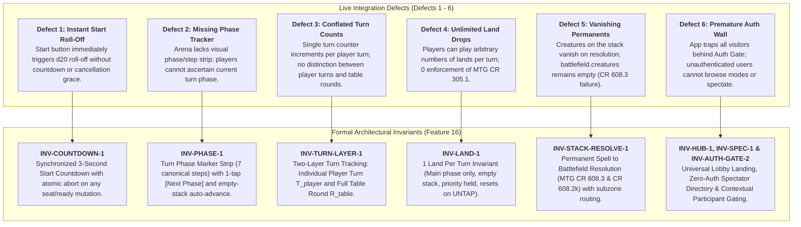
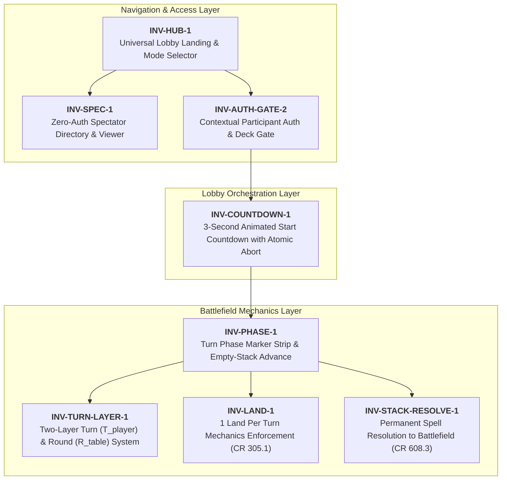
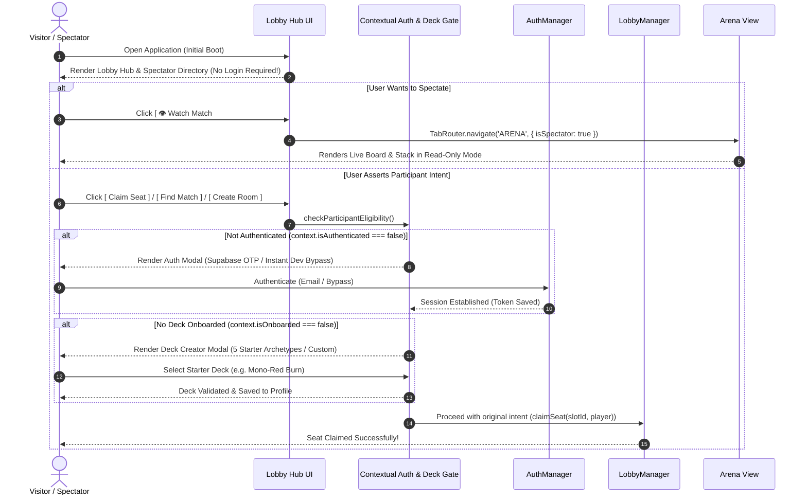
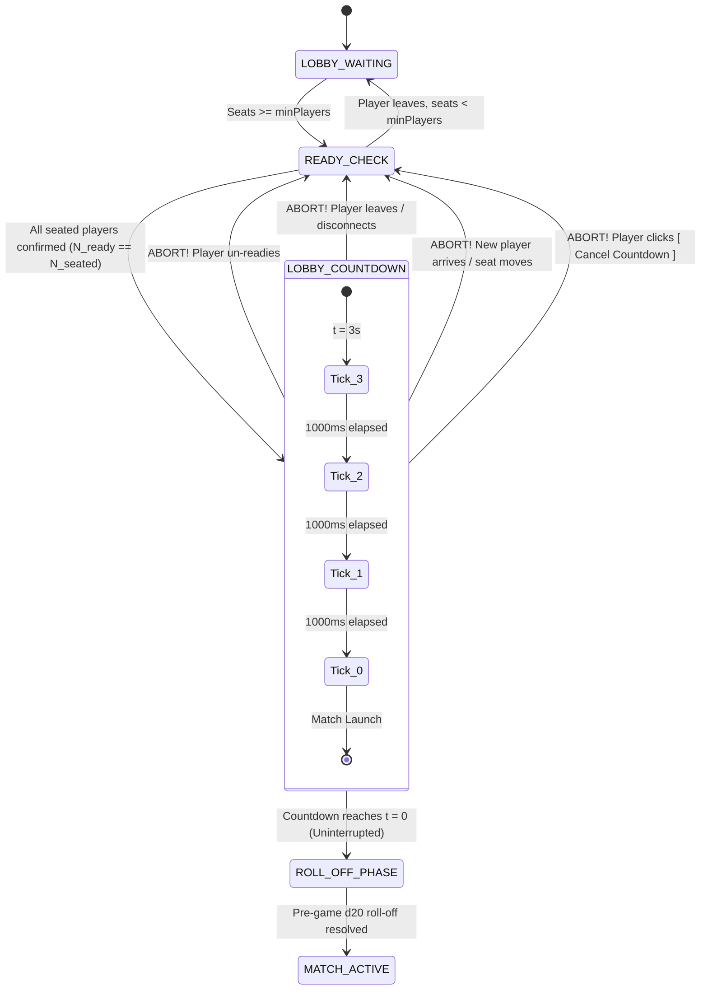
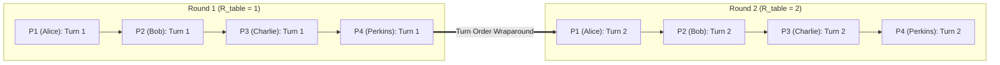
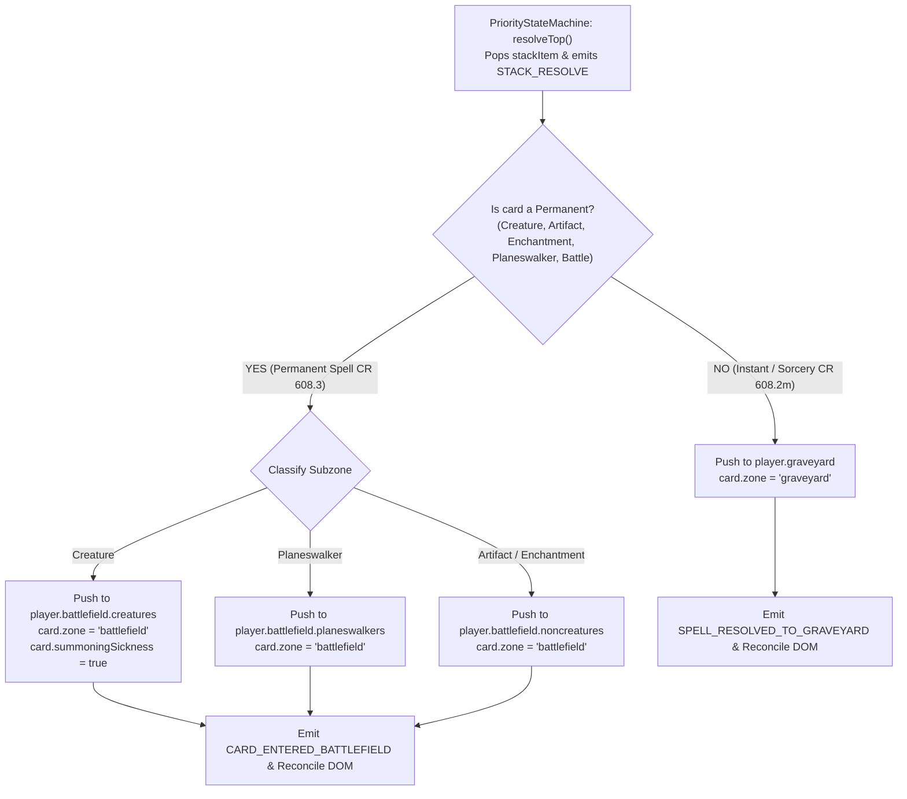

# FEATURE 16: Lobby Hub & Spectator Directory, Battle Mechanics Enforcement, and Phase Step Tracker

**Document ID:** `SPEC-RPM-BATTLE-016`  
**Status:** DRAFT / APPROVED FOR IMPLEMENTATION  
**Author:** Argon Specification Architect  
**Created Date:** October 19, 2026  
**Revision:** 1.0.0  
**Target File Path:** `specs/FEATURE_16_BATTLE_AND_SPECTATOR_SPEC.md`  
**Core Implementation Targets:**
- `src/TabletopStateManager.js` (MODIFY — 1 Land Per Turn Limit `INV-LAND-1`, Stack to Battlefield Resolution `INV-STACK-RESOLVE-1`, Player Turn Counters `INV-TURN-LAYER-1`)
- `src/PriorityStateMachine.js` (MODIFY — Two-Layer Turn & Round Counter `INV-TURN-LAYER-1`, Empty-Stack Auto-Advance `INV-PHASE-1`, Stack Resolution Payloads)
- `src/LobbyManager.js` (MODIFY — Synchronized 3-Second Start Countdown `INV-COUNTDOWN-1`, Spectator Registry & Directory `INV-SPEC-1`)
- `src/view/TabRouter.js` (MODIFY — Universal Lobby Landing `INV-HUB-1`, Zero-Auth Spectator Route `INV-SPEC-1`, Contextual Auth Gate `INV-AUTH-GATE-2`)
- `src/app.js` (MODIFY — Mode Selector Hub, Spectator Directory & Read-Only Arena Mode, 3s Animated Countdown Banner, Turn Phase Marker Strip, Battle HUD)
- `index.html` (MODIFY — Turn Phase Marker Strip container, Spectator Directory container, Countdown Overlay, Mode Selector Cards)
- `src/view/tabletop.css` (MODIFY — Phase Marker styling, pulsating active step glow, countdown animations, spectator watermarks)
- `test/test_battle_spectator.js` (NEW — Exhaustive 16-Vector Acceptance Test Suite)

**Related Specifications & Decision Records:**
- `specs/FEATURE_15_ONBOARDING_AND_TELEMETRY_SPEC.md` (`SPEC-RPM-ONBOARD-015`: Auth Gate, Starter Archetypes, Seating Invariants)
- `specs/FEATURE_14_UNIFIED_PLATFORM_SPEC.md` (`SPEC-RPM-PLATFORM-014`: Decoupled Tab Navigation, Roll-Off Engine, Matchmaking Queue)
- `specs/FEATURE_13_PERKINS_AI_SPEC.md` (`SPEC-RPM-PERKINS-013`: Perkins Autonomous Bot Pod Seating & Heuristics)
- `specs/FEATURE_4_STACK_PRIORITY_SPEC.md` (`SPEC-RPM-PRIORITY-004`: MTG CR 117 Priority Flow, LIFO Stack & Checkpoint Journal)
- `specs/FEATURE_3_TABLETOP_ZONE_STATE_SPEC.md` (`SPEC-RPM-ZONE-003`: Fog-of-War Projection & Tabletop Zone State Manager)
- `decisionlog.md`:
  - `DEC-019` (Unified Decoupled Platform, Tab Lockout & Turn Roll-Off)
  - `DEC-020` (Player Registration, Mandatory Deck Gate & Pod Seating)
  - `DEC-021` (Lobby Hub, Spectator Directory, Battle Mechanics & Phase Step Tracker)

---

## 1. Executive Summary & Root Cause Problem Formulation

Feature 16 rectifies six critical tabletop gameplay, arena clarity, and lobby lifecycle defects identified during live integration playtesting. These defects degrade player immersion, violate Magic: The Gathering Comprehensive Rules (CR), cause cards to disappear during spell resolution, and hinder spectator accessibility.



### 1.1 Defect 1: Lobby Immediate Roll-Off (No Countdown or Abort Grace)
- **Observed Behavior:** Clicking "Start Game" in `LobbyManager` immediately transitions the room to `ROLL_OFF_PHASE` and launches `TurnRollOffManager`. If a player accidentally clicks Start, or if another seated player was in the process of adjusting deck selection or un-readifying, the match initiates irreversibly.
- **Root Cause:** `LobbyManager.js` lacked an intermediate countdown state (`LOBBY_COUNTDOWN`). In `src/app.js`, the event listener for `btn-start-game` directly invoked `this.startRollOff()` synchronously without temporal delay, animation, or cancellation watchdog.
- **Remediation (`INV-COUNTDOWN-1`):** Introduce a deterministic 3-second countdown ($t \in \{3, 2, 1, 0\}$) with visible animated HUD overlay. If any participant un-confirms, leaves the seat, disconnects, or a new player arrives, the countdown terminates instantaneously with zero state corruption.

### 1.2 Defect 2: Absence of Visual Turn Phase Marker Strip
- **Observed Behavior:** The Arena interface provided only a small static textual badge (`Untap`) in the top navigation bar. Players frequently could not determine whether they were in `PRECOMBAT_MAIN`, `COMBAT`, or `POSTCOMBAT_MAIN`. Additionally, advancing steps required blindly passing priority repeatedly.
- **Root Cause:** No dedicated UI component existed to visualize the MTG 7-step turn structure (`UNTAP`, `UPKEEP`, `DRAW`, `MAIN 1`, `COMBAT`, `MAIN 2`, `END`). The priority machine possessed internal phase tracking, but lacked a 1-tap `[ ⏭️ Next Phase ]` dispatcher and prominent step marker strip.
- **Remediation (`INV-PHASE-1`):** Construct an authoritative Turn Phase Marker Strip at the top of the Arena battlefield highlighting the active step with animated glowing pill indicators, paired with a 1-tap `[ ⏭️ Next Phase ]` action button.

### 1.3 Defect 3: Single-Layer Turn Conflation ($T_{\text{player}}$ vs $R_{\text{table}}$)
- **Observed Behavior:** In a 4-player pod, when Player 1 finished Turn 1 and Player 2 took their first turn, the HUD displayed `"Turn 2"`. By the time Player 1 took their second turn, the HUD displayed `"Turn 5"`. Players and perk mechanics (e.g., Upkeep Dormancy until Round 4) could not differentiate between an individual's turn count and the overall table round.
- **Root Cause:** `PriorityStateMachine.turnNumber` was implemented as a single scalar integer incremented on every `advanceStep()` past `CLEANUP`.
- **Remediation (`INV-TURN-LAYER-1`):** Formalize a two-layer counter system:
  1. Full Table Round $R_{\text{table}} \in \mathbb{N}_{\ge 1}$, advancing only when the turn rotates back to the starting player (Seat 1 / Highest Roll-Off winner).
  2. Individual Player Turn $T_{\text{player}}(p) \in \mathbb{N}_{\ge 1}$, incrementing each time player $p$ enters their `UNTAP` step.

### 1.4 Defect 4: Unlimited Land Drops Unenforced
- **Observed Behavior:** In `TabletopStateManager._handlePlayLand()`, players could repeatedly invoke `PLAY_LAND` from hand without restriction, dumping 5 lands onto the battlefield in Turn 1.
- **Root Cause:** `_handlePlayLand()` verified that the card had `typeLine` matching `/land/i`, spliced it from `player.hand`, and pushed it to `player.battlefield.lands`. It performed zero validation of:
  - Turn owner ($p == P_{\text{active}}$);
  - Phase timing (must be Main phase: `PRECOMBAT_MAIN` or `POSTCOMBAT_MAIN`);
  - Stack state (must be empty: $\text{stack.length} == 0$);
  - Quota limit ($L_{\text{played}}(p) < 1$).
- **Remediation (`INV-LAND-1`):** Enforce MTG CR 305.1 & CR 305.2. Maintain `player.landsPlayedThisTurn`, reject drops exceeding limit with `LandLimitExceededError`, and reset counter to 0 during the `UNTAP` step.

### 1.5 Defect 5: Creature Spells Vanishing on Stack Resolution
- **Observed Behavior:** When a player cast a creature spell (e.g., *Ragavan, Nimble Pilferer*), the spell card correctly moved from `hand` to `stack`. Both players passed priority. `PriorityStateMachine.resolveTop()` popped the spell from `stack` and emitted `STACK_RESOLVE`. However, the creature never appeared on the battlefield: `battlefield.creatures` remained `[]`, and the card vanished from the game entirely!
- **Root Cause:** `PriorityStateMachine.js` was designed as a pure protocol arbiter that popped the stack item and emitted `STACK_RESOLVE`, but neither `TabletopStateManager.js` nor `app.js` subscribed to `STACK_RESOLVE` to transfer the permanent spell into the controller's battlefield.
- **Remediation (`INV-STACK-RESOLVE-1`):** Enforce MTG CR 608.3 & CR 608.2k: Permanent spells (Creature, Land, Artifact, Enchantment, Planeswalker, Battle) must be placed into the controller's `battlefield` subzone upon resolution. Non-permanent spells (Instant, Sorcery) resolve to the owner's `graveyard` (CR 608.2m).

### 1.6 Defect 6: Premature Auth Wall Locking Out Public Visitors
- **Observed Behavior:** Feature 15 enforced an upfront `AUTH_GATE` and `DECKBUILDER_GATE`. A user opening the URL was presented with a login modal; if closed, the app locked out all navigation. Prospective players and spectators could not view active matches, check public pods, or see the platform in action without creating an account.
- **Root Cause:** `TabRouter.canNavigate()` strictly blocked non-auth tabs if `isAuthenticated === false`.
- **Remediation (`INV-HUB-1`, `INV-SPEC-1`, `INV-AUTH-GATE-2`):** Transform `LOBBY` into the universal open landing hub. Render Mode Selectors and an Ongoing Matches Spectator Directory. Allow zero-auth spectating of active tables. Contextually trigger the Auth and Deck Creator modal ONLY when the user asserts an active player intent (`Claim Seat`, `Create Room`, `Queue 1v1`, `Play vs Perkins`).

---

## 2. Formal Architectural Invariant Hierarchy

Feature 16 specifies eight binding architectural invariants governed by MTG Comprehensive Rules and real-time distributed consensus principles:



### 2.1 Invariant Formal Definitions

| Invariant ID | Name | Formal Mathematical / Logical Definition | Enforcement Scope |
| :--- | :--- | :--- | :--- |
| **`INV-HUB-1`** | Universal Lobby Landing & Mode Selector | $\forall u \in \text{Users}, \text{Route}(\text{InitialBoot}(u)) = \text{LOBBY}$. Unauthenticated users may freely access `LOBBY` and inspect game modes and spectator rooms. | `TabRouter.js`, `app.js` |
| **`INV-SPEC-1`** | Zero-Auth Spectator Directory & Viewer | $\forall u, \text{role}(u) = \text{SPECTATOR} \implies \text{CanView}(\text{Arena}, \text{Stack}, \text{Chat}_{\text{casual}}) \land \neg \text{CanExecute}(\text{TurnActions}) \land \text{AuthRequired} = \varnothing$. | `TabRouter.js`, `LobbyManager.js`, `app.js` |
| **`INV-AUTH-GATE-2`** | Contextual Participant Gate | $\text{Action} \in \{\text{ClaimSeat}, \text{Queue1v1}, \text{CreateRoom}, \text{PlayPerkins}\} \implies (\text{Auth} \land \text{DeckReady}) \lor \text{TriggerModal}$. | `app.js`, `LobbyManager.js`, `TabRouter.js` |
| **`INV-COUNTDOWN-1`** | 3-Second Synchronized Start Countdown | $\text{CountdownActive} \iff (N_{\text{ready}} = N_{\text{seated}} \ge N_{\text{min}} \land t \in [0, 3])$. Any seat/ready mutation $\implies t \gets \text{null} \land \text{Abort}$. | `LobbyManager.js`, `app.js` |
| **`INV-PHASE-1`** | Turn Phase Marker Strip & Flow | $\Phi = \{\text{UNTAP}, \text{UPKEEP}, \text{DRAW}, \text{MAIN1}, \text{COMBAT}, \text{MAIN2}, \text{END}\}$. Strip displays active $\phi \in \Phi$. Empty stack $+$ pass consensus $\implies \phi \gets \text{next}(\phi)$. | `PriorityStateMachine.js`, `app.js` |
| **`INV-TURN-LAYER-1`** | Two-Layer Turn & Round System | $R_{\text{table}} = 1 + \lfloor \frac{\text{TurnsTotal}}{N_{\text{players}}} \rfloor; \quad T_{\text{player}}(p) = \text{count}(\text{UNTAP}(p))$. Distinct displays in HUD. | `PriorityStateMachine.js`, `TabletopStateManager.js` |
| **`INV-LAND-1`** | 1 Land Per Turn Mechanics (CR 305.1) | $\text{PlayLand}(p, c) \implies (p = P_{\text{active}} \land \phi \in \{\text{MAIN1}, \text{MAIN2}\} \land |\text{Stack}| = 0 \land L_{\text{played}}(p) < 1)$. Resets at UNTAP. | `TabletopStateManager.js`, `PriorityStateMachine.js` |
| **`INV-STACK-RESOLVE-1`** | Permanent Spell Resolution (CR 608.3) | $\text{Resolve}(s) \implies (s.\text{isPermanent} \to \text{Battlefield}[s.\text{subzone}] \land s.\text{zone} = \text{'battlefield'}) \lor (s \to \text{Graveyard})$. | `TabletopStateManager.js`, `PriorityStateMachine.js`, `app.js` |

---

## 3. Universal Lobby Hub & Mode Selector (`INV-HUB-1`)

### 3.1 Unconditional Landing Architecture
Under `INV-HUB-1`, the application entrypoint unconditionally presents the **Lobby Hub** (`TABS.LOBBY`) to every client upon boot, completely replacing the upfront hard blocking authentication modal.

```
+----------------------------------------------------------------------------------------------------+
|  RPM TABLETOP COMPANION                     [🏟️ Arena]  [📚 Decks]  [🔍 Lobby]  [👤 Login / Profile] |
+----------------------------------------------------------------------------------------------------+
|                                                                                                    |
|   ⚔️  BATTLE HUB: SELECT A GAME MODE                                                                |
|                                                                                                    |
|   +--------------------------+  +--------------------------+  +--------------------------------+   |
|   | ⚡ 1v1 RANKED QUEUE      |  | 🛡️ MULTIPLAYER POD (3-6) |  | 🗝️ CUSTOM PRIVATE ROOM         |   |
|   | Modern Construct         |  | Commander / Casual Pod   |  | Play with Friends              |   |
|   | Quick Matchmaking        |  | Up to 6 Seated Players   |  | Passcode & Direct Code         |   |
|   | [ ⚔️ Find Match ]        |  | [ 👥 Enter Pod Lobby ]   |  | [ ➕ Create ]  [ 🔗 Join ]     |   |
|   +--------------------------+  +--------------------------+  +--------------------------------+   |
|                                                                                                    |
|   🤖 SOLO TEST LAB: [ Play vs Perkins AI ] (Instant Practice with Bot)                             |
|                                                                                                    |
|----------------------------------------------------------------------------------------------------|
|   📺 ONGOING MATCHES (SPECTATOR DIRECTORY)                             [ 🔄 Refresh Directory ]    |
|                                                                                                    |
|   Table Code   Format       Round / Turn     Players                 Spectators    Action          |
|   ----------------------------------------------------------------------------------------------   |
|   #POD-774     Pod (4p)     Round 3 (T2)     Alice, Bob, Perkins x2  👁️ 4          [ 👁️ Watch ]   |
|   #DUEL-109    1v1 Ranked   Round 5 (T5)     Gideon vs Jace          👁️ 12         [ 👁️ Watch ]   |
|   #PRIV-442    Custom Pod   Round 1 (T1)     Carlos, Dave, Eve       👁️ 1          [ 👁️ Watch ]   |
|                                                                                                    |
+----------------------------------------------------------------------------------------------------+
```

### 3.2 Mode Selector Specification
1. **1v1 Ranked Matchmaking (`DUEL_1V1`):**
   - Direct entry into the FIFO `MatchmakingQueue` with 45-second Perkins AI watchdog fallback (`INV-QUEUE-1`).
2. **Multiplayer Pod (`POD_MULTIPLAYER`):**
   - 3 to 6 seats. Supports human players and autonomous Perkins AI bots in seats 2..6.
3. **Custom Private Room:**
   - 6-character alphanumeric room codes with optional private host controls.
4. **Solo Test Lab (`PERKINS_SOLO`):**
   - 1-click instant duel against Perkins AI for quick card and perk testing.

---

## 4. Zero-Auth Spectator Directory & Viewer (`INV-SPEC-1`)

### 4.1 Spectator Directory Engine & Public Relay
Active game tables periodically publish lightweight telemetry heartbeats to the relay server or Supabase channel `tabletop_matches_directory`. Unauthenticated guests poll or subscribe to this stream.

#### Match Directory Entry Data Model (`MatchSummary`):
```typescript
interface MatchSummary {
  roomCode: string;
  roomType: 'DUEL_1V1' | 'POD_MULTIPLAYER' | 'CUSTOM_ROOM';
  format: 'Modern' | 'Commander' | 'Casual';
  status: 'LOBBY_WAITING' | 'LOBBY_COUNTDOWN' | 'ROLL_OFF_PHASE' | 'MATCH_ACTIVE' | 'MATCH_COMPLETED';
  roundNumber: number;
  activePlayerTurnNumber: number;
  activePlayerName: string;
  seatedPlayers: Array<{
    playerId: string;
    playerName: string;
    isBot: boolean;
    life: number;
    colorIdentity: string[];
  }>;
  spectatorCount: number;
  createdAt: number;
  lastHeartbeatAt: number;
}
```

### 4.2 Spectator Role Permissions & Fog-of-War Projection
When a client clicks `[ 👁️ Watch ]`, `TabRouter` navigates them directly to `TABS.ARENA` with `isSpectator = true`.

#### Permissions Matrix:

| Action / Capability | Seated Participant | Spectator (`isSpectator = true`) |
| :--- | :---: | :---: |
| View Public Battlefield (Lands, Creatures, Noncreatures) | ✅ Full | ✅ Full |
| View Active Stack & Response Alarm Timer | ✅ Full | ✅ Full |
| View Player Graveyards & Exile Zones | ✅ Full | ✅ Full |
| View Life Totals, Poison, Mana Pools, Perk HUD | ✅ Full | ✅ Full |
| View Private Hands (Fog-of-War) | ✅ Own Hand Only | ❌ Blinded (Card Backs & Hand Count) |
| Post Messages in `casual` (Chit-Chat) Channel | ✅ Yes | ✅ Yes (Labeled `[Spectator] Name`) |
| Post Messages in `gameplay` (Action Bus) Channel | ✅ Yes | ❌ Blocked (Read-Only) |
| Voice Recognition & Vernacular Commands | ✅ Yes | ❌ Muted |
| Play Lands, Cast Spells, Tap Permanents | ✅ Yes | ❌ Action UI Hidden / Disabled |
| Pass Priority, Hold Response, Roll Dice | ✅ Yes | ❌ Action UI Hidden / Disabled |
| Concede Match / Claim Seat | ✅ Yes | ❌ Button says `[ 🚪 Exit Spectating ]` |

---

## 5. Contextual Participant Auth & Deck Gate (`INV-AUTH-GATE-2`)

### 5.1 Gating Lifecycle & Interception Flow
Rather than repelling visitors at the door, authentication and deck creation are deferred until the visitor explicitly expresses intent to occupy a game seat.



### 5.2 Contextual Gate Protocol
```javascript
export async function assertParticipantEligibility(authManager, onAuthRequired, onDeckRequired) {
  if (!authManager.isAuthenticated()) {
    const authResult = await onAuthRequired();
    if (!authResult || !authResult.success) return false;
  }
  if (!authManager.isOnboarded()) {
    const deckResult = await onDeckRequired();
    if (!deckResult || !deckResult.success) return false;
  }
  return true;
}
```

---

## 6. Synchronized 3-Second Start Countdown Engine (`INV-COUNTDOWN-1`)

### 6.1 State Machine Specification
When all seated players confirm readiness ($\text{isReady} = \text{true}$ for all slots, with $\ge N_{\text{min}}$ players seated), or the host clicks "Start Game", the room transitions into `LOBBY_COUNTDOWN`.



### 6.2 Abort Watchdog & Invariant Invalidation
The countdown execution is governed by a strict guard function evaluated on every event loop tick:

$$\text{Valid}(\text{Countdown}) \iff \begin{cases} 
|\text{slots}| \ge N_{\text{min}} \\
\forall s \in \text{slots}, s.\text{connectionStatus} = \text{'CONNECTED'} \land s.\text{isReady} = \text{true} \\
\Delta \text{Membership} = \varnothing 
\end{cases}$$

If any condition fails:
1. `clearInterval(this._countdownTimer)`;
2. `this.countdownSecondsRemaining = null`;
3. `this.status = LOBBY_STATUS.READY_CHECK`;
4. Emit `COUNTDOWN_ABORTED` with `{ reason, slotId, timestamp }`;
5. Visual overlay collapses with toast: *"Match start aborted: [Reason]"*.

---

## 7. Turn Phase Step Tracker & Marker Strip (`INV-PHASE-1`)

### 7.1 Visual Marker Strip Specification
The Arena battlefield header contains a responsive horizontal ribbon displaying the canonical 7-step sequence:

```
+------------------------------------------------------------------------------------------------------------------+
| [ UNTAP ] -> [ UPKEEP ] -> [ DRAW ] -> [ 🌟 MAIN 1 ] -> [ COMBAT ] -> [ MAIN 2 ] -> [ END ]    [ ⏭️ Next Phase ] |
+------------------------------------------------------------------------------------------------------------------+
```

#### Mapping MTG Comprehensive Rules to the 7-Step Strip:
1. `UNTAP` (CR 502): Untap permanents; reset $L_{\text{played}} \gets 0$; no priority.
2. `UPKEEP` (CR 503): Trigger upkeep abilities; random perk roll check ($R_{\text{table}} \ge 4$ in 1v1, $R_{\text{table}} \ge 2$ in pods); priority exchanged.
3. `DRAW` (CR 504): Active player draws 1 card from library; priority exchanged.
4. `MAIN 1` (`PRECOMBAT_MAIN`, CR 505): Sorcery speed actions permitted; land drops permitted ($1/\text{turn}$); empty stack allows creature/permanent casting.
5. `COMBAT` (CR 506-511): Consolidates Beginning of Combat, Declare Attackers, Declare Blockers, Combat Damage, End of Combat.
6. `MAIN 2` (`POSTCOMBAT_MAIN`, CR 505): Second Main phase; sorcery speed permitted; land drop permitted if unused in Main 1.
7. `END` (`END_STEP` & `CLEANUP`, CR 512-514): "At beginning of end step" triggers; damage wears off; turn hands over.

### 7.2 1-Tap `[ ⏭️ Next Phase ]` & Auto-Advance Invariant
- **1-Tap Manual Advance:** The active player holding priority on an empty stack may tap `[ ⏭️ Next Phase ]` to immediately yield priority and transition to the subsequent phase step.
- **Consensus Auto-Advance:** When the stack is empty and all seated players pass priority consecutively ($N_{\text{passes}} \ge N_{\text{players}}$), `PriorityStateMachine` automatically advances to the next step without requiring secondary button presses (CR 500.2).

---

## 8. Two-Layer Turn & Round Counter System (`INV-TURN-LAYER-1`)

### 8.1 Mathematical Model & Invariants
In multiplayer tabletop games, turn timing involves two orthogonal dimensions:



1. **Table Round ($R_{\text{table}}$):**
   $$R_{\text{table}} = 1 + \left\lfloor \frac{\sum_{p \in P} T_{\text{completed}}(p)}{|P|} \right\rfloor$$
   $R_{\text{table}}$ increments if and only if the active player turns over from the final player in the roll-off seating order ($P_N$) back to the first player ($P_1$).
2. **Individual Player Turn ($T_{\text{player}}(p)$):**
   $$T_{\text{player}}(p) = 1 + \text{Count}(\text{TurnCompletedEvents for player } p)$$
   Increments when player $p$ enters their `UNTAP` step.

### 8.2 HUD Representation
The Arena top status bar must format the counters as:
$$\text{HUD Display} = \text{"Round } R_{\text{table}} \text{ • } \text{PlayerName (Turn } T_{\text{player}}(P_{\text{active}}) \text{)"}$$
*Example:* `"Round 3 • Alice (Turn 3)"` vs `"Round 3 • Bob (Turn 2)"`.

---

## 9. 1 Land Per Turn Mechanics Enforcement (`INV-LAND-1`)

### 9.1 Rules Formulation (MTG CR 305.1 & 305.2)
1. **Special Action:** Playing a land is a special action. It does not use the stack and cannot be responded to (CR 305.1).
2. **Timing Restrictions:** A player may only play a land if:
   $$\text{CanPlayLand}(p) \iff \begin{cases}
   p = P_{\text{active}} & \text{(Must be active player)} \\
   \phi \in \{\text{PRECOMBAT\_MAIN}, \text{POSTCOMBAT\_MAIN}\} & \text{(Must be Main phase)} \\
   |\text{Stack}| = 0 & \text{(Stack must be empty)} \\
   p = P_{\text{priority}} & \text{(Must hold priority)} \\
   L_{\text{played}}(p) < L_{\text{limit}}(p) & \text{(Default limit: 1)}
   \end{cases}$$
3. **Reset Invariant:** Upon entering the `UNTAP` step of player $p$'s turn, $L_{\text{played}}(p) \gets 0$.

### 9.2 State Transition Algorithm
```javascript
function playLand(playerId, instanceId) {
  const player = this.getPlayer(playerId);
  if (this.priorityMachine.activePlayerId !== playerId) {
    throw new PriorityViolationError('Only the active player may play a land.');
  }
  const currentPhase = this.priorityMachine.currentPhaseStep;
  if (currentPhase !== 'PRECOMBAT_MAIN' && currentPhase !== 'POSTCOMBAT_MAIN') {
    throw new PhaseTimingError(`Lands may only be played during Main phases (current: ${currentPhase}).`);
  }
  if (this.priorityMachine.getStackDepth() > 0) {
    throw new PriorityViolationError('Lands may only be played when the stack is empty.');
  }
  if (player.landsPlayedThisTurn >= (player.landsPerTurnLimit || 1)) {
    throw new LandLimitExceededError(`Land drop limit reached for this turn (${player.landsPlayedThisTurn}/${player.landsPerTurnLimit || 1}).`);
  }

  // Deduct from hand and place onto battlefield
  const card = player.removeFromHand(instanceId);
  card.zone = 'battlefield';
  card.subzone = 'lands';
  card.isTapped = false;
  player.battlefield.lands.push(card);

  player.landsPlayedThisTurn++;
  this.emit('LAND_PLAYED', { playerId, card, landsPlayedThisTurn: player.landsPlayedThisTurn });
}
```

---

## 10. Permanent Spell Resolution Engine (`INV-STACK-RESOLVE-1`)

### 10.1 MTG CR 608.3 & CR 608.2k Invariant
When a spell card resolves from the stack:
- If the card is a **permanent spell** (Creature, Land, Artifact, Enchantment, Planeswalker, Battle):
  1. The card does **NOT** go to the graveyard.
  2. The card is transferred directly into the controller's `battlefield` container under the appropriate subzone:
     - Creature $\to$ `player.battlefield.creatures`
     - Land $\to$ `player.battlefield.lands`
     - Artifact / Enchantment / Battle $\to$ `player.battlefield.noncreatures`
     - Planeswalker $\to$ `player.battlefield.planeswalkers`
  3. `card.zone = 'battlefield'`.
  4. `card.isTapped = false`.
  5. If Creature, `card.summoningSickness = true`.
- If the card is an **instant or sorcery spell** (CR 608.2m):
  1. It is moved to its owner's graveyard (`player.graveyard.push(card)`).
  2. `card.zone = 'graveyard'`.



---

## 11. Comprehensive Component Architecture & Detailed Interface Signatures

### 11.1 Updates to `TabletopStateManager.js`

```typescript
export interface PlayerTabletopState {
  playerId: string;
  playerName: string;
  life: number;
  poison: number;
  landsPlayedThisTurn: number; // NEW (INV-LAND-1)
  landsPerTurnLimit: number;   // NEW (Default: 1)
  turnCount: number;           // NEW (T_player)
  hand: CardInstance[];
  library: CardInstance[];
  graveyard: CardInstance[];
  exile: CardInstance[];
  commandZone: CardInstance[];
  battlefield: {
    lands: CardInstance[];
    creatures: CardInstance[];
    noncreatures: CardInstance[];
    planeswalkers: CardInstance[];
  };
  resources: {
    manaPool: Record<string, number>;
  };
}

export class TabletopStateManager extends EventEmitter {
  public roundNumber: number; // NEW (R_table, INV-TURN-LAYER-1)
  public playerTurnNumbers: Map<string, number>; // NEW

  /**
   * Resets per-turn quotas (land drops, etc.) when a player's UNTAP step begins.
   */
  public resetTurnQuotas(playerId: string): void;

  /**
   * Enforces INV-LAND-1 and plays a land from hand to battlefield.
   */
  public playLand(payload: { playerId: string; instanceId: string }): { card: CardInstance };

  /**
   * Resolves top stack item into battlefield or graveyard under INV-STACK-RESOLVE-1.
   */
  public handleStackResolution(resolvedItem: StackItem): { card: CardInstance; destinationZone: string };
}
```

### 11.2 Updates to `PriorityStateMachine.js`

```typescript
export interface PhaseStepChangeEvent {
  previousStep: string;
  currentPhaseStep: string;
  roundNumber: number;          // NEW (R_table)
  playerTurnNumber: number;     // NEW (T_player)
  activePlayerId: string;
  priorityPlayerId: string;
}

export class PriorityStateMachine extends EventEmitter {
  public roundNumber: number;   // R_table
  public playerTurnCounts: Map<string, number>; // T_player
  public startingPlayerId: string; // The lead player determining round boundary

  /**
   * Advances phase step; handles round wraparound when passing from P_N to P_1.
   */
  public advanceStep(): string;

  /**
   * 1-Tap shortcut to advance to next phase if priority is held and stack is empty.
   */
  public nextPhase(playerId: string): string;

  /**
   * Pops stack item, resolves to destination zone, resets consecutive pass count.
   */
  public resolveTop(): StackItem | null;
}
```

### 11.3 Updates to `LobbyManager.js`

```typescript
export const LOBBY_STATUS = Object.freeze({
  LOBBY_WAITING: 'LOBBY_WAITING',
  READY_CHECK: 'READY_CHECK',
  LOBBY_COUNTDOWN: 'LOBBY_COUNTDOWN', // NEW (INV-COUNTDOWN-1)
  ROLL_OFF_PHASE: 'ROLL_OFF_PHASE',
  MATCH_ACTIVE: 'MATCH_ACTIVE',
  MATCH_COMPLETED: 'MATCH_COMPLETED'
});

export class LobbyManager extends EventEmitter {
  public countdownSecondsRemaining: number | null; // NEW (INV-COUNTDOWN-1)
  private _countdownTimer: any | null;             // NEW
  public spectators: Map<string, { spectatorId: string; joinedAt: number }>; // NEW (INV-SPEC-1)

  /**
   * Initiates synchronized 3-second animated countdown.
   */
  public startCountdown(durationSeconds?: number): void;

  /**
   * Aborts countdown immediately if any player un-confirms, leaves, or seat changes.
   */
  public abortCountdown(reason: string, metadata?: any): boolean;

  /**
   * Registers a zero-auth spectator.
   */
  public registerSpectator(spectatorId: string): void;
  public unregisterSpectator(spectatorId: string): void;
  public getSpectatorCount(): number;
}
```

### 11.4 Updates to `TabRouter.js`

```typescript
export class TabRouter extends EventEmitter {
  /**
   * Evaluates if navigation is permitted.
   * Under INV-HUB-1 and INV-SPEC-1:
   * - LOBBY is unconditionally permitted for everyone.
   * - ARENA is unconditionally permitted if isSpectator === true.
   */
  public canNavigate(targetTab: string, context?: any, isSpectator?: boolean): boolean;
}
```

---

## 12. Exhaustive Acceptance Test Suite Matrix (`test/test_battle_spectator.js`)

The test suite contains 16 formal verification vectors executed in Node.js / headless test runner:

| Test Vector ID | Invariant Verified | Preconditions | Inputs / Trigger Actions | Expected State Transitions & Assertions |
| :--- | :--- | :--- | :--- | :--- |
| `TC-BATTLE-01` | `INV-HUB-1` | App uninitialized; zero cached tokens in storage. | Boot application with empty auth context. | `TabRouter.getCurrentTab() === 'LOBBY'`. Mode Selector and Spectator Directory rendered; zero auth modal blocking view. |
| `TC-BATTLE-02` | `INV-SPEC-1` | 3 active matches running on relay (`#POD-1`, `#DUEL-2`, `#PRIV-3`). Unauthenticated guest. | Fetch ongoing match directory. | Renders 3 match cards with format, round count, player avatars, spectator counts; zero login prompt. |
| `TC-BATTLE-03` | `INV-SPEC-1` | Guest user viewing directory. `#DUEL-2` is in Round 3. | Click `[ 👁️ Watch ]` on `#DUEL-2`. | Navigates to `ARENA` with `isSpectator = true`. Lands/creatures/stack visible. Turn action controls hidden. |
| `TC-BATTLE-04` | `INV-SPEC-1` | Spectator inside active match `#DUEL-2`. | Spectator posts message in `casual` chat; then attempts `gameplay` command. | `casual` message broadcasts with `[Spectator]` tag. `gameplay` command rejected with `SpectatorPermissionError`. |
| `TC-BATTLE-05` | `INV-AUTH-GATE-2` | Unauthenticated visitor on Lobby Hub. | Visitor clicks `[ Claim Seat ]` on Pod Slot 1. | Action intercepted. Contextual Auth Modal opens. Seat remains open until authentication completes. |
| `TC-BATTLE-06` | `INV-AUTH-GATE-2` | Authenticated user with no saved deck (`isOnboarded = false`). | User clicks `[ ⚔️ Find Match ]` in 1v1 Ranked. | Matchmaking queue blocked. Mandatory Deck Creator modal opens. Selecting archetype unlocks queue. |
| `TC-BATTLE-07` | `INV-COUNTDOWN-1` | 3 players seated in Pod (`minPlayers = 3`). | All 3 players confirm `isReady = true`. | `LobbyManager.status === 'LOBBY_COUNTDOWN'`. `countdownSecondsRemaining === 3`. Emits `COUNTDOWN_TICK`. |
| `TC-BATTLE-08` | `INV-COUNTDOWN-1` | Countdown active at $t = 2\text{s}$. | Player 2 toggles `isReady` to `false`. | Countdown immediately aborts. `_countdownTimer` cleared. `status` reverts to `READY_CHECK`. Emits `COUNTDOWN_ABORTED`. |
| `TC-BATTLE-09` | `INV-COUNTDOWN-1` | Countdown active at $t = 1\text{s}$. All 3 players remain confirmed. | Clock ticks past $t = 0\text{s}$. | `status === 'ROLL_OFF_PHASE'`. Transitions to pre-game d20 roll-off and navigates seated players to `ARENA`. |
| `TC-BATTLE-10` | `INV-PHASE-1` | Arena match active; P1 active in `PRECOMBAT_MAIN`. | Render Arena battlefield DOM. | Turn Phase Marker Strip renders all 7 steps. `MAIN 1` pill has `.active` pulsating glow. Active player badge shows P1. |
| `TC-BATTLE-11` | `INV-PHASE-1` | P1 active in `PRECOMBAT_MAIN`, stack empty, priority held. | P1 taps `[ ⏭️ Next Phase ]`. | State transitions directly to `COMBAT`. Turn Phase Marker Strip highlights `COMBAT`. Emits `PHASE_STEP_CHANGED`. |
| `TC-BATTLE-12` | `INV-PHASE-1` | P1 active in `UPKEEP`, stack empty. | P1 passes priority; P2 passes priority consecutively. | Stack is empty; consecutive pass count $\ge 2$. Phase auto-advances to `DRAW` (CR 500.2). |
| `TC-BATTLE-13` | `INV-TURN-LAYER-1` | 4-Player Pod. Turn order: P1, P2, P3, P4. | P1..P4 complete Turn 1. Turn hands back to P1. | Round 1: $T(\text{P1})=1, T(\text{P2})=1, T(\text{P3})=1, T(\text{P4})=1$. When P1 untaps: $R_{\text{table}} = 2$ and $T(\text{P1}) = 2$. |
| `TC-BATTLE-14` | `INV-LAND-1` | P1 in `MAIN 1`, hand has 2 lands. P1 plays 1 Forest. | P1 attempts to play 2nd Forest from hand. | `playLand()` throws `LandLimitExceededError`. 2nd land remains in hand. `battlefield.lands.length === 1`. |
| `TC-BATTLE-15` | `INV-LAND-1` | P1 played land on Turn 1 ($L_{\text{played}} = 1$). | Turn ends, P2 plays, turn returns to P1's UNTAP step. | `resetTurnQuotas('p1')` executes. `landsPlayedThisTurn === 0`. P1 can successfully play a land in Main 1. |
| `TC-BATTLE-16` | `INV-STACK-RESOLVE-1` | P1 casts *Grizzly Bears* (Creature). Both players pass priority. | `PriorityStateMachine.resolveTop()` pops stack. | `STACK_RESOLVE` handled by state manager. Bear moves to `battlefield.creatures`. Card NOT in graveyard. |

---

## 13. Implementation Directives for Flash Builder & Verification Protocol

1. **Atomic File Updates:** Implement changes cleanly across `TabletopStateManager.js`, `PriorityStateMachine.js`, `LobbyManager.js`, `TabRouter.js`, and `app.js` without regressions to existing Feature 14 and 15 tests.
2. **Backwards Compatibility:** Ensure existing tests (`test_unified_platform.js`, `test_onboarding_lobby.js`) continue passing 100%.
3. **Chrome DevTools Live Verification:** Open Chrome via MCP, verify the 3-second countdown animation, the Turn Phase Marker Strip, spectator entry without auth, and land drop/creature resolution.
4. **Verificator Pro Audit:** Execute independent audit after coding to verify 100% adherence to all invariants.
