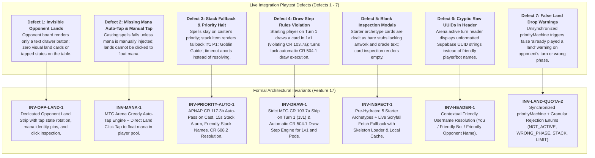
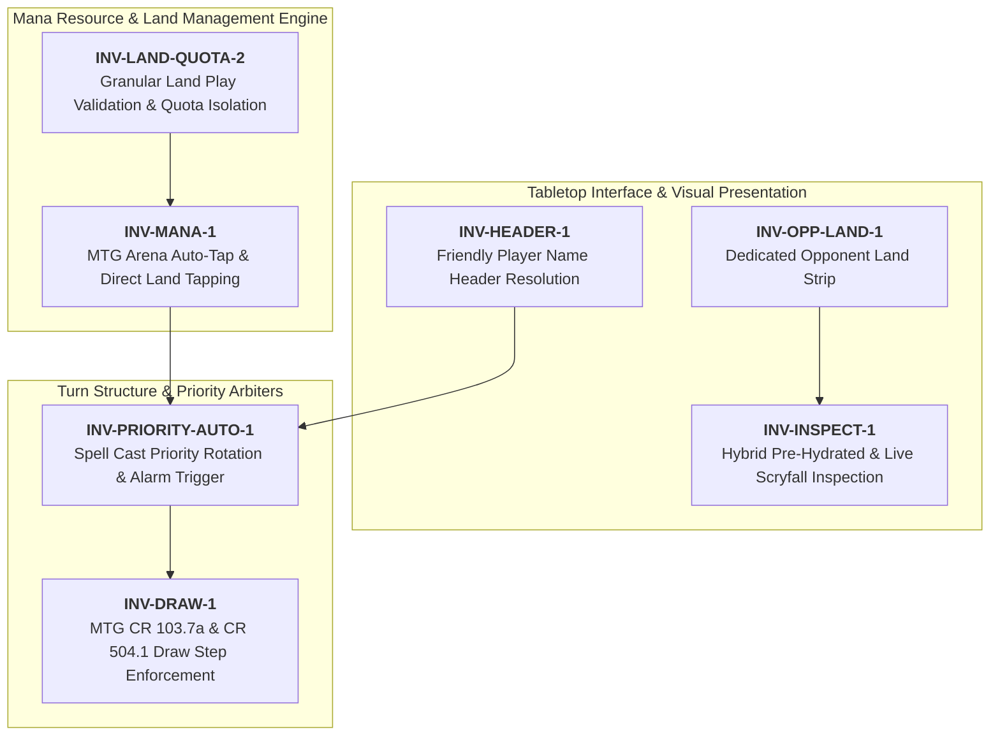
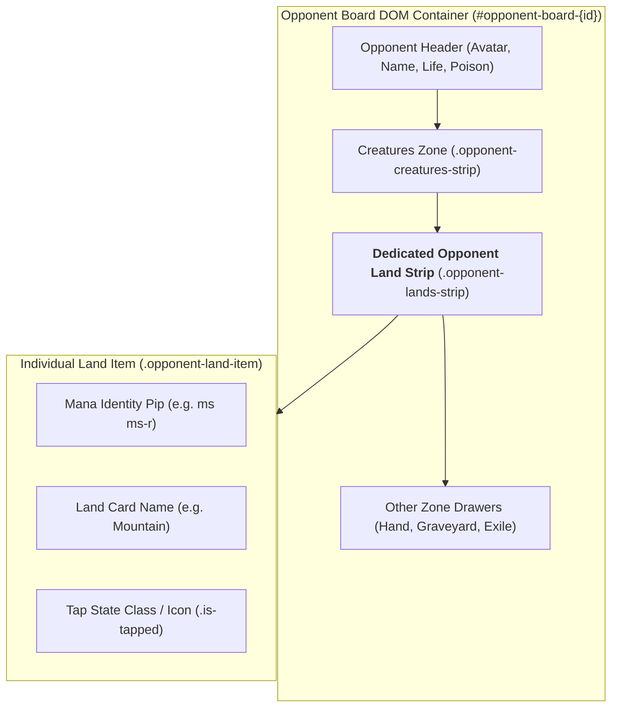
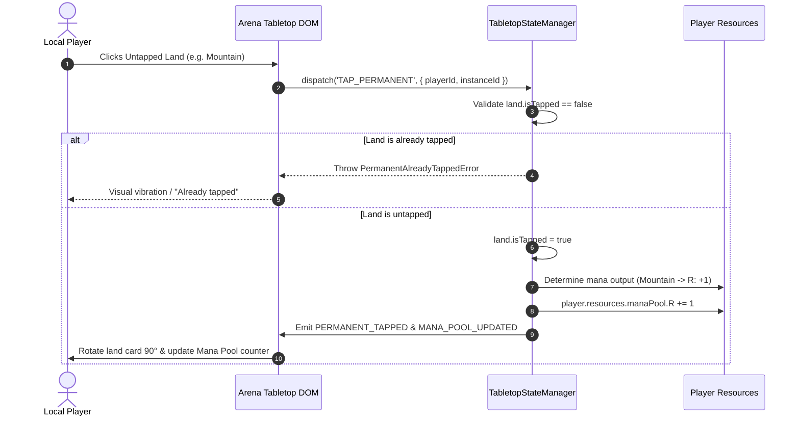
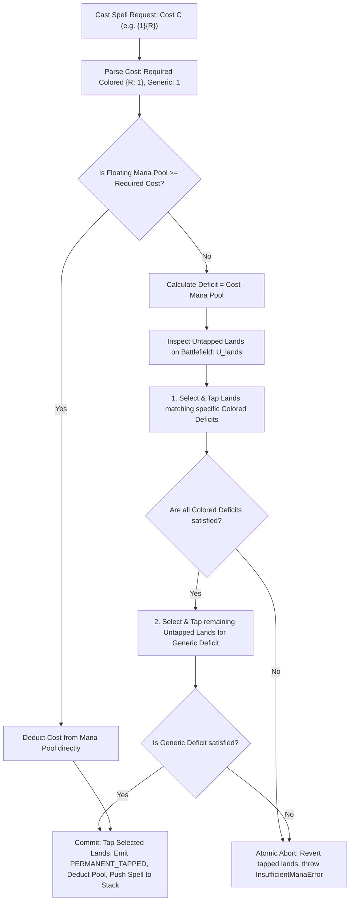
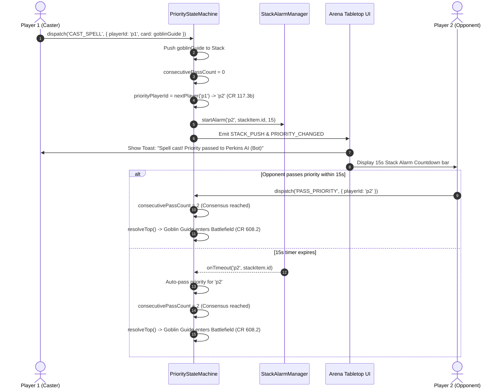
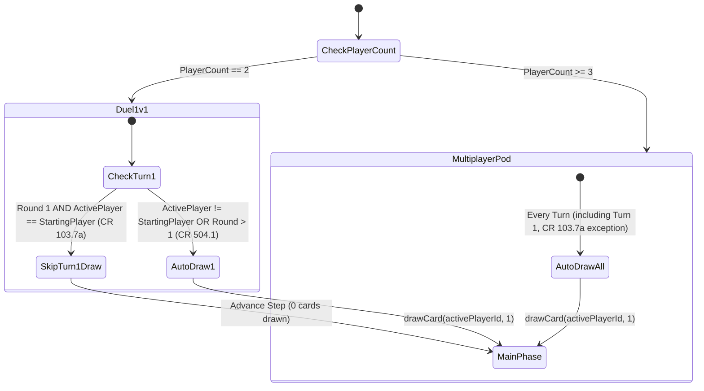
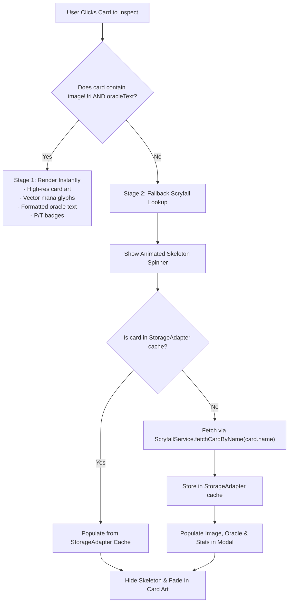
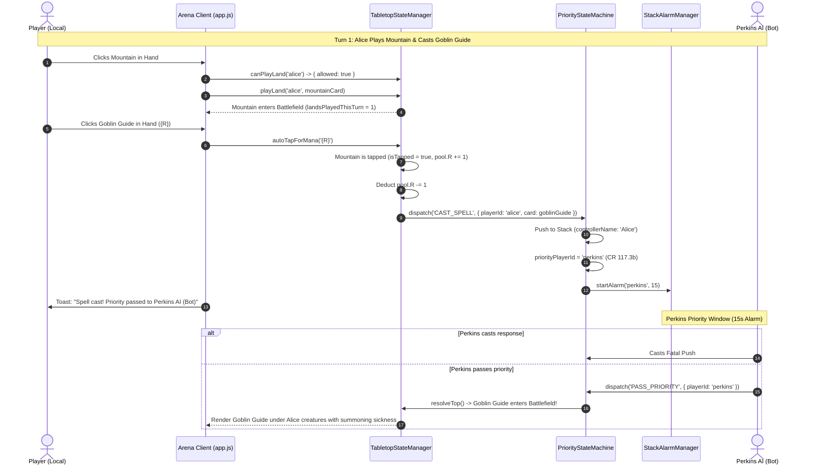

# FEATURE 17: Battle Stability, Opponent Land Field, Auto-Tap Mana Engine, Stack Resolution, and Card Inspection

**Document ID:** `SPEC-RPM-STABILITY-017`  
**Status:** APPROVED FOR IMPLEMENTATION  
**Author:** Argon Specification Architect  
**Created Date:** October 19, 2026  
**Revision:** 1.0.0  
**Target File Path:** `specs/FEATURE_17_BATTLE_STABILITY_SPEC.md`  

**Core Implementation Targets:**
- [`src/TabletopStateManager.js`](file:///home/svayneak/Documents/Svayneak/rpm%20multiplayer/src/TabletopStateManager.js) (MODIFY — MTG Arena Auto-Tap Engine `INV-MANA-1`, Direct Land Tapping `INV-MANA-1`, Granular Land Play Validation `INV-LAND-QUOTA-2`, Quota Reset on UNTAP)
- [`src/PriorityStateMachine.js`](file:///home/svayneak/Documents/Svayneak/rpm%20multiplayer/src/PriorityStateMachine.js) (MODIFY — Spell Cast Priority Rotation & APNAP CR 117.3b `INV-PRIORITY-AUTO-1`, Stack Alarm Countdown Integration `INV-PRIORITY-AUTO-1`, Official MTG Draw Step CR 103.7a & CR 504.1 `INV-DRAW-1`, Friendly Controller Metadata in Stack Items)
- [`src/PerkinsAgent.js`](file:///home/svayneak/Documents/Svayneak/rpm%20multiplayer/src/PerkinsAgent.js) (MODIFY — Explicit Land Tapping Heuristic `INV-MANA-1` prior to `CAST_SPELL`)
- [`src/DeckbuilderAI.js`](file:///home/svayneak/Documents/Svayneak/rpm%20multiplayer/src/DeckbuilderAI.js) (MODIFY — Pre-Hydrate 5 Starter Archetypes with full Scryfall metadata `INV-INSPECT-1`, rich starting hand dealing)
- [`src/view/CardOverlayModal.js`](file:///home/svayneak/Documents/Svayneak/rpm%20multiplayer/src/view/CardOverlayModal.js) (MODIFY — Instant rendering of pre-hydrated cards, modern loading skeleton/spinner, Scryfall fetch fallback & caching `INV-INSPECT-1`)
- [`src/ScryfallService.js`](file:///home/svayneak/Documents/Svayneak/rpm%20multiplayer/src/ScryfallService.js) (MODIFY — Add `fetchCardByName(name)` with single-card endpoint `/cards/named?exact=` and local storage caching)
- [`src/app.js`](file:///home/svayneak/Documents/Svayneak/rpm%20multiplayer/src/app.js) (MODIFY — Opponent Dedicated Land Strip `INV-OPP-LAND-1`, Friendly Username Header Resolution `INV-HEADER-1`, Direct Land Click handler, Synchronize `tabletopState.priorityMachine`, Granular Land Warning Banner Fix `INV-LAND-QUOTA-2`)
- [`src/view/tabletop.css`](file:///home/svayneak/Documents/Svayneak/rpm%20multiplayer/src/view/tabletop.css) (MODIFY — Opponent Land Strip styling, tapped state 90° rotation and translucent styling, mana identity pips, loading skeleton shimmer animation)
- [`test/test_battle_stability.js`](file:///home/svayneak/Documents/Svayneak/rpm%20multiplayer/test/test_battle_stability.js) (NEW — Exhaustive 16-Vector Acceptance Test Suite)

**Related Specifications & Decision Records:**
- [`specs/FEATURE_16_BATTLE_AND_SPECTATOR_SPEC.md`](file:///home/svayneak/Documents/Svayneak/rpm%20multiplayer/specs/FEATURE_16_BATTLE_AND_SPECTATOR_SPEC.md) (`SPEC-RPM-BATTLE-016`: Lobby Hub, Spectator Directory, Battle Mechanics Enforcement, Phase Tracker)
- [`specs/FEATURE_15_ONBOARDING_AND_TELEMETRY_SPEC.md`](file:///home/svayneak/Documents/Svayneak/rpm%20multiplayer/specs/FEATURE_15_ONBOARDING_AND_TELEMETRY_SPEC.md) (`SPEC-RPM-ONBOARD-015`: Auth Gate, Starter Archetypes, Seating Invariants)
- [`specs/FEATURE_13_PERKINS_AI_SPEC.md`](file:///home/svayneak/Documents/Svayneak/rpm%20multiplayer/specs/FEATURE_13_PERKINS_AI_SPEC.md) (`SPEC-RPM-PERKINS-013`: Perkins Autonomous Bot Pod Seating & Heuristics)
- [`specs/FEATURE_4_STACK_PRIORITY_SPEC.md`](file:///home/svayneak/Documents/Svayneak/rpm%20multiplayer/specs/FEATURE_4_STACK_PRIORITY_SPEC.md) (`SPEC-RPM-PRIORITY-004`: MTG CR 117 Priority Flow, LIFO Stack & Checkpoint Journal)
- [`specs/FEATURE_3_TABLETOP_ZONE_STATE_SPEC.md`](file:///home/svayneak/Documents/Svayneak/rpm%20multiplayer/specs/FEATURE_3_TABLETOP_ZONE_STATE_SPEC.md) (`SPEC-RPM-ZONE-003`: Fog-of-War Projection & Tabletop Zone State Manager)
- [`specs/FEATURE_1_2_CORE_INGESTION_SPEC.md`](file:///home/svayneak/Documents/Svayneak/rpm%20multiplayer/specs/FEATURE_1_2_CORE_INGESTION_SPEC.md) (`SPEC-RPM-INGEST-001`: Scryfall Ingestion Engine & Cache Layer)
- `decisionlog.md`:
  - `DEC-021` (Lobby Hub, Spectator Directory, Battle Mechanics & Phase Step Tracker)
  - `DEC-022` (Battle Stability, Opponent Land Field, Auto-Tap Mana Engine, Stack Resolution, Card Inspection)

---

## 1. Executive Summary & Root Cause Problem Formulation

Feature 17 resolves seven fundamental battlefield stability, visual clarity, mana flow, and MTG rules compliance defects uncovered during end-to-end integration testing. These issues collectively break gameplay immersion, disrupt card inspection, lead to false warning toasts, and cause mana desynchronization during spell execution.



### 1.1 Defect 1: Opponent Lands Invisibility on the Battlefield
- **Observed Behavior:** On an opponent's tabletop card (`.opponent-board`), only their creatures were visually displayed or grouped in a drawer button `[ Creatures (N) ]` and `[ Hand (N) ]`. Opponents' land cards (`player.battlefield.lands`) were completely hidden from view. A player could not see how much mana an opponent possessed, how many lands they controlled, or whether their lands were tapped or untapped.
- **Root Cause:** In [`src/app.js`](file:///home/svayneak/Documents/Svayneak/rpm%20multiplayer/src/app.js) `_reconcileOpponents()`, the DOM builder iterated only over life, poison, and drawer counts (`handCount`, `graveCount`, `exileCount`, `creatureCount`). No container element or card render loop existed for `oppData.battlefield.lands` or `oppData.zones.battlefield.filter(c => isLand(c))`.
- **Remediation (`INV-OPP-LAND-1`):** Construct a dedicated horizontal land strip (`.opponent-lands-strip`) on every opponent's battlefield card. Each land item displays the card name, mana identity pip glyph (`ms-w`, `ms-u`, `ms-b`, `ms-r`, `ms-g`, `ms-c`), and a visual tapped state (translucent opacity and 90° rotation). Clicking any opponent land triggers the inspection modal.

### 1.2 Defect 2: Absence of Mana Auto-Tap and Direct Land Tapping
- **Observed Behavior:** When a player attempted to cast a spell requiring mana (e.g., *Goblin Guide* `{R}` or *Counterspell* `{U}{U}`), if their mana pool did not already have floating mana, the spell either failed validation or required awkward manual CLI / developer inputs. Clicking an untapped land on the player's own battlefield did nothing. Furthermore, `PerkinsAgent.js` checked if it had available mana by counting untapped lands, but never actually tapped them when emitting `CAST_SPELL`, causing state desynchronization.
- **Root Cause:** `TabletopStateManager._handleCastSpell()` required explicit `manaCostPaid` deductions from `player.resources.manaPool`, but contained no automated resolution against untapped lands (`battlefield.lands`). `app.js` lacked click event bindings for lands in `.player-battlefield-lands`.
- **Remediation (`INV-MANA-1`):** Implement the MTG Arena-style greedy Auto-Tap Mana Engine (`autoTapForMana(card.manaCost)`):
  1. If floating mana in `manaPool` satisfies the cost, deduct it directly.
  2. If there is a deficit, automatically identify matching untapped lands from `battlefield.lands`, tap them (`TAP_PERMANENT`), float the mana, and pay the spell cost atomically.
  3. Allow players to directly click any untapped land on their battlefield to tap it and float 1 mana into their mana pool.
  4. Ensure `PerkinsAgent.js` explicitly executes land tapping prior to or alongside `CAST_SPELL`.

### 1.3 Defect 3: Priority Stall, Fallback `#1 P1` Stack Names & Vanishing Spells
- **Observed Behavior:** When a player cast a spell to the stack, priority did not clearly pass to the opponent, or the stack item rendered with cryptic fallback text: `#1 P1: Goblin Guide` or `#1 P1: Spell/Ability`. When the 15-second response alarm expired, in certain flows the spell was cancelled or failed to resolve to the battlefield.
- **Root Cause:** In [`src/app.js`](file:///home/svayneak/Documents/Svayneak/rpm%20multiplayer/src/app.js) `_reconcileStack()`, stack items used `item.sourcePlayerId || 'P1'` and `item.name || 'Spell/Ability'` without checking `item.controllerName` or `item.card.name`. In `PriorityStateMachine.js`, casting a spell pushed `{ id, sourcePlayerId, card }` without resolving a friendly controller name. In addition, when the 15s alarm timed out, if `consecutivePassCount` reached the player count, `resolveTop()` was not universally piped to `TabletopStateManager.handleStackResolution()`.
- **Remediation (`INV-PRIORITY-AUTO-1`):** Enforce MTG CR 117.3b:
  1. Casting a spell automatically passes priority to the opponent (APNAP order).
  2. Initiates the 15-second Stack Alarm (`StackAlarmManager.start(opponentId)`).
  3. Displays a toast notification: `"Spell cast! Priority passed to [Opponent]"`.
  4. Populates stack items with `controllerId`, `sourcePlayerId`, `controllerName` (e.g., `Perkins AI (Bot)` or `Alice`), and `cardName`.
  5. Upon 15-second timeout, opponent auto-passes; if both players have passed, the spell resolves to the controller's battlefield (CR 608.2 / CR 608.3) without vanishing.

### 1.4 Defect 4: Strict Official MTG Draw Step Non-Compliance (CR 103.7a & CR 504.1)
- **Observed Behavior:** In a 1v1 duel, the starting player drew a card immediately on Turn 1, violating the fundamental Magic rule that the player who goes first does not draw on their first turn. Furthermore, subsequent turn transitions did not automatically draw a card for the active player during the `DRAW` step.
- **Root Cause:** `PriorityStateMachine.js` advanced phases through `UNTAP -> UPKEEP -> DRAW -> PRECOMBAT_MAIN`, but neither emitted an authoritative `DRAW_STEP` event nor enforced CR 103.7a skipping logic.
- **Remediation (`INV-DRAW-1`):** Enforce MTG Comprehensive Rules:
  - **CR 103.7a:** In a two-player game, the starting player on Turn 1 (Round 1, P1) skips the draw step of their first turn.
  - **CR 504.1:** On every other turn (Player 2 on Turn 1, and all players on Turn 2+), the active player automatically draws 1 card from their library into their hand during the `DRAW` step.
  - **Multiplayer Pods (3+ Players):** All players draw on Turn 1 per CR 103.7a.

### 1.5 Defect 5: Blank Starter Archetype Cards & Missing Artwork in Inspection Modals
- **Observed Behavior:** Clicking a card in hand or on the battlefield opened `CardOverlayModal.js`, but displayed an empty placeholder with no card artwork, missing oracle text, and missing power/toughness stats.
- **Root Cause:** In [`src/DeckbuilderAI.js`](file:///home/svayneak/Documents/Svayneak/rpm%20multiplayer/src/DeckbuilderAI.js), `PRECOMPILED_ARCHETYPES` cards were defined as bare stubs (e.g. `{ name: 'Goblin Guide', count: 4, cmc: 1, type: 'Creature' }`). Starting hands were dealt directly from these bare stubs without pre-hydrated Scryfall metadata. `CardOverlayModal.js` had no fallback to fetch Scryfall data if `imageUri` was missing.
- **Remediation (`INV-INSPECT-1`):** 
  1. Pre-hydrate all 5 Starter Archetype card definitions in `DeckbuilderAI.js` with complete Scryfall metadata (`imageUri`, `oracleText`, `manaCost`, `typeLine`, `power`, `toughness`).
  2. Deal starting hands using these rich card objects.
  3. In `CardOverlayModal.js`, if a card already has `imageUri` and `oracleText`, render immediately. If missing, display a modern loading skeleton/spinner while dynamically fetching card data via `ScryfallService.fetchCardByName(card.name)`. Cache fetched results locally in `StorageAdapter`.

### 1.6 Defect 6: Cryptic Raw UUIDs Displayed in Turn Header
- **Observed Behavior:** When playing against a registered user or a Supabase-authenticated player, the top header turn indicator rendered: `Round 1 • 7B51D073-9B47-4FFD-9AF3-DFE6691C4541 (Turn 1)`.
- **Root Cause:** [`src/app.js`](file:///home/svayneak/Documents/Svayneak/rpm%20multiplayer/src/app.js) `_reconcileHeader()` did `const pLabel = activeId.toUpperCase();` directly using the raw player ID string rather than resolving the friendly display name.
- **Remediation (`INV-HEADER-1`):** Resolve the active player's friendly username:
  - If `activeId === localPlayerId`: render `Turn: Your Turn (You)`.
  - If opponent: render `Turn: [Friendly Name]` (e.g., `Turn: Perkins AI (Bot)` or `Turn: Alice`) by querying `tabletopState.players[activeId]?.name`, `authManager`, or `lobbyManager`.

### 1.7 Defect 7: Unsynchronized `priorityMachine` & False Land Drop Warning Banners
- **Observed Behavior:** A player attempting to play a land during an opponent's turn or during the Combat phase received a toast: `"⚠️ You have already played a land this turn (1/1)"`, even if they had not played a land.
- **Root Cause:** 
  1. In [`src/app.js`](file:///home/svayneak/Documents/Svayneak/rpm%20multiplayer/src/app.js), `this.tabletopState` was instantiated before `this.priorityMachine`; `this.tabletopState.priorityMachine` remained `null`, causing phase and priority checks inside `TabletopStateManager` to fail silently or miscalculate.
  2. `canPlayLand()` returned only a boolean (`true`/`false`), and `app.js` hardcoded the rejection banner to `"⚠️ You have already played a land this turn (1/1)"` regardless of why the action was rejected.
- **Remediation (`INV-LAND-QUOTA-2`):**
  1. Synchronize `this.tabletopState.priorityMachine = this.priorityMachine` immediately in `app.js`.
  2. Enhance `TabletopStateManager.canPlayLand(playerId)` to return granular status and error codes:
     - `NOT_ACTIVE_PLAYER`: `"⚠️ It is not your turn"`
     - `WRONG_PHASE`: `"⚠️ Lands can only be played during Main phase"`
     - `STACK_NOT_EMPTY`: `"⚠️ Lands can only be played when the stack is empty"`
     - `LAND_LIMIT_REACHED`: `"⚠️ You have already played a land this turn (1/1)"`
  3. Reset `landsPlayedThisTurn = 0` per player strictly on their respective `UNTAP` step.

---

## 2. Formal Architectural Invariant Hierarchy



### 2.1 Invariant Formal Definitions

| Invariant ID | Name | Formal Mathematical / Logical Definition | Enforcement Scope |
| :--- | :--- | :--- | :--- |
| **`INV-OPP-LAND-1`** | Opponent Battlefield Land Strip Visibility | $\forall p \in \text{Opponents}, \text{DOM}(\text{Board}_p) \supseteq \text{LandStrip}(\text{battlefield.lands}(p))$. Every land card $l$ renders name, mana pip $\pi(l)$, and visual tapped state $\tau(l) = l.\text{isTapped}$. Clicking $l \implies \text{OpenModal}(l)$. | `app.js`, `TabletopUI.js`, `tabletop.css` |
| **`INV-MANA-1`** | MTG Arena Auto-Tap & Direct Land Tapping | $\forall c \in \text{Spells}, \text{Cast}(c) \land (\text{Pool} < \text{Cost}(c)) \implies \text{AutoTap}(\text{UntappedLands}, \text{Cost}(c) - \text{Pool})$. Directly clicking untapped land $l \implies l.\text{isTapped} \gets \text{true} \land \text{Pool}[\text{color}(l)] \mathrel{+}= 1$. Perkins AI must explicitly tap matching lands before casting. | `TabletopStateManager.js`, `PerkinsAgent.js`, `app.js` |
| **`INV-PRIORITY-AUTO-1`** | Spell Cast Priority Rotation & Alarm Trigger | $\forall s, \text{PushStack}(s) \implies (\text{Priority} \gets \text{Opponent} \land \text{StartAlarm}(15\text{s}) \land \text{Toast} \land s.\text{controllerName} \in \text{FriendlyNames})$. Timer expiry $\implies \text{ResolveTop}() \to \text{Battlefield}$ (CR 608.2). | `PriorityStateMachine.js`, `app.js` |
| **`INV-DRAW-1`** | MTG CR 103.7a / CR 504.1 Draw Step Enforcement | $N_{\text{players}} = 2 \land R_{\text{table}} = 1 \land p = P_{\text{start}} \implies \text{SkipDraw}(p)$. Otherwise, $\forall p, \phi = \text{DRAW} \implies \text{DrawCards}(p, 1)$ automatically. | `PriorityStateMachine.js`, `TabletopStateManager.js`, `app.js` |
| **`INV-INSPECT-1`** | Hybrid Pre-Hydrated & Live Scryfall Inspection | $\forall c \in \text{StarterArchetypes}, c \supseteq \{\text{imageUri}, \text{oracleText}, \text{manaCost}, \text{typeLine}, \text{pt}\}$. Inspecting card $c$ without metadata $\implies \text{ShowSkeleton}() \land \text{FetchScryfall}(c.\text{name}) \land \text{CacheStorage}(c)$. | `DeckbuilderAI.js`, `CardOverlayModal.js`, `ScryfallService.js` |
| **`INV-HEADER-1`** | Friendly Player Name Header Resolution | $\text{Header}(p) = (p == P_{\text{local}}) \mathrel{?} \text{"Turn: Your Turn (You)"} : \text{"Turn: "} + \text{FriendlyName}(p)$. Never display raw UUID strings to end users. | `app.js` |
| **`INV-LAND-QUOTA-2`** | Granular Land Play Validation & Quota Isolation | $\text{CanPlayLand}(p) \to \{\text{allowed}, \text{reason}, \text{message}\}$. Distinct reason codes for active player, phase, stack, and quota limit. Reset $L_{\text{played}}(p) \gets 0$ on $\text{UNTAP}(p)$. | `TabletopStateManager.js`, `app.js` |

---

## 3. Opponent Battlefield Architecture & Dedicated Land Strip (`INV-OPP-LAND-1`)

### 3.1 Structural Layout & DOM Hierarchy

Opponents' battlefield boards must not relegate lands to a mere text badge. Instead, each opponent board provides a dedicated, horizontally scrolling or flexing Land Strip directly alongside or beneath the opponent creatures row.



### 3.2 Land Strip DOM Representation

```html
<div class="opponent-lands-container">
  <div class="opponent-lands-header">
    <span class="lands-title">Lands (<span class="lands-count">3</span>)</span>
    <span class="mana-avail-summary">Available: 2 / 3</span>
  </div>
  <div class="opponent-lands-strip" data-player-id="opp_123">
    <!-- Land 1: Untapped Mountain -->
    <div class="opponent-land-card" data-instance-id="inst_land_001" data-tapped="false" title="Mountain (Untapped) - Click to inspect">
      <span class="land-pip mana-r"><i class="ms ms-r ms-cost"></i></span>
      <span class="land-name">Mountain</span>
    </div>
    <!-- Land 2: Tapped Mountain -->
    <div class="opponent-land-card is-tapped" data-instance-id="inst_land_002" data-tapped="true" title="Mountain (Tapped) - Click to inspect">
      <span class="land-pip mana-r"><i class="ms ms-r ms-cost"></i></span>
      <span class="land-name">Mountain</span>
      <span class="tap-badge">↺</span>
    </div>
    <!-- Land 3: Steam Vents -->
    <div class="opponent-land-card" data-instance-id="inst_land_003" data-tapped="false" title="Steam Vents (Untapped) - Click to inspect">
      <span class="land-pip mana-ur"><i class="ms ms-u ms-cost"></i><i class="ms ms-r ms-cost"></i></span>
      <span class="land-name">Steam Vents</span>
    </div>
  </div>
</div>
```

### 3.3 CSS Visual Styling Specifications (`tabletop.css`)

1. **Card Geometry & Compact Dimensions:**
   - Width: `88px`; Height: `38px` (horizontal pill format) or `64px` x `90px` (card aspect format).
   - Border radius: `6px`; Background: `linear-gradient(135deg, rgba(30, 41, 59, 0.95), rgba(15, 23, 42, 0.98))`.
   - Border: `1px solid rgba(255, 255, 255, 0.12)`.
2. **Tapped Visual State (`.is-tapped`):**
   - Transform: `rotate(90deg) scale(0.92)` or `skewX(-8deg)`.
   - Opacity: `0.58`.
   - Filter: `grayscale(25%) contrast(90%)`.
   - Transition: `transform 0.25s ease-out, opacity 0.25s ease-out`.
3. **Mana Identity Pip Integration:**
   - Integrated andrewgioia/mana vector glyphs (`ms ms-w`, `ms ms-u`, `ms ms-b`, `ms ms-r`, `ms ms-g`, `ms ms-c`).
   - Color coded glowing borders based on mana identity (e.g. Red: `#ef4444`, Blue: `#3b82f6`, Green: `#22c55e`).
4. **Interaction Contract:**
   - Hover: Brightens border (`rgba(56, 189, 248, 0.8)`) and scales slightly (`scale(1.04)`).
   - Pointer: `cursor: pointer`.
   - Click Handler: Opens `CardOverlayModal.show(cardInstance)`.

---

## 4. MTG Arena Auto-Tap Mana Engine & Direct Land Tapping (`INV-MANA-1`)

### 4.1 Direct Land Tapping Mechanism

Players can click any untapped land on their own battlefield to tap it and float mana into their mana pool prior to casting spells:



### 4.2 MTG Arena Greedy Auto-Tap Algorithm

When a player casts a spell (`CAST_SPELL`) and their manual floating mana does not cover the cost, the Auto-Tap Engine calculates and executes the required land tapping automatically:



### 4.3 Land Mana Production Matrix

The engine resolves mana production from land type lines, card names, and color identities:

| Land Type / Name | Produced Mana | Color Key | Precedence Heuristic |
| :--- | :--- | :--- | :--- |
| **Plains** | `{ W: 1 }` | `W` | Basic Land |
| **Island** | `{ U: 1 }` | `U` | Basic Land |
| **Swamp** | `{ B: 1 }` | `B` | Basic Land |
| **Mountain** | `{ R: 1 }` | `R` | Basic Land |
| **Forest** | `{ G: 1 }` | `G` | Basic Land |
| **Wastes** | `{ C: 1 }` | `C` | Basic Colorless |
| **Steam Vents / Spirebluff Canal** | `{ U: 1 }` or `{ R: 1 }` | `U` / `R` | Dual Land (produces needed deficit color) |
| **Overgrown Tomb / Twilight Mire** | `{ B: 1 }` or `{ G: 1 }` | `B` / `G` | Dual Land (produces needed deficit color) |
| **Breeding Pool / Stomping Ground** | `{ G: 1 }` / `{ U: 1 }` / `{ R: 1 }`| Dual Land | Dual Land (produces needed deficit color) |
| **Urza's Tower / Mine / Power Plant** | `{ C: 1 }` (or `{ C: 3 }` if Tron assembled) | `C` | Tron Land |

### 4.4 Perkins AI Land Tapping Integration

In [`src/PerkinsAgent.js`](file:///home/svayneak/Documents/Svayneak/rpm%20multiplayer/src/PerkinsAgent.js), before dispatching `CAST_SPELL`, Perkins must explicitly evaluate and tap its matching lands:

```javascript
// Inside PerkinsAgent.prototype.executeSorcerySpeedAction()
if (cardToCast) {
  const manaCost = cardToCast.manaCost || '';
  const neededMana = this._parseManaCost(manaCost); // e.g. { R: 1, generic: 0 }
  
  // 1. Identify untapped lands to tap
  const landsToTap = this._selectLandsToTap(neededMana);
  for (const land of landsToTap) {
    await this.dispatchAction({
      type: 'TAP_PERMANENT',
      playerId: this.slotId,
      instanceId: land.instanceId,
      payload: { playerId: this.slotId, instanceId: land.instanceId }
    });
  }

  // 2. Dispatch Spell to Stack
  const castAction = {
    type: 'CAST_SPELL',
    playerId: this.slotId,
    card: cardToCast,
    payload: {
      playerId: this.slotId,
      card: cardToCast,
      instanceId: cardToCast.instanceId
    }
  };
  await this.dispatchAction(castAction);
  return castAction;
}
```

---

## 5. Automatic Priority Rotation, APNAP Order & Stack Resolution (`INV-PRIORITY-AUTO-1`)

### 5.1 Spell Cast Priority Hand-off (MTG CR 117.3b)

Under Magic: The Gathering tournament rules and digital tabletop conventions (MTG Arena shortcutting), casting a spell or activating an ability automatically passes priority to the opponent, unless the player explicitly declares they are holding priority:



### 5.2 Friendly Stack Item Data Structure

To prevent the cryptic fallback `#1 P1: Goblin Guide` or `#1 P1: Spell/Ability`, the stack item data structure must retain rich metadata:

```typescript
export interface StackItem {
  id: string;                    // e.g. "stack_1729374920_abc123"
  sourcePlayerId: string;        // e.g. "p2_perkins" or "7b51d073-..."
  controllerId: string;          // e.g. "p2_perkins"
  controllerName: string;        // e.g. "Perkins AI (Bot)" or "Alice"
  card: CardInstance;            // Rich card entity
  name: string;                  // Card name: "Goblin Guide"
  type: 'SPELL' | 'ABILITY';
  targets: any[];
  manaCostPaid: Record<string, number>;
  timestamp: number;
}
```

In `_reconcileStack()`:
```javascript
// Render friendly controller name and card name
li.innerHTML = `
  <div class="stack-item-info">
    <span class="stack-index">#${stackItems.length - idx}</span>
    <span class="stack-source">${item.controllerName || item.sourcePlayerId}:</span>
    <span class="stack-name">${item.name || item.card?.name || 'Spell'}</span>
  </div>
`;
```

### 5.3 Permanent Resolution Guarantee (CR 608.2)

Spells that time out on the stack **must never vanish or cancel**. Under MTG CR 608.2, if no player casts a response within the priority window, the spell resolves:
- **Permanents (Creatures, Lands, Artifacts, Enchantments, Planeswalkers):** Added directly to `player.battlefield[subzone]` with `isSummoningSick = true` (for creatures) and `isTapped = false`.
- **Non-permanents (Instants, Sorceries):** Added to `player.graveyard`.

---

## 6. Official MTG Draw Step Enforcement (`INV-DRAW-1`)

### 6.1 MTG CR 103.7a & CR 504.1 Rules Matrix

Magic: The Gathering Comprehensive Rules dictate precise draw step mechanics:



### 6.2 Draw Step Specification Table

| Format | Player | Turn / Round | Step | Action | Rule Citation |
| :--- | :--- | :--- | :--- | :--- | :--- |
| **1v1 Duel** | Player 1 (Plays First) | Round 1, Turn 1 | `DRAW` | **SKIP DRAW** (0 cards drawn, library untouched) | MTG CR 103.7a |
| **1v1 Duel** | Player 2 (Plays Second) | Round 1, Turn 2 | `DRAW` | **DRAW 1 CARD** (from library to hand) | MTG CR 504.1 |
| **1v1 Duel** | Player 1 | Round 2+, Turn 3+ | `DRAW` | **DRAW 1 CARD** (from library to hand) | MTG CR 504.1 |
| **1v1 Duel** | Player 2 | Round 2+, Turn 4+ | `DRAW` | **DRAW 1 CARD** (from library to hand) | MTG CR 504.1 |
| **Multiplayer Pod (3+ Players)** | Any Player (including P1) | Round 1+, Turn 1+ | `DRAW` | **DRAW 1 CARD** (all players draw on turn 1) | MTG CR 103.7a |

### 6.3 Implementation Hook in `PriorityStateMachine.js`

```javascript
// Inside advanceStep() when entering 'DRAW' step
if (this.currentPhaseStep === 'DRAW') {
  const is1v1 = (this.players.length === 2);
  const isFirstTurnOfStartingPlayer = (this.roundNumber === 1 && this.activePlayerId === this.startingPlayerId);
  const shouldSkipDraw = is1v1 && isFirstTurnOfStartingPlayer;

  this.emit('DRAW_STEP', {
    activePlayerId: this.activePlayerId,
    roundNumber: this.roundNumber,
    shouldSkipDraw,
    reason: shouldSkipDraw ? 'CR 103.7a: Starting player in 1v1 skips first turn draw step' : 'CR 504.1: Normal turn draw'
  });
}
```

In [`src/app.js`](file:///home/svayneak/Documents/Svayneak/rpm%20multiplayer/src/app.js):
```javascript
this.priorityMachine.on('DRAW_STEP', (evt) => {
  if (evt.shouldSkipDraw) {
    this.showToast('CR 103.7a: Starting player skips Turn 1 draw step');
  } else {
    this.tabletopState.drawCard(evt.activePlayerId, 1);
    this.reconcileDOM();
  }
});
```

---

## 7. Card Metadata Pre-Hydration & High-Res Inspection Modal (`INV-INSPECT-1`)

### 7.1 Starter Archetypes Pre-Hydration Dictionary (`DeckbuilderAI.js`)

All 5 Starter Archetypes must be defined with complete, pre-hydrated Scryfall metadata dictionaries. When a player selects an archetype, starting hands receive full card models immediately:

```typescript
export interface HydratedCardDefinition {
  name: string;
  count: number;
  cmc: number;
  manaCost: string;
  typeLine: string;
  oracleText: string;
  imageUri: string;
  power?: string | number;
  toughness?: string | number;
  loyalty?: string | number;
  colors: string[];
}
```

#### Pre-Hydrated Data Samples:
1. **Goblin Guide:**
   - `manaCost`: `"{R}"`
   - `typeLine`: `"Creature — Goblin Scout"`
   - `oracleText`: `"Haste\nWhenever Goblin Guide attacks, defending player reveals the top card of their library. If it's a land card, that player puts it into their hand."`
   - `imageUri`: `"https://cards.scryfall.io/normal/front/3/b/3b0e5411-1940-4c05-9610-0f9752b450c3.jpg"`
   - `power`: `2`, `toughness`: `2`, `colors`: `["R"]`
2. **Lightning Bolt:**
   - `manaCost`: `"{R}"`
   - `typeLine`: `"Instant"`
   - `oracleText`: `"Lightning Bolt deals 3 damage to any target."`
   - `imageUri`: `"https://cards.scryfall.io/normal/front/f/2/f29ba16f-c8fb-42fe-aabf-87089cb214a7.jpg"`
   - `colors`: `["R"]`
3. **Murktide Regent:**
   - `manaCost`: `"{5}{U}{U}"`
   - `typeLine`: `"Creature — Dragon"`
   - `oracleText`: `"Delve\nFlying\nMurktide Regent enters the battlefield with a +1/+1 counter on it for each instant and sorcery card exiled with it.\nWhenever an instant or sorcery card leaves your graveyard, put a +1/+1 counter on Murktide Regent."`
   - `imageUri`: `"https://cards.scryfall.io/normal/front/2/0/20c4aae1-7665-4df7-bd51-a1d95bf8a17d.jpg"`
   - `power`: `3`, `toughness`: `3`, `colors`: `["U"]`
4. **Mountain / Island / Forest / Swamp / Plains:**
   - Standard basic land artwork and mana pips.

### 7.2 Two-Stage Inspection Cascade in `CardOverlayModal.js`



### 7.3 Single Card Fetch API (`ScryfallService.js`)

Add `fetchCardByName(cardName)` with automatic URL encoding and local cache lookup:
```javascript
async fetchCardByName(cardName) {
  const normalized = cardName.trim().toLowerCase();
  const cacheKey = `name:${normalized}`;
  
  // Check local cache
  const cached = await this.cache.getItem(cacheKey);
  if (cached) {
    try {
      return JSON.parse(cached);
    } catch (_) {}
  }

  // Network fetch: Scryfall named exact endpoint
  const url = `https://api.scryfall.com/cards/named?exact=${encodeURIComponent(cardName)}`;
  const response = await this.fetchFn(url, {
    headers: { 'User-Agent': 'RPM-Multiplayer/1.0', 'Accept': 'application/json' }
  });

  if (!response.ok) {
    throw new Error(`Scryfall card '${cardName}' not found (${response.status})`);
  }

  const rawCard = await response.json();
  const entity = this._transformScryfallCard(rawCard);
  
  // Cache result
  await this.cache.setItem(cacheKey, JSON.stringify(entity));
  return entity;
}
```

---

## 8. Header Friendly Username Resolution (`INV-HEADER-1`)

### 8.1 Header String Resolution Algorithm

In [`src/app.js`](file:///home/svayneak/Documents/Svayneak/rpm%20multiplayer/src/app.js) `_reconcileHeader()`, the active turn indicator must resolve friendly names rather than raw database UUIDs:

```javascript
_reconcileHeader() {
  const activePlayerName = this.container.querySelector('#active-player-name');
  if (!activePlayerName) return;

  const activeId = this.priorityMachine?.activePlayerId || this.tabletopState?.activePlayerId || 'p1';
  const roundNum = this.priorityMachine?.roundNumber || this.tabletopState?.roundNumber || 1;
  const playerTurn = typeof this.priorityMachine?.getPlayerTurnCount === 'function'
    ? this.priorityMachine.getPlayerTurnCount(activeId)
    : (this.priorityMachine?.turnNumber || 1);

  let displayName;
  if (activeId === this.myPlayerId) {
    displayName = 'Your Turn (You)';
  } else {
    // Resolve friendly name from tabletopState, lobby, or auth profile
    const pState = this.tabletopState?.players?.[activeId];
    if (pState && pState.name && !this._isRawUuid(pState.name)) {
      displayName = pState.name;
    } else if (activeId.toLowerCase().includes('perkins')) {
      displayName = 'Perkins AI (Bot)';
    } else {
      const slot = this.lobbyManager?.getSeatedSlots?.()?.find(s => s.playerId === activeId);
      displayName = slot?.username || `Opponent (${activeId.substring(0, 6).toUpperCase()})`;
    }
  }

  activePlayerName.textContent = `Round ${roundNum} • Turn: ${displayName} (Turn ${playerTurn})`;
}
```

### 8.2 UUID Detection Helper

```javascript
_isRawUuid(str) {
  if (typeof str !== 'string') return false;
  return /^[0-9a-f]{8}-[0-9a-f]{4}-[0-9a-f]{4}-[0-9a-f]{4}-[0-9a-f]{12}$/i.test(str.trim());
}
```

---

## 9. Granular Land Drop Quota & Warning Banner Correctness (`INV-LAND-QUOTA-2`)

### 9.1 Synchronized `priorityMachine` Reference

In [`src/app.js`](file:///home/svayneak/Documents/Svayneak/rpm%20multiplayer/src/app.js), `this.tabletopState.priorityMachine` must be set immediately upon constructing `this.priorityMachine`:

```javascript
this.priorityMachine = options.priorityMachine || new PriorityStateMachine({ ... });
if (this.tabletopState) {
  this.tabletopState.priorityMachine = this.priorityMachine;
}
```

### 9.2 Granular Land Validation Result Object

Enhance `TabletopStateManager.canPlayLand(playerId)` to return structured diagnostics:

```typescript
export interface CanPlayLandResult {
  allowed: boolean;
  reason?: 'NOT_ACTIVE_PLAYER' | 'WRONG_PHASE' | 'STACK_NOT_EMPTY' | 'LAND_LIMIT_REACHED';
  message?: string;
}
```

```javascript
canPlayLand(playerId = this.activePlayerId) {
  const player = this.getPlayer(playerId);
  if (!player) {
    return { allowed: false, reason: 'NOT_ACTIVE_PLAYER', message: '⚠️ Player not found' };
  }

  // 1. Check Active Player
  const activePid = this.priorityMachine?.activePlayerId || this.activePlayerId;
  if (activePid && activePid !== playerId) {
    return { allowed: false, reason: 'NOT_ACTIVE_PLAYER', message: '⚠️ It is not your turn' };
  }

  // 2. Check Phase Timing (Main Phase Only)
  const currentPhase = this.priorityMachine?.currentPhaseStep;
  if (currentPhase) {
    const normalized = currentPhase.toUpperCase();
    const isMain = normalized.includes('MAIN') || normalized === 'PRECOMBAT_MAIN' || normalized === 'POSTCOMBAT_MAIN';
    if (!isMain) {
      return { allowed: false, reason: 'WRONG_PHASE', message: '⚠️ Lands can only be played during Main phase' };
    }
  }

  // 3. Check Stack Depth (Must be empty)
  const stackDepth = this.priorityMachine?.getStackDepth?.() ?? this.stack.length;
  if (stackDepth > 0) {
    return { allowed: false, reason: 'STACK_NOT_EMPTY', message: '⚠️ Lands can only be played when the stack is empty' };
  }

  // 4. Check Priority
  const priorityPid = this.priorityMachine?.priorityPlayerId;
  if (priorityPid && priorityPid !== playerId) {
    return { allowed: false, reason: 'NOT_ACTIVE_PLAYER', message: '⚠️ You do not hold priority' };
  }

  // 5. Check Land Drop Limit (CR 305.1)
  const played = player.landsPlayedThisTurn ?? player.resources?.landsPlayedThisTurn ?? 0;
  const limit = player.maxLandsPerTurn ?? player.landsPerTurnLimit ?? 1;
  if (played >= limit) {
    return { allowed: false, reason: 'LAND_LIMIT_REACHED', message: '⚠️ You have already played a land this turn (1/1)' };
  }

  return { allowed: true };
}
```

In `app.js` `playLandFromHand(card)`:
```javascript
const check = this.tabletopState.canPlayLand(this.myPlayerId);
if (check === false || (typeof check === 'object' && !check.allowed)) {
  const msg = typeof check === 'object' && check.message ? check.message : "⚠️ Cannot play land";
  this.showWarningBanner(msg);
  return;
}
```

---

## 10. Complete System Architecture & Sequence Workflows



---

## 11. Concrete TypeScript/JSDoc Interface Signatures

### 11.1 Updates to `TabletopStateManager.js`

```typescript
export interface CanPlayLandResult {
  allowed: boolean;
  reason?: 'NOT_ACTIVE_PLAYER' | 'WRONG_PHASE' | 'STACK_NOT_EMPTY' | 'LAND_LIMIT_REACHED';
  message?: string;
}

export interface AutoTapResult {
  tappedLandIds: string[];
  manaPaid: Record<string, number>;
  remainingPool: Record<string, number>;
}

export class TabletopStateManager extends EventEmitter {
  public priorityMachine: any | null;

  /**
   * Evaluates whether player may play a land with granular diagnostics.
   */
  public canPlayLand(playerId?: string): boolean | CanPlayLandResult;

  /**
   * Directly taps a land on the battlefield to float 1 mana into mana pool.
   */
  public tapLandForMana(playerId: string, instanceId: string): { card: CardInstance; manaAdded: Record<string, number> };

  /**
   * Greedy MTG Arena auto-tap engine to satisfy spell mana cost.
   */
  public autoTapForMana(playerId: string, manaCostString: string): AutoTapResult;
}
```

### 11.2 Updates to `PriorityStateMachine.js`

```typescript
export interface DrawStepEvent {
  activePlayerId: string;
  roundNumber: number;
  shouldSkipDraw: boolean;
  reason: string;
}

export class PriorityStateMachine extends EventEmitter {
  public startingPlayerId: string;

  /**
   * Dispatches spell casting with automatic priority pass per CR 117.3b.
   */
  public castSpell(playerId: string, card: CardInstance, options?: any): StackItem;

  /**
   * Advances phase step and emits DRAW_STEP event governed by CR 103.7a.
   */
  public advanceStep(): string;
}
```

### 11.3 Updates to `ScryfallService.js`

```typescript
export class ScryfallService {
  /**
   * Fetches single card by exact name with caching and retry logic.
   */
  public fetchCardByName(cardName: string): Promise<ScryfallCardEntity>;
}
```

---

## 12. Exhaustive Acceptance Test Suite Matrix (`test/test_battle_stability.js`)

The test suite contains 16 formal verification vectors executed in Node.js / headless test runner:

| Test Vector ID | Invariant Verified | Preconditions | Inputs / Trigger Actions | Expected State Transitions & Assertions |
| :--- | :--- | :--- | :--- | :--- |
| `TC-STABILITY-01` | `INV-OPP-LAND-1` | Active match against Perkins AI; Perkins controls 2 Mountains on battlefield. | Render opponent battlefield DOM via `_reconcileOpponents()`. | `.opponent-lands-strip` contains 2 land items. Card names render `"Mountain"`, mana pip displays `ms-r`. |
| `TC-STABILITY-02` | `INV-OPP-LAND-1` | Opponent controls 1 untapped Forest and 1 tapped Forest. | Render opponent battlefield DOM. | Tapped Forest card element possesses `.is-tapped` class, `transform: rotate(90deg)` styling, and `0.58` opacity. |
| `TC-STABILITY-03` | `INV-MANA-1` | Local player controls 1 untapped Mountain; mana pool `{ R: 0 }`. | Click Mountain on battlefield (`tapLandForMana`). | Mountain transitions to `isTapped = true`. `player.resources.manaPool.R === 1`. Emits `PERMANENT_TAPPED`. |
| `TC-STABILITY-04` | `INV-MANA-1` | Local player controls 1 already tapped Mountain. | Attempt to invoke `tapLandForMana` on the tapped Mountain. | Action throws `PermanentAlreadyTappedError`. Mana pool remains unmodified (`R: 0`). |
| `TC-STABILITY-05` | `INV-MANA-1` | Player has `{ R: 0 }` in pool and 2 untapped Mountains. Casts *Eidolon of the Great Revel* (`{R}{R}`). | Execute `autoTapForMana('{R}{R}')` during `CAST_SPELL`. | Both Mountains become `isTapped = true`. Cost is paid; spell successfully pushes to stack. |
| `TC-STABILITY-06` | `INV-MANA-1` | Player has `{ R: 0 }` in pool and only 1 untapped Mountain. Casts `{R}{R}` spell. | Execute `autoTapForMana('{R}{R}')`. | Engine throws `InsufficientManaError`. Atomic rollback: Mountain remains `isTapped = false`. Spell stays in hand. |
| `TC-STABILITY-07` | `INV-MANA-1` | Perkins AI taking turn in Main 1; hand contains *Goblin Guide* (`{R}`); controls 1 untapped Mountain. | PerkinsAgent executes sorcery action. | PerkinsAgent explicitly dispatches `TAP_PERMANENT` on Mountain before casting. Mountain is tapped on battlefield. |
| `TC-STABILITY-08` | `INV-PRIORITY-AUTO-1` | P1 casts *Lightning Bolt* to stack. | `PriorityStateMachine.dispatch('CAST_SPELL')`. | Priority immediately passes to P2 (CR 117.3b). `priorityPlayerId === 'p2'`. `consecutivePassCount === 0`. |
| `TC-STABILITY-09` | `INV-PRIORITY-AUTO-1` | P1 casts spell to stack. | P1 casts spell. | `StackAlarmManager.start('p2', 15)` is invoked. Client displays toast: `"Spell cast! Priority passed to [Opponent]"`. |
| `TC-STABILITY-10` | `INV-PRIORITY-AUTO-1` | Spell on stack with 15s alarm. Opponent priority timer expires ($t = 15\text{s}$). | Alarm timeout fires (`onTimeout`). | P2 auto-passes; consensus reached ($N_{\text{pass}} = 2$); spell resolves to battlefield (CR 608.2) — does NOT vanish. |
| `TC-STABILITY-11` | `INV-DRAW-1` | 1v1 duel format ($N=2$). P1 is starting player ($P_{\text{start}}$). Round 1 begins. | P1 advances from UPKEEP to `DRAW` step. | `DRAW_STEP` emits `shouldSkipDraw = true` per CR 103.7a. Library count unchanged; hand size remains 7. |
| `TC-STABILITY-12` | `INV-DRAW-1` | 1v1 duel format ($N=2$). P2 takes their first turn (Round 1, Game Turn 2). | P2 enters `DRAW` step. | `DRAW_STEP` emits `shouldSkipDraw = false` per CR 504.1. P2 automatically draws 1 card; hand size increases to 8. |
| `TC-STABILITY-13` | `INV-DRAW-1` | Multiplayer Pod format ($N \ge 3$). P1 is starting player. Round 1 begins. | P1 enters `DRAW` step. | `DRAW_STEP` emits `shouldSkipDraw = false` (CR 103.7a pod exception). P1 draws 1 card; hand size increases to 8. |
| `TC-STABILITY-14` | `INV-INSPECT-1` | Player deals starting hand from Mono-Red Burn starter archetype. | Inspect *Goblin Guide* via `CardOverlayModal.show()`. | Card renders immediately with high-res art URI, vector glyph `{R}`, and full oracle text; 0 network requests. |
| `TC-STABILITY-15` | `INV-INSPECT-1` | Player inspects uncached custom card stub (missing imageUri and oracleText). | `CardOverlayModal.show(stubCard)`. | Modal displays animated skeleton shimmer; invokes `ScryfallService.fetchCardByName()`; caches result in StorageAdapter. |
| `TC-STABILITY-16` | `INV-HEADER-1` & `INV-LAND-QUOTA-2` | Match active vs Perkins AI. P1 attempts to play land during P2's turn, then in Combat phase. | 1. Header rendered.<br/>2. P1 plays land on P2 turn.<br/>3. P1 plays 2nd land in Main 1. | 1. Header shows `"Turn: Perkins AI (Bot)"` (no raw UUID).<br/>2. Toast: `"⚠️ It is not your turn"`.<br/>3. Toast: `"⚠️ You have already played a land this turn (1/1)"`. |

---

## 13. Implementation Directives & Backward Compatibility Guidelines

1. **Zero Breaking Changes to Existing Suites:**
   - Existing test suites (`test_unified_platform.js`, `test_onboarding_lobby.js`, `test_battle_spectator.js`) must continue to pass at 100%.
2. **Atomic Integration:**
   - When updating `canPlayLand()`, support both backwards-compatible boolean evaluations (`if (!canPlayLand())`) and rich diagnostic object returns (`if (!canPlayLand().allowed)`).
3. **Graceful Offline Fallback:**
   - If offline or Scryfall rate limits occur, `CardOverlayModal` must fallback to local pre-hydrated archetype metadata without throwing unhandled exceptions.
4. **Live Chrome DevTools MCP Verification:**
   - Implementers must verify opponent land strip rendering, direct land clicking, auto-tap deductions, and friendly headers in live Google Chrome sessions.
