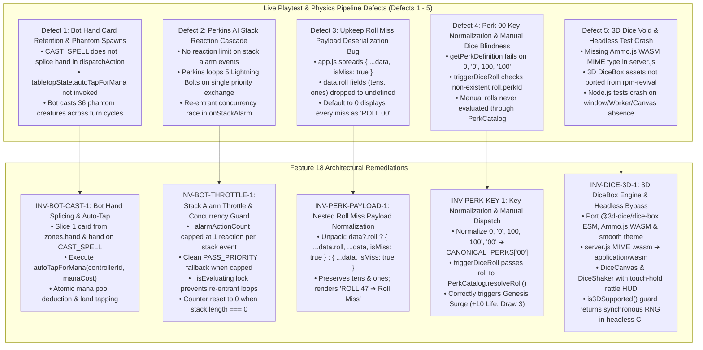
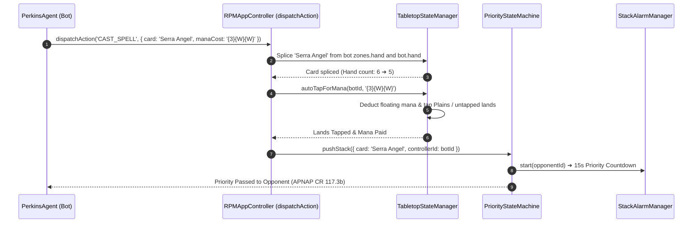
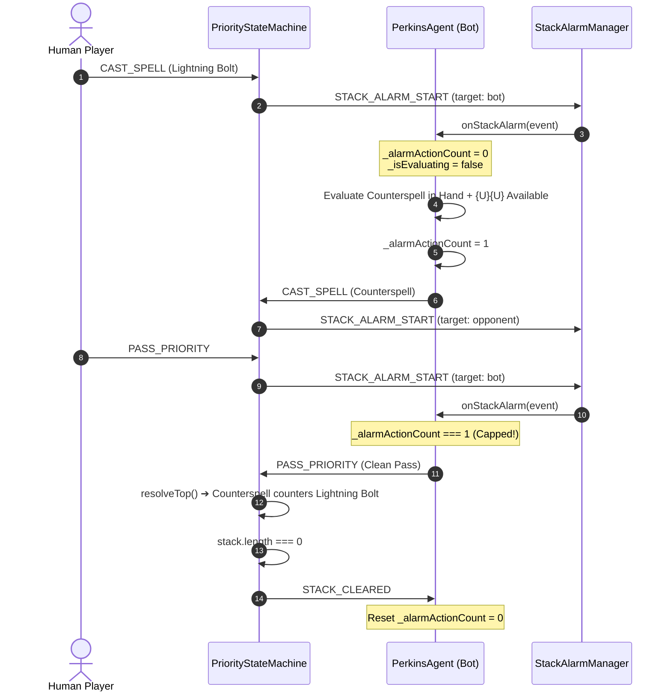

# FEATURE 18: 3D Dice Engine Integration, Bot Spell Cast Integrity, and Perk Activation Normalization

**Document ID:** `SPEC-RPM-DICE-018`  
**Status:** APPROVED FOR IMPLEMENTATION  
**Author:** Argon Specification Architect  
**Created Date:** October 20, 2026  
**Revision:** 1.0.0  
**Target File Path:** `specs/FEATURE_18_3D_DICE_AND_BOT_INTEGRITY_SPEC.md`  

**Core Implementation Targets:**
- [`src/app.js`](file:///home/svayneak/Documents/Svayneak/rpm%20multiplayer/src/app.js) (MODIFY — Bot Hand Card Splicing `INV-BOT-CAST-1`, `autoTapForMana` in `dispatchAction('CAST_SPELL')` `INV-BOT-CAST-1`, Nested Roll Payload Unpacking `INV-PERK-PAYLOAD-1`, Manual `triggerDiceRoll` Perk Resolution `INV-PERK-KEY-1`, `DiceCanvas` & `DiceShaker` DOM Initialization `INV-DICE-3D-1`)
- [`src/PerkinsAgent.js`](file:///home/svayneak/Documents/Svayneak/rpm%20multiplayer/src/PerkinsAgent.js) (MODIFY — Bot Stack Alarm Throttling `_alarmActionCount` capped at 1 reaction per stack event `INV-BOT-THROTTLE-1`, Concurrency Lock `_isEvaluating` `INV-BOT-THROTTLE-1`, Reset counter on `stack.length === 0` `INV-BOT-THROTTLE-1`)
- [`src/PerkCatalog.js`](file:///home/svayneak/Documents/Svayneak/rpm%20multiplayer/src/PerkCatalog.js) (MODIFY — `getPerkDefinition` Key Normalization for `0`, `'0'`, `100`, `'100'`, and `'00'` resolving to Genesis Surge `INV-PERK-KEY-1`)
- [`server.js`](file:///home/svayneak/Documents/Svayneak/rpm%20multiplayer/server.js) (MODIFY — Add `'.wasm': 'application/wasm'` to `MIME_TYPES` dictionary `INV-DICE-3D-1`)
- [`src/view/DiceCanvas.js`](file:///home/svayneak/Documents/Svayneak/rpm%20multiplayer/src/view/DiceCanvas.js) (NEW — 3D Dice Box Singleton with `is3DSupported()` Headless Bypass, Percentile 2d10 & d20 Physics Throws, Auto-Clear and Fade Timers `INV-DICE-3D-1`)
- [`src/view/DiceShaker.js`](file:///home/svayneak/Documents/Svayneak/rpm%20multiplayer/src/view/DiceShaker.js) (NEW — Pointer Hold-and-Shake HUD, Dynamic Velocity Tracking, Angular Jitter Rattle, Throw Force Calculation, Haptic & Audio Feedback `INV-DICE-3D-1`)
- [`index.html`](file:///home/svayneak/Documents/Svayneak/rpm%20multiplayer/index.html) (MODIFY — Add transparent `#dice-canvas` viewport overlay container `INV-DICE-3D-1`)
- [`src/view/tabletop.css`](file:///home/svayneak/Documents/Svayneak/rpm%20multiplayer/src/view/tabletop.css) (MODIFY — Add `#dice-canvas`, `.is-fading`, `.dice-shaker-hud`, `.shaker-aura`, `.shaker-burst`, `.shaker-die`, `.shaker-hint` styles `INV-DICE-3D-1`)
- [`assets/lib/dice-box/`](file:///home/svayneak/Documents/Svayneak/rpm%20multiplayer/assets/lib/dice-box/) (ASSET MIGRATION — Port `@3d-dice/dice-box` ESM build from `rpm-revival` `INV-DICE-3D-1`)
- [`assets/dice-box/ammo/`](file:///home/svayneak/Documents/Svayneak/rpm%20multiplayer/assets/dice-box/ammo/) (ASSET MIGRATION — Port Ammo.js WASM physics engine `ammo.wasm.wasm` `INV-DICE-3D-1`)
- [`assets/dice-box/themes/smooth/`](file:///home/svayneak/Documents/Svayneak/rpm%20multiplayer/assets/dice-box/themes/smooth/) (ASSET MIGRATION — Port `smooth` theme with 0-9 d10 mesh faces `INV-DICE-3D-1`)
- [`assets/sounds/roll.mp3`](file:///home/svayneak/Documents/Svayneak/rpm%20multiplayer/assets/sounds/roll.mp3) (ASSET MIGRATION — Port authentic 3D dice collision clatter sound `INV-DICE-3D-1`)
- [`test/test_dice_bot_integrity.js`](file:///home/svayneak/Documents/Svayneak/rpm%20multiplayer/test/test_dice_bot_integrity.js) (NEW — Exhaustive 16-Vector Acceptance Test Suite `TC-DICE-01` to `TC-DICE-16`)

**Related Specifications & Decision Records:**
- [`specs/FEATURE_17_BATTLE_STABILITY_SPEC.md`](file:///home/svayneak/Documents/Svayneak/rpm%20multiplayer/specs/FEATURE_17_BATTLE_STABILITY_SPEC.md) (`SPEC-RPM-STABILITY-017`: Battle Stability, Opponent Land Field, Auto-Tap Mana Engine, Stack Resolution, Card Inspection)
- [`specs/FEATURE_16_BATTLE_AND_SPECTATOR_SPEC.md`](file:///home/svayneak/Documents/Svayneak/rpm%20multiplayer/specs/FEATURE_16_BATTLE_AND_SPECTATOR_SPEC.md) (`SPEC-RPM-BATTLE-016`: Lobby Hub, Spectator Directory, Battle Mechanics Enforcement, Phase Tracker)
- [`specs/FEATURE_13_PERKINS_AI_SPEC.md`](file:///home/svayneak/Documents/Svayneak/rpm%20multiplayer/specs/FEATURE_13_PERKINS_AI_SPEC.md) (`SPEC-RPM-PERKINS-013`: Perkins Autonomous Bot Pod Seating & Heuristics)
- [`specs/FEATURE_9_RANDOM_PERK_SPEC.md`](file:///home/svayneak/Documents/Svayneak/rpm%20multiplayer/specs/FEATURE_9_RANDOM_PERK_SPEC.md) (`SPEC-RPM-PERK-009`: Random Perk Upkeep Engine, Perk Catalog & RPBD Birthday Options)
- [`specs/FEATURE_4_STACK_PRIORITY_SPEC.md`](file:///home/svayneak/Documents/Svayneak/rpm%20multiplayer/specs/FEATURE_4_STACK_PRIORITY_SPEC.md) (`SPEC-RPM-PRIORITY-004`: MTG CR 117 Priority Flow, LIFO Stack & Checkpoint Journal)
- [`specs/FEATURE_3_TABLETOP_ZONE_STATE_SPEC.md`](file:///home/svayneak/Documents/Svayneak/rpm%20multiplayer/specs/FEATURE_3_TABLETOP_ZONE_STATE_SPEC.md) (`SPEC-RPM-ZONE-003`: Fog-of-War Projection & Tabletop Zone State Manager)
- `decisionlog.md`:
  - `DEC-014` (Random Perk Upkeep Mechanics & Canonical Perk Table)
  - `DEC-022` (Battle Stability, Opponent Land Field, Auto-Tap Mana Engine, Stack Resolution)
  - `DEC-023` (3D Dice Engine Integration, Bot Spell Cast Integrity, Perk Activation Normalization)

---

## 1. Executive Summary & Root Cause Problem Formulation

Live integration stress testing, turn-cycle simulations, and headless test executions identified five critical failure modes across the bot intelligence loop, the perk evaluation pipeline, and tabletop visual physics. These defects undermine game balance, generate phantom board states, produce confusing UI toasts, and block 3D dice rolling.



### 1.1 Defect 1: Bot Hand Card Retention, Mana Bypass & 36 Phantom Creatures (`INV-BOT-CAST-1`)
- **Observed Behavior:** In extended local and multiplayer matches against Perkins AI, the battlefield became clogged with dozens of identical creatures (up to 36 creatures). Simultaneously, Perkins's hand count never decreased, and Perkins cast 4CMC and 5CMC creatures without tapping lands or exhausting its mana pool.
- **Root Cause Analysis:** In [`src/app.js`](file:///home/svayneak/Documents/Svayneak/rpm%20multiplayer/src/app.js) `dispatchAction(action)` under `case 'CAST_SPELL':`, the action was forwarded directly to `this.priorityMachine.pushStack(item)`. Unlike `castSpellByName()` (which was only invoked for the local human player), `dispatchAction` failed to:
  1. Splice the cast card from `tabletopState.players[controllerId].hand` and `zones.hand`.
  2. Invoke `tabletopState.autoTapForMana(controllerId, card.manaCost)` to deduct mana and tap the bot's lands.
  As a consequence, on every bot turn tick, the bot re-evaluated its hand, saw the same creature cards still present, found untapped lands still available, and cast the creature again without paying costs.
- **Remediation (`INV-BOT-CAST-1`):** In `app.js` `dispatchAction('CAST_SPELL')`:
  1. Look up the controller's player object: `const p = this.tabletopState?.players?.[controllerId];`.
  2. Locate the card in `p.zones.hand` by `instanceId` or `cardName`/`name`.
  3. Splice exactly 1 card instance from `p.zones.hand` and synchronize `p.hand = p.zones.hand`.
  4. If `card.manaCost` exists, invoke `this.tabletopState.autoTapForMana(controllerId, card.manaCost)` to ensure colored mana and untapped lands are atomically tapped and deducted.

### 1.2 Defect 2: Perkins AI Stack Reaction Cascade & Concurrency Race (`INV-BOT-THROTTLE-1`)
- **Observed Behavior:** When a human player cast a spell or triggered an ability, Perkins AI instantly fired multiple reaction spells in rapid succession (e.g. casting 5 Lightning Bolts or alternating Counterspells and Bolts within milliseconds on a single priority hand-off).
- **Root Cause Analysis:** In [`src/PerkinsAgent.js`](file:///home/svayneak/Documents/Svayneak/rpm%20multiplayer/src/PerkinsAgent.js), both `_bindAppListeners()` and `onStackAlarm()` reacted to stack events without maintaining state regarding the ongoing stack chain. When Perkins cast an instant (e.g. Lightning Bolt), that cast itself generated a new stack event. Because `onStackAlarm` had no throttling mechanism, Perkins received another priority notification and immediately fired another instant. Furthermore, asynchronous timer delays in `onStackAlarm` lacked a re-entrancy lock, leading to concurrent evaluations executing in parallel.
- **Remediation (`INV-BOT-THROTTLE-1`):**
  1. Maintain an internal reaction counter `this._alarmActionCount = 0` per stack chain.
  2. Cap reactions at exactly 1 instant reaction per stack event. If `this._alarmActionCount >= 1`, cleanly emit `PASS_PRIORITY`.
  3. Reset `this._alarmActionCount = 0` whenever the stack is empty (`stack.length === 0` or upon `STACK_CLEARED` / `PHASE_STEP_CHANGED`).
  4. Enforce a concurrency guard `this._isEvaluating`: if `onStackAlarm` is already running, subsequent synchronous or asynchronous triggers immediately yield or pass.

### 1.3 Defect 3: Upkeep Roll Miss Payload Deserialization Bug (`INV-PERK-PAYLOAD-1`)
- **Observed Behavior:** During the Upkeep phase, whenever a player failed to roll a double (e.g. rolling 47, 82, or 35), the UI badge displayed: `"ROLL 00 ➔ Roll Miss (No Perk)"`. Players reported that every single missed roll falsely displayed as `00`.
- **Root Cause Analysis:** In [`src/RandomPerkEngine.js`](file:///home/svayneak/Documents/Svayneak/rpm%20multiplayer/src/RandomPerkEngine.js), `PERK_ROLL_MISS` is emitted with a payload structured as:
  ```javascript
  this.emit('PERK_ROLL_MISS', {
    activePlayerId,
    roll: rollResult, // { tens: 4, ones: 7, total: 47, rollString: '47' }
    turnNumber
  });
  ```
  However, in [`src/app.js`](file:///home/svayneak/Documents/Svayneak/rpm%20multiplayer/src/app.js) lines 1771-1774, the listener was implemented as:
  ```javascript
  const onMiss = (data) => {
    if (this.isDestroyed) return;
    this.handlePerkRolled({ ...data, isMiss: true });
  };
  ```
  Spreading `{ ...data, isMiss: true }` left `tens` and `ones` nested inside `data.roll`. Inside `handlePerkRolled(roll)`, the code accessed `roll.tens ?? 0` and `roll.ones ?? 0`. Because `roll.tens` was `undefined`, it fell back to `0`, causing the UI to render `ROLL 00 ➔ Roll Miss (No Perk)` for every single non-double roll.
- **Remediation (`INV-PERK-PAYLOAD-1`):** Unpack the nested roll payload in `app.js`:
  ```javascript
  const rollPayload = data?.roll ? { ...data.roll, ...data, isMiss: true } : { ...data, isMiss: true };
  this.handlePerkRolled(rollPayload);
  ```

### 1.4 Defect 4: Perk 00 Key Normalization & Manual Dice Blindness (`INV-PERK-KEY-1`)
- **Observed Behavior:** 
  1. True double zero rolls (00) occasionally failed to trigger Perk #00 (Genesis Surge) if parsed as number `0` or string `'0'` or percentile `100`.
  2. Clicking the manual roll button in the HUD or via ActionLexer did not trigger perk resolution; the UI showed a raw roll without checking the Perk Catalog, and `isMiss` was calculated erroneously because `roll.perkId` was checked instead of resolving through `PerkCatalog`.
- **Root Cause Analysis:**
  1. In [`src/PerkCatalog.js`](file:///home/svayneak/Documents/Svayneak/rpm%20multiplayer/src/PerkCatalog.js) `getPerkDefinition(perkKey)`, the catalog only looked up `CANONICAL_PERKS[perkKey]`. If `perkKey` was passed as `0`, `'0'`, `100`, or `'100'`, it failed to find `CANONICAL_PERKS['00']`.
  2. In [`src/app.js`](file:///home/svayneak/Documents/Svayneak/rpm%20multiplayer/src/app.js) `triggerDiceRoll(diceType)`:
     ```javascript
     const roll = executeAuthoritativeRoll();
     this.handlePerkRolled({ ...roll, isMiss: roll.perkId === null });
     ```
     `executeAuthoritativeRoll()` returns `{ tens, ones, rollString }` and does NOT define `perkId`. Thus `roll.perkId === null` evaluated to `false` (since `undefined === null` is `false`), bypassing perk execution entirely.
- **Remediation (`INV-PERK-KEY-1`):**
  1. In `PerkCatalog.js`, normalize `perkKey`: map `0`, `'0'`, `100`, `'100'` and `'00'` to `'00'`, and pad single digits (`'1'` to `'9'`) with a leading zero.
  2. In `app.js` `triggerDiceRoll`, route manual rolls through `PerkCatalog.resolveRoll(roll.tens, roll.ones)` to evaluate canonical doubles, birthday matches (`RPBD`), and genuine misses.

### 1.5 Defect 5: Missing 3D Dice Engine, Ammo.js WASM MIME Header & Headless Fragility (`INV-DICE-3D-1`)
- **Observed Behavior:** 
  1. Rolling dice in the multiplayer arena displayed only static flat CSS boxes. The rich 3D physics-based dice tumbling with sound clatter and haptic rattle from `rpm-revival` was missing.
  2. In local development or standalone production server, requesting `.wasm` files failed or threw MIME type mismatch errors (`Expected 'application/wasm' but received 'application/octet-stream'`).
  3. Running test suites in Node.js or headless CI environments crashed when 3D dice classes attempted to initialize `window.Worker` or `OffscreenCanvas`.
- **Root Cause Analysis:**
  1. Standalone [`server.js`](file:///home/svayneak/Documents/Svayneak/rpm%20multiplayer/server.js) lacked `.wasm: 'application/wasm'` in its `MIME_TYPES` lookup table.
  2. The `@3d-dice/dice-box` ESM library, Ammo.js WASM physics engine (`ammo.wasm.wasm`), and `smooth` 3D theme (which provides d10 faces engraved 0-9) had not been ported from `/home/svayneak/Documents/Svayneak/rpm-revival/`.
  3. Neither `DiceCanvas.js` nor `DiceShaker.js` existed in `rpm multiplayer`, and headless test runs lacked an `is3DSupported()` environment detection guard.
- **Remediation (`INV-DICE-3D-1`):**
  1. Port vendored `@3d-dice/dice-box` ESM library, Ammo.js WASM, and `smooth` 3D theme assets into `rpm multiplayer/assets/`.
  2. Update `server.js` with `.wasm: 'application/wasm'`.
  3. Implement `src/view/DiceCanvas.js` singleton and `src/view/DiceShaker.js` touch-hold/rattle HUD.
  4. Provide a hermetic test guard `is3DSupported()`: when running in Node.js or headless test environments (lacking `window.Worker` or `OffscreenCanvas`), `DiceCanvas` bypasses 3D physics and returns authoritative RNG rolls synchronously without throwing or hanging.
  5. Mount `#dice-canvas` transparent overlay container into `index.html` with responsive styles in `tabletop.css`.

---

## 2. Formal Architectural Invariant Hierarchy

All implementations in Feature 18 MUST strictly adhere to the five formal architectural invariants:

```
┌─────────────────────────────────────────────────────────────────────────────┐
│                    FEATURE 18 ARCHITECTURAL INVARIANTS                      │
├─────────────────────────────────────────────────────────────────────────────┤
│  INV-BOT-CAST-1: Bot Hand & Mana State Synchronization                      │
│  • Splicing cast card from tabletopState.players[controllerId].hand         │
│  • Invoking tabletopState.autoTapForMana(controllerId, card.manaCost)      │
│  • Total prevention of phantom creature accumulation across turn cycles     │
├─────────────────────────────────────────────────────────────────────────────┤
│  INV-BOT-THROTTLE-1: Bot Stack Reaction Throttling & Concurrency Guard       │
│  • Maximum 1 instant reaction per stack event (_alarmActionCount <= 1)     │
│  • Concurrency lock (_isEvaluating) blocks re-entrant evaluation loops      │
│  • Reset _alarmActionCount = 0 upon stack.length === 0 or STACK_CLEARED    │
├─────────────────────────────────────────────────────────────────────────────┤
│  INV-PERK-PAYLOAD-1: Upkeep Roll Miss Payload Normalization                │
│  • Unpack nested roll payload: data?.roll ? { ...data.roll, ...data }      │
│  • Retain tens and ones values for accurate non-zero miss display          │
│  • Format UI badge with actual rolled values: "ROLL [tens][ones] ➔ Miss"   │
├─────────────────────────────────────────────────────────────────────────────┤
│  INV-PERK-KEY-1: Perk 00 Key Normalization & Manual Roll Dispatch           │
│  • getPerkDefinition normalizes 0, '0', 100, '100' ➔ '00' (Genesis Surge)  │
│  • triggerDiceRoll passes rolls to PerkCatalog.resolveRoll(tens, ones)      │
│  • Correctly applies +10 Life and 3-card draw for Genesis Surge            │
├─────────────────────────────────────────────────────────────────────────────┤
│  INV-DICE-3D-1: 3D Dice Engine Integration & Headless Test Bypass           │
│  • Port @3d-dice/dice-box, Ammo.js WASM & smooth 0-9 d10 theme             │
│  • server.js serves .wasm as application/wasm                              │
│  • DiceCanvas & DiceShaker interactive HUD with rattle & haptics           │
│  • is3DSupported() guard guarantees zero crashes in headless Node.js tests │
└─────────────────────────────────────────────────────────────────────────────┘
```

---

## 3. Bot Hand & Mana State Synchronization (`INV-BOT-CAST-1`)

### 3.1 MTG Rules Foundation & State Flow
Under Magic: The Gathering Comprehensive Rules (CR 601.2):
- **CR 601.2a:** To cast a spell, the player moves the card from where it is (usually the hand) onto the stack.
- **CR 601.2f / 601.2h:** The player determines the total cost and pays costs (tapping lands and deducting mana from their mana pool).

When a bot or network player dispatches `CAST_SPELL` via `app.js` `dispatchAction()`, the state manager must synchronously move the card out of the player's hand and execute the auto-tap engine before the spell enters the stack.

### 3.2 State Mutation in `app.js` `dispatchAction('CAST_SPELL')`
```javascript
case 'CAST_SPELL': {
  const cardObj = payload.card || action.card || payload;
  const controllerId = payload.controllerId || payload.playerId || action.playerId || cardObj.controllerId;
  const sourcePlayerId = payload.playerId || action.playerId || payload.controllerId || cardObj.sourcePlayerId;
  const controllerName = payload.controllerName || action.controllerName || cardObj.controllerName;
  const cardName = payload.cardName || action.cardName || cardObj.name || cardObj.cardName;

  // 1. Hand Zone Card Splicing (INV-BOT-CAST-1)
  if (this.tabletopState?.players?.[controllerId]) {
    const p = this.tabletopState.players[controllerId];
    const handList = Array.isArray(p.zones?.hand) ? p.zones.hand : (Array.isArray(p.hand) ? p.hand : []);
    const idx = handList.findIndex(c => {
      if (!c) return false;
      if (cardObj.instanceId && c.instanceId === cardObj.instanceId) return true;
      const cName = c.name || c.cardName || c;
      return cName === cardName;
    });

    if (idx !== -1) {
      handList.splice(idx, 1);
      if (p.zones) p.zones.hand = handList;
      p.hand = handList;
    }
  }

  // 2. Auto-Tap Mana Pool Deduction & Land Tapping (INV-BOT-CAST-1)
  const manaCost = cardObj.manaCost || payload.manaCost;
  if (this.tabletopState && manaCost && typeof this.tabletopState.autoTapForMana === 'function') {
    try {
      this.tabletopState.autoTapForMana(controllerId, manaCost);
    } catch (err) {
      console.warn(`[app] autoTapForMana warning for player ${controllerId}:`, err.message);
    }
  }

  // 3. Stack Placement & Priority Forwarding
  if (this.priorityMachine) {
    const item = {
      ...cardObj,
      card: cardObj,
      controllerId,
      sourcePlayerId,
      controllerName,
      cardName,
      targetId: payload.targetId || action.targetId || payload.targets || action.targets,
      targets: payload.targets || action.targets || payload.targetId || action.targetId
    };
    this.priorityMachine.pushStack(item);
  }
  break;
}
```

---

## 4. Bot Stack Reaction Throttling & Concurrency Guard (`INV-BOT-THROTTLE-1`)

### 4.1 The Re-entrant Cascade Problem
In MTG CR 117.3c, a player receiving priority in response to a stack event may cast an instant spell or activate an ability. Once cast, priority returns to the active player or passes down the APNAP chain. If the AI reacts to every priority shift without tracking whether it has already cast a response in the current exchange, it enters an infinite feedback loop:
`Cast Bolt ➔ Stack Pushed ➔ Priority Changes ➔ Bot Sees Priority ➔ Cast Bolt ➔ ...`

### 4.2 Architectural Throttling State in `PerkinsAgent.js`
In [`src/PerkinsAgent.js`](file:///home/svayneak/Documents/Svayneak/rpm%20multiplayer/src/PerkinsAgent.js):
```javascript
class PerkinsAgent {
  constructor(options = {}) {
    // ... existing fields ...
    this._alarmActionCount = 0;   // Stack reaction throttle counter (INV-BOT-THROTTLE-1)
    this._isEvaluating = false;    // Concurrency re-entrancy lock (INV-BOT-THROTTLE-1)
  }
```

### 4.3 Evaluation Guard & Throttled Reaction Logic
```javascript
async onStackAlarm(alarmState) {
  if (this.isDestroyed) return;
  if (alarmState?.targetPlayerId && alarmState.targetPlayerId !== this.slotId) return;

  // 1. Concurrency Lock: Prevent parallel re-entrant executions (INV-BOT-THROTTLE-1)
  if (this._isEvaluating) {
    return;
  }

  // 2. Throttle Guard: Maximum 1 instant reaction per stack event chain (INV-BOT-THROTTLE-1)
  if (this._alarmActionCount >= 1) {
    const passAction = { type: 'PASS_PRIORITY', playerId: this.slotId };
    await this.dispatchAction(passAction);
    return passAction;
  }

  this._isEvaluating = true;
  try {
    const executeAlarmReaction = async () => {
      if (this.isDestroyed) return;
      const state = this.getProjectedState();
      const myPlayer = state?.players?.[this.slotId];
      if (!myPlayer) {
        const passAction = { type: 'PASS_PRIORITY', playerId: this.slotId };
        await this.dispatchAction(passAction);
        return passAction;
      }

      // Check for available reactions (Counterspell, Lightning Bolt, Fatal Push)...
      // If a spell is cast:
      // this._alarmActionCount++;
      // await this.dispatchAction(castAction);
      // return castAction;

      // Default: Clean Pass
      const passAction = { type: 'PASS_PRIORITY', playerId: this.slotId };
      await this.dispatchAction(passAction);
      return passAction;
    };

    if (this.thinkingDelayMs > 0) {
      return await new Promise((resolve) => {
        const timerId = setTimeout(async () => {
          this._activeTimers.delete(timerId);
          const res = await executeAlarmReaction();
          resolve(res);
        }, this.thinkingDelayMs);
        this._activeTimers.add(timerId);
      });
    } else {
      return await executeAlarmReaction();
    }
  } finally {
    this._isEvaluating = false;
  }
}
```

### 4.4 Counter Reset Trigger
The counter `this._alarmActionCount` MUST be reset to `0` whenever:
1. The stack becomes empty (`stack.length === 0`).
2. A `STACK_CLEARED` event is received from `PriorityStateMachine`.
3. The turn advances or phase step changes (`PHASE_STEP_CHANGED`).

```javascript
_handleStackEmpty() {
  this._alarmActionCount = 0;
}
```

---

## 5. Upkeep Roll Miss Payload Normalization (`INV-PERK-PAYLOAD-1`)

### 5.1 Event Contract Mismatch
[`src/RandomPerkEngine.js`](file:///home/svayneak/Documents/Svayneak/rpm%20multiplayer/src/RandomPerkEngine.js) emits `PERK_ROLL_MISS` with a wrapped dictionary:
```javascript
{
  activePlayerId: 'player_1',
  roll: {
    tens: 4,
    ones: 7,
    total: 47,
    rollString: '47'
  },
  turnNumber: 3
}
```

### 5.2 Remediation in `app.js`
In [`src/app.js`](file:///home/svayneak/Documents/Svayneak/rpm%20multiplayer/src/app.js) lines 1771-1774:
```javascript
// BEFORE (Buggy):
const onMiss = (data) => {
  if (this.isDestroyed) return;
  this.handlePerkRolled({ ...data, isMiss: true });
};

// AFTER (Normalized INV-PERK-PAYLOAD-1):
const onMiss = (data) => {
  if (this.isDestroyed) return;
  const rollPayload = data?.roll ? { ...data.roll, ...data, isMiss: true } : { ...data, isMiss: true };
  this.handlePerkRolled(rollPayload);
};
```

### 5.3 UI Display Reconciliation in `handlePerkRolled`
When `rollPayload` contains valid `tens` and `ones` values:
```javascript
if (roll.isMiss) {
  perkKeyBadge.textContent = `ROLL ${roll.tens ?? 0}${roll.ones ?? 0} ➔ Roll Miss (No Perk)`;
  perkDesc.textContent = 'No perk triggered for this roll.';
}
```
For example, a roll of 4 and 7 now renders:
`ROLL 47 ➔ Roll Miss (No Perk)`
instead of the erroneous `ROLL 00 ➔ Roll Miss (No Perk)`.

---

## 6. Perk 00 Key Normalization & Manual Roll Dispatch (`INV-PERK-KEY-1`)

### 6.1 `getPerkDefinition` Key Normalization in `PerkCatalog.js`
In percentile dice mechanics, rolling double zero represents either `00` or `100`. In the canonical RPM perk table, `00` maps to **Genesis Surge** (`CANONICAL_PERKS['00']`):
- Name: Genesis Surge
- Effect: "You gain 10 life and draw three cards."

```javascript
export function getPerkDefinition(perkKey, lang = 'en') {
  let key = perkKey;
  if (key === 0 || key === '0' || key === 100 || key === '100') {
    key = '00';
  } else if (typeof key === 'number') {
    key = key < 10 ? `0${key}` : `${key}`;
  } else if (typeof key === 'string') {
    key = key.trim();
    if (key.length === 1) key = `0${key}`;
  }

  const perk = CANONICAL_PERKS[key];
  if (!perk) return null;
  return {
    ...perk,
    name: perk.names?.[lang] || perk.name,
    text: perk.rulesText?.[lang] || perk.rulesText.en
  };
}
```

### 6.2 Manual Roll Dispatch in `app.js` `triggerDiceRoll`
When a player rolls dice manually via UI click or ActionLexer command (`ROLL_DICE`), the roll result MUST be passed through `PerkCatalog.resolveRoll()`:

```javascript
triggerDiceRoll(diceType = 'dice') {
  if (diceType === 'd20' || this.isRollOffActive) {
    this.submitRollOff();
  } else {
    // 1. Generate Authoritative Roll (INV-PERK-KEY-1)
    const roll = executeAuthoritativeRoll();
    
    // 2. Resolve Perk Key, Double Match, or Miss via PerkCatalog
    const resolved = resolveRoll(roll.tens, roll.ones);
    
    // 3. Dispatch Handled Perk Result
    this.handlePerkRolled({
      ...roll,
      ...resolved
    });
  }
}
```

---

## 7. 3D Dice Engine Integration & Headless Test Bypass (`INV-DICE-3D-1`)

### 7.1 Architecture & Asset Migration from `rpm-revival`
The 3D dice physics engine is powered by `@3d-dice/dice-box` running Ammo.js WebAssembly physics inside a Web Worker with an `OffscreenCanvas` render target (falling back to an onscreen `<canvas>` element if OffscreenCanvas is unsupported).

```mermaid
flowchart TD
    subgraph UI["Arena Tabletop View"]
        Trigger["Roll Button Click / Touch-Hold"]
        HUD["DiceShaker HUD<br/>(Pointer aura, rattle jitter, haptics)"]
        Overlay["#dice-canvas Viewport Overlay<br/>(Fixed transparent canvas container)"]
    end

    subgraph Engine["3D Dice Box Engine"]
        DC["DiceCanvas Singleton"]
        Box["@3d-dice/dice-box (ESM)"]
        Ammo["Ammo.js Physics (ammo.wasm.wasm)"]
        Theme["Smooth Theme<br/>(0-9 d10 Faces & d20 Meshes)"]
    end

    subgraph Fallback["Headless CI / Node.js"]
        Guard["is3DSupported() Guard"]
        SyncRNG["executeAuthoritativeRoll() Synchronous RNG"]
    end

    Trigger -->|Touch-Hold| HUD
    HUD -->|Release Throw| DC
    Trigger -->|Direct Click| DC

    DC -->|Check Environment| Guard
    Guard -->|Supported (Browser + Worker)| Box
    Guard -->|Unsupported (Node.js/Headless)| SyncRNG

    Box --> Ammo
    Box --> Theme
    Box --> Overlay
    SyncRNG -->|Deterministic Result| DC
```

### 7.2 Static Asset File Topology
The following assets MUST be copied from `/home/svayneak/Documents/Svayneak/rpm-revival/` to `/home/svayneak/Documents/Svayneak/rpm multiplayer/`:
1. `assets/lib/dice-box/`:
   - `dice-box.es.min.js` (Main ESM loader)
   - `Dice.min.js`
   - `world.offscreen.min.js` (OffscreenCanvas physics worker)
   - `world.onscreen.min.js` (Main thread canvas fallback worker)
   - `world.none.min.js` (Headless simulation worker)
2. `assets/dice-box/ammo/`:
   - `ammo.wasm.wasm` (Compiled WebAssembly physics core)
3. `assets/dice-box/themes/smooth/`:
   - `diffuse-dark.png`
   - `diffuse-light.png`
   - `normal.png`
   - `smoothDice.json` (d10 mesh faces engraved 0-9)
   - `theme.config.json`
   - `package.json`
4. `assets/sounds/`:
   - `roll.mp3` (Dice tumble collision sound)

### 7.3 Standalone Server WASM MIME Configuration (`server.js`)
In [`server.js`](file:///home/svayneak/Documents/Svayneak/rpm%20multiplayer/server.js):
```javascript
const MIME_TYPES = {
  '.html': 'text/html; charset=utf-8',
  '.js': 'text/javascript; charset=utf-8',
  '.css': 'text/css; charset=utf-8',
  '.json': 'application/json; charset=utf-8',
  '.png': 'image/png',
  '.jpg': 'image/jpeg',
  '.svg': 'image/svg+xml',
  '.ico': 'image/x-icon',
  '.woff': 'font/woff',
  '.woff2': 'font/woff2',
  '.ttf': 'font/ttf',
  '.ogg': 'audio/ogg',
  '.mp3': 'audio/mpeg',
  '.wasm': 'application/wasm' // Required for WebAssembly streaming compilation (INV-DICE-3D-1)
};
```

### 7.4 Hermetic Headless Test Guard `is3DSupported()`
To prevent test suite crashes when importing or running `DiceCanvas` in Node.js or headless CI environments:
```javascript
export function is3DSupported() {
  if (typeof window === 'undefined' || typeof document === 'undefined') {
    return false;
  }
  if (typeof window.Worker === 'undefined') {
    return false;
  }
  const hasCanvas = typeof HTMLCanvasElement !== 'undefined' || typeof OffscreenCanvas !== 'undefined';
  return hasCanvas;
}
```

When `is3DSupported()` returns `false`, `DiceCanvas.rollPercentile()` and `DiceCanvas.rollD20()` bypass 3D physics rendering entirely and return deterministic or PRNG roll results synchronously:
```javascript
async rollPercentile(options = {}) {
  if (!is3DSupported()) {
    const tens = Math.floor(Math.random() * 10);
    const ones = Math.floor(Math.random() * 10);
    return [tens, ones];
  }
  // Standard 3D physics throw via this._box.roll(...)
}
```

### 7.5 DOM Overlay Container & Styling
In [`index.html`](file:///home/svayneak/Documents/Svayneak/rpm%20multiplayer/index.html) mounted at body root:
```html
<!-- 3D Dice Box Viewport Overlay (INV-DICE-3D-1) -->
<div id="dice-canvas"></div>
```

In [`src/view/tabletop.css`](file:///home/svayneak/Documents/Svayneak/rpm%20multiplayer/src/view/tabletop.css):
```css
/* 3D Dice Canvas Viewport Overlay */
#dice-canvas {
  position: fixed;
  inset: 0;
  z-index: 9999;
  pointer-events: none;
  background: transparent;
  opacity: 1;
  transition: opacity 0.4s ease-out;
}

#dice-canvas.is-fading {
  opacity: 0;
}

#dice-canvas canvas,
#dice-canvas .dice-box-canvas {
  background: transparent;
  width: 100%;
  height: 100%;
}

/* Interactive Dice Shaker HUD (Touch-Hold & Shake) */
.dice-shaker-hud {
  position: fixed;
  inset: 0;
  pointer-events: none;
  z-index: 9999;
  overflow: hidden;
  user-select: none;
}

.shaker-aura {
  position: absolute;
  width: 120px;
  height: 120px;
  border-radius: 50%;
  transform: translate(-50%, -50%);
  background: radial-gradient(circle, rgba(124, 58, 237, 0.45) 0%, rgba(30, 27, 75, 0.75) 60%, rgba(15, 23, 42, 0) 100%);
  border: 2px solid rgba(255, 255, 255, 0.35);
  box-shadow: 0 0 30px rgba(139, 92, 246, 0.6), inset 0 0 20px rgba(255, 255, 255, 0.2);
  backdrop-filter: blur(8px);
  -webkit-backdrop-filter: blur(8px);
  display: flex;
  flex-direction: column;
  align-items: center;
  justify-content: center;
  will-change: transform, left, top;
  transition: opacity 0.15s ease;
}

.shaker-aura.shaker-burst {
  animation: shaker-burst-anim 0.25s cubic-bezier(0.16, 1, 0.3, 1) forwards;
}

@keyframes shaker-burst-anim {
  0% { transform: translate(-50%, -50%) scale(1); opacity: 1; }
  100% { transform: translate(-50%, -50%) scale(1.6); opacity: 0; }
}

.shaker-dice-container {
  display: flex;
  align-items: center;
  justify-content: center;
  gap: 8px;
  width: 100%;
  height: 60px;
  position: relative;
}

.shaker-die {
  width: 40px;
  height: 40px;
  border-radius: 10px;
  display: flex;
  align-items: center;
  justify-content: center;
  font-weight: 800;
  font-size: 1.1rem;
  color: white;
  box-shadow: 0 6px 16px rgba(0, 0, 0, 0.6), inset 0 1px 2px rgba(255, 255, 255, 0.4);
  will-change: transform;
  transition: transform 0.08s ease-out;
}

.shaker-die.die-tens {
  background: linear-gradient(135deg, #8b5cf6, #581c87);
  border: 2px solid #fbbf24;
  color: #fef08a;
  text-shadow: 0 2px 4px rgba(0, 0, 0, 0.6);
}

.shaker-die.die-ones {
  background: linear-gradient(135deg, #06b6d4, #0e7490);
  border: 2px solid #f87171;
  color: #fef2f2;
  text-shadow: 0 2px 4px rgba(0, 0, 0, 0.6);
}

.shaker-die.die-d20 {
  width: 46px;
  height: 46px;
  border-radius: 12px;
  background: linear-gradient(135deg, #f59e0b, #b45309);
  border: 2px solid #fef3c7;
  color: #ffffff;
  font-size: 1.25rem;
}
```

---

## 8. Complete System Architecture & Sequence Workflows

### 8.1 Upkeep 3D Dice Throw & Perk Resolution Sequence
```mermaid
sequenceDiagram
    autonumber
    actor Player as Human Player / Active Roller
    participant HUD as DiceShaker HUD
    participant Canvas as DiceCanvas (3D Overlay)
    participant Box as @3d-dice/dice-box (Ammo.js WASM)
    participant Engine as RandomPerkEngine
    participant Catalog as PerkCatalog
    participant State as TabletopStateManager

    Player->>HUD: Touch-Hold / Pointer Down on Roll Button
    HUD->>HUD: Spawn Aura, Track Pointer, Jitter Dice & Vibrate
    Player->>HUD: Release Pointer (Fling / Throw)
    HUD->>Canvas: release() ➔ { throwForce: 3.8 }
    Canvas->>Box: roll([{ sides: 10, themeColor: violet }, { sides: 10, themeColor: aqua }])
    Box->>Box: Ammo.js WASM Rigid-Body Physics Simulation
    Box-->>Canvas: onRollComplete(results: [ { value: 0 }, { value: 0 } ])
    Canvas->>Engine: Resolve Upkeep Roll (tens: 0, ones: 0)
    Engine->>Catalog: resolveRoll(0, 0) ➔ { perkKey: '00', matchedKey: '00', isMiss: false }
    Catalog->>Catalog: getPerkDefinition('00') ➔ Genesis Surge
    Catalog->>State: executePerkEffect('00') ➔ +10 Life, Draw 3 Cards
    State-->>Player: Life: 30, Hand: +3 Cards, UI Banner: Perk #00: Genesis Surge
```

### 8.2 Bot Spell Cast & Land Mana Auto-Tap Sequence


### 8.3 Bot Reaction Throttling & Priority Exchange Sequence


---

## 9. Concrete TypeScript/JSDoc Interface Signatures

```typescript
/**
 * Viewport scale configuration for calibrated Babylon camera FOV.
 */
export interface DiceScaleConfig {
  portrait: number;
  landscape: number;
}

/**
 * Throw options passed to the 3D physics engine.
 */
export interface DiceThrowOptions {
  throwForce?: number;
  gravity?: number;
  spinForce?: number;
  themeColor?: string;
}

/**
 * Normalized dice roll result structure returned by DiceCanvas.
 */
export interface DiceRollResult {
  value: number;
  dieType: 'd10' | 'd20';
  groupId?: string;
  themeColor?: string;
}

/**
 * Interface contract for DiceCanvas 3D singleton.
 */
export interface IDiceCanvas {
  init(): Promise<void>;
  teardown(): void;
  clear(): void;
  is3DSupported(): boolean;
  rollPercentile(options?: DiceThrowOptions): Promise<[number, number]>;
  rollD20(playerId: string, options?: DiceThrowOptions): Promise<number>;
  rollMultiD20(rolls: Array<{ playerId: string; colorHex?: string }>): Promise<Record<string, number>>;
}

/**
 * Interface contract for pointer-hold DiceShaker HUD.
 */
export interface IDiceShaker {
  start(x: number, y: number, options?: { isRotated?: boolean; isD20?: boolean }): void;
  update(x: number, y: number): void;
  release(x: number, y: number): { throwForce: number; speed: number; shakeCount: number };
  cancel(): void;
}

/**
 * Perkins AI Stack Throttle & Evaluation State.
 */
export interface IPerkinsStackThrottle {
  _alarmActionCount: number;
  _isEvaluating: boolean;
  onStackAlarm(alarmState: { targetPlayerId?: string; stackItemId?: string }): Promise<any>;
  _handleStackEmpty(): void;
}
```

---

## 10. Exhaustive Acceptance Test Suite Matrix (`test/test_dice_bot_integrity.js`)

The test suite [`test/test_dice_bot_integrity.js`](file:///home/svayneak/Documents/Svayneak/rpm%20multiplayer/test/test_dice_bot_integrity.js) specifies 16 exhaustive test vectors validating every invariant:

| Test ID | Invariant | Description | Verification Criteria |
| :--- | :--- | :--- | :--- |
| **`TC-DICE-01`** | `INV-BOT-CAST-1` | Bot Hand Card Splicing on `CAST_SPELL` | When bot casts a card, `p.zones.hand` and `p.hand` have exactly 1 instance removed; hand count decrements. |
| **`TC-DICE-02`** | `INV-BOT-CAST-1` | Bot Mana Pool Deduction & Land Tap on `CAST_SPELL` | Casting spell with `{3}{W}{W}` automatically invokes `autoTapForMana`, tapping matching lands and deducting pool. |
| **`TC-DICE-03`** | `INV-BOT-CAST-1` | Single Creature Cast Per Mana Availability | Bot cannot cast multiple creatures without sufficient mana; hand exhaustion stops phantom creature accumulation. |
| **`TC-DICE-04`** | `INV-BOT-THROTTLE-1` | Perkins Stack Alarm Single Reaction Throttling | Perkins executes at most 1 instant reaction per stack event; subsequent alarms in the same exchange emit `PASS_PRIORITY`. |
| **`TC-DICE-05`** | `INV-BOT-THROTTLE-1` | Alarm Counter Reset on Stack Empty | `_alarmActionCount` resets to `0` when `stack.length === 0` or upon `STACK_CLEARED` event. |
| **`TC-DICE-06`** | `INV-BOT-THROTTLE-1` | Concurrency Lock Re-entrancy Rejection | Calling `onStackAlarm` while `_isEvaluating === true` immediately rejects or cleanly yields, preventing re-entrant loop. |
| **`TC-DICE-07`** | `INV-PERK-PAYLOAD-1` | Roll Miss Nested Payload Unpacking in `app.js` | When `PERK_ROLL_MISS` emits `{ activePlayerId, roll: { tens: 4, ones: 7 }, turnNumber }`, unpacked payload retains `tens: 4, ones: 7`. |
| **`TC-DICE-08`** | `INV-PERK-PAYLOAD-1` | Non-Zero Roll Miss Correctly Displays Rolled Digits | `handlePerkRolled` renders `ROLL 47 ➔ Roll Miss (No Perk)` instead of defaulting to `ROLL 00`. |
| **`TC-DICE-09`** | `INV-PERK-KEY-1` | True 00 Roll Triggers Perk #00 Genesis Surge | Rolling 00 correctly matches Genesis Surge, life increases by 10, and 3 cards are drawn from library to hand. |
| **`TC-DICE-10`** | `INV-PERK-KEY-1` | Key Normalization for `0`, `'0'`, `100`, `'100'` | `getPerkDefinition` accepts `0`, `'0'`, `100`, `'100'`, and `'00'`, all cleanly returning the Genesis Surge definition. |
| **`TC-DICE-11`** | `INV-PERK-KEY-1` | Manual `triggerDiceRoll` Evaluates Legal Perks | Manual button clicks executing `triggerDiceRoll` route through `resolveRoll()` so hits and misses are properly categorized. |
| **`TC-DICE-12`** | `INV-DICE-3D-1` | 3D Dice Engine Asset Integrity & WASM MIME Header | Static assets exist on disk (Ammo.js, smooth theme, ESM bundle, roll.mp3) and `server.js` serves `.wasm` with `application/wasm`. |
| **`TC-DICE-13`** | `INV-DICE-3D-1` | `is3DSupported()` Headless Test Bypass Non-Throwing Invariant | In Node.js / headless environments without `window.Worker` or `OffscreenCanvas`, `DiceCanvas` falls back to RNG without throwing. |
| **`TC-DICE-14`** | `INV-DICE-3D-1` | Percentile 2d10 Roll Return Array Order & Value Range | Percentile rolls return `[tens, ones]` with each digit within `0..9`, preserving tens/ones index ordering. |
| **`TC-DICE-15`** | `INV-DICE-3D-1` | d20 Roll-Off Single & Multi-Player Integration | Single and multi-player d20 rolls return integers `1..20` and dispatch `ResolveD20Roll` correctly. |
| **`TC-DICE-16`** | `INV-DICE-3D-1` | Full Upkeep & Roll-Off Regression Invariant Integrity | Full turn cycle integration: Roll-Off -> Turn 1 Upkeep roll -> Bot response -> Stack resolution -> Battlefield state validation. |

---

## 11. Implementation Directives & Asset Migration Protocol

### 11.1 Asset Migration Commands
```bash
# 1. Create target directories
mkdir -p "/home/svayneak/Documents/Svayneak/rpm multiplayer/assets/lib/dice-box"
mkdir -p "/home/svayneak/Documents/Svayneak/rpm multiplayer/assets/dice-box/ammo"
mkdir -p "/home/svayneak/Documents/Svayneak/rpm multiplayer/assets/dice-box/themes/smooth"
mkdir -p "/home/svayneak/Documents/Svayneak/rpm multiplayer/assets/sounds"

# 2. Copy dice-box ESM library
cp -r "/home/svayneak/Documents/Svayneak/rpm-revival/assets/lib/dice-box/"* \
      "/home/svayneak/Documents/Svayneak/rpm multiplayer/assets/lib/dice-box/"

# 3. Copy Ammo.js WASM physics engine
cp -r "/home/svayneak/Documents/Svayneak/rpm-revival/assets/dice-box/ammo/"* \
      "/home/svayneak/Documents/Svayneak/rpm multiplayer/assets/dice-box/ammo/"

# 4. Copy smooth theme with 0-9 d10 mesh faces
cp -r "/home/svayneak/Documents/Svayneak/rpm-revival/assets/dice-box/themes/smooth/"* \
      "/home/svayneak/Documents/Svayneak/rpm multiplayer/assets/dice-box/themes/smooth/"

# 5. Copy roll collision audio
cp "/home/svayneak/Documents/Svayneak/rpm-revival/assets/sounds/roll.mp3" \
   "/home/svayneak/Documents/Svayneak/rpm multiplayer/assets/sounds/"
```

### 11.2 Verification Checklist
- [ ] All 16 acceptance test vectors in `test/test_dice_bot_integrity.js` pass with 0 failures (`node test/test_dice_bot_integrity.js`).
- [ ] Existing Feature 17 test suite (`test/test_battle_stability.js`) passes without regressions.
- [ ] Existing Perkins AI test suite (`test/test_perkins_ai.js`) passes without regressions.
- [ ] Standalone server (`server.js`) successfully serves `ammo.wasm.wasm` with `Content-Type: application/wasm`.
- [ ] Manual clicks on the roll button in the browser arena execute 3D dice rolls with audio clatter, and correctly evaluate perk triggers.
