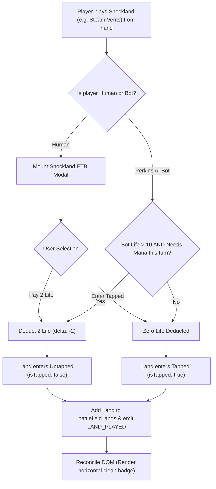

# FEATURE 19: Battle UX Hardening: Auto-Untap, Target Selector Modal, Shockland ETB Prompts, Clean Land Badges, Upkeep Perk Opt-In, and Touch-Drag 3D Dice Shaker

**Document ID:** `SPEC-RPM-BATTLE-UX-019`  
**Status:** APPROVED FOR IMPLEMENTATION  
**Author:** Argon Specification Architect  
**Created Date:** October 20, 2026  
**Revision:** 1.0.0  
**Target File Path:** `specs/FEATURE_19_BATTLE_UX_AND_RULES_SPEC.md`  

**Core Implementation Targets:**
- [`src/PriorityStateMachine.js`](file:///home/svayneak/Documents/Svayneak/rpm%20multiplayer/src/PriorityStateMachine.js) (MODIFY — Untap Step Emission `INV-UNTAP-1`, CR 502.3 Zero-Priority Pass Through `INV-UNTAP-1`, Mandatory Draw Step Emission `INV-DRAW-STEP-2`)
- [`src/TabletopStateManager.js`](file:///home/svayneak/Documents/Svayneak/rpm%20multiplayer/src/TabletopStateManager.js) (MODIFY — `untapAll` summoning sickness clearing & `doesNotUntap` support `INV-UNTAP-1`, Shockland 2-life ETB choice handling `INV-SHOCKLAND-1`, CR 104.3c empty library game loss handling `INV-DRAW-STEP-2`)
- [`src/RandomPerkEngine.js`](file:///home/svayneak/Documents/Svayneak/rpm%20multiplayer/src/RandomPerkEngine.js) (MODIFY — Upkeep Perk Opt-In Modal Hook & `PERK_ROLL_SKIPPED` emission `INV-PERK-OPTIN-1`)
- [`src/PerkinsAgent.js`](file:///home/svayneak/Documents/Svayneak/rpm%20multiplayer/src/PerkinsAgent.js) (MODIFY — Shockland 2-life payment heuristic `INV-SHOCKLAND-1`, Upkeep Perk opt-in / opt-out deckout heuristic `INV-PERK-OPTIN-1`, Target selection heuristic `INV-TARGETING-1`)
- [`src/view/TargetSelectorModal.js`](file:///home/svayneak/Documents/Svayneak/rpm%20multiplayer/src/view/TargetSelectorModal.js) (NEW — Interactive Target Selector Modal & Legal Target Filtration Engine `INV-TARGETING-1`)
- [`src/view/DiceShaker.js`](file:///home/svayneak/Documents/Svayneak/rpm%20multiplayer/src/view/DiceShaker.js) (MODIFY — Touch & Drag Hold/Shake Gesture Integration, Velocity Tracking, Haptic Vibration & Outward Throw Force Hand-off `INV-SHAKER-DRAG-1`)
- [`src/view/tabletop.css`](file:///home/svayneak/Documents/Svayneak/rpm%20multiplayer/src/view/tabletop.css) (MODIFY — Remove 90° rotation `INV-LAND-BADGE-1`, horizontal land chips with `(Untapped)`/`(Tapped)` status text `INV-LAND-BADGE-1`, Target Selector & Shockland ETB Modal styling)
- [`src/app.js`](file:///home/svayneak/Documents/Svayneak/rpm%20multiplayer/src/app.js) (MODIFY — Wire `UNTAP_STEP` to `untapAll` `INV-UNTAP-1`, Wire `MANDATORY_DRAW_TRIGGERED` to `drawCard` & deckout handling `INV-DRAW-STEP-2`, Mount Target Selector Modal on targeted spell casting `INV-TARGETING-1`, Mount Shockland ETB Prompt on land play `INV-SHOCKLAND-1`, Mount Upkeep Perk Opt-In Prompt on upkeep trigger `INV-PERK-OPTIN-1`, Wire Pointer Hold & Drag to `diceShaker` `INV-SHAKER-DRAG-1`, Render horizontal land chips `INV-LAND-BADGE-1`)
- [`src/index.js`](file:///home/svayneak/Documents/Svayneak/rpm%20multiplayer/src/index.js) (MODIFY — Export `TargetSelectorModal`, `SHOCKLAND_CATALOG`, `TARGET_TYPES`)
- [`test/test_battle_ux_and_rules.js`](file:///home/svayneak/Documents/Svayneak/rpm%20multiplayer/test/test_battle_ux_and_rules.js) (NEW — Exhaustive 16-Vector Acceptance Test Suite `TC-BATTLE-UX-01` to `TC-BATTLE-UX-16`)

**Related Specifications & Decision Records:**
- [`specs/FEATURE_18_3D_DICE_AND_BOT_INTEGRITY_SPEC.md`](file:///home/svayneak/Documents/Svayneak/rpm%20multiplayer/specs/FEATURE_18_3D_DICE_AND_BOT_INTEGRITY_SPEC.md) (`SPEC-RPM-DICE-018`: 3D Dice Engine Integration, Bot Spell Cast Integrity, Perk Normalization)
- [`specs/FEATURE_17_BATTLE_STABILITY_SPEC.md`](file:///home/svayneak/Documents/Svayneak/rpm%20multiplayer/specs/FEATURE_17_BATTLE_STABILITY_SPEC.md) (`SPEC-RPM-STABILITY-017`: Battle Stability, Opponent Land Field, Auto-Tap Mana Engine, Stack Resolution, Card Inspection)
- [`specs/FEATURE_16_BATTLE_AND_SPECTATOR_SPEC.md`](file:///home/svayneak/Documents/Svayneak/rpm%20multiplayer/specs/FEATURE_16_BATTLE_AND_SPECTATOR_SPEC.md) (`SPEC-RPM-BATTLE-016`: Lobby Hub, Spectator Directory, Battle Mechanics Enforcement, Phase Tracker)
- [`specs/FEATURE_9_RANDOM_PERK_SPEC.md`](file:///home/svayneak/Documents/Svayneak/rpm%20multiplayer/specs/FEATURE_9_RANDOM_PERK_SPEC.md) (`SPEC-RPM-PERK-009`: Random Perk Upkeep Engine, Perk Catalog & RPBD Birthday Options)
- [`specs/FEATURE_4_STACK_PRIORITY_SPEC.md`](file:///home/svayneak/Documents/Svayneak/rpm%20multiplayer/specs/FEATURE_4_STACK_PRIORITY_SPEC.md) (`SPEC-RPM-PRIORITY-004`: MTG CR 117 Priority Flow, LIFO Stack & Checkpoint Journal)
- [`specs/FEATURE_3_TABLETOP_ZONE_STATE_SPEC.md`](file:///home/svayneak/Documents/Svayneak/rpm%20multiplayer/specs/FEATURE_3_TABLETOP_ZONE_STATE_SPEC.md) (`SPEC-RPM-ZONE-003`: Tabletop State, Zones, Subzones & Mana Pool)

---

## 1. Executive Summary & Root Cause Problem Formulation

Following the deployment of Feature 18 (3D Dice Engine, Bot Cast Integrity, and Perk Activation Normalization), intensive playtesting sessions, voice memo feedback, and video screencasts revealed seven critical rules enforcement defects and user experience bottlenecks in active battle matches.

```
+----------------------------------------------------------------------------------------------------+
|                                    FEATURE 19 DEFECT TOPOLOGY                                      |
+----------------------------------------------------------------------------------------------------+
|  1. Stale Lands on Turn Start  --->  INV-UNTAP-1       : Automatic Untap Step & CR 502.3 Bypass    |
|  2. Unwired Mandatory Draw     --->  INV-DRAW-STEP-2   : Turn Draw Event & CR 104.3c Deckout Loss  |
|  3. Blind Targetless Spells    --->  INV-TARGETING-1   : Target Selector Modal & Legality Filter   |
|  4. Shockland Auto-Untap Bypass--->  INV-SHOCKLAND-1   : Shockland ETB 2-Life Choice Modal & Bot   |
|  5. 90-Deg Rotated Land Chaos  --->  INV-LAND-BADGE-1  : Clean Horizontal Badges & Text Status     |
|  6. Upkeep Perk Suicidal Trap  --->  INV-PERK-OPTIN-1  : Upkeep Perk Opt-In Modal & Skip Action   |
|  7. Static Roll Button UX      --->  INV-SHAKER-DRAG-1 : Touch-Drag 3D Dice Shaker HUD (rpm-revival)|
+----------------------------------------------------------------------------------------------------+
```

### 1.1 Defect 1: Missing Automatic Turn Untap Step & Stale Tapped State (`INV-UNTAP-1`)
- **Observed Behavior:** When a turn ended and transitioned to the next player's turn, the active player's lands and creatures remained tapped from previous turns. Players had to either manually click each individual land or cast a spell to trigger auto-tapping side-effects. Furthermore, creatures retained summoning sickness flags across multiple rounds, and `PriorityStateMachine` stalled in the `UNTAP` step waiting for priority passes.
- **Root Cause Analysis:** In Magic: The Gathering rules (MTG CR 502.1 - 502.3), the Untap step is a turn-based mandatory step during which all permanents controlled by the active player untap simultaneously, summoning sickness expires, and **no player receives priority** (CR 502.3: *"No player receives priority during the untap step, so no spells can be cast or abilities activated"*). While `PriorityStateMachine.js` defined `'UNTAP'` as the first step of a turn, it never emitted a dedicated `UNTAP_STEP` event, never invoked `TabletopStateManager.untapAll(activePlayerId)`, and erroneously halted execution expecting priority passing.
- **Remediation (`INV-UNTAP-1`):**
  1. In `PriorityStateMachine.js`: When entering `'UNTAP'`, emit `UNTAP_STEP` with `{ activePlayerId, roundNumber, turnNumber }`.
  2. Implement CR 502.3 zero-priority bypass: the machine executes untap side effects and immediately transitions to `'UPKEEP'` without waiting for player passes.
  3. In `TabletopStateManager.js` `_handleUntapAll`: Iterate over active player's lands, creatures, noncreatures, and planeswalkers. Untap each permanent (`isTapped: false`) unless marked with `doesNotUntap: true`, and clear creature summoning sickness (`hasSummoningSickness: false`).
  4. In `app.js`: Wire `this.priorityMachine.on('UNTAP_STEP', ...)` to call `tabletopState.untapAll(activePlayerId)` and reset turn quotas.

### 1.2 Defect 2: Unwired Mandatory Draw Step & Deckout Freezes (`INV-DRAW-STEP-2`)
- **Observed Behavior:** While `PriorityStateMachine.js` implemented the CR 103.7a check (skipping P1 turn 1 draw in 1v1) and emitted `MANDATORY_DRAW_TRIGGERED`, `app.js` lacked an explicit listener for this event. Instead, `app.js` only listened to `DRAW_STEP`. Furthermore, when a player's library reached 0 cards and a mandatory draw occurred, the game did not enforce MTG CR 104.3c, leaving the game in an inconsistent state instead of declaring a game loss / concession.
- **Root Cause Analysis:** In `src/app.js`, `onDrawStep` caught `DRAW_STEP` but ignored `MANDATORY_DRAW_TRIGGERED`. Although `TabletopStateManager.js` lines 463-468 emitted `EMPTY_LIBRARY_DRAW` and `PLAYER_LOST`, `app.js` never handled the game over transition from draw step failure, failing to trigger `handlePlayerElimination` or celebrate the surviving player with `handleMatchVictory`.
- **Remediation (`INV-DRAW-STEP-2`):**
  1. Add an explicit listener in `app.js` for `MANDATORY_DRAW_TRIGGERED`:
     `this.priorityMachine.on('MANDATORY_DRAW_TRIGGERED', onMandatoryDrawTriggered)`.
  2. Invoke `this.tabletopState.drawCard(evt.activePlayerId, 1)` or dispatch `DRAW_CARD`.
  3. Listen to `EMPTY_LIBRARY_DRAW` / `PLAYER_LOST` from `TabletopStateManager`. When a player draws from an empty library, immediately invoke `this.handlePlayerElimination(playerId, 'EMPTY_LIBRARY')` per MTG CR 104.3c and trigger `this.handleMatchVictory()` if a single survivor remains.

### 1.3 Defect 3: Missing Interactive Target Selection for Targeted Spells (`INV-TARGETING-1`)
- **Observed Behavior:** When a human player cast a targeted spell (such as *Lightning Bolt* targeting "any target", *Fatal Push* targeting "creature", or *Counterspell* targeting "spell on stack"), the spell was pushed directly onto the stack with empty targets (`targets: []`). Players could not select whether *Lightning Bolt* was hitting the opponent player, an opponent creature, or their own permanent.
- **Root Cause Analysis:** In `src/app.js` `castSpellToStack(card)`, the application immediately constructed a `CAST_SPELL` payload without checking if the spell required targets. There was no interactive target selector modal, nor any target legality validation engine to enforce Hexproof, Shroud, or Protection from Color.
- **Remediation (`INV-TARGETING-1`):**
  1. Create `TargetSelectorModal.js` and target detection logic. Inspect card oracle text / type line (e.g. `/\btarget\s+(any target|creature|player|opponent|permanent|spell)\b/i`).
  2. When a player casts a targeted spell, intercept the cast and display the **Target Selector Modal**:
     - Group legal targets into **Players** (`Perkins AI (20 Life)`, `You (20 Life)`) and **Battlefield Creatures** (local and opponent creatures).
     - Automatically filter out illegal targets based on:
       - **Hexproof (CR 702.11):** Cannot be targeted by opponents.
       - **Shroud (CR 702.18):** Cannot be targeted by anyone (including controller).
       - **Protection from Color/Type (CR 702.16):** Cannot be targeted by spells of the protected color/type.
     - Provide a prominent **[Cancel]** button to abort casting without deducting mana or moving cards from hand.
  3. Selecting a target dispatches `CAST_SPELL` with `{ targetId, targetType, targetName, targetControllerId }` onto the stack.

### 1.4 Defect 4: Missing Shockland 2-Life ETB Choice Prompts (`INV-SHOCKLAND-1`)
- **Observed Behavior:** When a player played a shockland (e.g. *Steam Vents*, *Watery Grave*, *Blood Crypt*, *Stomping Ground*), the land always entered the battlefield untapped with zero life deducted, violating MTG CR 614.12 replacement effect rules.
- **Root Cause Analysis:** In `TabletopStateManager.js` `_handlePlayLand`, lands unconditionally received `card.isTapped = false;` without checking for shockland identity or evaluating life payment replacement effects.
- **Remediation (`INV-SHOCKLAND-1`):**
  1. Establish canonical catalog of the 10 Shocklands: *Steam Vents*, *Watery Grave*, *Blood Crypt*, *Stomping Ground*, *Temple Garden*, *Godless Shrine*, *Overgrown Tomb*, *Breeding Pool*, *Hallowed Fountain*, *Sacred Foundry*.
  2. When played from hand, open an interactive ETB prompt modal:
     `"${card.name} enters the battlefield tapped unless you pay 2 life."`
     `[💥 Pay 2 Life (Enter Untapped)]` `[💤 Enter Tapped (Save Life)]`
  3. "Pay 2 Life": Player loses 2 life (`delta: -2`), land enters untapped (`isTapped: false`).
  4. "Enter Tapped": Land enters tapped (`isTapped: true`), zero life lost.
  5. Bot heuristic in `PerkinsAgent.js`: Pays 2 life if `botLife > 10` AND bot has a playable spell requiring untapped mana this turn; otherwise enters tapped.

### 1.5 Defect 5: 90-Degree Rotated Land Badges Causing Layout Breakage (`INV-LAND-BADGE-1`)
- **Observed Behavior:** Both on the local battlefield strip (`#battlefield-lands`) and opponent land strip (`.opponent-lands-strip`), tapped lands applied `transform: rotate(90deg); opacity: 0.58;`. This 90-degree sideways rotation broke flexbox and grid layouts, caused land chips to overlap adjacent buttons and cards, clipped text outside viewport boundaries, and was unreadable on mobile screens.
- **Root Cause Analysis:** CSS transforms change the visual geometry without updating the box-model bounds of inline-block chips. In tight UI strips, 90-degree rotated badges overlap preceding and succeeding elements.
- **Remediation (`INV-LAND-BADGE-1`):**
  1. Remove all 90-degree rotations (`transform: none !important;`) from both player and opponent land displays.
  2. Standardize horizontal card chip representation:
     - **Untapped Land:** Render crisp horizontal chip with neutral background:
       `[ (Pip: 🔴) Mountain (Untapped) ]`.
     - **Tapped Land:** Render dimmed horizontal chip with `opacity: 0.65`, italic status text, and visual tap badge:
       `[ (Pip: ⚪) Mountain (Tapped) ↺ ]`.
  3. Keep mana pip clickable for mana generation when untapped.

### 1.6 Defect 6: Unskippable Upkeep Perk Rolls Causing Strategic & Deckout Traps (`INV-PERK-OPTIN-1`)
- **Observed Behavior:** During the Upkeep step, the Random Perk engine automatically executed a 2d10 dice roll on every single turn. In scenarios where a player was low on cards in library (e.g. 2 cards remaining), a roll of `22` (Genesis Overdrive: draw cards) forced an instant deckout loss under MTG CR 104.3c. Players had no strategic autonomy to skip the perk roll.
- **Root Cause Analysis:** In `RandomPerkEngine.js`, when `PERK_UPKEEP_TRIGGER` resolved on the stack, `handleStep1Resolution` called `this.rollDice()` unconditionally.
- **Remediation (`INV-PERK-OPTIN-1`):**
  1. When `PERK_UPKEEP_TRIGGER` resolves on the stack, display an interactive modal:
     `"🎲 Random Perk Upkeep: Roll 2d10 for a perk?"`
     `[🎲 Roll Perk]` `[⏭️ Skip Perk this Turn]`
  2. If the player clicks "Skip Perk", emit `PERK_ROLL_SKIPPED`, log `"Player skipped upkeep perk roll"`, and advance cleanly to Draw step.
  3. If the player clicks "Roll Perk", trigger the dice shaker/roll flow and evaluate outcome.
  4. Bot heuristic: Perkins AI opts out if `library.length < 5` (to guard against self-mill), otherwise opts in.

### 1.7 Defect 7: Disconnected Touch-Drag 3D Dice Shaker Experience (`INV-SHAKER-DRAG-1`)
- **Observed Behavior:** While `DiceShaker.js` was introduced in Feature 18, it was not wired to the UI roll triggers. Clicking "Roll Dice" or the Upkeep prompt immediately executed a programmatic roll without the signature touch-and-drag shaking experience demonstrated in `rpm-revival`.
- **Root Cause Analysis:** Event listeners on roll buttons only listened to simple `click` events, bypassing pointer velocity tracking, vibration APIs, and throw force calculation.
- **Remediation (`INV-SHAKER-DRAG-1`):**
  1. Wire pointer gestures (`pointerdown`, `pointermove`, `pointerup`, `pointercancel`) directly to `diceShaker`.
  2. When pointer drag exceeds 6px, mount holographic floating aura `#dice-shaker-hud` ("SHAKE & RELEASE") with violet and teal dice.
  3. Track shake velocity and direction reversals, triggering mobile haptic vibration (`navigator.vibrate(12)`) and rattle sound.
  4. On release: compute dynamic `throwForce` and pass to `diceCanvas.rollPercentile({ throwForce })`.

---

## 2. Formal Architectural Invariant Hierarchy

The seven hardened battle rules and UX invariants form an interdependent, rigorous hierarchy:

```
+----------------------------------------------------------------------------------------------------+
|                                    INVARIANT DEPENDENCY GRAPH                                      |
+----------------------------------------------------------------------------------------------------+
|                                                                                                    |
|                       +---------------------------------------------+                              |
|                       |  INV-UNTAP-1: Automatic Untap Step & Bypass |                              |
|                       +----------------------+----------------------+                              |
|                                              |                                                     |
|                                              v                                                     |
|                       +---------------------------------------------+                              |
|                       |  INV-PERK-OPTIN-1: Upkeep Perk Opt-In Modal |                              |
|                       +----------------------+----------------------+                              |
|                                              |                                                     |
|                                              v                                                     |
|                       +---------------------------------------------+                              |
|                       |  INV-DRAW-STEP-2: Mandatory Draw & Deckout  |                              |
|                       +----------------------+----------------------+                              |
|                                              |                                                     |
|                                              v                                                     |
|                       +---------------------------------------------+                              |
|                       |  INV-LAND-BADGE-1: Horizontal Chip Display  |                              |
|                       +----------------------+----------------------+                              |
|                                              |                                                     |
|                       +----------------------+----------------------+                              |
|                       |                                             |                              |
|                       v                                             v                              |
|    +------------------------------------+        +------------------------------------+            |
|    | INV-SHOCKLAND-1: ETB Choice Prompt |        | INV-TARGETING-1: Target Selector   |            |
|    +------------------+-----------------+        +------------------+-----------------+            |
|                       |                                             |                              |
|                       +----------------------+----------------------+                              |
|                                              |                                                     |
|                                              v                                                     |
|                       +---------------------------------------------+                              |
|                       | INV-SHAKER-DRAG-1: Touch-Drag 3D Dice HUD   |                              |
|                       +---------------------------------------------+                              |
+----------------------------------------------------------------------------------------------------+
```

| Invariant ID | Title | MTG CR / Architectural Basis | Scope | Enforcement Mechanism |
| :--- | :--- | :--- | :--- | :--- |
| `INV-UNTAP-1` | Automatic Turn Untap Step | MTG CR 502.1 - 502.3 | Turn Engine, Battlefield | When entering `'UNTAP'`, emit `UNTAP_STEP`. Call `untapAll(activePlayerId)`. Untap lands/creatures (`isTapped: false`), clear summoning sickness, respect `doesNotUntap`. Zero priority passed (CR 502.3). |
| `INV-DRAW-STEP-2` | Mandatory Turn Draw Step | MTG CR 103.7a, 504.1, 104.3c | Turn Engine, Player Hand, Library | Explicit listener for `MANDATORY_DRAW_TRIGGERED`. Calls `drawCard(activePlayerId, 1)`. On empty library draw, enforce CR 104.3c game loss via `handlePlayerElimination`. |
| `INV-TARGETING-1` | Interactive Target Selection Modal | MTG CR 115.1a, 601.2c, 702.11, 702.16, 702.18 | Spell Casting, UI Modal, LIFO Stack | Targeted spells pop up Target Selector Modal with legal players and creatures. Filters Hexproof (opponents), Shroud (all), and Protection from Color. Includes [Cancel] button. |
| `INV-SHOCKLAND-1` | Shockland ETB 2-Life Choice Prompt | MTG CR 614.12 (Replacement Effects) | Land Play, UI Modal, Life Engine | Playing any of 10 shocklands prompts ETB choice modal. "Pay 2 Life" enters untapped; "Enter Tapped" saves life. Perkins AI heuristic evaluates life > 10 and mana need. |
| `INV-LAND-BADGE-1` | Horizontal Battlefield Land Badges | Visual UX, CSS Box Model | Local & Opponent Tabletop Boards | Remove 90° rotation (`transform: none`). Render clean horizontal chips with explicit `(Untapped)` vs `(Tapped)` text, dim opacity (`0.65`), and visual tap badge. |
| `INV-PERK-OPTIN-1` | Upkeep Random Perk Opt-In Choice | Game Strategy, Deckout Prevention | Upkeep Phase, UI Modal, Perk Engine | Resolution of `PERK_UPKEEP_TRIGGER` prompts active player with `[Roll Perk]` vs `[Skip Perk]`. Skipping emits `PERK_ROLL_SKIPPED` and safely transitions to Draw step. |
| `INV-SHAKER-DRAG-1` | Touch-Drag 3D Dice Shaker Integration | Haptic & Visual Physics Interaction | Arena HUD, Roll-Off, Dice Box | Press and hold / drag (>6px) mounts `#dice-shaker-hud` ("SHAKE & RELEASE"). Tracks velocity, vibrates device (`12ms`), computes `throwForce`, and triggers 3D physics throw. |

---

## 3. Automatic Turn Untap Step Engine (`INV-UNTAP-1`)

### 3.1 MTG Comprehensive Rules Compliance (CR 502)
Magic: The Gathering CR 502 defines the exact structure of the untap step:
1. **CR 502.1:** First, all active player permanents with phasing phase in or out simultaneously.
2. **CR 502.2:** Next, the active player determines which permanents they control untap, and untaps all of them simultaneously.
3. **CR 502.3:** No player receives priority during the untap step, so no spells can be cast or activated abilities activated. Any abilities triggered during this step wait to be put onto the stack until the upkeep step begins.

### 3.2 State Machine Implementation (`PriorityStateMachine.js`)
When `advanceStep()` rotates to a new player turn or encounters the `'UNTAP'` step, it must not wait for priority passes. It emits `UNTAP_STEP` and immediately advances to `'UPKEEP'`:

```javascript
// Inside PriorityStateMachine.js advanceStep()
if (nextIndex >= this.phaseSteps.length) {
  const previousPlayerId = this.activePlayerId;
  const nextPlayerId = this.nextPlayer(this.activePlayerId);
  this.activePlayerId = nextPlayerId;
  this.currentPhaseStep = this.phaseSteps[0]; // 'UNTAP'
  this.priorityPlayerId = this.activePlayerId;
  this.consecutivePassCount = 0;
  this.turnNumber++;

  const nextTurnCount = (this.playerTurnCounts.get(nextPlayerId) || 0) + 1;
  this.playerTurnCounts.set(nextPlayerId, nextTurnCount);

  if (nextPlayerId === this.startingPlayerId) {
    this.roundNumber++;
  }

  this.emit('TURN_ROTATED', {
    roundNumber: this.roundNumber,
    activePlayerId: nextPlayerId,
    playerTurnCount: nextTurnCount,
    previousPlayerId
  });

  this.emit('TURN_ADVANCED', {
    turnNumber: this.turnNumber,
    roundNumber: this.roundNumber,
    activePlayerId: this.activePlayerId,
    playerTurnCount: nextTurnCount
  });

  // INV-UNTAP-1: Emit UNTAP_STEP for authoritative state mutation
  this.emit('UNTAP_STEP', {
    activePlayerId: this.activePlayerId,
    turnNumber: this.turnNumber,
    roundNumber: this.roundNumber
  });

  // CR 502.3: Zero priority passed in UNTAP. Advance immediately to UPKEEP.
  this.currentPhaseStep = 'UPKEEP';
  this.emit('PHASE_STEP_CHANGED', {
    previousStep: 'UNTAP',
    currentPhaseStep: 'UPKEEP',
    roundNumber: this.roundNumber,
    playerTurnNumber: nextTurnCount,
    turnNumber: this.turnNumber,
    activePlayerId: this.activePlayerId,
    priorityPlayerId: this.priorityPlayerId
  });
}
```

### 3.3 State Manager Untap Execution (`TabletopStateManager.js`)
`_handleUntapAll(payload)` must untap lands, creatures, noncreatures, and planeswalkers, clear summoning sickness from creatures, and respect `doesNotUntap`:

```javascript
// TabletopStateManager.js
_handleUntapAll(payload) {
  const { playerId } = payload;
  const player = this.getPlayer(playerId);
  const subzones = ['lands', 'creatures', 'noncreatures', 'planeswalkers'];
  let count = 0;

  for (const sub of subzones) {
    for (const card of (player.battlefield[sub] || [])) {
      // Respect permanents that do not untap during untap step
      if (card.doesNotUntap === true) {
        continue;
      }
      card.isTapped = false;
      count++;

      // Summoning sickness expires during active player's untap step (CR 302.6)
      if (sub === 'creatures' || card.hasSummoningSickness) {
        card.hasSummoningSickness = false;
      }
    }
  }

  // Also synchronize zones.battlefield if present
  if (Array.isArray(player.zones?.battlefield)) {
    for (const card of player.zones.battlefield) {
      if (card.doesNotUntap !== true) {
        card.isTapped = false;
        if (card.hasSummoningSickness) card.hasSummoningSickness = false;
      }
    }
  }

  return { untappedCount: count, activePlayerId: playerId };
}
```

---

## 4. Mandatory Draw Step & Deckout Resolution (`INV-DRAW-STEP-2`)

### 4.1 MTG CR 103.7a, CR 504.1 & CR 104.3c Foundation
- **CR 103.7a:** In a two-player game, the starting player skips their first draw step.
- **CR 504.1:** At the start of the draw step, the active player draws a card from their library.
- **CR 104.3c:** If a player is required to draw a card from an empty library, they lose the game as a state-based action.

### 4.2 Explicit Event Handling in `app.js`
In `app.js`, add an explicit listener for `MANDATORY_DRAW_TRIGGERED`:

```javascript
// app.js setupPriorityListeners()
const onMandatoryDraw = (evt) => {
  if (this.isDestroyed || !evt) return;
  const activeId = evt.activePlayerId;

  if (this.tabletopState && typeof this.tabletopState.drawCard === 'function') {
    try {
      const drawResult = this.tabletopState.drawCard(activeId, 1);
      this.authManager?.dispatchTelemetry('MANDATORY_DRAW', activeId, {
        roundNumber: evt.roundNumber,
        cardsRemaining: drawResult.libraryCount
      });
    } catch (err) {
      console.warn('Mandatory draw execution caught error:', err);
    }
  }
  this.reconcileDOM();
};

this.priorityMachine.on('MANDATORY_DRAW_TRIGGERED', onMandatoryDraw);
```

### 4.3 CR 104.3c Empty Library Loss & Victory Chain
When `TabletopStateManager` detects an empty library draw, it emits `EMPTY_LIBRARY_DRAW` and `PLAYER_LOST`. `app.js` handles this immediately:

```javascript
// app.js setupTabletopStateListeners()
this.tabletopState.on('EMPTY_LIBRARY_DRAW', (evt) => {
  const playerId = evt.playerId;
  const player = this.tabletopState.players[playerId];
  const playerName = player?.name || playerId;

  this.showToast(`💀 ${playerName} has drawn from an empty library and loses! (CR 104.3c)`);
  this.handlePlayerElimination(playerId, 'EMPTY_LIBRARY');
});
```

---

## 5. Interactive Target Selector Modal & Legality Filtration (`INV-TARGETING-1`)

### 5.1 Targeted Spell Detection
A spell is classified as targeted if its Scryfall oracle text or card definition specifies targets:
- Regex detector: `/\btarget\s+(any target|creature|player|opponent|permanent|spell|creature or player)\b/i`.
- Recognized target archetypes:
  - `ANY_TARGET`: Can target any player or creature (*Lightning Bolt*).
  - `CREATURE`: Can target any creature on the battlefield (*Fatal Push*, *Giant Growth*).
  - `OPPONENT`: Can target any opponent player (*Thoughtseize*).
  - `SPELL_ON_STACK`: Can target any spell currently on the stack (*Counterspell*).

### 5.2 Legal Target Gathering & Filtration Algorithm (`TargetSelectorModal.js`)

```javascript
/**
 * src/view/TargetSelectorModal.js
 * Gathers candidate targets and filters out illegal targets per MTG rules:
 * - Hexproof (CR 702.11): Opponents cannot target.
 * - Shroud (CR 702.18): No one can target.
 * - Protection from Color (CR 702.16): Spells matching the color quality cannot target.
 */

export class TargetLegalityEvaluator {
  /**
   * Evaluates legal targets for a given spell cast by casterId.
   * 
   * @param {Object} card - The spell card object
   * @param {string} casterId - Player ID casting the spell
   * @param {Object} tabletopState - Current TabletopStateManager instance
   * @param {Array} stack - Current priority stack
   * @returns {{ legalTargets: Array, illegalTargets: Array }}
   */
  static getTargetsForSpell(card, casterId, tabletopState, stack = []) {
    const cardText = (card.oracle_text || card.text || card.oracleText || '').toLowerCase();
    const spellColors = this._extractCardColors(card);
    const isAnyTarget = cardText.includes('any target') || cardText.includes('creature or player') || card.name === 'Lightning Bolt';
    const isCreatureOnly = cardText.includes('target creature') || card.name === 'Fatal Push' || card.name === 'Giant Growth';
    const isOpponentOnly = cardText.includes('target opponent') || card.name === 'Thoughtseize';
    const isSpellOnStack = cardText.includes('target spell') || card.name === 'Counterspell';

    const candidates = [];

    // 1. Player Candidates
    if (isAnyTarget || isOpponentOnly) {
      for (const [pid, p] of Object.entries(tabletopState.players || {})) {
        if (p.isEliminated) continue;
        const isSelf = pid === casterId;
        if (isOpponentOnly && isSelf) continue;

        candidates.push({
          id: pid,
          type: 'PLAYER',
          name: isSelf ? 'You (Self)' : (p.name || `Opponent (${pid})`),
          controllerId: pid,
          life: p.resources?.life ?? 20,
          hasHexproof: Boolean(p.hasHexproof),
          hasShroud: Boolean(p.hasShroud),
          protections: p.protections || []
        });
      }
    }

    // 2. Creature Candidates
    if (isAnyTarget || isCreatureOnly) {
      for (const [pid, p] of Object.entries(tabletopState.players || {})) {
        if (p.isEliminated) continue;
        const creatures = p.battlefield?.creatures || p.zones?.battlefield?.filter(c => (c.typeLine || '').toLowerCase().includes('creature')) || [];
        for (const creat of creatures) {
          const keywords = (creat.keywords || []).map(k => k.toLowerCase());
          const oracle = (creat.oracle_text || creat.text || '').toLowerCase();
          const hasHexproof = keywords.includes('hexproof') || oracle.includes('hexproof');
          const hasShroud = keywords.includes('shroud') || oracle.includes('shroud');
          const protections = creat.protections || this._extractProtections(oracle);

          candidates.push({
            id: creat.instanceId || creat.id,
            type: 'CREATURE',
            name: creat.name,
            power: creat.power ?? 1,
            toughness: creat.toughness ?? 1,
            controllerId: pid,
            controllerName: pid === casterId ? 'You' : (p.name || pid),
            hasHexproof,
            hasShroud,
            protections
          });
        }
      }
    }

    // 3. Stack Spells Candidates
    if (isSpellOnStack) {
      for (const item of stack) {
        if (item && item.type !== 'LAND') {
          candidates.push({
            id: item.id,
            type: 'SPELL_ON_STACK',
            name: item.cardName || item.name || 'Spell on Stack',
            controllerId: item.controllerId || item.sourcePlayerId,
            controllerName: item.controllerName || 'Opponent'
          });
        }
      }
    }

    // Filter legality
    const legalTargets = [];
    const illegalTargets = [];

    for (const cand of candidates) {
      const reason = this._checkIllegality(cand, casterId, spellColors);
      if (reason) {
        illegalTargets.push({ ...cand, illegalReason: reason });
      } else {
        legalTargets.push(cand);
      }
    }

    return { legalTargets, illegalTargets };
  }

  static _checkIllegality(candidate, casterId, spellColors) {
    const isOpponent = candidate.controllerId !== casterId;

    // Hexproof (CR 702.11): Cannot be targeted by opponents
    if (candidate.hasHexproof && isOpponent) {
      return 'Hexproof (Cannot be targeted by opponents)';
    }

    // Shroud (CR 702.18): Cannot be targeted by anyone
    if (candidate.hasShroud) {
      return 'Shroud (Cannot be targeted by spells or abilities)';
    }

    // Protection from Color (CR 702.16)
    if (Array.isArray(candidate.protections)) {
      for (const color of spellColors) {
        if (candidate.protections.includes(color.toUpperCase()) || candidate.protections.includes('all')) {
          return `Protection from ${color}`;
        }
      }
    }

    return null;
  }

  static _extractCardColors(card) {
    if (Array.isArray(card.colors)) return card.colors;
    const cost = (card.manaCost || card.mana_cost || '').toUpperCase();
    const colors = [];
    if (cost.includes('W')) colors.push('W');
    if (cost.includes('U')) colors.push('U');
    if (cost.includes('B')) colors.push('B');
    if (cost.includes('R')) colors.push('R');
    if (cost.includes('G')) colors.push('G');
    return colors;
  }

  static _extractProtections(oracleText) {
    const list = [];
    if (/protection from red/i.test(oracleText)) list.push('R');
    if (/protection from blue/i.test(oracleText)) list.push('U');
    if (/protection from black/i.test(oracleText)) list.push('B');
    if (/protection from white/i.test(oracleText)) list.push('W');
    if (/protection from green/i.test(oracleText)) list.push('G');
    return list;
  }
}
```

### 5.3 Target Selector Modal DOM & Interaction
When a targeted spell is cast, `app.js` opens the `#target-selector-modal`:

```html
<div id="target-selector-modal" class="modal-backdrop z-[9999]">
  <div class="target-modal-panel">
    <div class="target-modal-header">
      <h3 class="target-modal-title">🎯 Select Target for Lightning Bolt</h3>
      <span class="target-modal-subtitle">Choose 1 legal target for this spell</span>
    </div>
    <div class="target-candidates-list">
      <div class="target-group-section">
        <h4 class="target-group-title">👤 Players</h4>
        <div class="target-buttons-grid">
          <button class="btn btn-target" data-target-id="bot" data-target-type="PLAYER">
            Perkins AI (Bot) — 20 Life
          </button>
          <button class="btn btn-target" data-target-id="user" data-target-type="PLAYER">
            You (Self) — 20 Life
          </button>
        </div>
      </div>
      <div class="target-group-section">
        <h4 class="target-group-title">⚔️ Creatures on Battlefield</h4>
        <div class="target-buttons-grid">
          <button class="btn btn-target" data-target-id="c_101" data-target-type="CREATURE">
            Opponent's Goblin Guide (2/2)
          </button>
          <button class="btn btn-target btn-target-disabled" disabled title="Hexproof">
            Opponent's Invisible Stalker (⛔ Hexproof)
          </button>
        </div>
      </div>
    </div>
    <div class="target-modal-actions">
      <button id="btn-cancel-target-selector" class="btn btn-secondary">❌ Cancel Cast</button>
    </div>
  </div>
</div>
```

---

## 6. Shockland Enters-the-Battlefield 2-Life Choice Engine (`INV-SHOCKLAND-1`)

### 6.1 Shockland Catalog & MTG CR 614.12
The 10 canonical shocklands represent the core Modern/Pioneer mana base. Each possesses a continuous replacement effect:
*"As [Land Name] enters the battlefield, you may pay 2 life. If you don't, it enters the battlefield tapped."*

| Land Name | Color Identity | Land Types | Oracle Mana Production |
| :--- | :--- | :--- | :--- |
| **Steam Vents** | {U}, {R} | Island Mountain | {T}: Add {U} or {R} |
| **Watery Grave** | {U}, {B} | Island Swamp | {T}: Add {U} or {B} |
| **Blood Crypt** | {B}, {R} | Swamp Mountain | {T}: Add {B} or {R} |
| **Stomping Ground** | {R}, {G} | Mountain Forest | {T}: Add {R} or {G} |
| **Temple Garden** | {G}, {W} | Forest Plains | {T}: Add {G} or {W} |
| **Godless Shrine** | {W}, {B} | Plains Swamp | {T}: Add {W} or {B} |
| **Overgrown Tomb** | {B}, {G} | Swamp Forest | {T}: Add {B} or {G} |
| **Breeding Pool** | {G}, {U} | Forest Island | {T}: Add {G} or {U} |
| **Hallowed Fountain** | {W}, {U} | Plains Island | {T}: Add {W} or {U} |
| **Sacred Foundry** | {R}, {W} | Mountain Plains | {T}: Add {R} or {W} |

```javascript
export const SHOCKLAND_NAMES = Object.freeze(new Set([
  'Steam Vents',
  'Watery Grave',
  'Blood Crypt',
  'Stomping Ground',
  'Temple Garden',
  'Godless Shrine',
  'Overgrown Tomb',
  'Breeding Pool',
  'Hallowed Fountain',
  'Sacred Foundry'
]));

export function isShockland(cardName) {
  if (!cardName) return false;
  return SHOCKLAND_NAMES.has(cardName.trim());
}
```

### 6.2 Interactive ETB Choice Modal (`#shockland-etb-modal`)
When played from hand, `app.js` prompts the user:

```javascript
// app.js promptShocklandETB(card)
async promptShocklandETB(card) {
  return new Promise((resolve) => {
    const modal = document.createElement('div');
    modal.id = 'shockland-etb-modal';
    modal.className = 'modal-backdrop z-[9999]';
    modal.innerHTML = `
      <div class="shockland-modal-panel">
        <h3 class="shockland-modal-title">⚡ ${card.name}</h3>
        <p class="shockland-modal-text">${card.name} enters the battlefield tapped unless you pay 2 life.</p>
        <div class="shockland-life-preview">
          Current Life: <span class="life-old">${this.getCurrentLife()}</span> ➔ <span class="life-new">${this.getCurrentLife() - 2}</span>
        </div>
        <div class="shockland-modal-buttons">
          <button id="btn-pay-2-life" class="btn btn-primary btn-shock-pay">
            💥 Pay 2 Life (Enter Untapped)
          </button>
          <button id="btn-enter-tapped" class="btn btn-secondary btn-shock-tap">
            💤 Enter Tapped (Save Life)
          </button>
        </div>
      </div>
    `;
    document.body.appendChild(modal);

    modal.querySelector('#btn-pay-2-life').onclick = () => {
      modal.remove();
      resolve({ payLife: true, enterTapped: false });
    };

    modal.querySelector('#btn-enter-tapped').onclick = () => {
      modal.remove();
      resolve({ payLife: false, enterTapped: true });
    };
  });
}
```

### 6.3 State Mutation in `TabletopStateManager.js`
In `_handlePlayLand`, incorporate `payload.payLife`:

```javascript
// TabletopStateManager.js _handlePlayLand
const isShock = isShockland(card.name);
let entersTapped = Boolean(payload.enterTapped);

if (isShock) {
  if (payload.payLife === true) {
    // Pay 2 life
    player.resources.life = Math.max(0, (player.resources.life ?? 20) - 2);
    entersTapped = false;
  } else {
    entersTapped = true;
  }
}

player.hand.splice(cardIdx, 1);
card.zone = 'battlefield';
card.subzone = 'lands';
card.isTapped = entersTapped;
player.battlefield.lands.push(card);
```

### 6.4 Perkins AI Autonomous Bot Heuristic
In `PerkinsAgent.js`, when Perkins plays a shockland:
- If `perkinsLife > 10` AND Perkins holds a spell in hand that can be cast this turn using the untapped mana:
  - Chooses `payLife: true` (enters untapped).
- Otherwise:
  - Chooses `payLife: false` (enters tapped).

---

## 7. Horizontal Battlefield Land Display & Text Status (`INV-LAND-BADGE-1`)

### 7.1 Elimination of 90-Degree Rotation
All `transform: rotate(90deg)` styles are completely abolished from:
1. `#battlefield-lands .land-chip`
2. `.opponent-lands-strip .opponent-land-card`

### 7.2 Horizontal Card Chip Specification
Both local player lands and opponent lands are rendered as clean horizontal chips with inline mana identity glyphs and explicit text indicators:

```html
<!-- Local Player Untapped Land -->
<span class="battlefield-card-chip land-chip" data-instance-id="land_1" data-tapped="false" title="Mountain (Untapped - Click to tap for mana)">
  <span class="land-pip mana-r"><i class="ms ms-r ms-cost"></i></span>
  Mountain <span class="land-status-label">(Untapped)</span>
</span>

<!-- Local Player Tapped Land -->
<span class="battlefield-card-chip land-chip tapped is-tapped card-tapped" data-instance-id="land_2" data-tapped="true" style="opacity: 0.65;" title="Mountain (Tapped)">
  <span class="land-pip mana-r"><i class="ms ms-r ms-cost"></i></span>
  Mountain <span class="land-status-label status-tapped">(Tapped)</span>
  <span class="tap-badge">↺</span>
</span>

<!-- Opponent Untapped Land -->
<div class="opponent-land-card" data-instance-id="opp_land_1" data-tapped="false" title="Island (Untapped)">
  <span class="land-pip mana-u"><i class="ms ms-u ms-cost"></i></span>
  <span class="land-name">Island</span>
  <span class="land-status-label">(Untapped)</span>
</div>

<!-- Opponent Tapped Land -->
<div class="opponent-land-card is-tapped card-tapped" data-instance-id="opp_land_2" data-tapped="true" style="opacity: 0.65;" title="Island (Tapped)">
  <span class="land-pip mana-u"><i class="ms ms-u ms-cost"></i></span>
  <span class="land-name">Island</span>
  <span class="land-status-label status-tapped">(Tapped)</span>
  <span class="tap-badge">↺</span>
</div>
```

### 7.3 CSS Styling Rules (`tabletop.css`)
```css
/* Clean Horizontal Battlefield Land Badges (INV-LAND-BADGE-1) */
.battlefield-card-chip.land-chip,
.opponent-land-card {
  display: inline-flex;
  align-items: center;
  gap: 6px;
  padding: 4px 8px;
  border-radius: 4px;
  background: rgba(30, 41, 59, 0.9);
  border: 1px solid rgba(255, 255, 255, 0.12);
  transform: none !important;
  transition: opacity 0.2s ease, border-color 0.2s ease;
  white-space: nowrap;
}

.battlefield-card-chip.land-chip.is-tapped,
.opponent-land-card.is-tapped {
  opacity: 0.65 !important;
  background: rgba(15, 23, 42, 0.85);
  border-color: rgba(255, 255, 255, 0.06);
}

.land-status-label {
  font-size: 0.72rem;
  color: #94a3b8;
  font-weight: 500;
}

.land-status-label.status-tapped {
  font-style: italic;
  color: #64748b;
}

.tap-badge {
  font-size: 0.75rem;
  color: #cbd5e1;
  margin-left: 2px;
}
```

---

## 8. Upkeep Random Perk Opt-In Choice Engine (`INV-PERK-OPTIN-1`)

### 8.1 Strategic Opt-In Rationale
In late-game states, forcing an upkeep roll is strategically disadvantageous:
- A player with 2 cards in library rolling Perk #22 (draw cards) instantly loses the match under MTG CR 104.3c.
- Providing an opt-in prompt gives players full tactical control over when to engage with Random Perk mechanics.

### 8.2 Opt-In Flow & Modal (`#perk-optin-modal`)
When `PERK_UPKEEP_TRIGGER` resolves on the stack:

```javascript
// Inside RandomPerkEngine.js handleStep1Resolution
if (this.requireOptIn) {
  this.emit('PERK_OPT_IN_PROMPT', {
    activePlayerId,
    turnNumber: this.priorityStateMachine?.turnNumber || 1
  });
  return;
}
```

In `app.js`:
```javascript
// app.js handlePerkOptInPrompt(data)
async handlePerkOptInPrompt(data) {
  if (this.myPlayerId !== data.activePlayerId) {
    // Waiting for opponent's opt-in choice
    return;
  }

  const modal = document.createElement('div');
  modal.id = 'perk-optin-modal';
  modal.className = 'modal-backdrop z-[9999]';
  modal.innerHTML = `
    <div class="perk-modal-panel">
      <h3 class="perk-modal-title">🎲 Random Perk Upkeep</h3>
      <p class="perk-modal-text">Roll 2d10 for a Random Perk this turn?</p>
      <div class="perk-modal-buttons">
        <button id="btn-perk-roll-optin" class="btn btn-primary">
          🎲 Roll Perk
        </button>
        <button id="btn-perk-skip-optin" class="btn btn-secondary">
          ⏭️ Skip Perk this Turn
        </button>
      </div>
    </div>
  `;
  document.body.appendChild(modal);

  modal.querySelector('#btn-perk-roll-optin').onclick = () => {
    modal.remove();
    this.triggerDiceRoll('dice');
  };

  modal.querySelector('#btn-perk-skip-optin').onclick = () => {
    modal.remove();
    this.randomPerk.skipUpkeepRoll(data.activePlayerId);
  };
}
```

When skipped, `RandomPerkEngine.js` emits `PERK_ROLL_SKIPPED`, sets `currentStep = 'IDLE'`, and allows `PriorityStateMachine` to advance to DRAW.

---

## 9. Touch & Drag 3D Dice Shaker Integration (`INV-SHAKER-DRAG-1`)

### 9.1 Gesture Recognition Lifecycle
The touch-and-drag shaker replicates the authentic physical sensation of rolling dice:

```
[pointerdown]  --->  Threshold Check (>6px)  --->  Mount #dice-shaker-hud
                             |                               |
                             v (<=6px)                       v
                       Standard Click                Spring-Follow Pointer
                                                             |
                                                             v
                                                  Detect Direction Reversals
                                                             |
                                                             v
                                            Rattle Dice + Haptic (12ms) + Audio
                                                             |
                                                             v
                                                        [pointerup]
                                                             |
                                                             v
                                              Compute throwForce & Burst FX
                                                             |
                                                             v
                                              diceCanvas.rollPercentile()
```

### 9.2 Gesture Binding in `app.js`
Attach pointer listeners to the arena Roll Dice button and Upkeep Perk modal buttons:

```javascript
// app.js bindDiceShakerGestures(buttonElement, diceType = 'dice')
bindDiceShakerGestures(buttonElement, diceType = 'dice') {
  if (!buttonElement) return;

  let isPointerDown = false;
  let startX = 0;
  let startY = 0;
  let isShaking = false;

  buttonElement.addEventListener('pointerdown', (e) => {
    isPointerDown = true;
    startX = e.clientX;
    startY = e.clientY;
    isShaking = false;
    buttonElement.setPointerCapture(e.pointerId);
  });

  buttonElement.addEventListener('pointermove', (e) => {
    if (!isPointerDown) return;
    const dist = Math.hypot(e.clientX - startX, e.clientY - startY);

    if (!isShaking && dist > 6) {
      isShaking = true;
      diceShaker.start(e.clientX, e.clientY, {
        isD20: diceType === 'd20',
        isRotated: false
      });
    }

    if (isShaking) {
      diceShaker.update(e.clientX, e.clientY);
    }
  });

  const onRelease = (e) => {
    if (!isPointerDown) return;
    isPointerDown = false;

    if (isShaking) {
      isShaking = false;
      const { throwForce } = diceShaker.release(e.clientX, e.clientY);
      if (diceType === 'd20') {
        this.submitRollOff(null, { throwForce });
      } else {
        this.triggerDiceRoll('dice', { throwForce });
      }
    } else {
      // Simple click without drag
      if (diceType === 'd20') {
        this.submitRollOff();
      } else {
        this.triggerDiceRoll('dice');
      }
    }
  };

  buttonElement.addEventListener('pointerup', onRelease);
  buttonElement.addEventListener('pointercancel', () => {
    isPointerDown = false;
    if (isShaking) {
      isShaking = false;
      diceShaker.cancel();
    }
  });
}
```

---

## 10. Complete System Architecture & Sequence Workflows

### 10.1 Turn Advance, Auto-Untap, Upkeep Perk Opt-In & Mandatory Draw Sequence

```mermaid
sequenceDiagram
    autonumber
    actor Player as Human / Bot Player
    participant PSM as PriorityStateMachine
    participant TSM as TabletopStateManager
    participant RPE as RandomPerkEngine
    participant APP as RPMAppController
    participant UI as Browser DOM

    Note over PSM: Previous turn concludes
    PSM->>PSM: advanceStep() -> Enters UNTAP
    PSM->>APP: emit('UNTAP_STEP', { activePlayerId })
    APP->>TSM: untapAll(activePlayerId)
    TSM->>TSM: Untap lands & creatures; clear summoning sickness
    TSM-->>APP: { untappedCount }
    APP->>TSM: resetTurnQuotas(activePlayerId)
    APP->>UI: reconcileDOM() (Horizontal badges updated)

    Note over PSM: CR 502.3 Zero-Priority Pass Through
    PSM->>PSM: Advance immediately to UPKEEP
    PSM->>APP: emit('PHASE_STEP_CHANGED', { currentPhaseStep: 'UPKEEP' })
    PSM->>RPE: onPhaseStepChanged('UPKEEP')
    RPE->>PSM: pushStack(PERK_UPKEEP_TRIGGER)
    PSM->>PSM: Resolve top of stack

    Note over RPE,APP: Upkeep Perk Opt-In Choice
    RPE->>APP: emit('PERK_OPT_IN_PROMPT', { activePlayerId })
    alt Player chooses Skip Perk
        APP->>RPE: skipUpkeepRoll(activePlayerId)
        RPE->>PSM: emit('PERK_ROLL_SKIPPED')
    else Player chooses Roll Perk
        APP->>UI: Mount Touch-Drag DiceShaker HUD
        Player->>UI: Shake & Release
        UI->>APP: throwForce calculated
        APP->>RPE: handleStep1Resolution(roll)
    end

    Note over PSM: Upkeep ends -> Enters DRAW
    PSM->>PSM: advanceStep() -> Enters DRAW
    PSM->>APP: emit('MANDATORY_DRAW_TRIGGERED', { activePlayerId })
    APP->>TSM: drawCard(activePlayerId, 1)
    alt Library has cards
        TSM-->>APP: { handCount, libraryCount }
        APP->>UI: reconcileDOM()
    else Library is empty (CR 104.3c)
        TSM->>APP: emit('EMPTY_LIBRARY_DRAW', { playerId })
        APP->>APP: handlePlayerElimination(playerId, 'EMPTY_LIBRARY')
        APP->>APP: handleMatchVictory(survivorId)
    end
```

### 10.2 Spell Casting with Interactive Target Selector & Legality Filtration

```mermaid
sequenceDiagram
    autonumber
    actor Player as Local Player
    participant APP as RPMAppController
    participant TSM as TabletopStateManager
    participant TSM_LEG as TargetLegalityEvaluator
    participant MODAL as TargetSelectorModal
    participant PSM as PriorityStateMachine

    Player->>APP: Clicks "Cast Lightning Bolt"
    APP->>TSM_LEG: getTargetsForSpell(card, myPlayerId, tabletopState)
    TSM_LEG->>TSM_LEG: Scan players & creatures
    TSM_LEG->>TSM_LEG: Filter Hexproof, Shroud & Protection from Red
    TSM_LEG-->>APP: { legalTargets, illegalTargets }

    APP->>MODAL: Mount modal with legal target buttons & Cancel
    MODAL->>Player: Render Target Selection Menu

    alt Player clicks [Cancel Cast]
        Player->>MODAL: Clicks Cancel
        MODAL->>APP: Abort
        Note over APP: Mana is preserved; card remains in hand
    else Player clicks [Perkins AI (Bot) — 20 Life]
        Player->>MODAL: Selects Target
        MODAL->>APP: { targetId: 'bot', targetType: 'PLAYER', targetName: 'Perkins AI' }
        APP->>TSM: autoTapForMana(myPlayerId, card.manaCost)
        APP->>TSM: Remove card from hand
        APP->>PSM: dispatch('CAST_SPELL', { card, targets: [selectedTarget] })
        PSM->>PSM: pushStack({ spell, targets })
        PSM->>PSM: Auto-pass priority to opponent (CR 117.3b)
        APP->>APP: reconcileDOM()
    end
```

### 10.3 Shockland ETB Choice Decision Workflow



---

## 11. State Transition Tables & APNAP Priority Tables

### 11.1 Turn Phase Progression Table with Untap Pass-Through
| Starting Step | Trigger Event | Priority Held | Action / Side Effects | New Step |
| :--- | :--- | :--- | :--- | :--- |
| **END (P1)** | All players pass on empty stack | Rotates to P2 | Advances turn number; sets active player to P2. | **UNTAP (P2)** |
| **UNTAP (P2)** | Machine enters step | **NONE (CR 502.3)** | Emits `UNTAP_STEP`. `untapAll(P2)` untaps all lands & creatures; clears summoning sickness; resets land quota. | **UPKEEP (P2)** |
| **UPKEEP (P2)** | Machine enters step | P2 | Pushes `PERK_UPKEEP_TRIGGER` to stack. Starts Stack Alarm. | **UPKEEP (P2)** |
| **UPKEEP (P2)** | `PERK_UPKEEP_TRIGGER` resolves | P2 | Displays Upkeep Perk Opt-In prompt (`[Roll]` vs `[Skip]`). | **UPKEEP (P2)** |
| **UPKEEP (P2)** | All players pass on empty stack | P2 | Emits `MANDATORY_DRAW_TRIGGERED`. Executes CR 504.1 draw (or CR 103.7a skip). Checks CR 104.3c deckout. | **DRAW (P2)** |
| **DRAW (P2)** | All players pass on empty stack | P2 | Enables Sorcery speed casting and Land play. | **PRECOMBAT_MAIN (P2)** |

### 11.2 Target Legality Matrix
| Candidate Target | Spell: Lightning Bolt ({R}) | Spell: Fatal Push ({B}) | Spell: Giant Growth ({G}) | Spell: Counterspell ({U}) |
| :--- | :--- | :--- | :--- | :--- |
| **Opponent Player (Normal)** | ✅ Legal | ❌ Illegal (Creature only) | ❌ Illegal (Creature only) | ❌ Illegal (Spell on stack only) |
| **Opponent with Hexproof** | ❌ Illegal (Hexproof) | ❌ Illegal | ❌ Illegal | ❌ Illegal |
| **Local Player (Self)** | ✅ Legal | ❌ Illegal | ❌ Illegal | ❌ Illegal |
| **Opponent Creature (Normal)** | ✅ Legal | ✅ Legal | ✅ Legal | ❌ Illegal |
| **Opponent Creature with Shroud** | ❌ Illegal (Shroud) | ❌ Illegal (Shroud) | ❌ Illegal (Shroud) | ❌ Illegal |
| **Opponent Creature (Protection from Red)** | ❌ Illegal (Protection) | ✅ Legal | ✅ Legal | ❌ Illegal |
| **Active Spell on Stack** | ❌ Illegal | ❌ Illegal | ❌ Illegal | ✅ Legal |

---

## 12. Concrete TypeScript / JSDoc Interface Signatures

```typescript
/**
 * Target Candidate Representation
 */
export interface TargetCandidate {
  id: string;
  type: 'PLAYER' | 'CREATURE' | 'PERMANENT' | 'SPELL_ON_STACK';
  name: string;
  controllerId: string;
  controllerName?: string;
  power?: number;
  toughness?: number;
  life?: number;
  hasHexproof?: boolean;
  hasShroud?: boolean;
  protections?: string[];
  illegalReason?: string | null;
}

/**
 * Target Selector Modal Options
 */
export interface TargetSelectorOptions {
  card: {
    name: string;
    manaCost?: string;
    oracle_text?: string;
    typeLine?: string;
  };
  casterId: string;
  tabletopState: any;
  stack?: any[];
  onSelect: (target: TargetCandidate) => void;
  onCancel: () => void;
}

/**
 * Shockland ETB Options and Result
 */
export interface ShocklandETBPromptOptions {
  cardName: string;
  currentLife: number;
}

export interface ShocklandETBResult {
  payLife: boolean;
  enterTapped: boolean;
  lifeDeducted: number;
}

/**
 * Upkeep Perk Opt-In Options and Result
 */
export interface PerkOptInPromptOptions {
  activePlayerId: string;
  turnNumber: number;
  birthdayRoll: string;
}

export interface PerkOptInResult {
  optedIn: boolean;
  skipped: boolean;
}

/**
 * Touch & Drag Shaker Gesture Dynamics
 */
export interface DiceShakerReleasePayload {
  throwForce: number;
  speed: number;
  shakeCount: number;
}
```

---

## 13. Exhaustive Acceptance Test Suite Matrix (`test/test_battle_ux_and_rules.js`)

The test suite contains 16 deterministic, hermetic test vectors validating every invariant:

| Test ID | Invariant | Description | Expected Verification |
| :--- | :--- | :--- | :--- |
| `TC-BATTLE-UX-01` | `INV-UNTAP-1` | Auto-Untap step fires on turn advance | `PriorityStateMachine` emits `UNTAP_STEP`; `tabletopState.untapAll()` sets all active player lands `isTapped: false`. |
| `TC-BATTLE-UX-02` | `INV-UNTAP-1` | Creature summoning sickness cleared on untap | Creatures on active player's battlefield transition `hasSummoningSickness` from `true` to `false`. |
| `TC-BATTLE-UX-03` | `INV-UNTAP-1` | Permanents with `doesNotUntap` stay tapped | Permanent marked with `doesNotUntap: true` retains `isTapped: true` after `untapAll()`. |
| `TC-BATTLE-UX-04` | `INV-UNTAP-1` | Zero priority passed during UNTAP (CR 502.3) | `PriorityStateMachine` bypasses priority passing in `UNTAP` and immediately lands in `UPKEEP`. |
| `TC-BATTLE-UX-05` | `INV-DRAW-STEP-2` | Mandatory draw executes 1 card draw | Active player hand size increments by 1; library decrements by 1 on normal turn draw step. |
| `TC-BATTLE-UX-06` | `INV-DRAW-STEP-2` | MTG CR 103.7a starting player 1v1 draw skip | Starting player in 1v1 skips draw on Turn 1; hand size remains 7. |
| `TC-BATTLE-UX-07` | `INV-DRAW-STEP-2` | MTG CR 104.3c deckout elimination | Mandatory draw with 0 cards in library triggers `EMPTY_LIBRARY_DRAW` and eliminates player. |
| `TC-BATTLE-UX-08` | `INV-TARGETING-1` | Target Selector modal displays legal players & creatures | Casting *Lightning Bolt* lists opponent player, self, and creatures as candidate targets. |
| `TC-BATTLE-UX-09` | `INV-TARGETING-1` | Target Selector filters out Hexproof opponents | Opponent creature with Hexproof is filtered to `illegalTargets` and marked disabled. |
| `TC-BATTLE-UX-10` | `INV-TARGETING-1` | Target Selector filters Shroud and Protection from Color | Creature with Protection from Red cannot be selected for *Lightning Bolt*. |
| `TC-BATTLE-UX-11` | `INV-TARGETING-1` | Target Selector Cancel cleanly aborts casting | Clicking Cancel does not deduct mana, does not remove card from hand, and leaves stack empty. |
| `TC-BATTLE-UX-12` | `INV-SHOCKLAND-1` | Shockland ETB prompt pays 2 life for untapped entry | Selecting "Pay 2 Life" on *Steam Vents* deducts 2 life and enters with `isTapped: false`. |
| `TC-BATTLE-UX-13` | `INV-SHOCKLAND-1` | Shockland ETB prompt enters tapped with 0 life loss | Selecting "Enter Tapped" on *Blood Crypt* preserves life and enters with `isTapped: true`. |
| `TC-BATTLE-UX-14` | `INV-SHOCKLAND-1` | Perkins AI evaluates shockland heuristic | Perkins at 18 life with playable 1-drop pays 2 life; Perkins at 8 life enters tapped. |
| `TC-BATTLE-UX-15` | `INV-LAND-BADGE-1` | Horizontal land rendering without rotation | Local and opponent tapped lands render with `transform: none`, `opacity: 0.65`, and `(Tapped)` text. |
| `TC-BATTLE-UX-16` | `INV-PERK-OPTIN-1` & `INV-SHAKER-DRAG-1` | Upkeep perk opt-in skip & touch-drag shaker | Skipping perk roll emits `PERK_ROLL_SKIPPED`; drag (>6px) activates shaker HUD and computes `throwForce`. |

---

## 14. Implementation Directives & File-by-File Modification Guidelines

### 14.1 Target File Checklist
1. **`src/PriorityStateMachine.js`**:
   - In `advanceStep()`: Emit `UNTAP_STEP` with `{ activePlayerId, turnNumber, roundNumber }`.
   - Implement zero-priority bypass for `UNTAP`: automatically advance to `'UPKEEP'`.
2. **`src/TabletopStateManager.js`**:
   - In `_handleUntapAll()`: Clear `hasSummoningSickness = false` on creatures; respect `doesNotUntap === true`.
   - In `_handlePlayLand()`: Check `isShockland(card.name)`; if `payload.payLife === true`, deduct 2 life and set `card.isTapped = false`; else if `payload.enterTapped === true`, set `card.isTapped = true`.
3. **`src/view/TargetSelectorModal.js`**:
   - Create class `TargetLegalityEvaluator` and `TargetSelectorModal`.
   - Export `SHOCKLAND_NAMES`, `isShockland`, `TargetLegalityEvaluator`.
4. **`src/view/DiceShaker.js`**:
   - Ensure pointer gesture bindings, velocity calculations, and vibration triggers are exposed.
5. **`src/RandomPerkEngine.js`**:
   - In `handleStep1Resolution()`: Add opt-in check; emit `PERK_OPT_IN_PROMPT`; add `skipUpkeepRoll(playerId)`.
6. **`src/PerkinsAgent.js`**:
   - Add Shockland heuristic (`payLife` decision).
   - Add Upkeep Perk opt-in/opt-out heuristic based on library size.
   - Add autonomous target selection heuristic for targeted spells.
7. **`src/view/tabletop.css`**:
   - Strip out `transform: rotate(90deg)`.
   - Add styles for `.battlefield-card-chip.land-chip`, `.opponent-land-card`, `.land-status-label`, `#target-selector-modal`, and `#shockland-etb-modal`.
8. **`src/app.js`**:
   - Listen to `UNTAP_STEP` and invoke `tabletopState.untapAll(activePlayerId)`.
   - Listen to `MANDATORY_DRAW_TRIGGERED` and invoke `tabletopState.drawCard()`.
   - Listen to `EMPTY_LIBRARY_DRAW` and invoke `handlePlayerElimination`.
   - Intercept targeted spell casting to prompt `TargetSelectorModal`.
   - Intercept shockland plays to prompt `ShocklandETBModal`.
   - Hook upkeep perk trigger to prompt `PerkOptInModal`.
   - Wire `bindDiceShakerGestures` to Roll Dice buttons.
   - Update battlefield and opponent land rendering to horizontal layout with `(Untapped)`/`(Tapped)` status labels.
9. **`src/index.js`**:
   - Export `TargetSelectorModal`, `TargetLegalityEvaluator`, `SHOCKLAND_NAMES`, `isShockland`.
10. **`test/test_battle_ux_and_rules.js`**:
    - Construct exhaustive 16-vector acceptance test suite.

---

## 15. Architectural Verification & Sign-Off

Upon completion of the implementation tasks outlined in this specification:
1. `npm test` must run cleanly with 100% test pass rate across all test files (including `test_battle_ux_and_rules.js`).
2. No regressions must be introduced to prior invariants (`FEATURE_1` through `FEATURE_18`).
3. All UI overlays (Target Selector, Shockland ETB, Perk Opt-In, and Dice Shaker) must cleanly unmount without DOM leaks or dangling animation frames.
