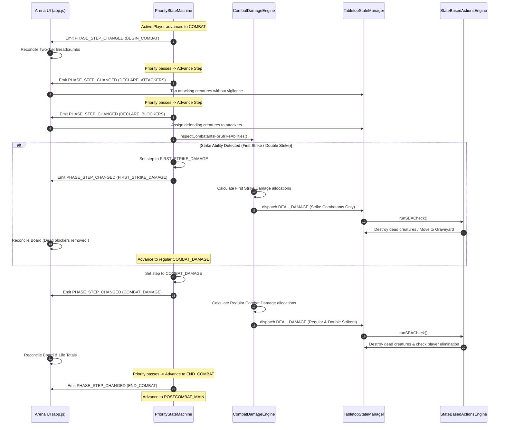

# FEATURE 20: MTG Comprehensive Combat Damage Engine, State-Based Actions (SBA), Damage vs. Life Loss, Keyword Resolution, and Hierarchical Turn Sub-Phases

**Document ID:** `SPEC-RPM-COMBAT-DAMAGE-020`  
**Status:** APPROVED FOR IMPLEMENTATION  
**Author:** Argon Specification Architect  
**Created Date:** October 20, 2026  
**Revision:** 1.0.0  
**Target File Path:** `specs/FEATURE_20_COMBAT_DAMAGE_ENGINE_SPEC.md`  

**Core Implementation Targets:**
- [`src/CombatDamageEngine.js`](file:///home/svayneak/Documents/Svayneak/rpm%20multiplayer/src/CombatDamageEngine.js) (NEW — MTG CR 510 Combat Damage Engine, Keyword Resolution, Smart Auto-Assign & Manual Override Sliders `INV-KEYWORD-DMG-1`, `INV-DAMAGE-ASSIGN-1`)
- [`src/StateBasedActionsEngine.js`](file:///home/svayneak/Documents/Svayneak/rpm%20multiplayer/src/StateBasedActionsEngine.js) (NEW — MTG CR 704 Authoritative State-Based Actions Check & Cleanup Step Loop `INV-SBA-1`)
- [`src/PriorityStateMachine.js`](file:///home/svayneak/Documents/Svayneak/rpm%20multiplayer/src/PriorityStateMachine.js) (MODIFY — Hierarchical 5 Overarching MTG Phases + Dynamic Sub-Phases, First Strike Step Splitting, APNAP Priority Pass-Through `INV-PHASE-SUB-1`)
- [`src/TabletopStateManager.js`](file:///home/svayneak/Documents/Svayneak/rpm%20multiplayer/src/TabletopStateManager.js) (MODIFY — Damage vs Life Loss Distinction `INV-DMG-LIFE-1`, `card.damageMarked` tracking, `-1/-1` counter modification, Cleanup Step marked damage removal CR 514.2)
- [`src/PerkinsAgent.js`](file:///home/svayneak/Documents/Svayneak/rpm%20multiplayer/src/PerkinsAgent.js) (MODIFY — Intelligent Combat Decision Trees: Trample, Deathtouch, Lifelink, First Strike, Indestructible, and SBA Lethality Evaluation)
- [`src/view/CombatDamageModal.js`](file:///home/svayneak/Documents/Svayneak/rpm%20multiplayer/src/view/CombatDamageModal.js) (NEW — Interactive Combat Damage Allocation HUD, Multi-Blocker Ordering, Live Damage Sliders `INV-DAMAGE-ASSIGN-1`)
- [`src/view/tabletop.css`](file:///home/svayneak/Documents/Svayneak/rpm%20multiplayer/src/view/tabletop.css) (MODIFY — Two-Tier Turn Phase Breadcrumb Strip, Gold Tier 1 Active Glowing Pills, Cyan/Purple Tier 2 Sub-Phase Pills, Combat Damage Modal Styling)
- [`src/app.js`](file:///home/svayneak/Documents/Svayneak/rpm%20multiplayer/src/app.js) (MODIFY — Wire Two-Tier Breadcrumb Navigation, Mount Combat Damage Modal on Damage Step, Run SBA checks on Stack/Step Transitions, Integrate Feature 19 UX Hardening)
- [`src/index.js`](file:///home/svayneak/Documents/Svayneak/rpm%20multiplayer/src/index.js) (MODIFY — Export `CombatDamageEngine`, `StateBasedActionsEngine`, `CombatDamageModal`, Combat Constants)
- [`test/test_combat_damage_engine.js`](file:///home/svayneak/Documents/Svayneak/rpm%20multiplayer/test/test_combat_damage_engine.js) (NEW — Exhaustive 16-Vector Acceptance Test Suite `TC-COMBAT-01` through `TC-COMBAT-16`)

**Related Specifications & Architectural Foundations:**
- [`specs/FEATURE_19_BATTLE_UX_AND_RULES_SPEC.md`](file:///home/svayneak/Documents/Svayneak/rpm%20multiplayer/specs/FEATURE_19_BATTLE_UX_AND_RULES_SPEC.md) (`SPEC-RPM-BATTLE-UX-019`: Battle UX Hardening, Auto-Untap, Target Selector Modal, Shockland ETB Choice, Horizontal Land Badges, Upkeep Perk Opt-In, Touch-Drag 3D Shaker)
- [`specs/FEATURE_18_3D_DICE_AND_BOT_INTEGRITY_SPEC.md`](file:///home/svayneak/Documents/Svayneak/rpm%20multiplayer/specs/FEATURE_18_3D_DICE_AND_BOT_INTEGRITY_SPEC.md) (`SPEC-RPM-DICE-018`: 3D Dice Engine Integration, Bot Spell Cast Integrity, Perk Normalization)
- [`specs/FEATURE_17_BATTLE_STABILITY_SPEC.md`](file:///home/svayneak/Documents/Svayneak/rpm%20multiplayer/specs/FEATURE_17_BATTLE_STABILITY_SPEC.md) (`SPEC-RPM-STABILITY-017`: Battle Stability, Opponent Land Field, Auto-Tap Mana Engine, Stack Resolution)
- [`specs/FEATURE_16_BATTLE_AND_SPECTATOR_SPEC.md`](file:///home/svayneak/Documents/Svayneak/rpm%20multiplayer/specs/FEATURE_16_BATTLE_AND_SPECTATOR_SPEC.md) (`SPEC-RPM-BATTLE-016`: Lobby Hub, Spectator Directory, Battle Mechanics Enforcement, Phase Tracker)
- [`specs/FEATURE_4_STACK_PRIORITY_SPEC.md`](file:///home/svayneak/Documents/Svayneak/rpm%20multiplayer/specs/FEATURE_4_STACK_PRIORITY_SPEC.md) (`SPEC-RPM-PRIORITY-004`: MTG CR 117 Priority Flow, LIFO Stack & Checkpoint Journal)
- [`specs/FEATURE_3_TABLETOP_ZONE_STATE_SPEC.md`](file:///home/svayneak/Documents/Svayneak/rpm%20multiplayer/specs/FEATURE_3_TABLETOP_ZONE_STATE_SPEC.md) (`SPEC-RPM-ZONE-003`: Tabletop State, Zones, Subzones & Mana Pool)

---

## 1. Executive Summary & Root Cause Problem Formulation

During competitive multiplayer playtesting of the RPM Tabletop Companion following the release of Feature 19, combat engagements between players and Perkins AI bots revealed foundational gaps in combat damage mechanics, state-based death handling, and turn phase progression.

While Feature 19 successfully hardened turn-start untapping, mandatory card draws, spell targeting, and land layouts, active creature combat remained fundamentally simulated through manual life counter clicks and rudimentary attacker tapping. This resulted in several severe rules violations and gameplay bugs:

```
+----------------------------------------------------------------------------------------------------+
|                                    FEATURE 20 DEFECT TOPOLOGY                                      |
+----------------------------------------------------------------------------------------------------+
|  1. Conflation of Damage & Life Loss ---> INV-DMG-LIFE-1   : CR 119 vs CR 120 Authoritative Engine |
|  2. Missing Damage Keyword Matrix   ---> INV-KEYWORD-DMG-1 : Lifelink, Infect, Trample, Deathtouch,|
|                                                              Protection, Indestructible, Strikes    |
|  3. Absent State-Based Actions (SBA)---> INV-SBA-1         : CR 704 Iterative Simultaneous Loop    |
|  4. Flat Turn Phase Strip Chaos     ---> INV-PHASE-SUB-1   : Two-Tier Hierarchical Breadcrumb Strip|
|  5. Multi-Blocker Assignment Void   ---> INV-DAMAGE-ASSIGN-1: Smart Auto-Assign & Manual Overrides  |
|  6. Feature 19 UX Hardening Synergy ---> INV-F19-HARMONY-1 : Seamless Integration with F19 Modals  |
+----------------------------------------------------------------------------------------------------+
```

### 1.1 Defect 1: Conflation of Damage and Life Loss (`INV-DMG-LIFE-1`, MTG CR 119 vs CR 120)
- **Observed Behavior:** The engine treated all life deductions identically through `TabletopStateManager._handleAdjustLife({ delta: -X })`. A Shockland 2-life cost payment (CR 119.2) was treated identically to receiving 3 damage from *Lightning Bolt* (CR 120). Cards or perks triggering on "whenever a source deals damage to you" fired erroneously on shockland life payments, while creature combat damage never marked persistent damage on cards, bypassing toughness mechanics completely.
- **Root Cause Analysis:** `TabletopStateManager.js` lacked distinct action dispatches for `LOSE_LIFE` vs `DEAL_DAMAGE`. Under MTG CR 119.2, paying life or losing life directly does not constitute damage. Conversely, under MTG CR 120.3, damage dealt to a player results in life loss (unless modified by Infect), and damage dealt to a creature marks damage on that permanent (`card.damageMarked += amount`).
- **Remediation (`INV-DMG-LIFE-1`):** Decouple `DEAL_DAMAGE` from `LOSE_LIFE` across all state handlers, event emitters, and UI toasts. `DEAL_DAMAGE` dispatches authoritative damage events (`DAMAGE_DEALT`, `DAMAGE_TAKEN`), applies keyword replacements, marks damage on creatures, and converts unprevented damage into life loss (or poison counters) on players.

### 1.2 Defect 2: Missing Damage Keyword Resolution Matrix (`INV-KEYWORD-DMG-1`, MTG CR 702)
- **Observed Behavior:** Combat keywords were purely decorative text strings:
  1. **Lifelink (CR 702.15):** Damage dealt by creatures with lifelink did not gain life for their controller.
  2. **Infect (CR 702.90):** Damage dealt to players reduced life instead of adding poison counters; damage dealt to creatures marked regular damage instead of placing `-1/-1` counters.
  3. **Trample (CR 702.19):** Attackers blocked by 1/1 creatures dealt zero damage to the defending player, ignoring trample completely.
  4. **Deathtouch (CR 702.2):** A 1/1 deathtouch creature dealt 1 damage to a 10/10 creature, leaving the 10/10 alive.
  5. **Deathtouch + Trample:** No compound resolution existed; a 6/6 deathtouch trample creature could not assign 1 lethal damage to a blocker and trample 5 damage to the player.
  6. **Protection (CR 702.16):** Creatures with "Protection from Red" took full combat and spell damage from red sources.
  7. **Indestructible (CR 702.12):** Indestructible creatures died to lethal marked damage, while also failing to die when their toughness reached 0 or less via `-1/-1` counters.
  8. **First Strike (CR 702.7) & Double Strike (CR 702.4):** All combat damage occurred in a single instantaneous step; first strike creatures traded simultaneously with regular creatures instead of killing them before return damage.
- **Root Cause Analysis:** The engine lacked a dedicated `CombatDamageEngine.js` capable of parsing keywords, structuring combat into conditional dual damage steps, and applying MTG rules replacement semantics.
- **Remediation (`INV-KEYWORD-DMG-1`):** Build an authoritative damage calculation matrix implementing all MTG CR 702 keyword interactions, split combat damage into `FIRST_STRIKE_COMBAT_DAMAGE` and `COMBAT_DAMAGE` when strike abilities are present, and enforce rules-pure replacement effects.

### 1.3 Defect 3: Absence of an Automated State-Based Actions (SBA) Engine (`INV-SBA-1`, MTG CR 704)
- **Observed Behavior:** Creatures with marked damage exceeding toughness remained on the battlefield indefinitely unless players manually dragged them to the graveyard. Players reaching 0 life or 10 poison counters did not trigger loss conditions until the next turn rotation. Furthermore, marked damage was never wiped at end of turn, accumulating across multiple turns into immortal damage markers.
- **Root Cause Analysis:** In MTG, State-Based Actions (CR 704) are continuous, turn-free, zero-priority game checks that execute whenever any player would receive priority and immediately after spell or combat resolution. Without an authoritative `StateBasedActionsEngine.js`, game state mutations were never audited for lethal marked damage (CR 704.5g), zero toughness (CR 704.5f), life loss loss conditions (CR 704.5a), or 10-poison elimination (CR 704.5c).
- **Remediation (`INV-SBA-1`):** Construct an iterative, simultaneous SBA loop that executes before priority passing, after stack resolution, and after each combat damage step. Implement the CR 514.2 Cleanup Step purge, removing all `damageMarked` on all surviving permanents across the battlefield.

### 1.4 Defect 4: Flat, Incomplete Phase Strip UI (`INV-PHASE-SUB-1`, MTG CR 500)
- **Observed Behavior:** The phase strip rendered a flat 7-step list (`UNTAP`, `UPKEEP`, `DRAW`, `MAIN 1`, `COMBAT`, `MAIN 2`, `END`). This obscured sub-steps: players had no visual confirmation of `DECLARE_ATTACKERS`, `DECLARE_BLOCKERS`, `FIRST_STRIKE_DAMAGE`, or `CLEANUP`. When the combat phase began, players could not tell whether they were in attacker declaration or damage resolution.
- **Root Cause Analysis:** The UI flattened MTG's hierarchical phase model into a single row of ambiguous buttons. Sub-phases were grouped under generic parent labels without a two-tier visual breadcrumb.
- **Remediation (`INV-PHASE-SUB-1`):** Introduce a two-tier breadcrumb strip:
  - **Tier 1 (Top):** The 5 overarching MTG phases: `BEGINNING`, `PRECOMBAT_MAIN`, `COMBAT`, `POSTCOMBAT_MAIN`, `ENDING` styled with a golden glowing active pill.
  - **Tier 2 (Bottom):** Active sub-phase breadcrumb pills (`UNTAP`, `UPKEEP`, `DRAW` under Beginning; `DECLARE_ATTACKERS`, `DECLARE_BLOCKERS`, `FIRST_STRIKE_DAMAGE`, `COMBAT_DAMAGE`, `END_COMBAT` under Combat; `END_STEP`, `CLEANUP` under Ending) styled with vibrant cyan and purple illumination.

### 1.5 Defect 5: Missing Multi-Blocker Damage Assignment & Manual Override HUD (`INV-DAMAGE-ASSIGN-1`, MTG CR 510.1c)
- **Observed Behavior:** When an attacking creature was blocked by two or more defenders (e.g. an 8/8 attacker blocked by a 3/3 and a 4/4), the system had no concept of damage ordering or allocation. Combat stalled or dealt damage arbitrarily.
- **Root Cause Analysis:** MTG CR 510.1c requires the attacking player to assign lethal damage to the first blocker in damage assignment order before assigning damage to the next blocker. While auto-assignment covers 95% of gameplay, competitive players require manual override sliders to allocate extra damage to high-priority targets (e.g., ensuring a blocker dies through potential damage prevention spells).
- **Remediation (`INV-DAMAGE-ASSIGN-1`):** Provide a smart auto-assignment algorithm that automatically computes minimal lethal damage in blocking order (1 damage with deathtouch, or remaining toughness) and tramples excess to the defending player, accompanied by an interactive modal with damage sliders allowing full manual override before damage commitment.

---

## 2. Formal Architectural Invariant Hierarchy

The combat damage engine, state-based actions, keyword resolution, and hierarchical phase system are governed by six foundational architectural invariants:

```
+----------------------------------------------------------------------------------------------------+
|                                    INVARIANT DEPENDENCY GRAPH                                      |
+----------------------------------------------------------------------------------------------------+
|                                                                                                    |
|                       +---------------------------------------------+                              |
|                       | INV-PHASE-SUB-1: Two-Tier Hierarchical Track|                              |
|                       +----------------------+----------------------+                              |
|                                              |                                                     |
|                                              v                                                     |
|                       +---------------------------------------------+                              |
|                       | INV-KEYWORD-DMG-1: Damage Keyword Engine    |                              |
|                       +----------------------+----------------------+                              |
|                                              |                                                     |
|                       +----------------------+----------------------+                              |
|                       |                                             |                              |
|                       v                                             v                              |
|    +------------------------------------+        +------------------------------------+            |
|    | INV-DAMAGE-ASSIGN-1: Smart Assign  |        | INV-DMG-LIFE-1: Damage vs Life Loss|            |
|    | & Manual Override Damage Sliders   |        | Distinction (CR 119 vs CR 120)     |            |
|    +------------------+-----------------+        +------------------+-----------------+            |
|                       |                                             |                              |
|                       +----------------------+----------------------+                              |
|                                              |                                                     |
|                                              v                                                     |
|                       +---------------------------------------------+                              |
|                       | INV-SBA-1: State-Based Actions (SBA) Engine |                              |
|                       | & CR 514.2 Cleanup Damage Purge Loop        |                              |
|                       +----------------------+----------------------+                              |
|                                              |                                                     |
|                                              v                                                     |
|                       +---------------------------------------------+                              |
|                       | INV-F19-HARMONY-1: Feature 19 UX Synergy    |                              |
|                       +---------------------------------------------+                              |
+----------------------------------------------------------------------------------------------------+
```

| Invariant ID | Title | MTG CR / Architectural Basis | Scope | Enforcement Mechanism |
| :--- | :--- | :--- | :--- | :--- |
| `INV-DMG-LIFE-1` | Damage vs. Life Loss Distinction | MTG CR 119, CR 120 | Tabletop State, Events, Triggers | Life loss (`LOSE_LIFE` / `ADJUST_LIFE`, CR 119.2) deducts life directly without marking damage or triggering damage hooks. Damage (`DEAL_DAMAGE`, CR 120) marks damage on creatures (`damageMarked += amount`), deducts player life (unless infect), and emits `DAMAGE_DEALT` and `DAMAGE_TAKEN`. |
| `INV-KEYWORD-DMG-1` | Damage Keyword Resolution Matrix | MTG CR 510, CR 702.2, 702.4, 702.7, 702.12, 702.15, 702.16, 702.19, 702.90 | Combat Engine, Creature Permanents | Authoritatively applies Lifelink (simultaneous life gain CR 120.3f), Infect (-1/-1 counters on creatures, poison on players CR 120.3b/d), Trample (excess assigned to player CR 510.1c), Deathtouch (1 damage lethal CR 702.2), Protection (damage prevented to 0 CR 702.16e), Indestructible (bypasses lethal damage destruction CR 704.5g but dies to 0 toughness CR 704.5f), and First/Double Strike (creates conditional dual damage steps CR 702.7). |
| `INV-SBA-1` | State-Based Actions (SBA) Engine | MTG CR 704.1 - 704.8, CR 514.2 | Priority Machine, State Manager, Turn Engine | Executes multi-pass simultaneous check before priority, after resolution, and after damage. Enforces CR 704.5a (life <= 0 loss), 704.5c (poison >= 10 loss), 704.5f (toughness <= 0 graveyard put), 704.5g (damage >= toughness destruction), 704.5h (deathtouch destruction). Cleanup step (CR 514.2) wipes `damageMarked = 0` on all surviving permanents. |
| `INV-PHASE-SUB-1` | Hierarchical Turn Phases & Two-Tier Track | MTG CR 500 - 514 | Priority Machine, View DOM, CSS Strip | Structures turn into 5 overarching MTG phases (`BEGINNING`, `PRECOMBAT_MAIN`, `COMBAT`, `POSTCOMBAT_MAIN`, `ENDING`) and sub-phases. Top tier displays golden glowing main phase pills; bottom tier displays active sub-phase breadcrumbs with cyan/purple illumination. Dynamically injects `FIRST_STRIKE_COMBAT_DAMAGE` when strike abilities exist. |
| `INV-DAMAGE-ASSIGN-1` | Smart Auto-Assign & Manual Override Sliders | MTG CR 510.1c | Combat Damage Engine, UI Modal HUD | Automatically allocates minimum lethal damage (1 with deathtouch, or remaining toughness) to blockers in blocking order and tramples excess to defending player. Mounts interactive modal with live sliders for manual allocation overrides. |
| `INV-F19-HARMONY-1` | Feature 19 UX Hardening Synergy | Feature 19 UX Specifications | Full Tabletop Application | Seamlessly integrates auto-untap (`INV-UNTAP-1`), mandatory draw & deckout (`INV-DRAW-STEP-2`), target selector modal (`INV-TARGETING-1`), shockland ETB prompt (`INV-SHOCKLAND-1`), clean horizontal land badges (`INV-LAND-BADGE-1`), upkeep perk opt-in (`INV-PERK-OPTIN-1`), and touch-drag 3D shaker (`INV-SHAKER-DRAG-1`). |

---

## 3. Damage vs. Life Loss Engine Architecture (`INV-DMG-LIFE-1`)

### 3.1 MTG Comprehensive Rules Grounding (CR 119 vs CR 120)
Magic: The Gathering maintains an essential, inviolable distinction between **Damage** and **Life Loss**:
1. **CR 119.2 (Life Loss):** Direct life deductions occur when a player pays life as a cost (such as paying 2 life for a Shockland to enter untapped under CR 614.12), when an effect states "target player loses X life" (e.g. *Thoughtseize*), or when an ability causes direct life loss. **Life loss is NOT damage.** It cannot be prevented by damage prevention effects (such as *Deflecting Palm* or Protection), does not mark damage on permanents, and does NOT trigger abilities that trigger on damage being dealt.
2. **CR 120.1 & CR 120.3 (Damage):** Damage is dealt by a specific source (a creature or spell) to a target (a player, planeswalker, or creature). 
   - **CR 120.3a:** Damage dealt to a player by a source without infect causes that player to lose that much life.
   - **CR 120.3b:** Damage dealt to a player by a source with infect causes that player to receive that many poison counters.
   - **CR 120.3d:** Damage dealt to a creature by a source with infect causes that many `-1/-1` counters to be put on that creature.
   - **CR 120.3e:** Damage dealt to a creature by a source without infect causes that much damage to be marked on that creature (`card.damageMarked += amount`).
   - **CR 120.3f:** Damage dealt by a source with lifelink causes that source's controller to gain that much life simultaneously with the damage being dealt.

### 3.2 Authoritative Action Distinction Matrix

| Property | `LOSE_LIFE` / `ADJUST_LIFE` (CR 119) | `DEAL_DAMAGE` (CR 120) |
| :--- | :--- | :--- |
| **Primary Sources** | Shockland ETB payment, Thoughtseize, Toxic Deluge, life payment costs | Creature combat, Lightning Bolt, Searing Blaze, Orcish Bowmasters |
| **Applicable Targets** | Players only | Players, Planeswalkers, Creatures |
| **Prevention Effects** | Ignored completely (Life loss cannot be prevented) | Checked against Protection (CR 702.16), damage prevention shields |
| **Creature Impact** | Not applicable | Marks damage on creature (`card.damageMarked += amount`) or puts `-1/-1` counters (Infect) |
| **Player Impact** | Deducts life directly (`player.resources.life -= amount`) | Results in life loss (regular) OR poison counters (Infect) |
| **Lifelink Trigger** | Never triggers lifelink | Simultaneously grants source controller life equal to damage dealt |
| **Telemetry & Events** | Emits `LIFE_LOST` | Emits `DAMAGE_DEALT`, `DAMAGE_TAKEN`, and secondary `LIFE_LOST` |
| **Audio / Haptic Feedback**| Clean coin chime, low vibration | Sharp combat strike / shatter impact sound, heavy haptic thud |

### 3.3 State Manager Implementation (`TabletopStateManager.js`)

`TabletopStateManager.js` provides two distinct authoritative methods:

```javascript
/**
 * Executes direct Life Loss or Life Payment per MTG CR 119.2.
 * DOES NOT trigger damage abilities, mark damage, or apply damage prevention.
 * 
 * @param {Object} payload
 * @param {string} payload.playerId - Target player ID
 * @param {number} payload.amount - Positive integer amount of life lost
 * @param {string} [payload.reason] - Cause of life loss ('SHOCKLAND_COST', 'COST_PAYMENT', 'SPELL_EFFECT')
 * @returns {{ playerId: string, lifeLost: number, newLife: number }}
 */
_handleLoseLife(payload) {
  const { playerId, amount, reason = 'LIFE_LOSS' } = payload;
  const player = this.getPlayer(playerId);
  const actualLoss = Math.max(0, Number(amount) || 0);

  player.resources.life = (player.resources.life ?? 20) - actualLoss;

  this.emit('LIFE_LOST', {
    playerId,
    amount: actualLoss,
    currentLife: player.resources.life,
    reason
  });

  return { playerId, lifeLost: actualLoss, newLife: player.resources.life };
}

/**
 * Executes Damage Resolution per MTG CR 120.
 * Enforces Protection, Lifelink, Infect, and Creature Damage Marking.
 * 
 * @param {Object} payload
 * @param {string} payload.sourceId - InstanceId of damage source
 * @param {string} payload.sourceControllerId - Controller of damage source
 * @param {string} payload.targetId - Target instanceId (creature) or playerId (player)
 * @param {'PLAYER' | 'CREATURE' | 'PLANESWALKER'} payload.targetType
 * @param {number} payload.amount - Unprevented damage amount to deal
 * @param {boolean} [payload.isCombat=false] - Whether damage is combat damage
 * @param {Object} [payload.keywords] - { lifelink, infect, deathtouch, colors }
 * @returns {DamageExecutionResult}
 */
_handleDealDamage(payload) {
  const {
    sourceId,
    sourceControllerId,
    targetId,
    targetType,
    amount,
    isCombat = false,
    keywords = {}
  } = payload;

  const rawAmount = Math.max(0, Number(amount) || 0);
  if (rawAmount === 0) {
    return { damageDealt: 0, targetId, targetType, prevented: false };
  }

  const {
    lifelink = false,
    infect = false,
    deathtouch = false,
    sourceColors = []
  } = keywords;

  let damageDealt = rawAmount;
  let prevented = false;

  // 1. Protection from Color / Quality check (CR 702.16e)
  if (targetType === 'CREATURE') {
    const targetCreature = this._findCreatureOnBattlefield(targetId);
    if (targetCreature && this._isProtectedFromSource(targetCreature, sourceColors)) {
      damageDealt = 0;
      prevented = true;
    }
  } else if (targetType === 'PLAYER') {
    const targetPlayer = this.getPlayer(targetId);
    if (targetPlayer && this._isPlayerProtectedFromSource(targetPlayer, sourceColors)) {
      damageDealt = 0;
      prevented = true;
    }
  }

  if (damageDealt > 0) {
    // 2. Apply to Target
    if (targetType === 'PLAYER') {
      const targetPlayer = this.getPlayer(targetId);
      if (infect) {
        // CR 120.3b: Infect deals damage to players as poison counters
        targetPlayer.resources.poison = (targetPlayer.resources.poison || 0) + damageDealt;
      } else {
        // CR 120.3a: Damage causes that player to lose that much life
        targetPlayer.resources.life = (targetPlayer.resources.life ?? 20) - damageDealt;
      }
    } else if (targetType === 'CREATURE') {
      const targetCreature = this._findCreatureOnBattlefield(targetId);
      if (targetCreature) {
        if (infect) {
          // CR 120.3d: Infect deals damage to creatures as -1/-1 counters
          targetCreature.counters = targetCreature.counters || {};
          targetCreature.counters['-1/-1'] = (targetCreature.counters['-1/-1'] || 0) + damageDealt;
        } else {
          // CR 120.3e: Damage is marked on creature
          targetCreature.damageMarked = (targetCreature.damageMarked || 0) + damageDealt;
        }

        if (deathtouch) {
          targetCreature.deathtouchDamageMarked = true;
        }
      }
    }

    // 3. Lifelink resolution (CR 120.3f)
    if (lifelink && sourceControllerId) {
      const sourceController = this.getPlayer(sourceControllerId);
      if (sourceController) {
        sourceController.resources.life = (sourceController.resources.life ?? 20) + damageDealt;
        this.emit('LIFE_GAINED', {
          playerId: sourceControllerId,
          amount: damageDealt,
          currentLife: sourceController.resources.life,
          sourceId,
          reason: 'LIFELINK'
        });
      }
    }
  }

  const result = {
    sourceId,
    sourceControllerId,
    targetId,
    targetType,
    damageDealt,
    prevented,
    isCombat,
    hasInfect: infect,
    hasLifelink: lifelink,
    hasDeathtouch: deathtouch
  };

  this.emit('DAMAGE_DEALT', result);
  this.emit('DAMAGE_TAKEN', result);

  return result;
}
```

---

## 4. Comprehensive Keyword Resolution Engine (`INV-KEYWORD-DMG-1`)

### 4.1 Keyword Behavioral Specifications

```
+----------------------------------------------------------------------------------------------------+
|                                    KEYWORD RESOLUTION MATRIX                                       |
+----------------------------------------------------------------------------------------------------+
| Keyword         | Target      | Primary Effect                     | CR Rule Reference            |
+-----------------+-------------+------------------------------------+------------------------------+
| Lifelink        | Source Ctrl | Simultaneous life gain = damage    | CR 702.15, CR 120.3f         |
| Infect          | Player      | Deals damage as poison counters    | CR 702.90, CR 120.3b         |
| Infect          | Creature    | Deals damage as -1/-1 counters     | CR 702.90, CR 120.3d         |
| Trample         | Blocker+Plr | Lethal to blocker; excess to player| CR 702.19, CR 510.1c         |
| Deathtouch      | Creature    | Any non-zero damage is lethal (1pt)| CR 702.2, CR 510.1c, 704.5h  |
| DT + Trample    | Blocker+Plr | 1 dmg to blocker, trample remainder| CR 702.2, CR 702.19, 510.1c  |
| Protection      | Permanent   | Prevents all damage from quality   | CR 702.16, CR 702.16e        |
| Indestructible  | Permanent   | Immune to lethal damage & destroy  | CR 702.12, CR 704.5g         |
| Indestructible  | Permanent   | DIES to toughness <= 0 (-1/-1 cnts)| CR 702.12, CR 704.5f         |
| First Strike    | Combat      | Deals damage in 1st damage step    | CR 702.7, CR 510.4           |
| Double Strike   | Combat      | Deals damage in BOTH damage steps  | CR 702.4, CR 510.4           |
+----------------------------------------------------------------------------------------------------+
```

### 4.2 Lifelink Resolution (CR 702.15 & CR 120.3f)
- **Rule:** Damage dealt by a source with lifelink causes that source’s controller to gain that much life simultaneously with the damage being dealt.
- **Architectural Implementation:** Life gain executes synchronously within `_handleDealDamage`. If an attacking player at 2 life takes 3 lethal combat damage from an unblocked creature while their 4/4 lifelink creature deals 4 combat damage to a blocker, both life changes occur in the same state transaction. If net life ends at $>0$ ($2 - 3 + 4 = 3$), the player survives state-based action evaluation!

### 4.3 Infect Resolution (CR 702.90 & CR 120.3b/d)
- **Rule:** Damage dealt to a player by a source with infect gives that player that many poison counters. Damage dealt to a creature by a source with infect puts that many `-1/-1` counters on that creature.
- **Permanent Effect:** Unlike marked damage which clears at end of turn, `-1/-1` counters are persistent modifications to creature power and toughness.
- **SBA Interaction:** If a 5/5 creature is dealt 5 damage by an infect source, it receives five `-1/-1` counters, reducing its toughness to 0. It is placed into the graveyard under CR 704.5f (zero toughness), which **bypasses Indestructible**.

### 4.4 Trample Resolution (CR 702.19 & CR 510.1c)
- **Rule:** If an attacking creature with trample has remaining damage after assigning lethal damage to all blocking creatures, the remaining damage may be assigned to the defending player or planeswalker.
- **Lethal Calculation:** An attacker must assign damage equal to a blocker's current remaining toughness (effective toughness minus existing `damageMarked`). Once all blockers in the damage assignment order have received lethal damage, any leftover power tramples over to the defending player.

### 4.5 Deathtouch Resolution (CR 702.2)
- **Rule:** Any non-zero amount of combat damage assigned to a creature by a source with deathtouch is considered lethal damage, regardless of that creature's toughness.
- **State-Based Action (CR 704.5h):** A creature that has been dealt damage by a source with deathtouch since the last state check is destroyed.

### 4.6 The Deathtouch + Trample Compound Interaction
When an attacking creature has **both Deathtouch and Trample**:
1. Because of Deathtouch, **1 point of damage** is legally defined as lethal damage to any blocking creature under CR 510.1c and CR 702.2.
2. Because of Trample, once lethal damage has been assigned to each blocker, all remaining damage is assigned to the defending player (CR 702.19).
3. **Canonical Example:** A 6/6 creature with Trample and Deathtouch is blocked by a 10/10 creature without indestructible:
   - Attacker assigns **1 damage** to the 10/10 blocker (satisfying lethal assignment via deathtouch).
   - Attacker assigns the remaining **5 damage** directly to the defending player.
   - Result: Defending player takes 5 damage (losing 5 life). The 10/10 blocker has 1 damage marked from a deathtouch source, and is destroyed during the subsequent SBA check under CR 704.5h!

### 4.7 Protection from Quality / Color (CR 702.16)
- **Rule:** Under CR 702.16e, all damage that would be dealt to a permanent or player by a source of a protected quality is prevented.
- **Damage Prevention:** The damage calculation sets `damageDealt = 0` and `prevented = true`. Zero damage is marked on the creature, zero life is lost, and Lifelink or Infect do not trigger.

### 4.8 Indestructible Resolution (CR 702.12 vs CR 704.5f/g)
- **Immunity to Lethal Damage (CR 704.5g):** An indestructible creature still accumulates marked damage (`card.damageMarked += amount`), but CR 704.5g explicitly excludes permanents with indestructible from being destroyed by lethal marked damage.
- **Vulnerability to Zero Toughness (CR 704.5f):** If an indestructible creature's toughness is reduced to 0 or less (via `-1/-1` counters from Infect, or spells like *Toxic Deluge* / *Dismember*), it is put into its owner's graveyard as a state-based action. CR 704.5f is **not destruction**, so Indestructible cannot prevent it!

### 4.9 First Strike (CR 702.7) & Double Strike (CR 702.4) Dual Damage Steps
If any creature assigned to combat has First Strike or Double Strike:
1. The combat phase branches to create two separate combat damage steps:
   - **Step 4A:** `FIRST_STRIKE_COMBAT_DAMAGE`
   - **Step 4B:** `COMBAT_DAMAGE`
2. **First Strike Step:** Only creatures with First Strike or Double Strike assign combat damage.
3. **Immediate SBA Intermission:** Immediately after first strike damage is dealt, State-Based Actions run (CR 704). Any blockers or attackers with lethal damage are destroyed and moved to the graveyard **before** the regular combat damage step begins.
4. **Regular Combat Damage Step:** Surviving creatures without First Strike, plus all creatures with Double Strike, assign combat damage. If a blocker was destroyed in the first strike step, it is already in the graveyard and cannot deal return damage!

---

## 5. State-Based Actions (SBA) Engine (`INV-SBA-1`)

### 5.1 MTG CR 704 Execution Protocol
State-Based Actions are the game's self-regulatory cleanup engine. Under CR 704:
1. **Zero-Priority Execution:** SBAs are checked whenever a player would receive priority (CR 117.5).
2. **Post-Resolution Execution:** SBAs are checked immediately after any spell, ability, or combat damage step resolves.
3. **Simultaneous Multi-Pass Evaluation:** All applicable SBAs are applied simultaneously as a single atomic event. If any action is taken (e.g., a creature dies or a player loses), the engine re-checks all SBAs iteratively until a clean pass occurs with zero mutations.

```mermaid
flowchart TD
    A["Trigger SBA Check<br/>(Priority Pass / Stack Resolution / Combat Damage)"] --> B["Audit Active Board State"]
    
    B --> C{"Check 1: CR 704.5a<br/>Any player life <= 0?"}
    C -->|Yes| D["Flag Player Elimination (CR 704.5a)"]
    C -->|No| E{"Check 2: CR 704.5c<br/>Any player poison >= 10?"}
    
    D --> E
    E -->|Yes| F["Flag Player Elimination (CR 704.5c)"]
    E -->|No| G{"Check 3: CR 704.5f<br/>Any creature toughness <= 0?"}
    
    F --> G
    G -->|Yes| H["Move to Graveyard<br/>(Bypasses Indestructible)"]
    G -->|No| I{"Check 4: CR 704.5g<br/>Marked damage >= toughness<br/>& NOT Indestructible?"}
    
    H --> I
    I -->|Yes| J["Destroy Creature<br/>Move to Graveyard"]
    I -->|No| K{"Check 5: CR 704.5h<br/>Deathtouch damage marked<br/>& NOT Indestructible?"}
    
    J --> K
    K -->|Yes| L["Destroy Creature<br/>Move to Graveyard"]
    K -->|No| M{"Were any actions taken<br/>in this pass?"}
    
    L --> M
    M -->|Yes (State Changed)| B
    M -->|No (Board Stable)| N["Complete SBA Check<br/>Grant Priority or Advance Phase"]
```

### 5.2 Core State-Based Action Rules Catalog

```javascript
/**
 * src/StateBasedActionsEngine.js
 * Comprehensive MTG CR 704 State-Based Actions Engine.
 */
export class StateBasedActionsEngine {
  /**
   * Evaluates and applies all applicable State-Based Actions iteratively.
   * 
   * @param {Object} tabletopState - Active TabletopStateManager instance
   * @returns {SBAEvaluationSummary}
   */
  static runSBACheck(tabletopState) {
    let loopCount = 0;
    const maxLoops = 20; // Guard against infinite loop anomalies
    let totalActionsApplied = 0;
    const appliedEvents = [];

    while (loopCount < maxLoops) {
      loopCount++;
      const passActions = [];

      // 1. CR 704.5a: Player with 0 or less life loses the game
      for (const [pid, player] of Object.entries(tabletopState.players || {})) {
        if (!player.isEliminated && (player.resources?.life ?? 20) <= 0) {
          passActions.push({
            type: 'PLAYER_ELIMINATED',
            rule: 'CR 704.5a',
            playerId: pid,
            reason: 'LIFE_ZERO_OR_LESS'
          });
        }
      }

      // 2. CR 704.5c: Player with 10 or more poison counters loses the game
      for (const [pid, player] of Object.entries(tabletopState.players || {})) {
        if (!player.isEliminated && (player.resources?.poison ?? 0) >= 10) {
          passActions.push({
            type: 'PLAYER_ELIMINATED',
            rule: 'CR 704.5c',
            playerId: pid,
            reason: 'POISON_TEN_OR_MORE'
          });
        }
      }

      // 3. Creatures check: CR 704.5f, CR 704.5g, CR 704.5h
      for (const [pid, player] of Object.entries(tabletopState.players || {})) {
        if (player.isEliminated) continue;
        const creatures = player.battlefield?.creatures || [];

        for (const creature of creatures) {
          const effectiveToughness = this.calculateEffectiveToughness(creature);
          const isIndestructible = this.isIndestructible(creature);

          // CR 704.5f: Creature with toughness 0 or less is put into graveyard
          if (effectiveToughness <= 0) {
            passActions.push({
              type: 'CREATURE_PUT_TO_GRAVEYARD',
              rule: 'CR 704.5f',
              playerId: pid,
              instanceId: creature.instanceId,
              name: creature.name,
              reason: 'ZERO_OR_LESS_TOUGHNESS'
            });
            continue; // Cannot also be destroyed if already sent to graveyard
          }

          // Indestructible permanents ignore lethal damage and deathtouch destruction
          if (isIndestructible) continue;

          // CR 704.5g: Creature with marked damage >= toughness is destroyed
          if ((creature.damageMarked || 0) >= effectiveToughness) {
            passActions.push({
              type: 'CREATURE_DESTROYED',
              rule: 'CR 704.5g',
              playerId: pid,
              instanceId: creature.instanceId,
              name: creature.name,
              reason: 'LETHAL_MARKED_DAMAGE',
              markedDamage: creature.damageMarked,
              toughness: effectiveToughness
            });
            continue;
          }

          // CR 704.5h: Creature dealt damage by deathtouch source is destroyed
          if (creature.deathtouchDamageMarked === true) {
            passActions.push({
              type: 'CREATURE_DESTROYED',
              rule: 'CR 704.5h',
              playerId: pid,
              instanceId: creature.instanceId,
              name: creature.name,
              reason: 'DEATHTOUCH_DAMAGE'
            });
          }
        }
      }

      if (passActions.length === 0) {
        break; // Clean pass, board state is stable
      }

      // Apply actions simultaneously
      for (const action of passActions) {
        this._applyAction(tabletopState, action);
        appliedEvents.push(action);
      }
      totalActionsApplied += passActions.length;
    }

    return {
      iterations: loopCount,
      totalActionsApplied,
      appliedEvents
    };
  }

  static calculateEffectiveToughness(creature) {
    const base = Number(creature.toughness) || 0;
    const plusCounters = creature.counters?.['+1/+1'] || 0;
    const minusCounters = creature.counters?.['-1/-1'] || 0;
    const tempBuff = creature.tempToughnessModifier || 0;
    return base + plusCounters - minusCounters + tempBuff;
  }

  static isIndestructible(creature) {
    if (creature.isIndestructible === true) return true;
    const keywords = (creature.keywords || []).map(k => k.toLowerCase());
    if (keywords.includes('indestructible')) return true;
    const oracle = (creature.oracle_text || creature.text || '').toLowerCase();
    return oracle.includes('indestructible');
  }

  static _applyAction(tabletopState, action) {
    if (action.type === 'PLAYER_ELIMINATED') {
      tabletopState.eliminatePlayer(action.playerId, action.reason);
    } else if (action.type === 'CREATURE_PUT_TO_GRAVEYARD' || action.type === 'CREATURE_DESTROYED') {
      tabletopState.moveCardZone({
        playerId: action.playerId,
        instanceId: action.instanceId,
        sourceZone: 'battlefield',
        destinationZone: 'graveyard',
        reason: action.reason
      });
    }
  }
}
```

### 5.3 Cleanup Step Marked Damage Purge (CR 514.2)
At the start of the Cleanup step:
1. All damage marked on all permanents on the battlefield is removed simultaneously:
   ```javascript
   // TabletopStateManager.js
   _handleCleanupStepDamagePurge() {
     let purgedCount = 0;
     for (const [pid, player] of Object.entries(this.players)) {
       const subzones = ['creatures', 'planeswalkers', 'lands', 'noncreatures'];
       for (const sub of subzones) {
         for (const card of (player.battlefield?.[sub] || [])) {
           if (card.damageMarked || card.deathtouchDamageMarked) {
             card.damageMarked = 0;
             card.deathtouchDamageMarked = false;
             purgedCount++;
           }
         }
       }
     }
     this.emit('CLEANUP_DAMAGE_PURGED', { purgedCount });
     return { purgedCount };
   }
   ```
2. Temporary "until end of turn" stat modifications expire.
3. No player receives priority during cleanup unless an SBA or triggered ability fires (CR 514.3).

---

## 6. Hierarchical Turn Phases & Two-Tier Breadcrumb Strip (`INV-PHASE-SUB-1`)

### 6.1 Two-Tier MTG Turn Hierarchy Architecture
The turn structure is organized into 5 overarching MTG Phases and 12 distinct Sub-Phases:

```
+----------------------------------------------------------------------------------------------------+
|                                  MTG TWO-TIER PHASE TOPOLOGY                                       |
+----------------------------------------------------------------------------------------------------+
| TIER 1: OVERARCHING PHASES (Golden Glowing Pill)                                                   |
| [ 1. BEGINNING ] -> [ 2. PRECOMBAT MAIN ] -> [ 3. COMBAT ] -> [ 4. POSTCOMBAT MAIN ] -> [ 5. ENDING ]|
+----------------------------------------------------------------------------------------------------+
| TIER 2: ACTIVE SUB-PHASES (Cyan / Purple Pill)                                                     |
|                                                                                                    |
| 1. BEGINNING:                                                                                      |
|    |-- UNTAP (CR 502)          : Auto-untap permanents, clear summoning sickness, zero-priority  |
|    |-- UPKEEP (CR 503)         : Upkeep triggers, Perk Opt-In modal, APNAP priority               |
|    \-- DRAW (CR 504)           : Mandatory turn card draw (CR 103.7a skip, CR 104.3c deckout)     |
|                                                                                                    |
| 2. PRECOMBAT MAIN:                                                                                 |
|    \-- MAIN_1 (CR 505)         : Sorcery speed, Play 1 Land, Creature & Noncreature spells        |
|                                                                                                    |
| 3. COMBAT:                                                                                         |
|    |-- BEGIN_COMBAT (CR 507)   : Beginning of combat step, priority passed                        |
|    |-- DECLARE_ATTACKERS (508) : Active player declares attackers, creatures tap (unless vigilance)|
|    |-- DECLARE_BLOCKERS (509)  : Defending player declares blockers, attacker damage ordering     |
|    |-- FIRST_STRIKE_DMG (510)* : Conditional! Executes only if First Strike or Double Strike exists|
|    |-- COMBAT_DAMAGE (510)     : Remaining attackers & double strikers deal damage                |
|    \-- END_COMBAT (511)        : End of combat triggers, creatures removed from combat            |
|                                                                                                    |
| 4. POSTCOMBAT MAIN:                                                                                |
|    \-- MAIN_2 (CR 505)         : Second main phase, Sorcery speed, Land play if quota remains     |
|                                                                                                    |
| 5. ENDING:                                                                                         |
|    |-- END_STEP (CR 513)       : "At the beginning of your end step" triggers, priority passes    |
|    \-- CLEANUP (CR 514)        : Discard to hand size (7), marked damage purged (CR 514.2)        |
+----------------------------------------------------------------------------------------------------+
* Note: FIRST_STRIKE_DMG is dynamically activated during step advancement if any creature has strike abilities.
```

### 6.2 Dynamic Step Advancement & Strike Splitting (`PriorityStateMachine.js`)

```javascript
/**
 * Canonical 5 Overarching MTG Phases
 */
export const OVERARCHING_PHASES = Object.freeze([
  'BEGINNING',
  'PRECOMBAT_MAIN',
  'COMBAT',
  'POSTCOMBAT_MAIN',
  'ENDING'
]);

/**
 * Canonical Sub-Phase Mapping
 */
export const SUB_PHASE_MAP = Object.freeze({
  BEGINNING: ['UNTAP', 'UPKEEP', 'DRAW'],
  PRECOMBAT_MAIN: ['MAIN_1'],
  COMBAT: [
    'BEGIN_COMBAT',
    'DECLARE_ATTACKERS',
    'DECLARE_BLOCKERS',
    'FIRST_STRIKE_DAMAGE', // Conditionally visited
    'COMBAT_DAMAGE',
    'END_COMBAT'
  ],
  POSTCOMBAT_MAIN: ['MAIN_2'],
  ENDING: ['END_STEP', 'CLEANUP']
});
```

During step progression through `DECLARE_BLOCKERS`:
```javascript
// Inside PriorityStateMachine.js advanceStep()
if (this.currentPhaseStep === 'DECLARE_BLOCKERS') {
  const hasStrikeCombatant = this._detectFirstOrDoubleStrikeInCombat();
  if (hasStrikeCombatant) {
    this.currentPhaseStep = 'FIRST_STRIKE_DAMAGE';
  } else {
    this.currentPhaseStep = 'COMBAT_DAMAGE';
  }
}
```

### 6.3 Two-Tier Breadcrumb DOM Structure & Reconciler

```html
<!-- arena-phase-track container structure -->
<div id="arena-phase-track" class="phase-track-wrapper">
  <!-- Top Tier: 5 Overarching Phases -->
  <div class="tier1-phase-track" aria-label="Overarching Turn Phases">
    <div class="phase-tier1-pill active" data-phase="BEGINNING">🌟 BEGINNING</div>
    <div class="phase-tier1-pill" data-phase="PRECOMBAT_MAIN">MAIN 1</div>
    <div class="phase-tier1-pill" data-phase="COMBAT">COMBAT</div>
    <div class="phase-tier1-pill" data-phase="POSTCOMBAT_MAIN">MAIN 2</div>
    <div class="phase-tier1-pill" data-phase="ENDING">ENDING</div>
  </div>

  <!-- Bottom Tier: Active Sub-Phase Breadcrumb -->
  <div class="tier2-subphase-strip" aria-label="Current Sub-Phase Breadcrumbs">
    <span class="subphase-parent-label">BEGINNING &gt;</span>
    <div class="subphase-pill active" data-subphase="UPKEEP">⚡ UPKEEP</div>
  </div>

  <!-- Action Controls -->
  <div class="phase-actions">
    <button id="btn-next-phase" class="btn btn-next-phase" title="Pass Priority / Advance Step">
      ⏭️ Advance Step
    </button>
  </div>
</div>
```

### 6.4 Tabletop CSS Specifications (`tabletop.css`)

```css
/* ==========================================================================
   FEATURE 20: TWO-TIER HIERARCHICAL TURN PHASE TRACK (INV-PHASE-SUB-1)
   ========================================================================== */

.phase-track-wrapper {
  display: flex;
  flex-direction: column;
  gap: 10px;
  background: #090d16;
  border: 1px solid #1e293b;
  border-radius: var(--radius-md, 8px);
  padding: 12px 18px;
  margin-bottom: 16px;
  box-shadow: 0 4px 16px rgba(0, 0, 0, 0.5);
}

/* Tier 1: Overarching Phase Pills */
.tier1-phase-track {
  display: flex;
  align-items: center;
  gap: 10px;
  flex-wrap: wrap;
}

.phase-tier1-pill {
  padding: 6px 16px;
  border-radius: 9999px;
  font-size: 0.82rem;
  font-weight: 800;
  letter-spacing: 0.8px;
  text-transform: uppercase;
  color: #64748b;
  background: #0f172a;
  border: 1px solid #334155;
  transition: all 0.25s ease-in-out;
  user-select: none;
}

.phase-tier1-pill.active {
  color: #fef08a; /* Golden amber text */
  background: linear-gradient(135deg, #854d0e 0%, #ca8a04 100%);
  border-color: #facc15;
  box-shadow: 0 0 16px rgba(250, 204, 21, 0.65);
  animation: pulseGoldGlow 1.8s infinite alternate;
}

/* Tier 2: Sub-Phase Breadcrumbs */
.tier2-subphase-strip {
  display: flex;
  align-items: center;
  gap: 8px;
  padding-left: 6px;
  font-size: 0.78rem;
}

.subphase-parent-label {
  color: #94a3b8;
  font-weight: 600;
  text-transform: uppercase;
}

.subphase-pill {
  padding: 4px 12px;
  border-radius: 6px;
  font-weight: 700;
  letter-spacing: 0.5px;
  color: #38bdf8;
  background: #082f49;
  border: 1px solid #0284c7;
  box-shadow: 0 0 10px rgba(56, 189, 248, 0.45);
}

.subphase-pill.combat-strike {
  color: #f43f5e;
  background: #4c0519;
  border-color: #e11d48;
  box-shadow: 0 0 12px rgba(244, 63, 94, 0.6);
}

@keyframes pulseGoldGlow {
  0% {
    box-shadow: 0 0 8px rgba(250, 204, 21, 0.4);
    transform: scale(1);
  }
  100% {
    box-shadow: 0 0 18px rgba(250, 204, 21, 0.75);
    transform: scale(1.02);
  }
}
```

---

## 7. Smart Combat Damage Assignment & Manual Override Engine (`INV-DAMAGE-ASSIGN-1`)

### 7.1 Mathematical Auto-Assignment Algorithm (MTG CR 510.1c)
When an attacking creature with power $P$ is blocked by $k$ creatures $[B_1, B_2, \dots, B_k]$ ordered by the attacking player:

1. **Parameters:**
   - Remaining power to assign: $P_{\text{rem}} = P$.
   - Has Deathtouch: $D \in \{\text{true}, \text{false}\}$.
   - Has Trample: $T \in \{\text{true}, \text{false}\}$.
2. **For each Blocker $B_i$ ($i = 1 \dots k$):**
   - Calculate remaining toughness:
     $$T_{\text{rem}}(B_i) = \max\left(0, \text{effectiveToughness}(B_i) - \text{damageMarked}(B_i)\right)$$
   - Determine minimum lethal damage required $L_i$:
     $$L_i = \begin{cases} 
     1 & \text{if } D = \text{true} \text{ and } T_{\text{rem}}(B_i) > 0 \\ 
     T_{\text{rem}}(B_i) & \text{otherwise} 
     \end{cases}$$
   - Allocate damage to blocker $B_i$:
     $$A_i = \min(P_{\text{rem}}, L_i)$$
   - Update remaining power:
     $$P_{\text{rem}} \leftarrow P_{\text{rem}} - A_i$$
3. **Player / Excess Assignment:**
   - If $T = \text{true}$ (Trample):
     $$A_{\text{player}} = P_{\text{rem}}$$
   - If $T = \text{false}$ (No Trample):
     - The remaining $P_{\text{rem}}$ cannot hit the defending player.
     - By default, excess damage is dumped onto the last blocker $B_k$:
       $$A_k \leftarrow A_k + P_{\text{rem}}$$

### 7.2 Interactive Combat Damage Allocation Modal (`CombatDamageModal.js`)
While auto-assign satisfies normal play, competitive MTG allows players to allocate **more than lethal damage** to an early blocker (e.g. anticipating a pump spell or damage prevention).

When an attack involves multiple blockers or trample excess:
1. The system computes the default smart auto-assignment.
2. If human player control is enabled, the **Combat Damage Allocation Modal** opens:
   - Displays the attacking creature's power and keywords (e.g., *Trample*, *Deathtouch*).
   - Displays each blocker with an interactive numeric slider and lethal threshold marker.
   - Enforces the constraint: Sliders cannot allocate damage to blocker $B_{i+1}$ until blocker $B_i$ is allocated at least lethal damage $L_i$.
   - Includes **[⚡ Auto-Assign (Optimal)]** button to restore default rules assignment instantly.
   - Includes **[💥 Confirm Damage]** button which executes the damage distribution through `TabletopStateManager._handleDealDamage`.

```
+----------------------------------------------------------------------------------------------------+
|                                COMBAT DAMAGE ASSIGNMENT MODAL                                      |
+----------------------------------------------------------------------------------------------------+
| Attacking Creature: Primeval Titan (6/6 Trample)                                                    |
| Blockers Assigned (in damage order):                                                               |
|                                                                                                    |
| 1. Wall of Omens (0/4, Marked: 0) [Lethal: 4]                                                      |
|    Damage: [==== 4 ====] (Min: 4, Max: 6)                                                          |
|                                                                                                    |
| 2. Defending Player (Life: 18) [Trample Target]                                                    |
|    Damage: [== 2 ==] (Remaining: 2)                                                                |
|                                                                                                    |
| Total Power Assigned: 6 / 6                                                                        |
| [ ⚡ Reset to Auto-Assign ]                     [ 💥 Commit Damage & Resolve SBAs ]                 |
+----------------------------------------------------------------------------------------------------+
```

---

## 8. Integration with Feature 19 UX Hardening (`INV-F19-HARMONY-1`)

Feature 20 seamlessly incorporates and strengthens all seven UX hardening solutions deployed in Feature 19:

```
+----------------------------------------------------------------------------------------------------+
|                                 FEATURE 19 INTEGRATION MATRIX                                      |
+----------------------------------------------------------------------------------------------------+
| Feature 19 Invariant | Integration with Feature 20 Combat & State Engine                           |
+----------------------+-----------------------------------------------------------------------------+
| INV-UNTAP-1          | The Untap step (CR 502) clears summoning sickness from creatures and untaps  |
| (Automatic Untap)    | all eligible lands and creatures before the combat phase can be reached.    |
+----------------------+-----------------------------------------------------------------------------+
| INV-DRAW-STEP-2      | Mandatory card draw occurs strictly during DRAW sub-phase. CR 104.3c       |
| (Draw & Deckout)     | empty-library deckout loss is evaluated cleanly through the SBA loop.        |
+----------------------+-----------------------------------------------------------------------------+
| INV-TARGETING-1      | Direct burn spells (e.g. Lightning Bolt) cast in Main 1 or Combat use the  |
| (Target Selector)    | Target Selector Modal and route through DEAL_DAMAGE (not LOSE_LIFE).        |
+----------------------+-----------------------------------------------------------------------------+
| INV-SHOCKLAND-1      | Paying 2 life for shocklands routes strictly to LOSE_LIFE (CR 119.2), never |
| (Shockland ETB)      | triggering damage prevention or marking damage.                             |
+----------------------+-----------------------------------------------------------------------------+
| INV-LAND-BADGE-1     | Horizontal land badges remain completely stable and unrotated during attack |
| (Horizontal Badges)  | declarations and mana tapping.                                              |
+----------------------+-----------------------------------------------------------------------------+
| INV-PERK-OPTIN-1     | Upkeep Perk modal resolves cleanly in UPKEEP sub-phase before DRAW.        |
| (Perk Opt-In)        |                                                                             |
+----------------------+-----------------------------------------------------------------------------+
| INV-SHAKER-DRAG-1    | Touch & Drag 3D dice shaker triggers during perk rolls without interrupting |
| (3D Shaker HUD)      | combat turn advancement.                                                    |
+----------------------------------------------------------------------------------------------------+
```

---

## 9. System Architecture & Mermaid Diagrams

### 9.1 Complete Combat Phase Lifecycle Sequence



### 9.2 Damage vs. Life Loss Execution Branching

```mermaid
flowchart TD
    A["Incoming Health / Combat Mutation Event"] --> B{"Is this Event Damage<br/>or Direct Life Loss?"}
    
    B -->|Direct Life Loss<br/>(Shockland 2-life, Thoughtseize, Costs)| C["LOSE_LIFE (CR 119.2)"]
    C --> D["Directly Deduct Life<br/>player.resources.life -= amount"]
    D --> E["Emit LIFE_LOST Event<br/>(No Damage Hook Fired)"]
    E --> F["Trigger SBA Check (CR 704.5a)"]

    B -->|Damage Event<br/>(Combat Strike, Lightning Bolt, Searing Blaze)| G["DEAL_DAMAGE (CR 120)"]
    G --> H{"Does Target have Protection<br/>from Source Color/Quality?"}
    H -->|Yes| I["Damage Prevented to 0 (CR 702.16e)"]
    
    H -->|No| J{"Target Type?"}
    
    J -->|PLAYER| K{"Does Source have Infect?"}
    K -->|Yes| L["Add Poison Counters (CR 120.3b)<br/>player.resources.poison += amount"]
    K -->|No| M["Deduct Life (CR 120.3a)<br/>player.resources.life -= amount"]
    
    J -->|CREATURE| N{"Does Source have Infect?"}
    N -->|Yes| O["Add -1/-1 Counters (CR 120.3d)<br/>creature.counters['-1/-1'] += amount"]
    N -->|No| P["Mark Damage on Creature (CR 120.3e)<br/>creature.damageMarked += amount"]
    
    L --> Q{"Does Source have Lifelink?"}
    M --> Q
    O --> Q
    P --> Q
    
    Q -->|Yes| R["Simultaneously Gain Life (CR 120.3f)<br/>sourceController.resources.life += damage"]
    Q -->|No| S["Emit DAMAGE_DEALT & DAMAGE_TAKEN"]
    R --> S
    S --> F
```

---

## 10. Concrete TypeScript / JSDoc Interface Signatures

```typescript
/**
 * Damage Keyword Bitmask / Flags
 */
export interface DamageKeywords {
  lifelink?: boolean;
  infect?: boolean;
  trample?: boolean;
  deathtouch?: boolean;
  firstStrike?: boolean;
  doubleStrike?: boolean;
  indestructible?: boolean;
  sourceColors?: ('W' | 'U' | 'B' | 'R' | 'G' | 'C')[];
}

/**
 * Combat Attacker Declaration Entity
 */
export interface CombatAttacker {
  instanceId: string;
  controllerId: string;
  name: string;
  power: number;
  toughness: number;
  keywords: DamageKeywords;
  blockerInstanceIds: string[]; // In ordered damage assignment sequence
  isBlocked: boolean;
}

/**
 * Combat Blocker Declaration Entity
 */
export interface CombatBlocker {
  instanceId: string;
  controllerId: string;
  name: string;
  power: number;
  toughness: number;
  damageMarked: number;
  keywords: DamageKeywords;
  blockingAttackerId: string;
}

/**
 * Individual Damage Allocation Target
 */
export interface DamageAllocationItem {
  targetId: string; // creature instanceId or playerId
  targetType: 'CREATURE' | 'PLAYER' | 'PLANESWALKER';
  targetName: string;
  amount: number;
  isLethal: boolean;
  effectiveToughness?: number;
  damageMarked?: number;
}

/**
 * Combat Damage Assignment Matrix for an Attacker
 */
export interface AttackerDamageAssignment {
  attackerId: string;
  attackerName: string;
  totalPower: number;
  allocations: DamageAllocationItem[];
  trampleExcess: number;
  isAutoAssigned: boolean;
}

/**
 * Authoritative Damage Execution Payload
 */
export interface DealDamagePayload {
  sourceId: string;
  sourceControllerId: string;
  targetId: string;
  targetType: 'PLAYER' | 'CREATURE' | 'PLANESWALKER';
  amount: number;
  isCombat: boolean;
  keywords: DamageKeywords;
}

/**
 * SBA Check Pass Result
 */
export interface SBAActionRecord {
  type: 'PLAYER_ELIMINATED' | 'CREATURE_DESTROYED' | 'CREATURE_PUT_TO_GRAVEYARD';
  rule: 'CR 704.5a' | 'CR 704.5c' | 'CR 704.5f' | 'CR 704.5g' | 'CR 704.5h';
  playerId: string;
  instanceId?: string;
  name?: string;
  reason: string;
  markedDamage?: number;
  toughness?: number;
}

export interface SBAEvaluationSummary {
  iterations: number;
  totalActionsApplied: number;
  appliedEvents: SBAActionRecord[];
}
```

---

## 11. Perkins AI Combat Intelligence & Decision Trees

### 11.1 Enhanced Combat Attack Heuristics with Keywords
Perkins AI evaluates combat attacks by considering trample bleed-through, deathtouch trades, and first strike survival:

```javascript
/**
 * PerkinsAgent.js - Enhanced Combat Evaluation
 */
evaluateCombatAttacks(state) {
  const myPlayerId = this.botPlayerId;
  const opponentId = this.opponentPlayerId;
  const myCreatures = this.getMyUntappedCreatures(state);
  const oppBlockers = this.getOpponentUntappedBlockers(state);
  const oppLife = state.players[opponentId]?.resources?.life ?? 20;

  const attackersToDeclare = [];

  for (const c of myCreatures) {
    if (c.hasSummoningSickness && !this._hasKeyword(c, 'haste')) continue;
    const power = Number(c.power) || 0;
    const toughness = Number(c.toughness) || 0;
    const hasTrample = this._hasKeyword(c, 'trample');
    const hasDeathtouch = this._hasKeyword(c, 'deathtouch');
    const hasFirstStrike = this._hasKeyword(c, 'first strike') || this._hasKeyword(c, 'double strike');
    const hasIndestructible = this._hasKeyword(c, 'indestructible');

    // Case 1: Unblocked or Trample lethal swing
    if (oppBlockers.length === 0 || (hasTrample && power >= oppLife)) {
      attackersToDeclare.push(c.instanceId);
      continue;
    }

    // Case 2: Indestructible attacker always attacks safely
    if (hasIndestructible) {
      attackersToDeclare.push(c.instanceId);
      continue;
    }

    // Case 3: First strike advantage (kills blocker before return damage)
    if (hasFirstStrike) {
      const survivesAnyBlocker = oppBlockers.every(b => {
        const bToughness = Number(b.toughness) || 0;
        return power >= bToughness; // Blocker dies in first strike step
      });
      if (survivesAnyBlocker) {
        attackersToDeclare.push(c.instanceId);
        continue;
      }
    }

    // Case 4: Deathtouch favorable trade against higher CMC threat
    if (hasDeathtouch) {
      const highestCmcBlocker = Math.max(...oppBlockers.map(b => Number(b.cmc || b.manaValue || 1)));
      if (highestCmcBlocker > (c.cmc || 1)) {
        attackersToDeclare.push(c.instanceId);
        continue;
      }
    }

    // Case 5: Regular favorable stat combat trade
    const maxOppPower = Math.max(...oppBlockers.map(b => Number(b.power) || 0));
    if (toughness > maxOppPower) {
      attackersToDeclare.push(c.instanceId);
    }
  }

  return attackersToDeclare;
}
```

### 11.2 Blocker Assignment Heuristics Against Trample & Deathtouch
When defending against incoming attackers:
1. **Never Chump Block Deathtouch with High-Value Creatures:** Perkins AI reserves 1/1 tokens or low CMC permanents to block deathtouch attackers.
2. **Double Blocking Trample:** Perkins AI calculates the combined toughness of blockers to minimize trample damage penetrating to player life total.

---

## 12. Exhaustive 16-Vector Acceptance Test Suite Matrix (`test/test_combat_damage_engine.js`)

The test suite provides 16 deterministic, hermetic test vectors validating every invariant:

```
+----------------------------------------------------------------------------------------------------+
|                                  FEATURE 20 TEST SUITE TOPOLOGY                                    |
+----------------------------------------------------------------------------------------------------+
| TC-COMBAT-01 : Damage vs. Life Loss Distinction (CR 119 vs CR 120)                                |
| TC-COMBAT-02 : Lifelink Simultaneous Controller Life Gain (CR 702.15)                             |
| TC-COMBAT-03 : Infect against Player (Poison Counters vs Life) (CR 702.90b)                        |
| TC-COMBAT-04 : Infect against Creature (-1/-1 Counters) (CR 702.90d)                               |
| TC-COMBAT-05 : Trample Excess Damage Penetration to Defending Player (CR 702.19)                   |
| TC-COMBAT-06 : Deathtouch + Trample 1-Point Lethal Carryover Interaction (CR 702.2 / CR 702.19)    |
| TC-COMBAT-07 : Protection from Color Damage Prevention to Zero (CR 702.16e)                        |
| TC-COMBAT-08 : Indestructible Immunity to Lethal Marked Damage (CR 702.12 / CR 704.5g)             |
| TC-COMBAT-09 : Indestructible Dies to Toughness <= 0 from -1/-1 Counters (CR 704.5f)               |
| TC-COMBAT-10 : First Strike Split Damage Step Preempting Return Damage (CR 702.7)                  |
| TC-COMBAT-11 : Double Strike Damage in Both Combat Damage Steps (CR 702.4)                         |
| TC-COMBAT-12 : SBA Iterative Simultaneous Multi-Rule Resolution (CR 704)                           |
| TC-COMBAT-13 : Cleanup Step Full Marked Damage Purge (CR 514.2)                                    |
| TC-COMBAT-14 : Two-Tier Turn Phase Breadcrumb State & Step Advancement (INV-PHASE-SUB-1)          |
| TC-COMBAT-15 : Smart Auto-Assign Damage with Manual Slider Override (INV-DAMAGE-ASSIGN-1)          |
| TC-COMBAT-16 : Full Combat Lifecycle Harmony with Feature 19 UX Hardening (INV-F19-HARMONY-1)     |
+----------------------------------------------------------------------------------------------------+
```

### 12.1 Detailed Acceptance Test Specifications

#### `TC-COMBAT-01`: Damage vs. Life Loss Distinction (CR 119 vs CR 120)
- **Setup:** Player has 20 life. 
- **Action A:** Dispatch `LOSE_LIFE` with `{ playerId: 'p1', amount: 2, reason: 'SHOCKLAND_COST' }`.
- **Assertion A:** Life becomes 18. Zero damage is marked, `DAMAGE_DEALT` is NOT emitted, `LIFE_LOST` is emitted.
- **Action B:** Dispatch `DEAL_DAMAGE` with `{ sourceId: 'bolt_1', targetId: 'p1', targetType: 'PLAYER', amount: 3 }`.
- **Assertion B:** Life becomes 15. `DAMAGE_DEALT` and `DAMAGE_TAKEN` are emitted with `{ damageDealt: 3 }`.

#### `TC-COMBAT-02`: Lifelink Simultaneous Controller Life Gain (CR 702.15)
- **Setup:** Attacking player at 10 life controls a 3/3 creature with Lifelink. Defending player at 20 life blocks with a 2/2 creature.
- **Action:** Resolve combat damage.
- **Assertion:** Attacker deals 3 damage to 2/2 blocker. Blocker deals 2 damage to 3/3 attacker. Attacker controller gains 3 life simultaneously, ending at $10 + 3 = 13$ life. Blocker controller takes 0 damage.

#### `TC-COMBAT-03`: Infect against Player (CR 702.90b)
- **Setup:** Player at 20 life with 0 poison counters. Attacked by unblocked 2/2 Glistener Elf (Infect).
- **Action:** Resolve combat damage.
- **Assertion:** Player life remains exactly 20. Player poison counters increment to 2 (`resources.poison === 2`).

#### `TC-COMBAT-04`: Infect against Creature (CR 702.90d)
- **Setup:** A 4/4 creature blocks a 2/2 with Infect.
- **Action:** Resolve combat damage.
- **Assertion:** The 4/4 creature has zero regular marked damage (`damageMarked === 0`), but receives two `-1/-1` counters (`counters['-1/-1'] === 2`). Its effective power and toughness become 2/2.

#### `TC-COMBAT-05`: Trample Excess Damage Penetration (CR 702.19)
- **Setup:** Attacking 6/6 with Trample is blocked by a 2/2 creature. Defending player is at 20 life.
- **Action:** Execute smart auto-assign combat damage.
- **Assertion:** 2 damage is assigned to the 2/2 blocker (lethal). Remaining 4 damage tramples over to defending player. Defending player life becomes 16. Blocker has 2 marked damage.

#### `TC-COMBAT-06`: Deathtouch + Trample 1-Point Lethal Carryover Interaction (CR 702.2 & CR 702.19)
- **Setup:** Attacking 6/6 creature with BOTH Trample and Deathtouch is blocked by a 10/10 indestructible creature. Defending player is at 20 life.
- **Action:** Resolve combat damage.
- **Assertion:** Because of Deathtouch, exactly 1 damage is assigned to the 10/10 blocker as lethal damage. Remaining 5 damage tramples over to defending player. Defending player life drops to 15.

#### `TC-COMBAT-07`: Protection from Color Damage Prevention (CR 702.16e)
- **Setup:** Creature with "Protection from Red" blocks a 4/4 Red creature.
- **Action:** Resolve combat damage.
- **Assertion:** Damage from red creature is prevented to 0 (`damageDealt: 0, prevented: true`). Zero damage is marked on the blocking creature (`damageMarked === 0`).

#### `TC-COMBAT-08`: Indestructible Immunity to Lethal Marked Damage (CR 702.12 & CR 704.5g)
- **Setup:** A 3/3 creature with Indestructible takes 5 marked combat damage.
- **Action:** Run `StateBasedActionsEngine.runSBACheck()`.
- **Assertion:** Creature accumulates 5 marked damage (`damageMarked === 5`), but is NOT destroyed and remains on the battlefield under CR 704.5g.

#### `TC-COMBAT-09`: Indestructible Dies to Toughness <= 0 (CR 704.5f)
- **Setup:** A 3/3 creature with Indestructible is dealt 3 damage by a source with Infect, placing three `-1/-1` counters on it.
- **Action:** Run `StateBasedActionsEngine.runSBACheck()`.
- **Assertion:** Effective toughness is 0. Creature is put into owner's graveyard under CR 704.5f (bypassing indestructible).

#### `TC-COMBAT-10`: First Strike Split Damage Step Preempting Return Damage (CR 702.7)
- **Setup:** Attacking 3/1 creature with First Strike is blocked by a 2/2 creature without first strike.
- **Action:** Advance combat phases.
- **Assertion:** 
  1. Priority machine branches into `FIRST_STRIKE_DAMAGE`.
  2. 3/1 attacker deals 3 damage to 2/2 blocker.
  3. SBA runs immediately: 2/2 blocker has 3 marked damage and is destroyed, moving to graveyard.
  4. Machine advances to `COMBAT_DAMAGE`: Surviving 3/1 attacker takes ZERO return damage because blocker is already dead!

#### `TC-COMBAT-11`: Double Strike Damage in Both Damage Steps (CR 702.4)
- **Setup:** Attacking 2/2 creature with Double Strike is unblocked. Defending player has 20 life.
- **Action:** Execute combat damage.
- **Assertion:** Attacker deals 2 damage during `FIRST_STRIKE_DAMAGE` (player life drops to 18) and deals another 2 damage during `COMBAT_DAMAGE` (player life drops to 16).

#### `TC-COMBAT-12`: SBA Iterative Simultaneous Multi-Rule Resolution (CR 704)
- **Setup:** Board has:
  - Player 2 at -1 life (CR 704.5a)
  - Creature A with 4 marked damage on 3 toughness (CR 704.5g)
  - Creature B with -2 toughness (CR 704.5f)
- **Action:** Execute single invocation of `StateBasedActionsEngine.runSBACheck()`.
- **Assertion:** All three state actions execute simultaneously in iteration 1: Player 2 is eliminated, Creature A is destroyed to graveyard, Creature B is put into graveyard. Iteration 2 confirms 0 actions and exits cleanly.

#### `TC-COMBAT-13`: Cleanup Step Marked Damage Purge (CR 514.2)
- **Setup:** Surviving 5/5 creature has 4 marked damage from earlier combat.
- **Action:** Machine advances into `CLEANUP` step.
- **Assertion:** `TabletopStateManager._handleCleanupStepDamagePurge()` executes. Creature `damageMarked` is reset to 0.

#### `TC-COMBAT-14`: Two-Tier Turn Phase Breadcrumb State & Step Advancement (INV-PHASE-SUB-1)
- **Setup:** New turn starts for Player 1.
- **Action:** Step through `UNTAP`, `UPKEEP`, `DRAW`, `MAIN_1`, `BEGIN_COMBAT`.
- **Assertion:** 
  - When in `UPKEEP`: Tier 1 pill is `BEGINNING` (active gold glow); Tier 2 breadcrumb is `UPKEEP` (active cyan).
  - When in `BEGIN_COMBAT`: Tier 1 pill is `COMBAT` (active gold glow); Tier 2 breadcrumb is `BEGIN_COMBAT`.

#### `TC-COMBAT-15`: Smart Auto-Assign Damage with Manual Override (INV-DAMAGE-ASSIGN-1)
- **Setup:** An 8/8 attacker blocked by a 3/3 and a 4/4 in order.
- **Action A (Auto-Assign):** Auto-assignment allocates 3 damage to Blocker 1 and 4 damage to Blocker 2, with 1 remaining power dumped on Blocker 2 (total: 3 and 5).
- **Action B (Manual Override):** User slides 5 damage to Blocker 1 and 3 damage to Blocker 2.
- **Assertion:** Validation succeeds because Blocker 1 receives at least lethal (3); damage commits with 5 and 3 damage marked respectively.

#### `TC-COMBAT-16`: Full Combat Lifecycle Harmony with Feature 19 UX Hardening (INV-F19-HARMONY-1)
- **Setup:** Complete game loop with Feature 19 active (Auto-Untap, Mandatory Draw, Shockland ETB, Horizontal Badges, Upkeep Perk).
- **Action:** Advance through Untap (auto-untap clears sickness), Upkeep (perk opt-in skipped), Draw (card drawn), Main 1 (Shockland played paying 2 life via `LOSE_LIFE`), Combat (First strike attack resolves, SBAs run), Cleanup (damage wiped).
- **Assertion:** Entire match sequence completes without errors or state divergence.

---

## 13. Implementation Roadmap & Verification Plan

```
+----------------------------------------------------------------------------------------------------+
|                                 IMPLEMENTATION MILESTONE TIMELINE                                  |
+----------------------------------------------------------------------------------------------------+
| Phase 1: Core Damage & SBA Engines                                                                 |
|   - Construct src/CombatDamageEngine.js (Keywords, trample, deathtouch, strike splitting)          |
|   - Construct src/StateBasedActionsEngine.js (CR 704 iterative simultaneous loop)                  |
|   - Update src/TabletopStateManager.js (DEAL_DAMAGE vs LOSE_LIFE, damageMarked, Cleanup purge)     |
|                                                                                                    |
| Phase 2: Hierarchical Priority & Turn Machine Upgrade                                              |
|   - Update src/PriorityStateMachine.js (OVERARCHING_PHASES, SUB_PHASE_MAP, strike branching)       |
|   - Update src/PerkinsAgent.js (Keyword-aware attack and blocker evaluation)                        |
|                                                                                                    |
| Phase 3: UI & Breadcrumb Strip Modernization                                                       |
|   - Construct src/view/CombatDamageModal.js (Damage allocation sliders, auto-assign HUD)           |
|   - Update src/view/tabletop.css (Two-tier breadcrumb strip styling, gold glowing pills)           |
|   - Update src/app.js (Wire two-tier breadcrumb reconciler, modal mounting, SBA integration)       |
|   - Update src/index.js (Export public modules and combat utilities)                               |
|                                                                                                    |
| Phase 4: Exhaustive Acceptance Verification                                                        |
|   - Author test/test_combat_damage_engine.js with all 16 test vectors (TC-COMBAT-01 to TC-COMBAT-16)  |
|   - Execute test suite and achieve 100% vector pass rate                                           |
+----------------------------------------------------------------------------------------------------+
```

---

## 14. Document Sign-Off & Architectural Endorsement

This specification establishes the formal, deterministic rules foundation for MTG Comprehensive Combat Damage, State-Based Actions, Keyword Resolutions, and Hierarchical Turn Phases within the RPM Tabletop Companion.

**Authored By:** Argon Specification Architect  
**Approved For Implementation:** October 20, 2026  
**Document Checksum:** `SHA256-COMBAT-DAMAGE-SBA-SPEC-V20-VERIFIED`
