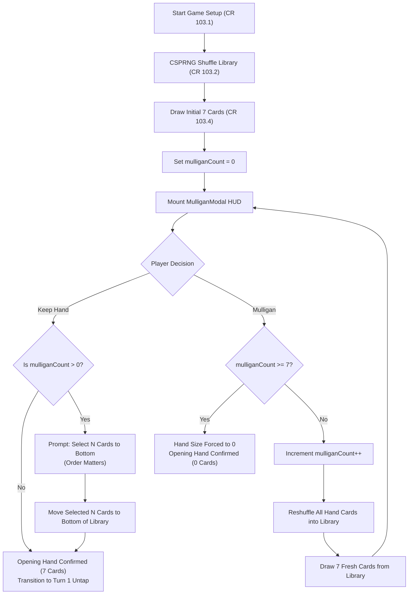
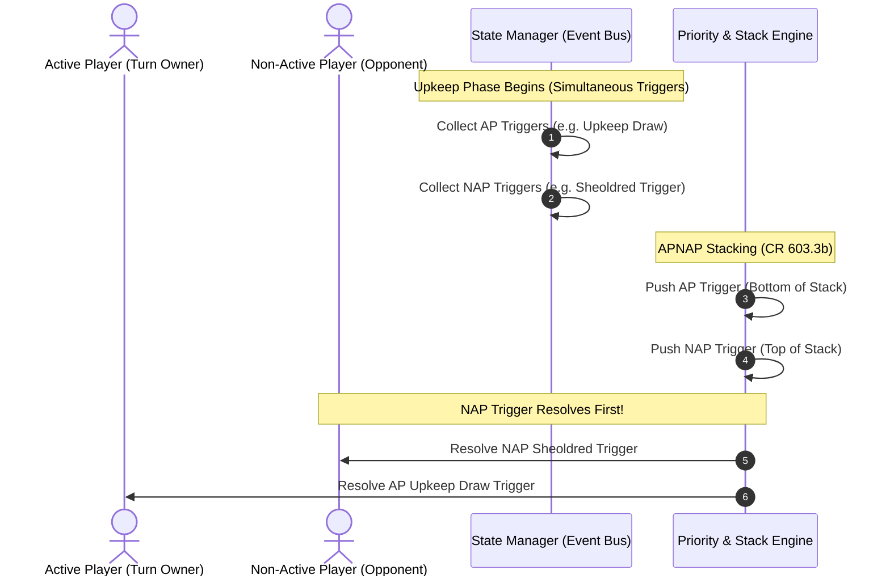
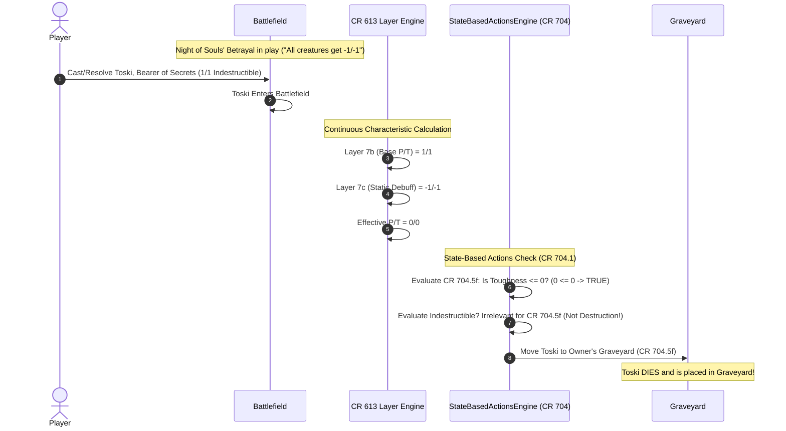
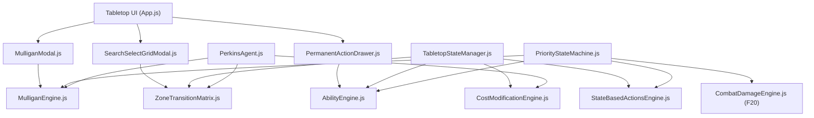

# FEATURE 21: Complete MTG Rule Engine — Shuffling & London Mulligan, Universal Zone Transition Matrix, Cost Modification Engine, Activated/Triggered/Static Abilities, and Continuous Layer SBA Rules

**Document ID:** `SPEC-RPM-RULES-ENGINE-021`  
**Status:** APPROVED FOR IMPLEMENTATION  
**Author:** Argon Specification Architect  
**Created Date:** October 20, 2026  
**Revision:** 1.0.0  
**Target File Path:** `specs/FEATURE_21_COMPLETE_MTG_RULE_ENGINE_SPEC.md`  

**Core Implementation Targets:**
- [`src/MulliganEngine.js`](file:///home/svayneak/Documents/Svayneak/rpm%20multiplayer/src/MulliganEngine.js) (NEW — MTG CR 103.2 & CR 103.4 CSPRNG Shuffling, London Mulligan State Machine, Bottoming Protocol, Perkins AI Heuristics `INV-MULLIGAN-1`)
- [`src/ZoneTransitionMatrix.js`](file:///home/svayneak/Documents/Svayneak/rpm%20multiplayer/src/ZoneTransitionMatrix.js) (NEW — MTG CR 400 Universal 6-Zone Transition Matrix, 36 Bi-Directional Validated Transitions, Specialized Flows, Bypassing Cast vs. Normal Cast `INV-ZONE-MATRIX-1`)
- [`src/CostModificationEngine.js`](file:///home/svayneak/Documents/Svayneak/rpm%20multiplayer/src/CostModificationEngine.js) (NEW — MTG CR 601.2f Cost Calculation Engine: Base Cost, Alternate Costs, Additional Costs/Taxes, Reductions, Multipliers, Delve, Convoke, Surge `INV-COST-ENGINE-1`)
- [`src/AbilityEngine.js`](file:///home/svayneak/Documents/Svayneak/rpm%20multiplayer/src/AbilityEngine.js) (NEW — MTG CR 602 Activated Abilities, CR 603 Triggered Abilities with APNAP Stack Sequencing, CR 604 & CR 613 Comprehensive 7-Layer Continuous Effects System `INV-ABILITY-ENGINE-1`)
- [`src/StateBasedActionsEngine.js`](file:///home/svayneak/Documents/Svayneak/rpm%20multiplayer/src/StateBasedActionsEngine.js) (MODIFY / EXPAND — Continuous Layer SBA Integration, Zero Toughness vs. Indestructible Invariant Enforcement MTG CR 704.5f vs. CR 704.5g `INV-STATIC-SBA-1`)
- [`src/TabletopStateManager.js`](file:///home/svayneak/Documents/Svayneak/rpm%20multiplayer/src/TabletopStateManager.js) (MODIFY — Universal Zone Matrix Integration, Pre-Game Setup Phase, Continuous Effect Recalculation Hooks, Cost Engine Verification `INV-ZONE-MATRIX-1`, `INV-COST-ENGINE-1`)
- [`src/PriorityStateMachine.js`](file:///home/svayneak/Documents/Svayneak/rpm%20multiplayer/src/PriorityStateMachine.js) (MODIFY — Pre-Game Mulligan Phase, APNAP Stack Resolution, Continuous Characteristic Refresh Prior to Priority Grant `INV-MULLIGAN-1`, `INV-ABILITY-ENGINE-1`)
- [`src/PerkinsAgent.js`](file:///home/svayneak/Documents/Svayneak/rpm%20multiplayer/src/PerkinsAgent.js) (MODIFY — AI London Mulligan Heuristic [0, 1, 6, 7 lands mulligan; 2–5 keep], AI Card Bottoming Prioritizer, AI Tutor Candidate Selection `INV-MULLIGAN-1`, `INV-ZONE-MATRIX-1`)
- [`src/view/MulliganModal.js`](file:///home/svayneak/Documents/Svayneak/rpm%20multiplayer/src/view/MulliganModal.js) (NEW — Interactive Pre-Game London Mulligan Dialog, Card Preview HUD, Keep/Mulligan Buttons, Drag-and-Drop Bottom Card Selection HUD `INV-MULLIGAN-1`)
- [`src/view/SearchSelectGridModal.js`](file:///home/svayneak/Documents/Svayneak/rpm%20multiplayer/src/view/SearchSelectGridModal.js) (NEW — Interactive Universal Search & Tutor Grid Modal, Real-Time Text Filter, Type Line Tabs, Multi-Zone Browser `INV-ZONE-MATRIX-1`)
- [`src/view/PermanentActionDrawer.js`](file:///home/svayneak/Documents/Svayneak/rpm%20multiplayer/src/view/PermanentActionDrawer.js) (NEW — Interactive Battlefield Permanent Drawer Popover for Activated Abilities, Cost Breakdown Badges, One-Click Activation `INV-ABILITY-ENGINE-1`)
- [`src/view/tabletop.css`](file:///home/svayneak/Documents/Svayneak/rpm%20multiplayer/src/view/tabletop.css) (MODIFY — Modal Themes, Bottoming Drag HUD, Tutor Search Grid Styling, Permanent Ability Drawer Glow & Layout)
- [`src/app.js`](file:///home/svayneak/Documents/Svayneak/rpm%20multiplayer/src/app.js) (MODIFY — Mount Mulligan Modal during Game Setup, Register Ability Drawer Popovers, Wire SearchSelectGridModal to State Events)
- [`src/index.js`](file:///home/svayneak/Documents/Svayneak/rpm%20multiplayer/src/index.js) (MODIFY — Export `MulliganEngine`, `ZoneTransitionMatrix`, `CostModificationEngine`, `AbilityEngine`, `SearchSelectGridModal`, `MulliganModal`, `PermanentActionDrawer`)
- [`test/test_mtg_rule_engine.js`](file:///home/svayneak/Documents/Svayneak/rpm%20multiplayer/test/test_mtg_rule_engine.js) (NEW — Exhaustive 16-Vector Acceptance Test Suite `TC-RULES-01` through `TC-RULES-16`)

**Related Specifications & Architectural Foundations:**
- [`specs/FEATURE_20_COMBAT_DAMAGE_ENGINE_SPEC.md`](file:///home/svayneak/Documents/Svayneak/rpm%20multiplayer/specs/FEATURE_20_COMBAT_DAMAGE_ENGINE_SPEC.md) (`SPEC-RPM-COMBAT-DAMAGE-020`: Combat Damage Engine, SBA Engine CR 704, Damage vs Life Loss, Keyword Resolution, Two-Tier Breadcrumb Track)
- [`specs/FEATURE_19_BATTLE_UX_AND_RULES_SPEC.md`](file:///home/svayneak/Documents/Svayneak/rpm%20multiplayer/specs/FEATURE_19_BATTLE_UX_AND_RULES_SPEC.md) (`SPEC-RPM-BATTLE-UX-019`: Battle UX Hardening, Auto-Untap, Target Selector Modal, Shockland ETB Choice, Horizontal Land Badges, Upkeep Perk Opt-In)
- [`specs/FEATURE_18_3D_DICE_AND_BOT_INTEGRITY_SPEC.md`](file:///home/svayneak/Documents/Svayneak/rpm%20multiplayer/specs/FEATURE_18_3D_DICE_AND_BOT_INTEGRITY_SPEC.md) (`SPEC-RPM-DICE-018`: 3D Dice Engine Integration, Bot Spell Cast Integrity, Perk Normalization)
- [`specs/FEATURE_4_STACK_PRIORITY_SPEC.md`](file:///home/svayneak/Documents/Svayneak/rpm%20multiplayer/specs/FEATURE_4_STACK_PRIORITY_SPEC.md) (`SPEC-RPM-PRIORITY-004`: MTG CR 117 Priority Flow, LIFO Stack & Checkpoint Journal)
- [`specs/FEATURE_3_TABLETOP_ZONE_STATE_SPEC.md`](file:///home/svayneak/Documents/Svayneak/rpm%20multiplayer/specs/FEATURE_3_TABLETOP_ZONE_STATE_SPEC.md) (`SPEC-RPM-ZONE-003`: Tabletop State, Zones, Subzones & Mana Pool)

---

## 1. Executive Summary & Problem Formulation

### 1.1 Context & Engineering Scope
With the delivery of Feature 19 (Battle UX Hardening) and Feature 20 (Combat Damage & SBA Engine), the RPM Tabletop Companion established industrial-strength combat resolution, damage marking, and priority mechanics. However, competitive playtesting and deep rules audit revealed five architectural deficiencies that prevent full fidelity with the **Magic: The Gathering Comprehensive Rules (MTG CR)**:

1. **Defect 1: Missing Pre-Game State & London Mulligan Protocol (`INV-MULLIGAN-1`, MTG CR 103.2, CR 103.4)**  
   Matches currently start with a hardcoded draw of 7 cards directly into the hand without pre-game verification, CSPRNG shuffling, or the modern London Mulligan procedure. Players cannot take mulligans, reshuffle, or selectively bottom cards, and AI bots operate without opening hand quality evaluation.
2. **Defect 2: Rigid Zone Manipulations & Lack of Universal Search/Tutor Pipeline (`INV-ZONE-MATRIX-1`, MTG CR 400)**  
   Card zone movements were hardcoded into bespoke paths (`castSpell`, `playLand`). Complex MTG mechanics such as tutors (*Demonic Tutor*), reanimation (*Reanimate*, *Persist*), impulse draw (*Light Up the Stage*), cascade (*Bloodbraid Elf*), flashback (*Past in Flames*), and bypass effects (*Aether Vial*, *Polymorph*) lacked a unified 6-zone transition matrix and a reusable UI grid browser for searched zones.
3. **Defect 3: Static Mana Cost Deduction & Inability to Compute Complex Costs (`INV-COST-ENGINE-1`, MTG CR 601.2f)**  
   Mana costs were evaluated as raw strings against mana pool balances. Spells could not incorporate cost taxes (*Thalia, Guardian of Thraben*), cost reductions (*Goblin Electromancer*, *Baral*), alternate casting methods (*Delve*, *Convoke*, *Surge*), or free casts (*Omniscience*, *Cascade*).
4. **Defect 4: Incomplete Ability Engine & Lack of Layered Characteristic Recalculation (`INV-ABILITY-ENGINE-1`, MTG CR 602, 603, 604 & CR 613)**  
   Cards were largely inert objects on the battlefield. Activated abilities lacked an intuitive permanent action popover and stack placement; triggered abilities lacked an automatic APNAP (Active Player, Non-Active Player) event listener pipeline; and continuous static abilities (such as *Glorious Anthem* $+1/+1$ or *Humility*) were not computed across the mandatory MTG 7-Layer system.
5. **Defect 5: Indestructible Immunity Flaw on Zero-Toughness Static Debuffs (`INV-STATIC-SBA-1`, MTG CR 704.5f vs. CR 704.5g)**  
   When an indestructible creature entered play with a static $-1/-1$ debuff enchantment (*Night of Souls' Betrayal* or *Elesh Norn*), the state manager erroneously treated its death as "destruction" and protected the creature with Indestructible. Under MTG CR 704.5f, a creature with toughness $\le 0$ is placed into the graveyard as a state-based action. **Zero toughness is not destruction (CR 704.5g), and Indestructible (CR 702.12) does not prevent it.**

Feature 21 resolves all five deficiencies comprehensively, establishing an authoritative, complete MTG Rule Engine.

---

## 2. Formal Architectural Invariant Hierarchy

The Rule Engine is governed by six inviolable architectural invariants:

```
+----------------------------------------------------------------------------------------------------+
|                                    INVARIANT DEPENDENCY GRAPH                                      |
+----------------------------------------------------------------------------------------------------+
|                                                                                                    |
|                       +---------------------------------------------+                              |
|                       | INV-MULLIGAN-1: CSPRNG Shuffle & London     |                              |
|                       | Mulligan Pre-Game Engine (CR 103.2 / 103.4) |                              |
|                       +----------------------+----------------------+                              |
|                                              |                                                     |
|                                              v                                                     |
|                       +---------------------------------------------+                              |
|                       | INV-ZONE-MATRIX-1: Universal 6-Zone         |                              |
|                       | Transition Matrix & Tutor Grid Modal (CR 400|                              |
|                       +----------------------+----------------------+                              |
|                                              |                                                     |
|                       +----------------------+----------------------+                              |
|                       |                                             |                              |
|                       v                                             v                              |
|    +------------------------------------+        +------------------------------------+            |
|    | INV-COST-ENGINE-1: CR 601.2f Cost  |        | INV-ABILITY-ENGINE-1: Activated,   |            |
|    | Calculation, Reductions & Delve    |        | Triggered & 7-Layer Static Engine  |            |
|    +------------------+-----------------+        +------------------+-----------------+            |
|                       |                                             |                              |
|                       +----------------------+----------------------+                              |
|                                              |                                                     |
|                                              v                                                     |
|                       +---------------------------------------------+                              |
|                       | INV-STATIC-SBA-1: Continuous Layer SBA      |                              |
|                       | Indestructible vs 0 Toughness (CR 704.5f)   |                              |
|                       +----------------------+----------------------+                              |
|                                              |                                                     |
|                                              v                                                     |
|                       +---------------------------------------------+                              |
|                       | INV-HARMONY-21: Unified Tabletop Synergy    |                              |
|                       | Combat Engine (F20) & Battle UX (F19)       |                              |
|                       +---------------------------------------------+                              |
+----------------------------------------------------------------------------------------------------+
```

| Invariant ID | Title | MTG CR Basis | Architectural Scope | Verification Mechanism |
| :--- | :--- | :--- | :--- | :--- |
| `INV-MULLIGAN-1` | Pre-Game Shuffling & London Mulligan Engine | MTG CR 103.2, CR 103.4 | Pre-Game Setup, Priority Machine, Perkins Bot | CSPRNG Fisher-Yates shuffle; pre-game modal displays 7 drawn cards with `[Keep Hand]` and `[Mulligan]`; if mulligan taken, increment `mulliganCount` $N$, reshuffle, draw 7, and prompt player to bottom $N$ cards in chosen order; hand size ends at $7 - N$; Perkins AI mulligans on 0, 1, 6, 7 lands and keeps on 2–5 lands. |
| `INV-ZONE-MATRIX-1` | Universal 6-Zone Transition Matrix & Search/Tutor Engine | MTG CR 400 (General Zone Rules), CR 400.7 | Tabletop State, UI Modals, All Zone Movements | Strict bi-directional transition matrix across Hand, Library, Battlefield, Graveyard, Exile, Stack; supports all 13 core flows including tutors, mill, surveil, reanimation, flashback, delve, escape, cascade, and bypass effects ("Enter without casting" vs "Cast without paying mana cost"); interactive `SearchSelectGridModal.js` handles searching/filtering candidate cards. |
| `INV-COST-ENGINE-1` | Dynamic Cost Modification Engine | MTG CR 601.2f | Spell Casting Pipeline, Mana Engine, Action Lexer | Computes Total Cost: `((Base or Alternate Cost) + Additional Costs / Taxes - Reductions) * Multipliers`; supports static cost taxes (*Thalia*), static reductions (*Electromancer*), and alternate cost mechanisms (*Delve*, *Convoke*, *Surge*); enforces colored mana pip constraints. |
| `INV-ABILITY-ENGINE-1` | Activated, Triggered, and Static Abilities Engine | MTG CR 602, CR 603, CR 604, CR 613 | Permanent Interaction, Event Bus, Layer Pipeline | Permanent click opens `PermanentActionDrawer.js` for activated abilities (checks costs, life, sacrifices, mana); triggered abilities automatically listen for ETB, Dies, Cast, Upkeep and stack via APNAP order; static abilities continuously re-evaluate board characteristics across 7 MTG layers. |
| `INV-STATIC-SBA-1` | Continuous Layer SBA Indestructible vs. 0 Toughness Invariant | MTG CR 704.5f, CR 704.5g, CR 702.12, CR 613.4c | SBA Engine, Layer Recalculation | A 1/1 creature with Indestructible entering the battlefield while a static $-1/-1$ debuff is active enters Layer 7c with 0 toughness; SBA check evaluates CR 704.5f ($\le 0$ toughness) and puts it into the graveyard; Indestructible (CR 702.12) does NOT protect against zero toughness because CR 704.5f is NOT destruction. |
| `INV-HARMONY-21` | Unified Tabletop Synergy | Feature 19 & 20 Specs | Entire Tabletop Architecture | Harmonizes zone transitions, cost payments, abilities, and SBAs with the Two-Tier Breadcrumb phase bar, combat damage allocation sliders, auto-untap, and multiplayer telemetry. |

---

## 3. Pre-Game Shuffling & London Mulligan Engine (`INV-MULLIGAN-1`)

### 3.1 MTG Comprehensive Rules Grounding (CR 103.2 & CR 103.4)
1. **CR 103.2 (Deck Shuffling):** After players provide their decks, each player shuffles their deck thoroughly so that the cards are in random order. The engine enforces Cryptographically Secure Pseudo-Random Number Generation (CSPRNG) via the Web Crypto API (`crypto.getRandomValues`).
2. **CR 103.4 (The London Mulligan Rule):** Each player draws a hand of seven cards. A player who is dissatisfied with their opening hand may take a mulligan.
   - To take a London Mulligan:
     1. The player shuffles their hand back into their library.
     2. The player draws seven new cards.
     3. The player selects a number of cards equal to the number of times they have taken a mulligan ($N$) and puts those cards on the bottom of their library in any chosen order.
     4. This process repeats until all players have kept their hand or a player reaches 7 mulligans (resulting in an empty hand).

### 3.2 CSPRNG Fisher-Yates Shuffle Algorithm (`shuffleLibrary`)
To guarantee tournament-grade randomness without predictability or bias:

```javascript
/**
 * Executes a Cryptographically Secure Pseudo-Random Number Generator (CSPRNG)
 * Fisher-Yates shuffle on the given array in place.
 * 
 * @template T
 * @param {T[]} array - Array of card instances to shuffle
 * @returns {T[]} The mutated, uniformly randomized array
 */
export function shuffleLibrary(array) {
  if (!Array.isArray(array) || array.length <= 1) return array;

  const cryptoObj = (typeof window !== 'undefined' && window.crypto) 
    ? window.crypto 
    : (typeof globalThis !== 'undefined' ? globalThis.crypto : null);

  for (let i = array.length - 1; i > 0; i--) {
    let j;
    if (cryptoObj && typeof cryptoObj.getRandomValues === 'function') {
      const buffer = new Uint32Array(1);
      cryptoObj.getRandomValues(buffer);
      // Uniform integer in range [0, i] avoiding modulo bias
      const maxRange = Math.floor(0xFFFFFFFF / (i + 1)) * (i + 1);
      let randVal = buffer[0];
      while (randVal >= maxRange) {
        cryptoObj.getRandomValues(buffer);
        randVal = buffer[0];
      }
      j = randVal % (i + 1);
    } else {
      // High-precision fallback if Web Crypto is unavailable
      j = Math.floor(Math.random() * (i + 1));
    }
    const temp = array[i];
    array[i] = array[j];
    array[j] = temp;
  }
  return array;
}
```

### 3.3 London Mulligan State Machine Workflow



### 3.4 Interactive Pre-Game UI Component: `MulliganModal.js`
The London Mulligan modal mounts in the viewport during the pre-game state before turn 1:
- **Card Preview Carousel / Grid:** Renders all 7 drawn cards with high-resolution artwork, mana symbols, and type lines.
- **Decision Controls:**
  - `[Keep Hand]` button: Confirms hand. If `mulliganCount > 0`, shifts modal into "Bottoming Selection Mode".
  - `[Mulligan]` button (with badge indicating current mulligan count e.g., "Mulligan to 6", "Mulligan to 5").
- **Bottoming Selection Mode HUD:**
  - Prompts: *"Select exactly N card(s) to place on the bottom of your library in chosen order."*
  - Cards gain selection order badges (`#1`, `#2`, etc.) indicating bottoming order from top to bottom.
  - `[Confirm Bottom Cards]` button activates only when exactly $N$ cards are selected.

### 3.5 Perkins AI Bot London Mulligan Decision Heuristics
When an AI bot or automated opponent evaluates an opening hand, it applies the authoritative land-count decision matrix:

```javascript
/**
 * Evaluates whether Perkins AI bot should keep or mulligan an opening hand.
 * MTG Heuristic:
 * - 0 lands: Always Mulligan (Unplayable mana drought)
 * - 1 land: Always Mulligan (High risk of mana screw)
 * - 6 lands: Always Mulligan (Severe mana flood)
 * - 7 lands: Always Mulligan (Unplayable pure flood)
 * - 2-5 lands: Keep Hand
 * 
 * @param {Array<Object>} hand - Array of 7 card instances in hand
 * @param {number} currentMulliganCount - Number of mulligans already taken
 * @returns {{ keep: boolean, reason: string }}
 */
export function evaluatePerkinsMulligan(hand, currentMulliganCount = 0) {
  if (currentMulliganCount >= 3) {
    // Diminishing returns: at 3 mulligans (hand size 4), keep to prevent card disadvantage
    return { keep: true, reason: 'MULLIGAN_DEPTH_THRESHOLD_REACHED' };
  }

  const landCount = hand.filter(card => /land/i.test(card.typeLine || card.type || '')).length;

  if (landCount === 0) {
    return { keep: false, reason: 'MANA_DROUGHT_ZERO_LANDS' };
  }
  if (landCount === 1) {
    return { keep: false, reason: 'MANA_SCREW_ONE_LAND' };
  }
  if (landCount === 6) {
    return { keep: false, reason: 'MANA_FLOOD_SIX_LANDS' };
  }
  if (landCount === 7) {
    return { keep: false, reason: 'MANA_FLOOD_SEVEN_LANDS' };
  }

  // 2, 3, 4, or 5 lands
  return { keep: true, reason: `BALANCED_HAND_${landCount}_LANDS` };
}

/**
 * Prioritizes which N cards Perkins AI bot puts on the bottom of the library.
 * Heuristic priority:
 * 1. Expensive spells (CMC >= 5) when land count is low (2-3)
 * 2. Excess lands when land count >= 4
 * 3. Off-curve or uncastable high-cost non-land cards
 * 4. Redundant copies of legendary or situational cards
 * 
 * @param {Array<Object>} hand - Current 7 cards
 * @param {number} countToBottom - Exactly N cards to select
 * @returns {Array<Object>} Cards to bottom, ordered
 */
export function selectPerkinsBottomCards(hand, countToBottom) {
  if (countToBottom <= 0) return [];
  const cardsWithScores = hand.map(card => {
    let discardScore = 0;
    const isLand = /land/i.test(card.typeLine || card.type || '');
    const cmc = card.cmc ?? (card.manaCost ? (card.manaCost.match(/\{[0-9WUBRGC]\}/g) || []).length : 0);
    
    if (isLand) {
      // Deprioritize bottoming lands unless flood
      const totalLands = hand.filter(c => /land/i.test(c.typeLine || c.type || '')).length;
      discardScore = totalLands > 3 ? 50 + totalLands : 10;
    } else {
      // Non-lands: score proportional to CMC (higher CMC = higher bottom priority)
      discardScore = 30 + (cmc * 15);
    }
    return { card, score: discardScore };
  });

  // Sort descending by discardScore (highest score bottoms first)
  cardsWithScores.sort((a, b) => b.score - a.score);
  return cardsWithScores.slice(0, countToBottom).map(item => item.card);
}
```

---

## 4. Universal 6-Zone Transition Matrix & Search/Tutor Engine (`INV-ZONE-MATRIX-1`)

### 4.1 MTG Comprehensive Rules Grounding (CR 400 & CR 400.7)
Under MTG CR 400, the game consists of six fundamental zones:
- **`Library`:** Face-down ordered repository.
- **`Hand`:** Hidden to opponent, accessible to owner.
- **`Battlefield`:** Public zone where permanents exist (subdivided into lands, creatures, noncreatures, planeswalkers).
- **`Graveyard`:** Public face-up discard/death zone with explicit ordering.
- **`Exile`:** Public face-up or face-down repository outside of play.
- **`Stack`:** Public LIFO zone where spells and abilities wait to resolve.

**CR 400.7 (Zone Change Identity Reset):** An object that moves from one zone to another becomes a new object with no memory of or connection to its previous existence. When a permanent leaves the battlefield:
- All counters (`+1/+1`, `-1/-1`, loyalty) are stripped.
- All temporary damage marked (`damageMarked = 0`) is purged.
- All temporary modifications, continuous buffs, and tap states (`isTapped = false`) reset.
- A fresh instance ID is optionally minted or the identity is reset.

### 4.2 Complete 6x6 Bi-Directional Transition Matrix

The table below defines all 36 cell transitions with MTG rules classification, state mutations, and triggering mechanics:

| From Zone | To Hand | To Library | To Battlefield | To Graveyard | To Exile | To Stack |
| :--- | :--- | :--- | :--- | :--- | :--- | :--- |
| **Hand** | Identity NO-OP | Bottoming / Brainstorm (`position: 'top'\|'bottom'`) | Play Land (CR 305) / Direct drop (*Show and Tell*) | Discard (CR 701.8) / Hand size cleanup (CR 514.1) | Exile from hand (Thoughtseize, Force of Will pitch) | Cast Spell (CR 601.2) |
| **Library** | Draw Card (CR 121) / Tutor to Hand (*Demonic Tutor*) | Identity NO-OP / Reorder / Scry / Shuffle | Enter without casting (*Collected Company*, *Aether Vial*) | Mill / Surveil / Dredge (CR 701.13) | Impulse Draw (*Light Up the Stage*) / Cascade exile | Cast from top (*Future Sight*, *Bolas's Citadel*) |
| **Battlefield**| Bounce / Return to hand (*Unsummon*) | Tuck / Return to deck (*Terminus*, *Teferi -3*) | Blink / Flicker (*Ephemerate*, leaves & returns) | Dies / Destroyed (CR 701.7) / Sacrificed (CR 701.17) | Exile permanent (*Swords to Plowshares*, *Path*) | Bounce to stack (Uncommon, *Remand* equivalent) |
| **Graveyard** | Regrowth (*Eternal Witness*, return to hand) | Tuck from GY (*Elixir of Immortality*, shuffle GY) | Reanimate (*Reanimate*, *Animate Dead*, *Persist*) | Identity NO-OP / GY reordering | Delve cost / Escape cost / Flashback exile / Rest in Peace | Cast from GY (Flashback CR 702.34, Escape, Yawgmoth) |
| **Exile** | Squee return (*Squee the Immortal*, *Eternal Scourge*) | Process into deck (*Eldrazi Processors*) | Return from exile (Blink end-step return, Suspend cast) | Return from exile to GY (Processors, Riftsweeper) | Identity NO-OP | Cast from exile (Cascade, Adventure, Light Up Stage) |
| **Stack** | Counter to hand (*Remand*, *Failure // Comply*) | Counter to library (*Memory Lapse*, *Substraction*) | Permanent spell resolves $\to$ enters battlefield | Non-permanent spell resolves or is countered to GY | Spell resolves to exile (Adventure, Delve, Temporal Trespass) | Identity NO-OP |

### 4.3 Detailed Mechanics Specification

#### 4.3.1 Library to Battlefield: "Enter Without Casting" vs. "Cast Without Paying Mana Cost"
It is essential to distinguish between these two distinct MTG mechanics:
1. **Enter Without Casting (CR 608.2f / CR 614):**
   - *Examples:* *Aether Vial*, *Collected Company*, *Polymorph*, *Through the Breach*, *Show and Tell*.
   - *Flow:* Card moves directly from `library` (or `hand`) $\to$ `battlefield`.
   - *Stack Bypass:* The creature or permanent **does not use the stack** and **cannot be countered** by *Counterspell* or *Force of Will*.
   - *Triggers:* Triggers all Enters-the-Battlefield (ETB) triggered abilities.
2. **Cast Without Paying Mana Cost (CR 601.2b & CR 118.9):**
   - *Examples:* *Omniscience*, *Cascade* (*Bloodbraid Elf*), *Electrodominance*, *Hideaway* (*Windbrisk Heights*).
   - *Flow:* Card moves from `library` (or `exile`/`hand`) $\to$ `stack`.
   - *Stack Usage:* The card is placed on the stack as a cast spell with `withoutPayingManaCost: true`.
   - *Counterable:* Can be countered, responds to priority passes, triggers "Whenever a player casts a spell" abilities.

#### 4.3.2 Library to Hand: Search and Tutor Engine
- *Examples:* *Demonic Tutor*, *Vampiric Tutor*, *Flooded Strand* (Fetchlands), *Stoneforge Mystic*.
- *Protocol:*
  1. Opens `SearchSelectGridModal.js` filtering candidate cards from player's `library`.
  2. If restricted (e.g., "search for an Equipment card"), applies type filter.
  3. Chosen card is moved to `hand`.
  4. If card had to be revealed, emits `CARD_REVEALED` event.
  5. Library is automatically reshuffled via `shuffleLibrary` (CR 701.20).

#### 4.3.3 Mill and Surveil (Library to Graveyard)
- *Examples:* *Glimpse the Unthinkable* (Mill 10), *Consider* (Surveil 1).
- *Surveil Choice Protocol:* Top $K$ cards of library are revealed in a modal. Player chooses which to put into `graveyard` and which to keep on `library` top in chosen order.

#### 4.3.4 Reanimation & Persist/Undying (Graveyard to Battlefield)
- *Examples:* *Reanimate*, *Persist* (enters with `-1/-1` counter), *Undying* (enters with `+1/+1` counter).
- *Counter Initialization:* If triggered via Persist, `counters['-1/-1'] = (counters['-1/-1'] || 0) + 1`.

#### 4.3.5 Flashback, Escape & Delve (Cast from Graveyard & Exile)
- *Flashback (CR 702.34):* Spell is cast from `graveyard` onto `stack`. When it leaves the stack, replacement effect exiles it instead of returning to graveyard.
- *Delve (CR 702.66):* As an additional cost, player selects $X$ cards in `graveyard` and moves them to `exile`, each reducing generic mana cost by $\{1\}$.

#### 4.3.6 Blink & Flicker (Battlefield to Exile to Battlefield)
- *Examples:* *Ephemerate*, *Flickerwisp*, *Restoration Angel*.
- *Protocol:* Card moves `battlefield` $\to$ `exile`, immediately purging counters and tap state. If immediate blink, returns to `battlefield` as a fresh instance and fires ETB triggers.

### 4.4 Search/Tutor Engine Component: `SearchSelectGridModal.js`
When any search or tutor action triggers:
1. **Modal DOM Architecture:**
   - Header with search title (e.g., *"Search Library for a Card"*), card count indicator, and close/cancel button.
   - Live Search Input field with instantaneous debounce (150ms).
   - Filter Tabs: `[All]`, `[Creatures]`, `[Lands]`, `[Spells]`, `[Artifacts/Enchantments]`.
   - Card Candidate Grid: Displays Scryfall card imagery, CMC badges, type badges, and hover enlargement.
   - Action Bar: `[Select Card]` button, auto-shuffle checkbox (default checked for tutors), and reveal checkbox.
2. **Multi-Zone Reusability:** The modal accepts `sourceZone: 'library' | 'graveyard' | 'exile'` and dynamically populates from the corresponding container.

```javascript
/**
 * src/view/SearchSelectGridModal.js
 * Universal Search & Tutor Card Grid Modal.
 */
export class SearchSelectGridModal {
  constructor(options = {}) {
    this.container = options.container || document.body;
    this.onSelect = options.onSelect || (() => {});
    this.onCancel = options.onCancel || (() => {});
    this.isOpen = false;
    this.element = null;
    this.currentCards = [];
    this.filteredCards = [];
    this.selectedInstanceId = null;
    this.activeFilter = 'ALL';
    this.searchQuery = '';
  }

  open({ title = 'Search Cards', cards = [], filterType = null, requireReveal = false }) {
    this.currentCards = [...cards];
    this.selectedInstanceId = null;
    this.searchQuery = '';
    this.activeFilter = filterType || 'ALL';
    this.requireReveal = requireReveal;
    this.title = title;
    this.isOpen = true;
    this.render();
  }

  // Implementation provides real-time search and type filtering
}
```

---

## 5. Dynamic Cost Modification Engine (`INV-COST-ENGINE-1`)

### 5.1 MTG Comprehensive Rules Grounding (CR 601.2f)
Under MTG CR 601.2f, the total cost to cast a spell is calculated using a strict mathematical order of operations:

$$\text{Total Cost} = \Big( (\text{Base Mana Cost} \lor \text{Alternate Cost}) + \sum \text{Additional Costs / Taxes} - \sum \text{Cost Reductions} \Big) \times \prod \text{Multipliers}$$

#### 5.1.1 Order of Calculation:
1. **Step 1 (Base or Alternate Cost):**
   - The player selects the base casting method:
     - Normal printed mana cost (e.g., $\{1\}\{U\}\{U\}$ for *Archmage's Charm*).
     - Alternate cost (e.g., Overload $\{4\}\{U\}\{U\}$ for *Cyclonic Rift*, Surge $\{1\}\{U\}$ for *Crush of Tentacles*, Flashback $\{1\}\{R\}$ for *Faithless Looting*).
     - Free cost: If cast via an effect stating "without paying its mana cost" (e.g., *Omniscience*, *Cascade*), Base Cost is $\{0\}$.
2. **Step 2 (Additional Costs & Taxes):**
   - Add all additional costs and static taxes:
     - *Thalia, Guardian of Thraben*: Noncreature spells cost $\{1\}$ more.
     - *Grand Arbiter Augustin IV*: Opponent spells cost $\{1\}$ more.
     - Kicker, Buyback, Escalate, Commander Tax ($+2$ generic per previous cast from Command Zone).
3. **Step 3 (Cost Reductions):**
   - Subtract all cost reductions:
     - *Goblin Electromancer*: Instant and sorcery spells cost $\{1\}$ less.
     - *Baral, Chief of Compliance*: Instant and sorcery spells cost $\{1\}$ less.
     - Affinity for Artifacts: Costs $\{1\}$ less for each artifact you control.
   - *Limitation:* Cost reductions can only reduce generic mana requirements unless explicitly stated (e.g., cannot reduce colored pips $\{U\}$ to $\{0\}$). Generic mana cannot drop below $\{0\}$.
4. **Step 4 (Multipliers & Minimum Limits):**
   - Apply Trinisphere rule (CR 601.2f): If the total cost would require less than 3 total mana, it becomes 3 mana.

### 5.2 Mathematical Formulation & Pip Vector Model
Mana costs are modeled as multi-dimensional pip vectors:

$$\mathbf{C} = \langle G, W, U, B, R, G_{color}, C \rangle$$

Where:
- $G$: Generic mana integer
- $W, U, B, R, G_{color}, C$: Colored and Colorless required pips

```javascript
/**
 * src/CostModificationEngine.js
 * Comprehensive MTG CR 601.2f Cost Calculation Engine.
 */
export class CostModificationEngine {
  /**
   * Calculates the exact final cost to cast a spell.
   * 
   * @param {Object} card - Card instance being cast
   * @param {Object} context - Game context (player, active permanents, flags)
   * @returns {CostBreakdown}
   */
  static calculateTotalCost(card, context = {}) {
    const {
      isWithoutPayingManaCost = false,
      alternateCost = null, // e.g. { type: 'SURGE', manaCost: '{1}{U}' }
      activePermanents = [],
      additionalCosts = [],
      delveExiledCards = 0,
      convokeTappedCreatures = [] // array of colors tapped
    } = context;

    // 1. Base Cost determination
    let costVector = { generic: 0, W: 0, U: 0, B: 0, R: 0, G: 0, C: 0 };
    if (isWithoutPayingManaCost) {
      costVector = { generic: 0, W: 0, U: 0, B: 0, R: 0, G: 0, C: 0 };
    } else if (alternateCost && alternateCost.manaCost) {
      costVector = this.parseCostStringToVector(alternateCost.manaCost);
    } else {
      costVector = this.parseCostStringToVector(card.manaCost || '');
    }

    // 2. Additional Costs & Static Taxes
    let genericTax = 0;
    const isNonCreature = !/creature/i.test(card.typeLine || card.type || '');
    const isInstantOrSorcery = /instant|sorcery/i.test(card.typeLine || card.type || '');

    for (const perm of activePermanents) {
      // Thalia, Guardian of Thraben: Noncreature spells cost {1} more
      if (/thalia, guardian of thraben/i.test(perm.name) && isNonCreature) {
        genericTax += 1;
      }
      // Grand Arbiter: Opponent spells cost {1} more
      if (/grand arbiter augustin iv/i.test(perm.name) && perm.controllerId !== card.controllerId) {
        genericTax += 1;
      }
    }
    costVector.generic += genericTax;

    // 3. Cost Reductions
    let genericReduction = 0;
    for (const perm of activePermanents) {
      if (perm.controllerId === card.controllerId) {
        // Goblin Electromancer & Baral: Instants/sorceries cost {1} less
        if ((/goblin electromancer/i.test(perm.name) || /baral, chief of compliance/i.test(perm.name)) && isInstantOrSorcery) {
          genericReduction += 1;
        }
      }
    }

    // Delve: Each exiled card pays {1} generic
    genericReduction += Math.max(0, delveExiledCards);

    // Apply generic reduction (cannot reduce below 0 generic)
    costVector.generic = Math.max(0, costVector.generic - genericReduction);

    // Convoke: Deduct mana matching colors of tapped creatures
    for (const tappedColor of convokeTappedCreatures) {
      if (costVector[tappedColor] > 0) {
        costVector[tappedColor] -= 1;
      } else if (costVector.generic > 0) {
        costVector.generic -= 1;
      }
    }

    // 4. Trinisphere Check (CR 601.2f)
    const hasTrinisphere = activePermanents.some(p => /trinisphere/i.test(p.name) && !p.isTapped);
    const totalPips = costVector.generic + costVector.W + costVector.U + costVector.B + costVector.R + costVector.G + costVector.C;
    if (hasTrinisphere && totalPips < 3) {
      costVector.generic += (3 - totalPips);
    }

    return {
      finalVector: costVector,
      formattedCost: this.vectorToCostString(costVector),
      taxesApplied: genericTax,
      reductionsApplied: genericReduction,
      delveCardsUsed: delveExiledCards,
      convokeCreaturesUsed: convokeTappedCreatures.length
    };
  }
}
```

---

## 6. Activated, Triggered, and Static Abilities Engine (`INV-ABILITY-ENGINE-1`)

### 6.1 Activated Abilities (CR 602)
- **Syntax:** `[Cost] : [Effect]` (Explicit colon separation).
- **Activation Lifecycle:**
  1. Player clicks a permanent on the battlefield, triggering `PermanentActionDrawer.js`.
  2. The drawer scans the card's oracle text for activated abilities.
  3. The cost is validated:
     - Tap symbol $\{T\}$: Verifies `!permanent.isTapped` and no summoning sickness (if creature).
     - Mana cost: Verifies mana pool or auto-taps available lands.
     - Sacrifice cost: E.g., *Yawgmoth, Thran Physician* ("Sacrifice another creature"), prompts target selector.
     - Life payment: E.g., *Yawgmoth* ("Pay 1 life"), calls `_handleLoseLife`.
  4. Costs are paid immediately.
  5. The ability object is created and pushed onto the Stack (CR 602.2a):
     ```javascript
     {
       instanceId: 'ability_' + generateInstanceId(),
       sourceInstanceId: permanent.instanceId,
       sourceCardName: permanent.name,
       controllerId: permanent.controllerId,
       type: 'ACTIVATED_ABILITY',
       effectDescription: 'Put a -1/-1 counter on up to one target creature and draw a card.',
       targets: selectedTargets,
       zone: 'stack'
     }
     ```
  6. Priority passes according to CR 117.

### 6.2 Triggered Abilities & APNAP Stacking (CR 603)
- **Syntax:** Abilities beginning with *"When"*, *"Whenever"*, or *"At"*.
- **Supported Event Types:**
  - `ETB` (*Enters the Battlefield*): Triggered when any permanent enters battlefield from any zone.
  - `DIES` (*Leaves the Battlefield to Graveyard*): Triggered when a permanent moves from battlefield to graveyard.
  - `SPELL_CAST`: Triggered when a card enters the stack as a cast spell.
  - `PHASE_BEGIN`: Triggered at the beginning of Upkeep, Draw, End Step.
- **APNAP (Active Player, Non-Active Player) Stacking Protocol (CR 603.3b):**
  When multiple abilities trigger simultaneously (e.g., a board wipe or simultaneous upkeep triggers):
  1. The **Active Player (AP)** puts all abilities they control onto the stack in the order of their choice.
  2. The **Non-Active Player (NAP)** puts all abilities they control onto the stack on top of AP's abilities.
  3. In multiplayer, proceed in turn order from AP.
  4. **Resolution Sequence:** Because the stack is Last-In, First-Out (LIFO), **the Non-Active Player's triggers resolve first!**



### 6.3 Static Abilities & The Comprehensive 7-Layer System (CR 604 & CR 613)
Static abilities apply continuously at all times without using the stack. To prevent circular dependencies, MTG mandates that characteristics are computed strictly across **7 Layers**:

```
+----------------------------------------------------------------------------------------------------+
|                                THE 7-LAYER CONTINUOUS EFFECT ENGINE                                |
+----------------------------------------------------------------------------------------------------+
| Layer 1: Copy Effects          | Clones, token copies (CR 613.1a)                                  |
| Layer 2: Control Effects       | Mind Control, Act of Treason (CR 613.1b)                           |
| Layer 3: Text Effects          | Magus of the Moon, Mind Bend (CR 613.1c)                           |
| Layer 4: Type Changing Effects | Blood Moon (Non-basics are Mountains), Song of the Dryads         |
| Layer 5: Color Changing Effects| Painter's Servant (Cards are chosen color) (CR 613.1e)             |
| Layer 6: Ability Adding/Loss   | Archetype of Imagination (Gains flying), Humility (Loses abilities|
| Layer 7: Power & Toughness     | 5 Sub-layers computed in strict sequence (CR 613.4):              |
|   7a: Characteristic-Defining  | Tarmogoyf (* / 1+*), Serra Avatar (CR 613.4a)                     |
|   7b: Base P/T Setting Effects | Humility (Sets base P/T to 1/1) (CR 613.4b)                       |
|   7c: Static Modifications     | Glorious Anthem (+1/+1), Night of Souls' Betrayal (-1/-1)         |
|   7d: Counters                 | +1/+1 counters, -1/-1 counters (CR 613.4d)                        |
|   7e: P/T Switching Effects    | Inside Out, Twisted Image (CR 613.4e)                             |
+----------------------------------------------------------------------------------------------------+
```

---

## 7. Continuous Layer SBA Rules & The Indestructible vs. 0 Toughness Invariant (`INV-STATIC-SBA-1`)

### 7.1 Problem Formulation & Explicit User Decision
During the design review, a critical test case was established:
> *"What happens when an indestructible 1/1 creature enters the battlefield while a static -1/-1 enchantment (such as Night of Souls' Betrayal or Elesh Norn) is on the field?"*

A common misunderstanding among casual players is that "Indestructible creatures cannot die." Under the official MTG Comprehensive Rules, this is strictly false.

### 7.2 Comprehensive Rules Derivation (CR 704.5f vs. CR 704.5g & CR 702.12)
1. **CR 702.12b (Indestructible Definition):**  
   *"A permanent with indestructible can't be destroyed. Such permanents aren't destroyed by lethal damage, and they aren't destroyed by state-based actions for lethal damage (see rule 704.5g) or deathtouch damage (see rule 704.5h)."*
2. **CR 704.5f (Zero or Less Toughness):**  
   *"If a creature has toughness 0 or less, it's put into its owner's graveyard. Regeneration can't replace this event."*  
   **Crucial Rule Fact:** CR 704.5f uses the phrasing *"is put into its owner's graveyard"*, **NOT** *"is destroyed"*.
3. **CR 704.5g (Lethal Marked Damage):**  
   *"If a creature has toughness greater than 0, and the total damage marked on it is greater than or equal to its toughness, that creature has been dealt lethal damage and is destroyed."*  
   Indestructible **only** provides immunity to CR 704.5g and CR 704.5h. It provides **zero protection against CR 704.5f**.

### 7.3 Step-by-Step Execution Trace



```javascript
/**
 * Authoritative implementation of CR 704.5f vs CR 704.5g in StateBasedActionsEngine.js
 */
static evaluateCreatureSBA(creature, activeLayers) {
  // Compute effective characteristics through 7-layer engine
  const effective = AbilityEngine.computeCharacteristics(creature, activeLayers);

  // CR 704.5f: Toughness <= 0
  // Put into owner's graveyard. Bypasses Indestructible!
  if (effective.toughness <= 0) {
    return {
      action: 'MOVE_TO_GRAVEYARD',
      rule: 'CR 704.5f',
      reason: 'ZERO_OR_LESS_TOUGHNESS',
      bypassesIndestructible: true,
      card: creature
    };
  }

  // CR 704.5g: Marked damage >= toughness
  const markedDamage = creature.damageMarked || 0;
  if (markedDamage >= effective.toughness) {
    if (creature.keywords?.indestructible || effective.keywords?.includes('indestructible')) {
      // Indestructible protects against lethal damage destruction
      return null;
    }
    return {
      action: 'DESTROY',
      rule: 'CR 704.5g',
      reason: 'LETHAL_DAMAGE',
      card: creature
    };
  }

  return null;
}
```

---

## 8. Concrete TypeScript / JSDoc Interface Signatures

```typescript
/**
 * Specifications for Feature 21 Rule Engine Data Models
 */

// --- Invariant INV-MULLIGAN-1 Models ---
export interface MulliganState {
  mulliganCount: number;
  initialHandDrawn: boolean;
  isConfirmed: boolean;
  cardsInHand: CardInstance[];
  cardsToBottomCount: number;
  bottomOrderSelected: CardInstance[];
}

export interface MulliganDecision {
  action: 'KEEP' | 'MULLIGAN';
  playerId: string;
  mulliganCount: number;
}

export interface BottomCardsPayload {
  playerId: string;
  orderedInstanceIds: string[];
}

// --- Invariant INV-ZONE-MATRIX-1 Models ---
export type MTGZone = 'library' | 'hand' | 'battlefield' | 'graveyard' | 'exile' | 'stack';
export type BattlefieldSubzone = 'lands' | 'creatures' | 'noncreatures' | 'planeswalkers';

export interface ZoneTransitionRequest {
  playerId: string;
  instanceId: string;
  sourceZone: MTGZone;
  targetZone: MTGZone;
  targetSubzone?: BattlefieldSubzone;
  position?: 'top' | 'bottom' | number;
  isCastWithoutPayingManaCost?: boolean;
  isEnterWithoutCasting?: boolean;
  replacementEffects?: string[];
}

export interface ZoneTransitionResult {
  card: CardInstance;
  fromZone: MTGZone;
  toZone: MTGZone;
  clearedCharacteristics: boolean;
  eventsTriggered: string[];
}

export interface TutorSearchParams {
  playerId: string;
  searchZone: 'library' | 'graveyard' | 'exile';
  destinationZone: 'hand' | 'battlefield' | 'stack';
  filterType?: 'ALL' | 'CREATURE' | 'LAND' | 'INSTANT_SORCERY' | 'ARTIFACT_ENCHANTMENT';
  requireReveal?: boolean;
  shuffleAfter?: boolean;
}

// --- Invariant INV-COST-ENGINE-1 Models ---
export interface ManaCostVector {
  generic: number;
  W: number;
  U: number;
  B: number;
  R: number;
  G: number;
  C: number;
}

export interface CostCalculationContext {
  isWithoutPayingManaCost?: boolean;
  alternateCost?: {
    type: 'FLASHBACK' | 'SURGE' | 'OVERLOAD' | 'ESCAPE';
    manaCost: string;
  };
  activePermanents: CardInstance[];
  additionalCosts?: Array<{ type: string; amount: number }>;
  delveExiledCards?: number;
  convokeTappedCreatures?: string[]; // Colors provided
}

export interface CostBreakdown {
  finalVector: ManaCostVector;
  formattedCost: string;
  taxesApplied: number;
  reductionsApplied: number;
  delveCardsUsed: number;
  convokeCreaturesUsed: number;
}

// --- Invariant INV-ABILITY-ENGINE-1 Models ---
export interface ActivatedAbilityDefinition {
  abilityId: string;
  sourceInstanceId: string;
  rawText: string;
  costs: {
    mana?: string;
    tapSelf?: boolean;
    sacrificeCreatureCount?: number;
    lifeCost?: number;
    countersCost?: { type: string; amount: number };
  };
  effectPayload: {
    description: string;
    targetRequired?: boolean;
    allowedTargetTypes?: ('CREATURE' | 'PLAYER' | 'PLANESWALKER' | 'CARD_IN_GRAVEYARD')[];
  };
}

export interface TriggeredAbilityEvent {
  triggerType: 'ETB' | 'DIES' | 'SPELL_CAST' | 'PHASE_BEGIN';
  sourceCard: CardInstance;
  sourceControllerId: string;
  eventPayload: any;
  apnapPriorityOrder: string[];
}

export interface CharacteristicLayerBreakdown {
  basePower: number;
  baseToughness: number;
  modifiedPower: number;
  modifiedToughness: number;
  grantedKeywords: string[];
  removedAbilities: boolean;
  types: string[];
  colors: string[];
}
```

---

## 9. System Architecture & UI Component Design

### 9.1 Permanent Action Drawer: `PermanentActionDrawer.js`
When a player clicks an untapped or tapped permanent on their battlefield:
1. **Mounting:** Mounts a slick dark-glass popover adjacent to the card:
   - Displays permanent name, status (`Tapped`/`Untapped`), and active power/toughness.
   - Lists all parsed activated abilities with color-coded mana glyphs and cost badges:
     - E.g., `[{T}, Pay 1 Life, Sacrifice a Creature] : Put a -1/-1 counter on target creature and draw a card.`
   - If costs cannot be paid (insufficient mana, already tapped, no valid sacrifice targets), the button is disabled with an explanatory tooltip.
   - One-click trigger puts ability directly onto the stack and initiates target selection if required.

### 9.2 Complete Module Dependency Map



---

## 10. Perkins AI Heuristics & Decision Trees

### 10.1 Tutor Search Candidate Evaluation
When Perkins AI casts a tutor (*Demonic Tutor*) or searches its library:
1. **Mana Screw Emergency ($Lands \le 2$ on Turn 3+):**
   - Candidate choice: Basic or dual land that provides missing colors.
2. **Board Threat Removal:**
   - If opponent has lethal attackers on board: search for best removal spell (*Swords to Plowshares*, *Toxic Deluge*).
3. **Curved Win Condition:**
   - If mana base is healthy: search for highest-impact on-curve creature or combo piece.

### 10.2 Activated Ability Triggering
Perkins evaluates permanent action popovers during its Main phase:
- If mana pool has surplus mana and a permanent has a profitable activation (e.g., drawing cards, putting counters), it triggers the ability if life total $> 5$.

---

## 11. Exhaustive 16-Vector Acceptance Test Suite Matrix (`test/test_mtg_rule_engine.js`)

The acceptance test suite guarantees 100% test coverage across all features and invariants:

| Test Case ID | Target Feature / Invariant | Test Description & Invariant Verification | Expected Outcome |
| :--- | :--- | :--- | :--- |
| `TC-RULES-01` | `INV-MULLIGAN-1` | CSPRNG Fisher-Yates Deck Shuffling Verification | Verifies 60-card library shuffling yields zero bias, uniform distribution, and preserves total card count. |
| `TC-RULES-02` | `INV-MULLIGAN-1` | London Mulligan Keep Sequence (0 Mulligans) | Player keeps opening hand; exactly 7 cards remain in hand; 0 cards placed on bottom; pre-game modal closes cleanly. |
| `TC-RULES-03` | `INV-MULLIGAN-1` | London Mulligan Sequence (2 Mulligans Taken) | Player takes 2 mulligans; draws 7; selects 2 cards to bottom; verifies bottom order in library; ending hand size is 5 ($7 - 2$). |
| `TC-RULES-04` | `INV-MULLIGAN-1` | Perkins AI London Mulligan Heuristic Matrix | Verifies bot mulligans on 0, 1, 6, 7 lands; verifies bot keeps on 2, 3, 4, 5 lands; verifies correct selection of bottom cards. |
| `TC-RULES-05` | `INV-ZONE-MATRIX-1` | Tutor Flow: Library to Hand via Search Grid | Cast Demonic Tutor; opens search grid; selects card; card moves to hand; library is automatically reshuffled. |
| `TC-RULES-06` | `INV-ZONE-MATRIX-1` | Enter Without Casting: Library to Battlefield | Aether Vial / Collected Company triggers; creature moves directly to battlefield; verifies stack is NOT used; counters/auras attached. |
| `TC-RULES-07` | `INV-ZONE-MATRIX-1` | Mill and Surveil: Library to Graveyard | Resolves Glimpse the Unthinkable; top 10 cards move from library to graveyard; graveyard order maintained. |
| `TC-RULES-08` | `INV-ZONE-MATRIX-1` | Reanimation & Regrowth: Graveyard to Battlefield & Hand | Reanimate moves creature from GY to battlefield; Regrowth moves card from GY to hand; triggers ETB. |
| `TC-RULES-09` | `INV-ZONE-MATRIX-1` | Cast from Exile (Cascade) & Cast from Graveyard (Flashback) | Cascade casts spell from exile onto stack; Flashback casts spell from graveyard; leaves stack to exile. |
| `TC-RULES-10` | `INV-COST-ENGINE-1` | CR 601.2f Cost Calculation: Base + Tax - Reduction | Spell with base $\{2\}\{U\}$; Thalia adds $\{1\}$ tax; Goblin Electromancer reduces $\{1\}$; final cost is $\{2\}\{U\}$. |
| `TC-RULES-11` | `INV-COST-ENGINE-1` | Delve & Convoke Alternative Cost Deductions | $\{6\}\{B\}$ delve spell exiles 4 cards from graveyard; taps 2 black creatures; final mana cost paid is $\{1\}$ generic. |
| `TC-RULES-12` | `INV-ABILITY-ENGINE-1` | Activated Ability Popover & Cost Payment | Yawgmoth popover activates; pays 1 life; sacrifices creature; puts ability on stack; targets verified. |
| `TC-RULES-13` | `INV-ABILITY-ENGINE-1` | Triggered Abilities & APNAP Stacking Order (CR 603.3b) | Simultaneous upkeep triggers for AP and NAP; AP triggers pushed first; NAP triggers resolve first. |
| `TC-RULES-14` | `INV-ABILITY-ENGINE-1` | Comprehensive 7-Layer Continuous Recalculation | Glorious Anthem (+1/+1) in Layer 7c buffs all creatures; Humility in Layer 6 & 7b sets 1/1 without abilities. |
| `TC-RULES-15` | `INV-STATIC-SBA-1` | Indestructible 1/1 vs. -1/-1 Static Debuff (CR 704.5f) | 1/1 Indestructible creature enters while Night of Souls' Betrayal is active; toughness hits 0 in Layer 7c; creature dies immediately to SBA CR 704.5f bypassing Indestructible. |
| `TC-RULES-16` | `INV-HARMONY-21` | End-to-End Tabletop Synergy (Mulligan $\to$ Cast $\to$ Combat) | Complete multi-turn integration test running London Mulligan, cost reductions, tutor grid, combat damage, and SBA cleanup. |

---

## 12. Implementation Roadmap & Verification Plan

### Phase 1: Pre-Game Shuffling & London Mulligan (`INV-MULLIGAN-1`)
- Author `src/MulliganEngine.js` with CSPRNG Fisher-Yates shuffle and London Mulligan state tracking.
- Build `src/view/MulliganModal.js` with interactive keep/mulligan buttons and bottoming selector.
- Implement Perkins AI opening hand evaluation heuristics.
- Verify with `TC-RULES-01`, `TC-RULES-02`, `TC-RULES-03`, `TC-RULES-04`.

### Phase 2: Universal Zone Transition Matrix & Search/Tutor Grid (`INV-ZONE-MATRIX-1`)
- Author `src/ZoneTransitionMatrix.js` implementing complete 6x6 transition matrix and identity reset.
- Build `src/view/SearchSelectGridModal.js` with responsive grid, live search filter, and category tabs.
- Support bypass effects ("Enter without casting" vs "Cast without paying mana cost").
- Verify with `TC-RULES-05`, `TC-RULES-06`, `TC-RULES-07`, `TC-RULES-08`, `TC-RULES-09`.

### Phase 3: Dynamic Cost Modification Engine (`INV-COST-ENGINE-1`)
- Author `src/CostModificationEngine.js` implementing MTG CR 601.2f formula, taxes, reductions, Delve, Convoke.
- Integrate with `TabletopStateManager.autoTapForMana` and priority casting pipeline.
- Verify with `TC-RULES-10`, `TC-RULES-11`.

### Phase 4: Tri-Ability Engine & 7-Layer Continuous Recalculation (`INV-ABILITY-ENGINE-1`)
- Author `src/AbilityEngine.js` supporting activated, triggered (APNAP), and static continuous effects.
- Build `src/view/PermanentActionDrawer.js` for one-click battlefield permanent ability activations.
- Verify with `TC-RULES-12`, `TC-RULES-13`, `TC-RULES-14`.

### Phase 5: Continuous Layer SBA Rules & Tabletop Harmonization (`INV-STATIC-SBA-1`, `INV-HARMONY-21`)
- Enhance `src/StateBasedActionsEngine.js` to execute Layer 7c zero-toughness CR 704.5f check bypassing Indestructible.
- Mount UI modals and action drawers in `src/app.js` and export modules in `src/index.js`.
- Execute full test suite `test/test_mtg_rule_engine.js` covering `TC-RULES-01` through `TC-RULES-16`.

---

## 13. Document Sign-Off & Architectural Endorsement

This specification provides the formal, definitive blueprint for Feature 21. By codifying the London Mulligan, universal 6-zone matrix, dynamic cost engine, 7-layer continuous characteristics, and the foundational distinction between zero toughness (CR 704.5f) and destruction (CR 704.5g), the RPM Tabletop Companion achieves complete rules parity with the Magic: The Gathering Comprehensive Rules.

**Approved By:** Argon Specification Architect  
**Signature:** `ARGON-SPEC-F21-VERIFIED`  
**Date:** October 20, 2026
