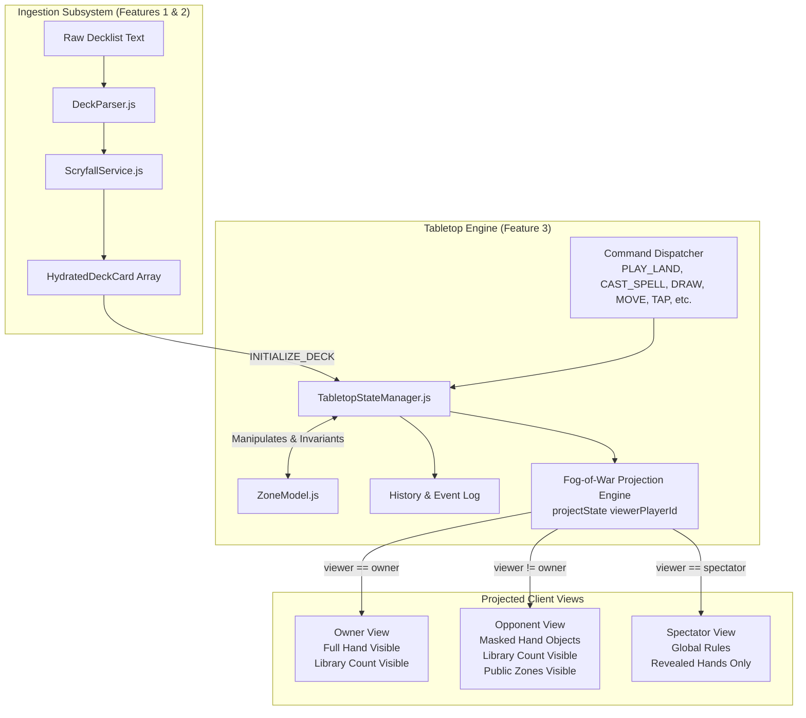
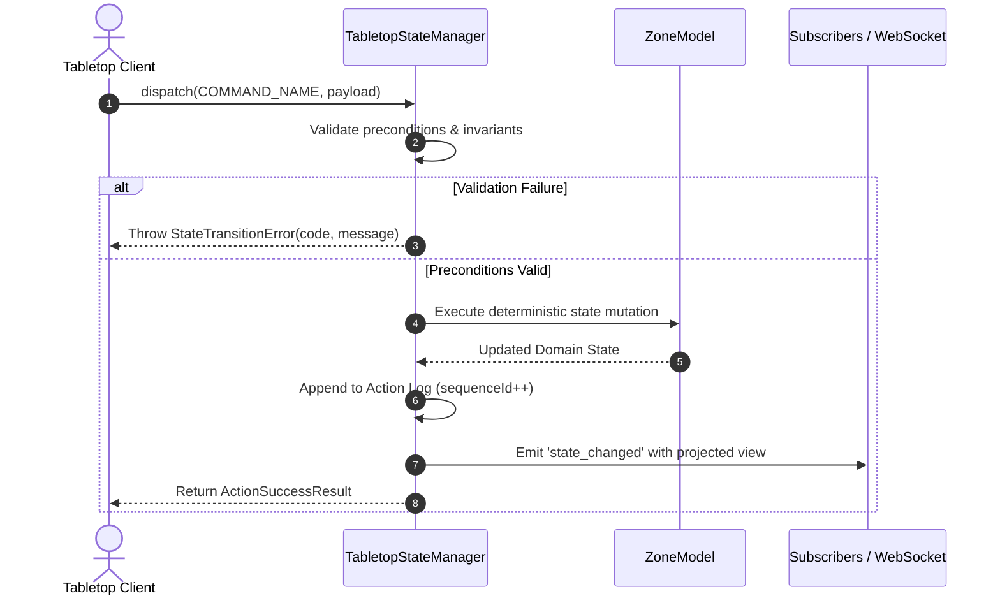

# Technical Specification: Tabletop Zone State Manager & Fog-of-War Projection

- **Document ID:** `SPEC-RPM-ZONE-003`
- **Feature Scope:** Feature 3 (`TabletopStateManager.js` & `ZoneModel.js`)
- **System:** RPM Multiplayer / RPM Revival Modern Expansion
- **Architect:** Argon Specification Architect
- **Status:** APPROVED / READY FOR IMPLEMENTATION
- **Revision:** 1.0.0
- **Target File Path:** `specs/FEATURE_3_TABLETOP_ZONE_STATE_SPEC.md`
- **Related Specifications:** `specs/FEATURE_1_2_CORE_INGESTION_SPEC.md` (`SPEC-RPM-INGEST-001`)

---

## 1. Executive Summary & Architectural Overview

The **Tabletop Zone State Manager & Fog-of-War Projection Engine** provides deterministic, synchronized, and cryptographically discrete state representation for tabletop Magic: The Gathering matches within the RPM Multiplayer platform.

Following deck parsing (`DeckParser.js`) and Scryfall card hydration (`ScryfallService.js`), raw decklists are transformed into active game sessions. Magic: The Gathering requires precise tracking of multiple physical and virtual zones (library, hand, battlefield, graveyard, stack, and exile), strict subcategory sorting (lands, creatures, noncreatures, planeswalkers), counter states (+1/+1, loyalty, poison, energy), mana pools, and tapped states. 

Crucially, in remote multiplayer play, players must never receive private information (such as cards in opponent hands or unrevealed library order) over the network wire. The state manager enforces **Fog-of-War Projections**, where private card details are structurally masked from opponent payloads at the state projection layer while preserving accurate card counts, public zones, and revealed mechanics.

### 1.1 Architectural Topology



### 1.2 Separation of Concerns

1. **`ZoneModel.js` (Domain Entities & Zone Operations)**:
   - Low-level data structures for cards (`CardInstance`) and zones (`PlayerZoneState`).
   - Generation of unique instance identifiers (`inst_<timestamp>_<uuid>`).
   - Pure zone transfer primitives (e.g. `transferCard(fromZone, toZone, instanceId, position)`).
   - Battlefield subcategory classification based on MTG `typeLine` (`lands`, `creatures`, `noncreatures`, `planeswalkers`).
   - Counter tracking (+1/+1, loyalty, energy, charge, poison).
   - Permanent reset logic (clearing tapped states and counters when permanents change zones).

2. **`TabletopStateManager.js` (Game State Orchestration & Projection)**:
   - Match-level state manager for multi-player games (2-player duel, Commander 4-player, etc.).
   - Action command dispatcher implementing validation rules and state transitions.
   - Resource pools (`life`, `manaPool: { W, U, B, R, G, C }`, `poison`, `energy`).
   - Turn, priority, and phase state machine.
   - Hand revelation mechanics (`isHandRevealed: boolean`).
   - Fog-of-War state projection (`projectState(viewerPlayerId)`).
   - History logging and subscriber event notification.

---

## 2. Core Domain State Model & TypeScript Definitions

### 2.1 Complete TypeScript Interfaces

```typescript
/**
 * Canonical MTG Zone Types supported by RPM Tabletop
 */
export type ZoneType = 'library' | 'hand' | 'battlefield' | 'graveyard' | 'stack' | 'exile';

/**
 * Battlefield Subdivided Zones for board layout organization
 */
export type BattlefieldSubzone = 'lands' | 'creatures' | 'noncreatures' | 'planeswalkers';

/**
 * Five MTG Colors + Colorless Mana
 */
export type ManaColor = 'W' | 'U' | 'B' | 'R' | 'G' | 'C';

export interface ManaPool {
  W: number;
  U: number;
  B: number;
  R: number;
  G: number;
  C: number;
}

export interface PlayerResources {
  life: number;
  poison: number;
  energy: number;
  manaPool: ManaPool;
}

/**
 * Unique Card Instance Entity within a Tabletop Session
 */
export interface CardInstance {
  instanceId: string;            // Format: `inst_${timestamp}_${uuid}`
  cardId: string;                // Scryfall UUID
  name: string;                  // Canonical Oracle card name
  manaCost: string;              // e.g. "{1}{U}{R}"
  typeLine: string;              // e.g. "Creature — Human Wizard"
  oracleText: string;            // Formatted rules text
  imageUri: string;              // High-resolution image URL
  colors: string[];              // ["U", "R"]
  ownerId: string;               // Match Player ID who owns the card
  controllerId: string;          // Match Player ID currently controlling the card
  zone: ZoneType;                // Current location
  subzone: BattlefieldSubzone | null; // Populated only if zone === 'battlefield'
  isTapped: boolean;             // Permanent tap state
  counters: Record<string, number>; // e.g. { "+1/+1": 2, "loyalty": 4 }
  isToken: boolean;              // Indicates generated token card
  isFaceDown: boolean;           // Morph, manifest, or face-down exile
  annotations: Record<string, any>; // Arbitrary player notes/tags
}

/**
 * Battlefield Partition Model
 */
export interface BattlefieldState {
  lands: CardInstance[];
  creatures: CardInstance[];
  noncreatures: CardInstance[];
  planeswalkers: CardInstance[];
}

/**
 * Complete Player Zone State (Unmasked Canonical State)
 */
export interface PlayerZoneState {
  playerId: string;
  playerName: string;
  library: CardInstance[];       // Ordered: index 0 is TOP of library
  hand: CardInstance[];          // Array of cards in hand
  battlefield: BattlefieldState; // Partitioned battlefield permanents
  graveyard: CardInstance[];     // Ordered: index 0 is oldest, last is top of graveyard
  exile: CardInstance[];         // Exiled cards
  isHandRevealed: boolean;       // If true, hand is visible to opponents
  resources: PlayerResources;    // Life, poison, energy, mana pool
}

/**
 * Masked Card Representation for Fog-of-War Opponent Views
 */
export interface MaskedCardInstance {
  instanceId: string;
  isHidden: true;
}

/**
 * Projected Hand View
 */
export type ProjectedHand = CardInstance[] | MaskedCardInstance[];

/**
 * Projected Player View returned by projectState(viewerPlayerId)
 */
export interface ProjectedPlayerState {
  playerId: string;
  playerName: string;
  library: {
    count: number;
  };
  hand: {
    count: number;
    cards: ProjectedHand;
    isRevealed: boolean;
  };
  battlefield: BattlefieldState;
  graveyard: CardInstance[];
  exile: CardInstance[];
  resources: PlayerResources;
}

/**
 * Global Tabletop State Projection
 */
export interface ProjectedTabletopState {
  sessionId: string;
  activePlayerId: string;
  turnNumber: number;
  stack: CardInstance[];
  players: Record<string, ProjectedPlayerState>;
  viewerPlayerId: string;
  timestamp: number;
}

/**
 * Action Log Record for State Replication & Replay
 */
export interface TabletopActionLogEntry {
  sequenceId: number;
  timestamp: number;
  actionType: string;
  playerId: string;
  payload: Record<string, any>;
}
```

---

### 2.2 Instance ID Generation Specification

Card instances require deterministic uniqueness across multiple players playing identical cards (e.g. 4 copies of *Lightning Bolt* across 2 players = 8 distinct instances).

```javascript
/**
 * Generates an RFC-compliant collision-resistant Card Instance ID
 * Format: `inst_${timestamp}_${randomHex8}`
 */
export function generateInstanceId() {
  const timestamp = Date.now();
  const randomHex = Math.random().toString(36).substring(2, 10);
  return `inst_${timestamp}_${randomHex}`;
}
```

---

### 2.3 Battlefield Subzone Classification Algorithm

When cards enter the battlefield without an explicit subzone designation, `ZoneModel.classifySubzone(typeLine)` deterministically routes the card to the proper partition based on MTG comprehensive rules precedence:

```javascript
/**
 * Classifies an MTG card into its proper battlefield subzone based on typeLine.
 * Precedence Rule:
 * 1. Planeswalker -> 'planeswalkers'
 * 2. Creature     -> 'creatures'
 * 3. Land         -> 'lands'
 * 4. Default      -> 'noncreatures' (Artifacts, Enchantments, Battles)
 * 
 * @param {string} typeLine - Card type line (e.g. "Artifact Creature — Golem")
 * @returns {BattlefieldSubzone}
 */
export function classifySubzone(typeLine = '') {
  const normalized = String(typeLine).toLowerCase();
  
  if (normalized.includes('planeswalker')) {
    return 'planeswalkers';
  }
  if (normalized.includes('creature')) {
    return 'creatures';
  }
  if (normalized.includes('land')) {
    return 'lands';
  }
  return 'noncreatures';
}
```

---

## 3. Commands & State Transitions

`TabletopStateManager` executes state transitions via an atomic command dispatch architecture. Every command validates preconditions, alters state via `ZoneModel`, registers an entry in the sequential action log, and notifies active subscribers.



---

### 3.1 Command Registry & Transition Specifications

#### 1. `INITIALIZE_DECK`
- **Purpose:** Initializes a player's session by expanding hydrated Scryfall cards, populating their library, shuffling, drawing an initial 7-card hand, and setting starting life.
- **Parameters:**
  ```typescript
  interface InitializeDeckPayload {
    playerId: string;
    playerName?: string;
    hydratedCards: Array<HydratedDeckCard | ScryfallCardEntity>;
    options?: {
      startingHandSize?: number; // Default: 7
      startingLife?: number;     // Default: 20
      skipShuffle?: boolean;     // Default: false (used for deterministic testing)
    };
  }
  ```
- **Transition Logic:**
  1. For each entry in `hydratedCards`, if `card.count` exists, instantiate `card.count` distinct `CardInstance` entities using `generateInstanceId()`.
  2. Assign `zone = 'library'`, `subzone = null`, `isTapped = false`, `counters = {}`, `ownerId = playerId`, `controllerId = playerId`.
  3. If `!options.skipShuffle`, execute Fisher-Yates shuffle on the library array.
  4. Splice the top $K$ cards (`startingHandSize`, default 7) from index 0 of `library` to `hand`. Update each moved card's `zone = 'hand'`.
  5. Initialize resources: `life = startingLife || 20`, `poison = 0`, `energy = 0`, `manaPool = { W: 0, U: 0, B: 0, R: 0, G: 0, C: 0 }`.
  6. Empty `battlefield` partitions, `graveyard`, and `exile`. Set `isHandRevealed = false`.

---

#### 2. `DRAW_CARD`
- **Purpose:** Draws one or more cards from the top of the player's library into their hand.
- **Parameters:**
  ```typescript
  interface DrawCardPayload {
    playerId: string;
    count?: number; // Default: 1
  }
  ```
- **Transition Logic:**
  1. Let $N = \text{payload.count} \parallel 1$.
  2. If `library.length < N`, draw as many as remaining and emit event / flag `DECK_OUT_CONDITION`.
  3. Splice $N$ cards from the start of `library` (`index 0` to `N`).
  4. For each drawn card, set `card.zone = 'hand'`, `card.subzone = null`.
  5. Append drawn cards into player's `hand` array.

---

#### 3. `PLAY_LAND`
- **Purpose:** Plays a land card from hand directly onto the battlefield under the `lands` subzone.
- **Parameters:**
  ```typescript
  interface PlayLandPayload {
    playerId: string;
    instanceId: string;
  }
  ```
- **Validation Rules:**
  - Card with `instanceId` must exist in player's `hand`.
  - Card `typeLine` must contain `"Land"` (case-insensitive).
- **Transition Logic:**
  1. Remove card from `hand`.
  2. Set `card.zone = 'battlefield'`, `card.subzone = 'lands'`, `card.isTapped = false`.
  3. Push card into `battlefield.lands`.

---

#### 4. `CAST_SPELL`
- **Purpose:** Moves a card from hand (or permitted source zone) to the global `stack`, optionally deducting required mana from the player's mana pool.
- **Parameters:**
  ```typescript
  interface CastSpellPayload {
    playerId: string;
    instanceId: string;
    sourceZone?: 'hand' | 'graveyard' | 'exile'; // Default: 'hand'
    manaCostPaid?: Partial<ManaPool>;
    targets?: Array<{ instanceId?: string; playerId?: string }>;
  }
  ```
- **Validation Rules:**
  - Card must exist in the specified `sourceZone` (default `hand`).
  - If `manaCostPaid` provided, player's `manaPool` must possess sufficient quantities for each specified color.
- **Transition Logic:**
  1. If `manaCostPaid` is provided, deduct each color from `resources.manaPool`.
  2. Remove card from `sourceZone`.
  3. Set `card.zone = 'stack'`, `card.subzone = null`.
  4. Attach any provided targets to `card.annotations.castTargets`.
  5. Append card to global `stack` (LIFO: index `stack.length - 1` is top of stack).

---

#### 5. `MOVE_ZONE` (Generic Unified Transition)
- **Purpose:** Universal card motion primitive transferring an instance between any two zones (e.g. stack to battlefield, battlefield to graveyard, graveyard to hand, etc.).
- **Parameters:**
  ```typescript
  interface MoveZonePayload {
    playerId: string;
    instanceId: string;
    sourceZone?: ZoneType; // Optional: auto-detected if omitted
    targetZone: ZoneType;
    targetSubzone?: BattlefieldSubzone; // Optional: auto-classified if target is battlefield
    position?: 'top' | 'bottom' | number; // Default: 'bottom' for public zones, 'top' for library
  }
  ```
- **State Cleanup & Invariants:**
  1. **Locate Card:** Locate `card` by `instanceId` across all zones of player (or global stack). If not found, throw `CardNotFoundError`.
  2. **Leaving Battlefield Cleanup:** If source was `battlefield`:
     - Reset `card.isTapped = false`.
     - Reset `card.counters = {}`.
     - Clear temporary battlefield `annotations`.
  3. **Target Destination Insertion:**
     - If `targetZone === 'battlefield'`:
       - `subzone = targetSubzone || classifySubzone(card.typeLine)`.
       - Push card into `battlefield[subzone]`.
       - Set `card.isTapped = false`.
     - If `targetZone === 'library'`:
       - If `position === 'bottom'`, `library.push(card)`.
       - Else (default or `'top'`), `library.unshift(card)`.
     - If `targetZone === 'graveyard'`:
       - `graveyard.push(card)`.
     - If `targetZone === 'exile'`:
       - `exile.push(card)`.
     - If `targetZone === 'hand'`:
       - `hand.push(card)`.
     - If `targetZone === 'stack'`:
       - Global `stack.push(card)`.
  4. Update `card.zone = targetZone` and `card.subzone = (targetZone === 'battlefield' ? subzone : null)`.

---

#### 6. `TAP_PERMANENT` / `UNTAP_PERMANENT` / `UNTAP_ALL`
- **Parameters:**
  ```typescript
  interface TapPermanentPayload {
    playerId: string;
    instanceId: string;
  }
  interface UntapAllPayload {
    playerId: string;
  }
  ```
- **Transition Logic:**
  - `TAP_PERMANENT`:
    - Locate card in player's `battlefield` (any subzone). If not on battlefield, throw `InvalidZoneError`.
    - If `card.isTapped === true`, throw `PermanentAlreadyTappedError` or no-op.
    - Set `card.isTapped = true`.
  - `UNTAP_PERMANENT`:
    - Locate card in player's `battlefield`.
    - Set `card.isTapped = false`.
  - `UNTAP_ALL`:
    - Iterate every permanent across `lands`, `creatures`, `noncreatures`, and `planeswalkers` in player's battlefield.
    - Set `isTapped = false` for all permanents.

---

#### 7. `ADJUST_LIFE`
- **Purpose:** Modifies player life total via relative delta or absolute assignment.
- **Parameters:**
  ```typescript
  interface AdjustLifePayload {
    playerId: string;
    delta?: number;       // e.g. -3, +5
    targetValue?: number; // e.g. 20 (overrides delta if specified)
    source?: string;      // e.g. "Combat Damage", "Fetches"
  }
  ```
- **Transition Logic:**
  - If `targetValue !== undefined`, `resources.life = targetValue`.
  - Else if `delta !== undefined`, `resources.life += delta`.

---

#### 8. `UPDATE_MANA_POOL`
- **Purpose:** Adds or deducts floating mana colors.
- **Parameters:**
  ```typescript
  interface UpdateManaPoolPayload {
    playerId: string;
    color?: ManaColor;
    amount?: number;                 // e.g. +1, -1
    poolDelta?: Partial<ManaPool>;  // e.g. { R: 2, G: 1 }
    clearAll?: boolean;             // Clears mana pool to 0
  }
  ```
- **Invariants:**
  - Mana values can **never be negative**. If a deduction exceeds current pool balance, throw `InsufficientManaError`.
  - If `clearAll === true`, reset all 6 colors to 0.

---

#### 9. `MODIFY_COUNTERS`
- **Purpose:** Adds, removes, or sets counters on a battlefield permanent (+1/+1, loyalty, charge, etc.).
- **Parameters:**
  ```typescript
  interface ModifyCountersPayload {
    playerId: string;
    instanceId: string;
    counterType: string; // e.g. "+1/+1", "loyalty", "-1/-1"
    delta?: number;      // e.g. +1, -1
    targetCount?: number;
  }
  ```
- **Invariants:**
  - If counter count drops to $\le 0$, the counter key is deleted from `card.counters`.

---

#### 10. `REVEAL_HAND` / `HIDE_HAND`
- **Purpose:** Toggles hand visibility for Fog-of-War calculation (e.g. *Thoughtseize*, *Gitaxian Probe*, or player choice).
- **Parameters:**
  ```typescript
  interface RevealHandPayload {
    playerId: string;
    isRevealed: boolean;
  }
  ```
- **Transition Logic:**
  - Set `player.isHandRevealed = isRevealed`.

---

## 4. Fog-of-War Projection (`projectState(viewerPlayerId)`)

In online tabletop play, a server or local peer projection engine must serialize game state safely. If raw hand arrays or deck order were sent to opponent clients, bad actors could inspect network traffic or browser memory to see opponent cards.

The Fog-of-War Projection algorithm deterministically sanitizes state according to strict visibility policies before transmitting or exposing state to any viewer.

### 4.1 Visibility Policy Matrix

| Zone / Attribute | Owner View (`viewer === owner`) | Opponent View (`isHandRevealed === false`) | Opponent View (`isHandRevealed === true`) | Spectator View |
| :--- | :--- | :--- | :--- | :--- |
| **Hand Cards** | **Full Visibility** (Name, Mana, Art, Oracle Text, InstanceId) | **Masked Array** (`count` preserved, cards replaced with `{ instanceId: 'hidden', isHidden: true }`) | **Full Visibility** | Masked (unless revealed) |
| **Hand Count** | Visible | Visible | Visible | Visible |
| **Library Cards** | **Masked** (`count` only, array ordering hidden to prevent top-deck scouting) | **Masked** (`count` only) | **Masked** (`count` only) | **Masked** (`count` only) |
| **Battlefield** | Full Visibility (Public) | Full Visibility (Public) | Full Visibility (Public) | Full Visibility (Public) |
| **Graveyard** | Full Visibility (Public) | Full Visibility (Public) | Full Visibility (Public) | Full Visibility (Public) |
| **Stack** | Full Visibility (Public) | Full Visibility (Public) | Full Visibility (Public) | Full Visibility (Public) |
| **Exile (Face-Up)** | Full Visibility (Public) | Full Visibility (Public) | Full Visibility (Public) | Full Visibility (Public) |
| **Exile (Face-Down)** | Full Visibility to Owner | Masked (`{ isHidden: true }`) | Masked | Masked |
| **Life / Resources** | Full Visibility (Public) | Full Visibility (Public) | Full Visibility (Public) | Full Visibility (Public) |

---

### 4.2 Formal Projection Algorithm

```javascript
/**
 * Projects canonical state into a safe Fog-of-War perspective for viewerPlayerId.
 * 
 * @param {Object} fullState - The complete unmasked TabletopState
 * @param {string} viewerPlayerId - The ID of the viewing player or 'spectator'
 * @returns {ProjectedTabletopState}
 */
export function projectState(fullState, viewerPlayerId) {
  const projectedPlayers = {};

  for (const [playerId, playerState] of Object.entries(fullState.players)) {
    const isOwner = (playerId === viewerPlayerId);
    const canSeeHand = isOwner || playerState.isHandRevealed === true;

    // 1. Project Hand Zone
    let projectedHandCards;
    if (canSeeHand) {
      // Deep clone cards to prevent mutating canonical state
      projectedHandCards = playerState.hand.map(card => ({ ...card }));
    } else {
      // Opponent sees opaque masked objects matching exact hand size
      projectedHandCards = playerState.hand.map(() => ({
        instanceId: 'hidden',
        isHidden: true
      }));
    }

    // 2. Project Library Zone (Order is ALWAYS hidden during ordinary play)
    const projectedLibrary = {
      count: playerState.library.length
    };

    // 3. Project Public Zones (Deep copy to ensure immutability)
    const projectedBattlefield = {
      lands: playerState.battlefield.lands.map(c => ({ ...c })),
      creatures: playerState.battlefield.creatures.map(c => ({ ...c })),
      noncreatures: playerState.battlefield.noncreatures.map(c => ({ ...c })),
      planeswalkers: playerState.battlefield.planeswalkers.map(c => ({ ...c }))
    };

    const projectedGraveyard = playerState.graveyard.map(c => ({ ...c }));
    
    // 4. Project Exile (handle face-down cards if any)
    const projectedExile = playerState.exile.map(c => {
      if (c.isFaceDown && !isOwner) {
        return { instanceId: 'hidden', isFaceDown: true, isHidden: true };
      }
      return { ...c };
    });

    projectedPlayers[playerId] = {
      playerId: playerState.playerId,
      playerName: playerState.playerName,
      library: projectedLibrary,
      hand: {
        count: playerState.hand.length,
        cards: projectedHandCards,
        isRevealed: playerState.isHandRevealed
      },
      battlefield: projectedBattlefield,
      graveyard: projectedGraveyard,
      exile: projectedExile,
      resources: {
        life: playerState.resources.life,
        poison: playerState.resources.poison,
        energy: playerState.resources.energy,
        manaPool: { ...playerState.resources.manaPool }
      }
    };
  }

  return {
    sessionId: fullState.sessionId,
    activePlayerId: fullState.activePlayerId,
    turnNumber: fullState.turnNumber,
    stack: fullState.stack.map(c => ({ ...c })),
    players: projectedPlayers,
    viewerPlayerId,
    timestamp: Date.now()
  };
}
```

---

### 4.3 Structural Comparison: Canonical vs Projected Payload

#### Canonical State (Stored in Memory / Server Node)
```json
{
  "playerId": "p1",
  "hand": [
    {
      "instanceId": "inst_1729158000_a1b2c3d4",
      "cardId": "48b615da-1b91-4475-ae98-7cfd6945cb57",
      "name": "Lightning Bolt",
      "manaCost": "{R}",
      "typeLine": "Instant",
      "oracleText": "Lightning Bolt deals 3 damage to any target."
    }
  ]
}
```

#### Projected State Sent to Opponent `p2` (When `isHandRevealed === false`)
```json
{
  "playerId": "p1",
  "hand": {
    "count": 1,
    "isRevealed": false,
    "cards": [
      {
        "instanceId": "hidden",
        "isHidden": true
      }
    ]
  }
}
```
*Zero leaks of card name, Mana cost, type line, rules text, or original instance identifier.*

---

## 5. Component Implementation Architecture

### 5.1 `ZoneModel.js` Specifications

```javascript
/**
 * Low-level pure zone operations and validation
 */
export class ZoneModel {
  /**
   * Creates a fresh player zone state object.
   */
  static createInitialPlayerState(playerId, playerName = 'Player') { ... }

  /**
   * Instantiates a card instance from a hydrated card entity.
   */
  static createCardInstance(hydratedCard, ownerId) { ... }

  /**
   * Classifies card typeLine into lands, creatures, noncreatures, or planeswalkers.
   */
  static classifySubzone(typeLine) { ... }

  /**
   * Fisher-Yates array shuffle.
   */
  static shuffleArray(array) { ... }

  /**
   * Finds a card instance across all zones of a player or global stack.
   * Returns: { card, zone, subzone, index } | null
   */
  static findCard(playerState, instanceId, stack = []) { ... }

  /**
   * Removes a card instance from whatever zone it resides in.
   */
  static removeCardFromZone(playerState, instanceId, stack = []) { ... }

  /**
   * Inserts a card into a target zone and optional subzone.
   */
  static insertCardIntoZone(playerState, card, targetZone, targetSubzone, position, stack = []) { ... }

  /**
   * Resets card permanent state (untaps and clears counters).
   */
  static resetCardState(card) { ... }
}
```

---

### 5.2 `TabletopStateManager.js` Specifications

```javascript
/**
 * High-level tabletop match manager and event coordinator
 */
export class TabletopStateManager {
  constructor(options = {}) {
    this.sessionId = options.sessionId || `session_${Date.now()}`;
    this.players = {}; // Map: playerId -> PlayerZoneState
    this.stack = [];   // Array: CardInstance
    this.activePlayerId = null;
    this.turnNumber = 1;
    this.actionLog = [];
    this.subscribers = new Set();
    this.sequenceCounter = 0;
  }

  /**
   * Register a player in the session
   */
  registerPlayer(playerId, playerName) { ... }

  /**
   * Primary action dispatch method
   */
  dispatch(actionType, payload) { ... }

  /**
   * Generates safe Fog-of-War view for viewerPlayerId
   */
  projectState(viewerPlayerId) { ... }

  /**
   * Subscriptions for UI re-rendering and socket broadcasting
   */
  subscribe(listener) { ... }

  /**
   * Returns full sequential audit log
   */
  getActionLog() { ... }
}
```

---

## 6. Formal System Invariants

The state manager guarantees the following mathematical invariants across every state transition:

$$\begin{aligned}
& \mathbf{I_1 \text{ (Card Conservation)}:} \quad \forall p \in \text{Players}, \sum_{z \in \text{Zones}} |z_p| + |\text{Stack}_p| = N_{\text{initial}}(p) + N_{\text{tokens}}(p) \\
& \mathbf{I_2 \text{ (Spatial Exclusivity)}:} \quad \forall c_1, c_2 \in \text{AllCards}, \; c_1.\text{instanceId} = c_2.\text{instanceId} \implies \text{Zone}(c_1) = \text{Zone}(c_2) \\
& \mathbf{I_3 \text{ (Zero Fog Leakage)}:} \quad \forall c \in \text{Hand}_p, \; \forall v \neq p, \; \neg \text{isHandRevealed}_p \implies \text{Entropy}(\text{Project}(c, v)) = 0 \\
& \mathbf{I_4 \text{ (Mana Floor)}:} \quad \forall c \in \{W, U, B, R, G, C\}, \; \text{manaPool}[c] \ge 0 \\
& \mathbf{I_5 \text{ (Battlefield Purity)}:} \quad \forall c \notin \text{Battlefield}, \; c.\text{isTapped} = \text{false} \;\land\; |c.\text{counters}| = 0
\end{aligned}$$

---

## 7. Acceptance Test Plan & Criteria (12 Automated Test Cases)

To verify the implementation meets all requirements without ambiguity, the test suite (`test/tabletop_state_test.js`) must implement the following **12 comprehensive test cases** with exact assertions.

---

### Test Suite Structure

```javascript
import assert from 'node:assert/strict';
import { TabletopStateManager } from '../src/TabletopStateManager.js';
import { ZoneModel } from '../src/ZoneModel.js';
```

---

### Test Case 1: `INITIALIZE_DECK` and Starting Hand Allocation
- **Objective:** Verify that initializing a deck expands card counts, populates library, performs initial draw of 7 cards, and sets life to 20.
- **Fixture:** 60-card hydrated list (e.g. 4x *Lightning Bolt*, 4x *Ragavan*, 24x *Mountain*, 28x other cards).
- **Assertions:**
  ```javascript
  assert.equal(player.library.length, 53);
  assert.equal(player.hand.length, 7);
  assert.equal(player.resources.life, 20);
  assert.equal(player.resources.poison, 0);
  assert.equal(player.resources.manaPool.R, 0);
  // Verify all 60 card instances have unique instance IDs
  const allIds = new Set([...player.library, ...player.hand].map(c => c.instanceId));
  assert.equal(allIds.size, 60);
  ```

---

### Test Case 2: `DRAW_CARD` Top-of-Library Transition
- **Objective:** Verify drawing $K$ cards decrements library, increments hand, and preserves instance identity.
- **Assertions:**
  ```javascript
  const topCardBefore = player.library[0];
  stateManager.dispatch('DRAW_CARD', { playerId: 'p1', count: 1 });
  assert.equal(player.library.length, 52);
  assert.equal(player.hand.length, 8);
  assert.equal(player.hand[player.hand.length - 1].instanceId, topCardBefore.instanceId);
  assert.equal(player.hand[player.hand.length - 1].zone, 'hand');
  ```

---

### Test Case 3: `PLAY_LAND` Type Line Validation & Subzone Routing
- **Objective:** Verify playing a land routes to `battlefield.lands` with `isTapped: false` and rejects non-land cards.
- **Assertions:**
  ```javascript
  const landCard = player.hand.find(c => c.typeLine.includes('Land'));
  stateManager.dispatch('PLAY_LAND', { playerId: 'p1', instanceId: landCard.instanceId });
  assert.equal(player.battlefield.lands.length, 1);
  assert.equal(player.battlefield.lands[0].instanceId, landCard.instanceId);
  assert.equal(player.battlefield.lands[0].isTapped, false);
  assert.equal(player.battlefield.lands[0].subzone, 'lands');

  // Attempt to play a non-land creature as land -> should throw error
  const creatureCard = player.hand.find(c => c.typeLine.includes('Creature'));
  assert.throws(() => {
    stateManager.dispatch('PLAY_LAND', { playerId: 'p1', instanceId: creatureCard.instanceId });
  }, /InvalidCardTypeError|Card is not a land/);
  ```

---

### Test Case 4: `CAST_SPELL` Stack Transition & Mana Deduction
- **Objective:** Casting a spell moves card from hand to `stack` and deducts mana pool correctly.
- **Assertions:**
  ```javascript
  stateManager.dispatch('UPDATE_MANA_POOL', { playerId: 'p1', poolDelta: { R: 2, U: 1 } });
  const bolt = player.hand.find(c => c.name === 'Lightning Bolt');
  
  stateManager.dispatch('CAST_SPELL', {
    playerId: 'p1',
    instanceId: bolt.instanceId,
    manaCostPaid: { R: 1 }
  });
  
  assert.equal(stateManager.stack.length, 1);
  assert.equal(stateManager.stack[0].instanceId, bolt.instanceId);
  assert.equal(stateManager.stack[0].zone, 'stack');
  assert.equal(player.resources.manaPool.R, 1);
  assert.equal(player.resources.manaPool.U, 1);
  ```

---

### Test Case 5: `TAP_PERMANENT`, `UNTAP_PERMANENT`, and `UNTAP_ALL`
- **Objective:** Verify tap states on battlefield permanents and untap all during untap step.
- **Assertions:**
  ```javascript
  const land = player.battlefield.lands[0];
  stateManager.dispatch('TAP_PERMANENT', { playerId: 'p1', instanceId: land.instanceId });
  assert.equal(land.isTapped, true);

  stateManager.dispatch('UNTAP_PERMANENT', { playerId: 'p1', instanceId: land.instanceId });
  assert.equal(land.isTapped, false);

  stateManager.dispatch('TAP_PERMANENT', { playerId: 'p1', instanceId: land.instanceId });
  stateManager.dispatch('UNTAP_ALL', { playerId: 'p1' });
  assert.equal(land.isTapped, false);
  ```

---

### Test Case 6: `MOVE_ZONE` from Battlefield to Graveyard with State Cleanup
- **Objective:** When a permanent with counters and tapped state moves to graveyard, reset tapped state and remove counters.
- **Assertions:**
  ```javascript
  // Move creature to battlefield, tap it, add +1/+1 counter
  const creature = player.hand.find(c => c.typeLine.includes('Creature'));
  stateManager.dispatch('MOVE_ZONE', {
    playerId: 'p1',
    instanceId: creature.instanceId,
    targetZone: 'battlefield'
  });
  stateManager.dispatch('TAP_PERMANENT', { playerId: 'p1', instanceId: creature.instanceId });
  stateManager.dispatch('MODIFY_COUNTERS', { playerId: 'p1', instanceId: creature.instanceId, counterType: '+1/+1', delta: 2 });
  
  assert.equal(creature.isTapped, true);
  assert.equal(creature.counters['+1/+1'], 2);

  // Move to Graveyard (e.g. dies)
  stateManager.dispatch('MOVE_ZONE', {
    playerId: 'p1',
    instanceId: creature.instanceId,
    targetZone: 'graveyard'
  });

  assert.equal(player.graveyard.length, 1);
  const deadCreature = player.graveyard[0];
  assert.equal(deadCreature.isTapped, false);
  assert.deepEqual(deadCreature.counters, {});
  assert.equal(deadCreature.zone, 'graveyard');
  ```

---

### Test Case 7: `ADJUST_LIFE` Delta and Absolute Targeting
- **Objective:** Verify relative damage/healing and absolute life total setting.
- **Assertions:**
  ```javascript
  stateManager.dispatch('ADJUST_LIFE', { playerId: 'p1', delta: -3 });
  assert.equal(player.resources.life, 17);

  stateManager.dispatch('ADJUST_LIFE', { playerId: 'p1', delta: +5 });
  assert.equal(player.resources.life, 22);

  stateManager.dispatch('ADJUST_LIFE', { playerId: 'p1', targetValue: 10 });
  assert.equal(player.resources.life, 10);
  ```

---

### Test Case 8: `UPDATE_MANA_POOL` Multi-Color Operations & Non-Negative Invariant
- **Objective:** Mana pool allows adding and spending mana, rejecting transactions resulting in negative mana.
- **Assertions:**
  ```javascript
  stateManager.dispatch('UPDATE_MANA_POOL', { playerId: 'p1', poolDelta: { W: 1, U: 2, B: 0, R: 3, G: 0, C: 1 } });
  assert.deepEqual(player.resources.manaPool, { W: 1, U: 2, B: 0, R: 3, G: 0, C: 1 });

  stateManager.dispatch('UPDATE_MANA_POOL', { playerId: 'p1', poolDelta: { R: -2 } });
  assert.equal(player.resources.manaPool.R, 1);

  // Attempt to spend more mana than available -> must throw error
  assert.throws(() => {
    stateManager.dispatch('UPDATE_MANA_POOL', { playerId: 'p1', poolDelta: { W: -2 } });
  }, /InsufficientManaError|Cannot reduce mana below 0/);
  ```

---

### Test Case 9: Fog-of-War Projection: Active Owner vs Opponent
- **Objective:** Ensure active player sees full card details in hand, while opponent receives opaque masked objects and library counts.
- **Assertions:**
  ```javascript
  const ownerProjection = stateManager.projectState('p1');
  const opponentProjection = stateManager.projectState('p2');

  // Owner view: Full hand visibility
  assert.equal(ownerProjection.players.p1.hand.count, player.hand.length);
  assert.ok(ownerProjection.players.p1.hand.cards[0].name);
  assert.ok(ownerProjection.players.p1.hand.cards[0].manaCost);

  // Opponent view: Masked hand
  const oppHand = opponentProjection.players.p1.hand;
  assert.equal(oppHand.count, player.hand.length);
  assert.equal(oppHand.isRevealed, false);
  assert.equal(oppHand.cards.length, player.hand.length);
  assert.equal(oppHand.cards[0].instanceId, 'hidden');
  assert.equal(oppHand.cards[0].isHidden, true);
  assert.equal(oppHand.cards[0].name, undefined);
  assert.equal(oppHand.cards[0].manaCost, undefined);
  assert.equal(oppHand.cards[0].oracleText, undefined);

  // Both views see library as count only
  assert.equal(ownerProjection.players.p1.library.count, 52);
  assert.equal(ownerProjection.players.p1.library.cards, undefined);
  ```

---

### Test Case 10: Fog-of-War Hand Reveal Mechanics
- **Objective:** When `isHandRevealed === true`, opponent projection exposes full hand; toggling back masks it immediately.
- **Assertions:**
  ```javascript
  stateManager.dispatch('REVEAL_HAND', { playerId: 'p1', isRevealed: true });
  const revealedProjection = stateManager.projectState('p2');
  assert.equal(revealedProjection.players.p1.hand.isRevealed, true);
  assert.ok(revealedProjection.players.p1.hand.cards[0].name);
  assert.notEqual(revealedProjection.players.p1.hand.cards[0].instanceId, 'hidden');

  stateManager.dispatch('REVEAL_HAND', { playerId: 'p1', isRevealed: false });
  const hiddenProjection = stateManager.projectState('p2');
  assert.equal(hiddenProjection.players.p1.hand.isRevealed, false);
  assert.equal(hiddenProjection.players.p1.hand.cards[0].instanceId, 'hidden');
  assert.equal(hiddenProjection.players.p1.hand.cards[0].name, undefined);
  ```

---

### Test Case 11: Error Rejection on Invalid Move / Non-Existent Card
- **Objective:** Verify robust error handling when targeting invalid instances or unauthorized zones.
- **Assertions:**
  ```javascript
  assert.throws(() => {
    stateManager.dispatch('MOVE_ZONE', {
      playerId: 'p1',
      instanceId: 'inst_fake_999999',
      targetZone: 'graveyard'
    });
  }, /CardNotFoundError/);

  assert.throws(() => {
    stateManager.dispatch('TAP_PERMANENT', {
      playerId: 'p1',
      instanceId: player.hand[0].instanceId // In hand, not battlefield
    });
  }, /InvalidZoneError/);
  ```

---

### Test Case 12: Card Count Conservation Across Zone Cycles
- **Objective:** Verify that cycling cards across hand $\to$ stack $\to$ battlefield $\to$ graveyard $\to$ exile $\to$ library maintains strict card count invariance ($N = 60$).
- **Assertions:**
  ```javascript
  const startingTotal = 60;
  // Execute sequence of 10 rapid zone transitions
  // ...
  const p1 = stateManager.players.p1;
  const currentTotal = p1.library.length +
                       p1.hand.length +
                       p1.battlefield.lands.length +
                       p1.battlefield.creatures.length +
                       p1.battlefield.noncreatures.length +
                       p1.battlefield.planeswalkers.length +
                       p1.graveyard.length +
                       p1.exile.length +
                       stateManager.stack.filter(c => c.ownerId === 'p1').length;

  assert.equal(currentTotal, startingTotal);
  ```

---

## 8. Directory & Implementation Roadmap

### 8.1 Target Directory Layout

```text
rpm multiplayer/
├── specs/
│   ├── FEATURE_1_2_CORE_INGESTION_SPEC.md   # Ingestion Spec (Parser & Scryfall)
│   └── FEATURE_3_TABLETOP_ZONE_STATE_SPEC.md # This Specification
├── src/
│   ├── DeckParser.js                        # Feature 1 Ingestion
│   ├── ScryfallService.js                   # Feature 2 Ingestion
│   ├── ZoneModel.js                         # Feature 3 Domain & Zone Primitives
│   ├── TabletopStateManager.js              # Feature 3 Session & Fog-of-War Orchestrator
│   └── index.js                             # Unified Module Exports
├── test/
│   ├── run_tests.js                         # Feature 1 & 2 Test Suite
│   ├── live_scryfall_test.js                # Live Scryfall E2E Test
│   └── tabletop_state_test.js               # Feature 3 Test Suite (12 Tests)
└── package.json
```

### 8.2 Exports in `src/index.js`
The main package entry point will export the new domain entities and classes:
```javascript
export { ZoneModel, classifySubzone, generateInstanceId } from './ZoneModel.js';
export { TabletopStateManager, projectState } from './TabletopStateManager.js';
```

---

## 9. Architectural Sign-off

- **Specification Architect:** Argon Specification Architect
- **Target Status:** Approved for Implementation
- **Dependencies:** Fully interoperable with output schemas of `FEATURE_1_2_CORE_INGESTION_SPEC.md`
