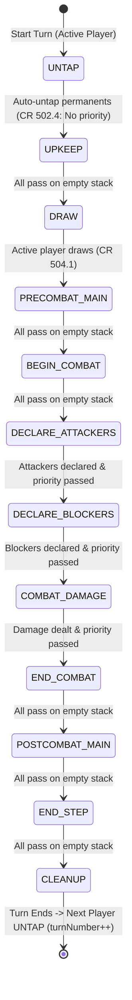
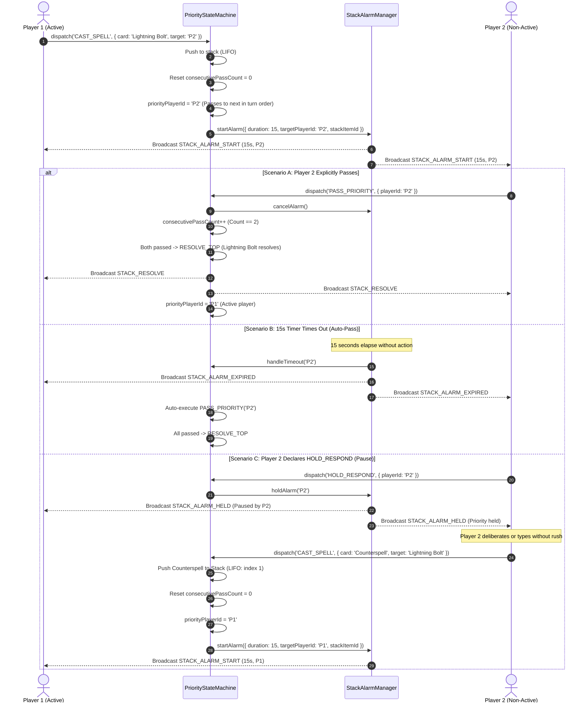

# Technical Specification: Stack & Priority Flow State Machine (15-Second Stack Alarm & Checkpoint Bus)

- **Document ID:** `SPEC-RPM-PRIORITY-004`
- **Feature Scope:** Feature 4 (`PriorityStateMachine.js` & `StackAlarmManager.js`)
- **System:** RPM Multiplayer / RPM Revival Modern Expansion
- **Architect:** Argon Specification Architect
- **Status:** APPROVED / READY FOR IMPLEMENTATION
- **Revision:** 1.0.0
- **Target File Path:** `specs/FEATURE_4_STACK_PRIORITY_SPEC.md`
- **Related Specifications:** 
  - `specs/FEATURE_1_2_CORE_INGESTION_SPEC.md` (`SPEC-RPM-INGEST-001`)
  - `specs/FEATURE_3_TABLETOP_ZONE_STATE_SPEC.md` (`SPEC-RPM-ZONE-003`)

---

## 1. Executive Summary & Architectural Overview

The **Stack & Priority Flow State Machine** provides deterministic, rules-compliant priority arbitration and stack resolution for Magic: The Gathering matches within the RPM Multiplayer ecosystem.

In MTG (CR 117: *Timing and Priority*), actions do not resolve instantaneously; spells and abilities are placed on the **Stack** (a Last-In, First-Out queue), and each player receives an opportunity to respond in turn order (Active Player, Non-Active Player—**APNAP**). In physical tabletop play, this negotiation occurs via verbal cues (e.g., *"Cast Lightning Bolt. Response?"*). In remote digital tabletop play, verbal communication often suffers from audio dropouts, network latency, or ambiguous timing.

Feature 4 introduces a formal, automated hybrid engine:
1. **Deterministic Priority State Machine (`PriorityStateMachine.js`)**: Strictly tracks the turn order (`players: string[]`), the active player whose turn it is (`activePlayerId`), the player currently holding priority (`priorityPlayerId`), and turn phases/steps (`UNTAP` through `CLEANUP`).
2. **15-Second Stack Alarm ("Alarma de Pila") (`StackAlarmManager.js`)**: Whenever a spell or ability is pushed to the stack, an automated 15-second countdown timer initiates for the non-active player(s). If no player takes action within 15 seconds, priority passes automatically (`TIMEOUT` $\to$ `PASS_PRIORITY`). Alternatively, players can explicitly pass or assert `HOLD_RESPOND`, which freezes the timer and grants an unmetered window to declare responses without rush.
3. **Checkpoint & Rollback Bus**: Tabletop play requires human dispute resolution. If a player was midway through typing or declaring an instant response when latency caused the 15-second timer to lapse, the engine provides an immutable snapshot journal (`CheckpointSnapshot`). Disputed states can be rewound to the exact pre-resolution frame (`ROLLBACK_TO_CHECKPOINT`) without corrupting board state or zone counters.

### 1.1 Architectural Topology

```mermaid
flowchart TD
    subgraph Feature3 ["Zone & Session Subsystem (Feature 3)"]
        TTSM[TabletopStateManager.js]
        ZoneMod[ZoneModel.js]
    end

    subgraph Feature4Core ["Priority & Stack Subsystem (Feature 4)"]
        PSM[PriorityStateMachine.js]
        SAM[StackAlarmManager.js]
        CPB[CheckpointBus / Snapshot Journal]
    end

    subgraph ClientUIs ["Player Clients & Network Layer"]
        ActiveClient[Active Player Client\n(activePlayerId)]
        OpponentClient[Opponent Client\n(priorityPlayerId)]
    end

    %% State Machine Coupling
    TTSM <-->|Delegates Turn, Phase & Stack Invariants| PSM
    PSM -->|Triggers Alarm on Stack Push| SAM
    SAM -->|TIMEOUT / EXPIRED Auto-Pass| PSM
    
    %% Checkpoint Integration
    PSM -->|Capture State Snapshot on PUSH/PHASE| CPB
    CPB -.->|Rollback State on Dispute| PSM
    CPB -.->|Rollback Zones & Life| TTSM

    %% Player Interactions
    ActiveClient -->|CAST_SPELL / ACTIVATE_ABILITY| PSM
    PSM -->|STACK_ALARM_START (15s)| OpponentClient
    OpponentClient -->|PASS_PRIORITY| PSM
    OpponentClient -->|HOLD_RESPOND (Pause Timer)| SAM
    OpponentClient -->|CAST_COUNTERSPELL (LIFO Push)| PSM
```

### 1.2 Separation of Concerns

1. **`PriorityStateMachine.js`**:
   - Manages match-level turn phases and steps according to MTG CR 500–514.
   - Enforces APNAP turn priority order (`CR 117.3`).
   - Acts as the gating authority: guarantees that only the player matching `priorityPlayerId` can dispatch mutating game actions (`PriorityViolationError`).
   - Maintains the LIFO Stack (`stack: StackItem[]`) and consecutive pass counter (`consecutivePassCount`).
   - Coordinates stack resolution (`RESOLVE_TOP`) and phase step advancement (`ADVANCE_PHASE_STEP`).
   - Maintains the checkpoint journal and handles state rollbacks.

2. **`StackAlarmManager.js`**:
   - Manages non-blocking asynchronous timers with sub-second precision.
   - Dispatches lifecycle notifications (`STACK_ALARM_START`, `STACK_ALARM_TICK`, `STACK_ALARM_HELD`, `STACK_ALARM_EXPIRED`, `STACK_ALARM_CANCELLED`).
   - Provides safe pause/hold semantics (`HOLD_RESPOND`) and resume capabilities.
   - Integrates cleanly with Node.js `setTimeout` and browser environments without blocking the main event loop.

---

## 2. Core Domain State Model & TypeScript Definitions

### 2.1 Complete TypeScript Interfaces

```typescript
/**
 * Canonical MTG Turn Phases and Steps (CR 500-514)
 */
export type PhaseStep =
  | 'UNTAP'              // CR 502: Untap step (Active player untaps all permanents, no priority)
  | 'UPKEEP'             // CR 503: Upkeep step (Active player receives priority)
  | 'DRAW'               // CR 504: Draw step (Active player draws 1 card, receives priority)
  | 'PRECOMBAT_MAIN'     // CR 505: Pre-combat Main phase (Sorcery speed permitted)
  | 'BEGIN_COMBAT'       // CR 507: Beginning of combat step
  | 'DECLARE_ATTACKERS'  // CR 508: Declare attackers step
  | 'DECLARE_BLOCKERS'   // CR 509: Declare blockers step
  | 'COMBAT_DAMAGE'      // CR 510: Combat damage step
  | 'END_COMBAT'         // CR 511: End of combat step
  | 'POSTCOMBAT_MAIN'    // CR 505: Post-combat Main phase (Sorcery speed permitted)
  | 'END_STEP'           // CR 513: End of turn step
  | 'CLEANUP';           // CR 514: Cleanup step (Discard to hand size, damage removed)

/**
 * Stack Item Discriminator
 */
export type StackItemType = 'SPELL' | 'ABILITY';

/**
 * Stack Item Entity (LIFO Node)
 */
export interface StackItem {
  id: string;                     // Unique identifier: `stack_${timestamp}_${hex8}`
  sourcePlayerId: string;         // Player who cast the spell or activated the ability
  card: Record<string, any>;      // Hydrated CardInstance or Card metadata
  type: StackItemType;            // 'SPELL' or 'ABILITY'
  targets: Array<{
    targetType: 'PLAYER' | 'PERMANENT' | 'SPELL';
    targetId: string;
    description?: string;
  }>;
  manaCostPaid?: Record<string, number>;
  timestamp: number;              // Milliseconds epoch when pushed
}

/**
 * Status of the 15-Second Stack Alarm
 */
export type StackAlarmStatus = 'IDLE' | 'RUNNING' | 'HELD' | 'EXPIRED' | 'CANCELLED';

/**
 * Stack Alarm Manager State
 */
export interface StackAlarmState {
  status: StackAlarmStatus;
  durationSeconds: number;       // Default: 15 seconds
  targetPlayerId: string | null; // Player under the timer
  stackItemId: string | null;    // Stack item triggering the countdown
  startTime: number | null;      // Epoch ms when timer was initiated
  remainingMs: number;           // Remaining milliseconds
  heldByPlayerId: string | null; // Player who issued HOLD_RESPOND
}

/**
 * Immutable State Checkpoint for Rollback Bus
 */
export interface CheckpointSnapshot {
  checkpointId: string;          // `ckpt_${sequenceId}_${timestamp}`
  sequenceId: number;            // Monotonic sequence number
  timestamp: number;
  triggerAction: string;         // Action that initiated snapshot (e.g. 'CAST_SPELL', 'ADVANCE_STEP')
  activePlayerId: string;
  priorityPlayerId: string;
  currentPhaseStep: PhaseStep;
  turnNumber: number;
  consecutivePassCount: number;
  stack: StackItem[];            // Deep clone of stack
  playersStateSummary: Record<string, {
    life: number;
    handCount: number;
    libraryCount: number;
    graveyardCount: number;
    battlefieldCount: number;
    exileCount: number;
    manaPool: Record<string, number>;
  }>;
  serializedFullState?: string;  // Complete JSON snapshot for full rollbacks
}

/**
 * Priority State Machine Core State
 */
export interface PriorityMachineState {
  sessionId: string;
  players: string[];             // Ordered player IDs in turn order [P1, P2, ...]
  activePlayerId: string;        // Player whose turn it currently is
  priorityPlayerId: string;      // Player who currently holds priority
  currentPhaseStep: PhaseStep;   // Current phase/step
  turnNumber: number;            // Monotonic turn counter
  consecutivePassCount: number;  // Number of consecutive passes without action
  stack: StackItem[];            // LIFO Stack array (last index is top)
  isTurnEnded: boolean;
}

/**
 * Outbound WebSocket / Event Bus Payloads
 */
export interface PriorityEvent {
  type:
    | 'PRIORITY_CHANGED'
    | 'PHASE_STEP_CHANGED'
    | 'STACK_PUSH'
    | 'STACK_RESOLVE'
    | 'STACK_ALARM_START'
    | 'STACK_ALARM_TICK'
    | 'STACK_ALARM_HELD'
    | 'STACK_ALARM_EXPIRED'
    | 'STACK_ALARM_CANCELLED'
    | 'CHECKPOINT_CAPTURED'
    | 'CHECKPOINT_RESTORED'
    | 'TURN_ADVANCED';
  sessionId: string;
  timestamp: number;
  payload: Record<string, any>;
}
```

---

### 2.2 Stack Item & Checkpoint Identifier Generation

Identifiers for stack items and checkpoints are generated using collision-resistant, monotonically indexable schemas:

```javascript
/**
 * Generates an RFC-compliant Stack Item ID
 * Format: `stack_${timestamp}_${hex8}`
 */
export function generateStackItemId() {
  const timestamp = Date.now();
  const hex = Math.random().toString(36).substring(2, 10);
  return `stack_${timestamp}_${hex}`;
}

/**
 * Generates an RFC-compliant Checkpoint ID
 * Format: `ckpt_${sequenceId}_${hex6}`
 */
export function generateCheckpointId(sequenceId) {
  const hex = Math.random().toString(36).substring(2, 8);
  return `ckpt_${sequenceId}_${hex}`;
}
```

---

## 3. MTG CR 117 Priority Flow & State Machine Specification

### 3.1 Turn Phases & Step State Machine

Magic: The Gathering CR 500 through 514 dictates that a turn is partitioned into five phases, with several phases further partitioned into distinct steps.



#### Step Progression Table & Turn-Based Actions (TBAs)

| Step / Phase | Canonical Key | MTG CR Reference | Turn-Based Action (TBA) Performed | Initial Priority Player | Sorcery Speed Permitted? |
| :--- | :--- | :--- | :--- | :--- | :--- |
| **Untap Step** | `UNTAP` | CR 502 | All active player permanents untap (`UNTAP_ALL`). Phasing resolves. | *None* (CR 502.4: Automatically advances to Upkeep) | ❌ No |
| **Upkeep Step** | `UPKEEP` | CR 503 | Any upkeep triggers trigger. | `activePlayerId` | ❌ No |
| **Draw Step** | `DRAW` | CR 504 | Active player draws 1 card (`DRAW_CARD`) unless turn 1 play-draw rule. | `activePlayerId` | ❌ No |
| **Precombat Main** | `PRECOMBAT_MAIN`| CR 505 | None. Mana empties at step boundary. | `activePlayerId` | ✅ Yes (Empty stack only) |
| **Beginning Combat** | `BEGIN_COMBAT` | CR 507 | "At beginning of combat" triggers trigger. | `activePlayerId` | ❌ No |
| **Declare Attackers**| `DECLARE_ATTACKERS`| CR 508| Active player declares attacking creatures and tap them. | `activePlayerId` | ❌ No |
| **Declare Blockers** | `DECLARE_BLOCKERS` | CR 509| Defending player(s) declare blockers. | `activePlayerId` | ❌ No |
| **Combat Damage** | `COMBAT_DAMAGE` | CR 510 | Combat damage assigned and dealt simultaneously. | `activePlayerId` | ❌ No |
| **End of Combat** | `END_COMBAT` | CR 511 | "At end of combat" triggers trigger. | `activePlayerId` | ❌ No |
| **Postcombat Main** | `POSTCOMBAT_MAIN`| CR 505 | None. Land drop permitted if unused. | `activePlayerId` | ✅ Yes (Empty stack only) |
| **End Step** | `END_STEP` | CR 513 | "At the beginning of the end step" triggers trigger. | `activePlayerId` | ❌ No |
| **Cleanup Step** | `CLEANUP` | CR 514 | Active player discards down to max hand size (7). Damage removed. | *None* (CR 514.3: Automatically advances unless triggers) | ❌ No |

---

### 3.2 APNAP Priority Ordering & Passing Algorithm

In a game with player array $P = [P_0, P_1, \dots, P_{N-1}]$, turn priority strictly cycles clockwise (index increment modulo $N$):

$$\text{nextPlayer}(P_i) = P_{(i + 1) \pmod N}$$

#### Mathematical Invariant for Consecutive Passes
Let $C_{\text{pass}}$ be the consecutive pass counter, and $N = |P|$ be the total number of active players in the game:

1. **Initial Step State**:
   $$C_{\text{pass}} = 0, \quad \text{priorityPlayerId} = \text{activePlayerId}$$
2. **Action Dispatch**: Whenever any player successfully casts a spell, activates an ability, or triggers a game action:
   $$C_{\text{pass}} \leftarrow 0$$
3. **Pass Priority (`PASS_PRIORITY`)**:
   $$C_{\text{pass}} \leftarrow C_{\text{pass}} + 1$$
   $$\text{priorityPlayerId} \leftarrow \text{nextPlayer}(\text{priorityPlayerId})$$
4. **Resolution Condition ($C_{\text{pass}} == N \land |\text{Stack}| > 0$)**:
   - When all $N$ players pass priority consecutively while the stack is non-empty:
     - The top item of the stack resolves:
       $$\text{resolvedItem} = \text{Stack}.\text{pop}()$$
     - Reset consecutive passes:
       $$C_{\text{pass}} \leftarrow 0$$
     - Priority returns to the active player:
       $$\text{priorityPlayerId} \leftarrow \text{activePlayerId}$$
5. **Phase Step Advancement Condition ($C_{\text{pass}} == N \land |\text{Stack}| == 0$)**:
   - When all $N$ players pass priority consecutively while the stack is completely empty:
     - Advance to the next phase step:
       $$\text{currentPhaseStep} \leftarrow \text{nextStep}(\text{currentPhaseStep})$$
     - Reset consecutive passes:
       $$C_{\text{pass}} \leftarrow 0$$
     - Priority returns to the active player:
       $$\text{priorityPlayerId} \leftarrow \text{activePlayerId}$$
     - If advancing past `CLEANUP`, advance turn:
       $$\text{activePlayerId} \leftarrow \text{nextPlayer}(\text{activePlayerId})$$
       $$\text{turnNumber} \leftarrow \text{turnNumber} + 1$$
       $$\text{currentPhaseStep} \leftarrow \text{UNTAP}$$

---

### 3.3 Priority Gating & Invariant Enforcement

Every incoming game mutation request targeting the tabletop session must pass through `PriorityStateMachine.validateAction(playerId, actionType)`:

```javascript
/**
 * Priority Gating Rules:
 * 1. Player must hold priority (priorityPlayerId === playerId).
 * 2. If actionType is SORCERY_SPEED (playing land, casting sorceries/creatures/artifacts):
 *    - currentPhaseStep must be PRECOMBAT_MAIN or POSTCOMBAT_MAIN.
 *    - stack must be empty (stack.length === 0).
 *    - activePlayerId must equal playerId (CR 116.1a).
 * 3. If actionType is INSTANT_SPEED (casting instant, activating ability):
 *    - priorityPlayerId must equal playerId (stack can be non-empty).
 * 
 * Throws PriorityViolationError if any guard fails.
 */
export class PriorityViolationError extends Error {
  constructor(message, details = {}) {
    super(message);
    this.name = 'PriorityViolationError';
    this.details = details;
  }
}
```

---

## 4. The 15-Second Stack Alarm ("Alarma de Pila") & Interruption Engine

### 4.1 Stack Alarm Sequence & Interruption Flow

When a spell or ability is placed onto the stack, opponent clients must receive an urgent interactive window to respond. If opponents fail to act within 15 seconds, the engine automatically treats the absence of input as a priority pass.



---

### 4.2 `StackAlarmManager.js` Architecture

The `StackAlarmManager` encapsulates a deterministic, tick-based or timeout-based timer that supports:
- Starting a countdown for a target player.
- Emitting periodic tick events for responsive UI countdown progress bars.
- Immediate cancellation when priority passes or responses are cast.
- Indefinite pause (`HOLD_RESPOND`) preserving remaining time.

```javascript
/**
 * StackAlarmManager: Coordinates the 15-second response countdown.
 */
export class StackAlarmManager {
  /**
   * @param {Object} options
   * @param {number} [options.defaultDurationSeconds=15]
   * @param {Function} [options.onTimeout] Callback invoked on expiration
   * @param {Function} [options.onEmit] Callback invoked on status updates
   */
  constructor(options = {}) {
    this.defaultDurationSeconds = options.defaultDurationSeconds || 15;
    this.onTimeout = options.onTimeout || (() => {});
    this.onEmit = options.onEmit || (() => {});

    this.timer = null;
    this.tickInterval = null;
    this.status = 'IDLE'; // 'IDLE' | 'RUNNING' | 'HELD' | 'EXPIRED' | 'CANCELLED'
    this.durationSeconds = this.defaultDurationSeconds;
    this.remainingMs = 0;
    this.targetPlayerId = null;
    this.stackItemId = null;
    this.heldByPlayerId = null;
    this.startTime = null;
    this.endTime = null;
  }

  /**
   * Initiates a 15-second countdown for targetPlayerId.
   */
  start(targetPlayerId, stackItemId, durationSeconds = this.defaultDurationSeconds) {
    this.cancel(); // Clear any existing timers

    this.status = 'RUNNING';
    this.durationSeconds = durationSeconds;
    this.remainingMs = durationSeconds * 1000;
    this.targetPlayerId = targetPlayerId;
    this.stackItemId = stackItemId;
    this.heldByPlayerId = null;
    this.startTime = Date.now();
    this.endTime = this.startTime + this.remainingMs;

    this.onEmit({
      type: 'STACK_ALARM_START',
      duration: this.durationSeconds,
      remainingMs: this.remainingMs,
      targetPlayerId: this.targetPlayerId,
      stackItemId: this.stackItemId
    });

    this.timer = setTimeout(() => {
      this._handleExpiry();
    }, this.remainingMs);
  }

  /**
   * Pauses the timer and enters HELD state.
   */
  hold(playerId) {
    if (this.status !== 'RUNNING') {
      return false;
    }
    if (this.timer) {
      clearTimeout(this.timer);
      this.timer = null;
    }
    const elapsed = Date.now() - this.startTime;
    this.remainingMs = Math.max(0, this.remainingMs - elapsed);
    this.status = 'HELD';
    this.heldByPlayerId = playerId;

    this.onEmit({
      type: 'STACK_ALARM_HELD',
      heldByPlayerId: playerId,
      remainingMs: this.remainingMs,
      stackItemId: this.stackItemId
    });
    return true;
  }

  /**
   * Cancels the active alarm.
   */
  cancel() {
    if (this.timer) {
      clearTimeout(this.timer);
      this.timer = null;
    }
    if (this.status !== 'IDLE') {
      this.status = 'CANCELLED';
      this.onEmit({
        type: 'STACK_ALARM_CANCELLED',
        stackItemId: this.stackItemId
      });
    }
    this.status = 'IDLE';
    this.targetPlayerId = null;
    this.stackItemId = null;
    this.heldByPlayerId = null;
  }

  /**
   * Internal timeout handler.
   * @private
   */
  _handleExpiry() {
    this.status = 'EXPIRED';
    const expiredPlayerId = this.targetPlayerId;
    const expiredStackItemId = this.stackItemId;
    
    this.onEmit({
      type: 'STACK_ALARM_EXPIRED',
      targetPlayerId: expiredPlayerId,
      stackItemId: expiredStackItemId
    });

    this.onTimeout(expiredPlayerId, expiredStackItemId);
    this.status = 'IDLE';
  }
}
```

---

## 5. Checkpoint & Rollback Bus

### 5.1 Checkpoint Architecture & Invariant Guarantees

In remote tabletop gaming, latency or overlapping actions can cause a player to declare an interruption a fraction of a second after a countdown expired or after an active player clicked "Resolve". Without a rollback system, the game must be completely restarted or manually unpicked across dozens of properties.

The **Checkpoint & Rollback Bus** maintains an in-memory chronological ring buffer (maximum 50 checkpoints).

#### Automatic Checkpoint Triggers
A snapshot is captured immediately **before** any state-altering event:
1. `BEFORE_STACK_PUSH`: Captured right before a spell/ability is placed onto the stack.
2. `BEFORE_STACK_RESOLVE`: Captured right before the top item is popped and resolved into the battlefield, graveyard, or exile.
3. `BEFORE_PHASE_ADVANCE`: Captured right before the phase or step transitions.
4. `USER_CHECKPOINT`: Explicit snapshot triggered on demand by any participant.

```mermaid
flowchart LR
    StateBefore[Tabletop & Priority State] --> Capture[Capture Snapshot\nserializeState / deepClone]
    Capture --> Journal[(Checkpoint Journal Ring Buffer\nMax 50 Checkpoints)]
    
    Dispute[Dispute Raised / Out-of-Order Call] --> RollbackCmd[ROLLBACK_TO_CHECKPOINT(checkpointId)]
    RollbackCmd --> Lookup{Found in Journal?}
    Lookup -->|Yes| Restore[Restore Stack, Priority, Zones & Counters]
    Lookup -->|No| Error[CheckpointNotFoundError]
    Restore --> Notify[Broadcast CHECKPOINT_RESTORED]
```

### 5.2 Rollback Bus Specification

```javascript
/**
 * RollbackBus manages the journal of historical game snapshots.
 */
export class CheckpointJournal {
  constructor(maxSnapshots = 50) {
    this.maxSnapshots = maxSnapshots;
    this.snapshots = []; // Ordered array: newest at end
    this.sequenceCounter = 0;
  }

  /**
   * Captures an immutable checkpoint snapshot.
   */
  captureSnapshot(triggerAction, state) {
    this.sequenceCounter++;
    const checkpointId = generateCheckpointId(this.sequenceCounter);

    const snapshot = {
      checkpointId,
      sequenceId: this.sequenceCounter,
      timestamp: Date.now(),
      triggerAction,
      activePlayerId: state.activePlayerId,
      priorityPlayerId: state.priorityPlayerId,
      currentPhaseStep: state.currentPhaseStep,
      turnNumber: state.turnNumber,
      consecutivePassCount: state.consecutivePassCount,
      stack: JSON.parse(JSON.stringify(state.stack)), // Deep clone
      serializedState: JSON.stringify(state)
    };

    this.snapshots.push(snapshot);
    if (this.snapshots.length > this.maxSnapshots) {
      this.snapshots.shift(); // Evict oldest
    }

    return snapshot;
  }

  /**
   * Retrieves a checkpoint by its ID.
   */
  getSnapshot(checkpointId) {
    return this.snapshots.find(s => s.checkpointId === checkpointId) || null;
  }

  /**
   * Returns list of recent checkpoints.
   */
  getRecentCheckpoints(count = 10) {
    return this.snapshots.slice(-count).reverse();
  }
}
```

---

## 6. Action & Event Bus Contract

### 6.1 Inbound Commands

All commands are submitted via `PriorityStateMachine.dispatch(actionType, payload)`.

#### 1. `CAST_SPELL_TO_STACK` / `ACTIVATE_ABILITY_TO_STACK`
- **Preconditions**:
  - `payload.playerId === state.priorityPlayerId`.
  - If sorcery speed, `state.currentPhaseStep` in `['PRECOMBAT_MAIN', 'POSTCOMBAT_MAIN']`, `state.stack.length === 0`, and `payload.playerId === state.activePlayerId`.
- **Postconditions**:
  - Generates a new `StackItem` and pushes to `state.stack`.
  - Resets `state.consecutivePassCount = 0`.
  - Passes priority to `nextPlayer(playerId)`.
  - Initiates 15-second `StackAlarmManager` for the new `priorityPlayerId`.
  - Records a checkpoint.

#### 2. `PASS_PRIORITY`
- **Preconditions**:
  - `payload.playerId === state.priorityPlayerId`.
- **Postconditions**:
  - Increments `state.consecutivePassCount`.
  - Cancels or handles active alarm.
  - If `consecutivePassCount < players.length`:
    - `priorityPlayerId = nextPlayer(priorityPlayerId)`.
    - If stack is non-empty, restarts 15-second alarm for the new priority player.
  - If `consecutivePassCount === players.length`:
    - If `stack.length > 0`: Invokes `RESOLVE_TOP`.
    - If `stack.length === 0`: Invokes `ADVANCE_PHASE_STEP`.

#### 3. `HOLD_RESPOND`
- **Preconditions**:
  - `payload.playerId === state.priorityPlayerId`.
  - Alarm is currently running.
- **Postconditions**:
  - Pauses countdown in `StackAlarmManager`.
  - Emits `STACK_ALARM_HELD`.
  - Priority remains with `payload.playerId` without an expiring timeout.

#### 4. `RESOLVE_TOP`
- **Preconditions**:
  - `consecutivePassCount === players.length`.
  - `state.stack.length > 0`.
- **Postconditions**:
  - Pops the top `StackItem` (`state.stack.pop()`).
  - Emits `STACK_RESOLVE` with the resolved item.
  - Resets `consecutivePassCount = 0`.
  - Restores priority to `state.activePlayerId`.
  - Captures a checkpoint.

#### 5. `ADVANCE_PHASE_STEP`
- **Preconditions**:
  - `consecutivePassCount === players.length`.
  - `state.stack.length === 0`.
- **Postconditions**:
  - Transitions `currentPhaseStep` to the next step according to Section 3.1.
  - If transitioning from `CLEANUP`, increments `turnNumber` and rotates `activePlayerId` to `nextPlayer(activePlayerId)`.
  - Performs step Turn-Based Actions (TBAs) (e.g. untap permanents during `UNTAP`, draw card during `DRAW`).
  - Resets `consecutivePassCount = 0`.
  - Sets `priorityPlayerId = activePlayerId` (or auto-advances if step has no priority window).

#### 6. `ROLLBACK_TO_CHECKPOINT`
- **Preconditions**:
  - `payload.checkpointId` exists in `CheckpointJournal`.
- **Postconditions**:
  - Restores `stack`, `currentPhaseStep`, `turnNumber`, `activePlayerId`, `priorityPlayerId`, and `consecutivePassCount` from snapshot.
  - Cancels any running stack alarms.
  - Emits `CHECKPOINT_RESTORED` to all participants.

---

### 6.2 Outbound Event Schemas

```typescript
// 1. STACK_ALARM_START
{
  type: 'STACK_ALARM_START',
  duration: 15,
  remainingMs: 15000,
  targetPlayerId: 'player_2',
  stackItemId: 'stack_1729158000000_abc123'
}

// 2. STACK_ALARM_HELD
{
  type: 'STACK_ALARM_HELD',
  heldByPlayerId: 'player_2',
  remainingMs: 11450,
  stackItemId: 'stack_1729158000000_abc123'
}

// 3. STACK_ALARM_EXPIRED
{
  type: 'STACK_ALARM_EXPIRED',
  targetPlayerId: 'player_2',
  stackItemId: 'stack_1729158000000_abc123'
}

// 4. PRIORITY_CHANGED
{
  type: 'PRIORITY_CHANGED',
  activePlayerId: 'player_1',
  priorityPlayerId: 'player_2',
  currentPhaseStep: 'PRECOMBAT_MAIN',
  consecutivePassCount: 1
}

// 5. PHASE_STEP_CHANGED
{
  type: 'PHASE_STEP_CHANGED',
  previousStep: 'UPKEEP',
  currentPhaseStep: 'DRAW',
  turnNumber: 2,
  activePlayerId: 'player_1'
}

// 6. CHECKPOINT_RESTORED
{
  type: 'CHECKPOINT_RESTORED',
  checkpointId: 'ckpt_4_9bf2a1',
  restoredToTrigger: 'CAST_SPELL',
  activePlayerId: 'player_1',
  priorityPlayerId: 'player_2',
  stackSize: 1
}
```

---

## 7. Comprehensive Acceptance Test Suite

The acceptance test suite consists of 12 fully automated test cases with exact assertions covering all aspects of priority, stack LIFO ordering, 15-second alarms, timer pausing, phase progression, and rollback operations.

```javascript
/**
 * Test Suite Requirements Summary:
 * - Module: test/priority_state_machine_test.js
 * - Framework: Node.js assert/strict
 * - Minimum 12 Test Cases
 */
```

---

### Test Case 1: Initial Turn Setup & Active Player Priority in Upkeep
- **Objective:** Verify match begins at `UNTAP`, automatically executes untap TBA, transitions to `UPKEEP`, and assigns `priorityPlayerId = activePlayerId`.
- **Assertions:**
  ```javascript
  const sm = new PriorityStateMachine({
    players: ['p1', 'p2'],
    activePlayerId: 'p1'
  });
  
  // Game starts at UNTAP
  assert.equal(sm.activePlayerId, 'p1');
  assert.equal(sm.turnNumber, 1);
  assert.equal(sm.currentPhaseStep, 'UNTAP');

  // Advancing from UNTAP automatically performs untap and moves to UPKEEP with priority on active player
  sm.advanceStep();
  assert.equal(sm.currentPhaseStep, 'UPKEEP');
  assert.equal(sm.priorityPlayerId, 'p1');
  assert.equal(sm.consecutivePassCount, 0);
  assert.equal(sm.stack.length, 0);
  ```

---

### Test Case 2: Priority Gating & `PriorityViolationError` on Unauthorized Player Action
- **Objective:** Verify that when Player 1 holds priority, Player 2 cannot dispatch actions or pass priority, throwing `PriorityViolationError`.
- **Assertions:**
  ```javascript
  assert.equal(sm.priorityPlayerId, 'p1');

  // Player 2 attempts to pass priority out of turn
  assert.throws(() => {
    sm.dispatch('PASS_PRIORITY', { playerId: 'p2' });
  }, /PriorityViolationError|Player 'p2' does not hold priority/);

  // Player 2 attempts to cast a spell out of turn
  assert.throws(() => {
    sm.dispatch('CAST_SPELL', {
      playerId: 'p2',
      card: { name: 'Opt', typeLine: 'Instant' }
    });
  }, /PriorityViolationError|Player 'p2' does not hold priority/);
  ```

---

### Test Case 3: Single Spell Cast & 15-Second Stack Alarm Initiation
- **Objective:** Player 1 casts *Lightning Bolt*. The card is placed on the stack, priority passes to Player 2, and `StackAlarmManager` starts a 15-second timer.
- **Assertions:**
  ```javascript
  let alarmEvents = [];
  sm.alarmManager.onEmit = (event) => alarmEvents.push(event);

  sm.dispatch('CAST_SPELL', {
    playerId: 'p1',
    card: { instanceId: 'bolt_1', name: 'Lightning Bolt', typeLine: 'Instant' },
    targets: [{ targetType: 'PLAYER', targetId: 'p2' }]
  });

  assert.equal(sm.stack.length, 1);
  assert.equal(sm.stack[0].card.name, 'Lightning Bolt');
  assert.equal(sm.stack[0].sourcePlayerId, 'p1');
  assert.equal(sm.priorityPlayerId, 'p2'); // Passed to opponent
  assert.equal(sm.consecutivePassCount, 0);

  // Verify alarm started
  assert.equal(sm.alarmManager.status, 'RUNNING');
  assert.equal(sm.alarmManager.targetPlayerId, 'p2');
  assert.equal(alarmEvents.some(e => e.type === 'STACK_ALARM_START' && e.targetPlayerId === 'p2'), true);
  ```

---

### Test Case 4: Opponent Explicit `PASS_PRIORITY` & Single Spell Resolution
- **Objective:** Player 2 explicitly calls `PASS_PRIORITY`. Since Player 1 already passed priority when casting/yielding, all players have passed consecutively; the spell resolves (`RESOLVE_TOP`) and priority returns to Active Player.
- **Assertions:**
  ```javascript
  let resolveEvents = [];
  sm.on('STACK_RESOLVE', (e) => resolveEvents.push(e));

  sm.dispatch('PASS_PRIORITY', { playerId: 'p2' });

  // Stack should now be resolved and empty
  assert.equal(sm.stack.length, 0);
  assert.equal(resolveEvents.length, 1);
  assert.equal(resolveEvents[0].resolvedItem.card.name, 'Lightning Bolt');
  assert.equal(sm.priorityPlayerId, 'p1'); // Priority returns to active player
  assert.equal(sm.consecutivePassCount, 0);
  assert.equal(sm.alarmManager.status, 'IDLE');
  ```

---

### Test Case 5: 15-Second Timer Expiration (`TIMEOUT`) Auto-Passes Priority
- **Objective:** When a spell is on the stack and the 15-second timer expires without action, `StackAlarmManager` triggers an automatic `PASS_PRIORITY`, resolving the spell.
- **Assertions:**
  ```javascript
  sm.dispatch('CAST_SPELL', {
    playerId: 'p1',
    card: { instanceId: 'shock_1', name: 'Shock', typeLine: 'Instant' }
  });
  assert.equal(sm.priorityPlayerId, 'p2');
  assert.equal(sm.stack.length, 1);

  // Simulate timer expiration
  sm.alarmManager._handleExpiry();

  // Expiration must auto-pass priority and resolve the top of the stack
  assert.equal(sm.stack.length, 0);
  assert.equal(sm.priorityPlayerId, 'p1');
  assert.equal(sm.alarmManager.status, 'IDLE');
  ```

---

### Test Case 6: `HOLD_RESPOND` Freezes Timer and Grants Unmetered Response Window
- **Objective:** Player 2 issues `HOLD_RESPOND`. The timer pauses (`HELD` state), canceling the pending timeout callback and preventing auto-pass.
- **Assertions:**
  ```javascript
  sm.dispatch('CAST_SPELL', {
    playerId: 'p1',
    card: { instanceId: 'bolt_2', name: 'Lightning Bolt', typeLine: 'Instant' }
  });
  assert.equal(sm.alarmManager.status, 'RUNNING');

  sm.dispatch('HOLD_RESPOND', { playerId: 'p2' });
  assert.equal(sm.alarmManager.status, 'HELD');
  assert.equal(sm.alarmManager.heldByPlayerId, 'p2');
  assert.equal(sm.priorityPlayerId, 'p2');

  // Simulating time passage: verify no automatic timeout fires while HELD
  assert.equal(sm.stack.length, 1); // Still on stack, not resolved
  ```

---

### Test Case 7: LIFO Counter-Spell on Top of Stack & Alarm Restart
- **Objective:** Player 1 casts *Lightning Bolt*. Player 2 responds with *Counterspell*. *Counterspell* is placed on top of the stack (index 1). Priority passes to Player 1 with a fresh 15-second alarm. Resolving pops *Counterspell* first, then *Lightning Bolt*.
- **Assertions:**
  ```javascript
  // P1 casts Lightning Bolt
  sm.dispatch('CAST_SPELL', {
    playerId: 'p1',
    card: { instanceId: 'bolt_3', name: 'Lightning Bolt', typeLine: 'Instant' }
  });
  assert.equal(sm.priorityPlayerId, 'p2');

  // P2 responds with Counterspell targeting Lightning Bolt
  sm.dispatch('CAST_SPELL', {
    playerId: 'p2',
    card: { instanceId: 'counter_1', name: 'Counterspell', typeLine: 'Instant' },
    targets: [{ targetType: 'SPELL', targetId: 'bolt_3' }]
  });

  // Verify LIFO stack structure: top is index 1 (Counterspell)
  assert.equal(sm.stack.length, 2);
  assert.equal(sm.stack[1].card.name, 'Counterspell');
  assert.equal(sm.stack[0].card.name, 'Lightning Bolt');
  assert.equal(sm.priorityPlayerId, 'p1'); // Priority passed to P1 to respond
  assert.equal(sm.alarmManager.status, 'RUNNING');
  assert.equal(sm.alarmManager.targetPlayerId, 'p1');

  // P1 passes priority
  sm.dispatch('PASS_PRIORITY', { playerId: 'p1' });
  // P2 passes priority
  sm.dispatch('PASS_PRIORITY', { playerId: 'p2' });

  // Counterspell resolves first (LIFO)
  assert.equal(sm.stack.length, 1);
  assert.equal(sm.stack[0].card.name, 'Lightning Bolt');

  // Both pass again to resolve Lightning Bolt
  sm.dispatch('PASS_PRIORITY', { playerId: 'p1' });
  sm.dispatch('PASS_PRIORITY', { playerId: 'p2' });
  assert.equal(sm.stack.length, 0);
  ```

---

### Test Case 8: Multi-Player 3-Player Priority Rotation (APNAP Order)
- **Objective:** In a 3-player match `['p1', 'p2', 'p3']`, priority rotates $P_1 \to P_2 \to P_3 \to P_1$. All 3 must pass consecutively before stack or step resolves.
- **Assertions:**
  ```javascript
  const sm3 = new PriorityStateMachine({
    players: ['p1', 'p2', 'p3'],
    activePlayerId: 'p1',
    initialPhaseStep: 'PRECOMBAT_MAIN'
  });

  sm3.dispatch('CAST_SPELL', {
    playerId: 'p1',
    card: { name: 'Growth Spiral', typeLine: 'Instant' }
  });
  assert.equal(sm3.priorityPlayerId, 'p2');

  sm3.dispatch('PASS_PRIORITY', { playerId: 'p2' });
  assert.equal(sm3.priorityPlayerId, 'p3');
  assert.equal(sm3.stack.length, 1); // Not resolved yet (only 1 pass)

  sm3.dispatch('PASS_PRIORITY', { playerId: 'p3' });
  assert.equal(sm3.priorityPlayerId, 'p1');
  assert.equal(sm3.stack.length, 1); // Not resolved yet (2 passes, need 3)

  sm3.dispatch('PASS_PRIORITY', { playerId: 'p1' });
  // Now 3 consecutive passes have occurred -> Resolves
  assert.equal(sm3.stack.length, 0);
  assert.equal(sm3.priorityPlayerId, 'p1');
  ```

---

### Test Case 9: Empty Stack Consecutive Passes Advance Phase Steps Sequentially
- **Objective:** When the stack is empty and all players pass consecutively, the step advances: `PRECOMBAT_MAIN` $\to$ `BEGIN_COMBAT` $\to$ `DECLARE_ATTACKERS`.
- **Assertions:**
  ```javascript
  sm.setPhaseStep('PRECOMBAT_MAIN');
  assert.equal(sm.stack.length, 0);

  // P1 passes
  sm.dispatch('PASS_PRIORITY', { playerId: 'p1' });
  assert.equal(sm.currentPhaseStep, 'PRECOMBAT_MAIN');
  assert.equal(sm.priorityPlayerId, 'p2');

  // P2 passes -> Step advances to BEGIN_COMBAT
  sm.dispatch('PASS_PRIORITY', { playerId: 'p2' });
  assert.equal(sm.currentPhaseStep, 'BEGIN_COMBAT');
  assert.equal(sm.priorityPlayerId, 'p1'); // Priority returns to active player

  // Both pass again -> Step advances to DECLARE_ATTACKERS
  sm.dispatch('PASS_PRIORITY', { playerId: 'p1' });
  sm.dispatch('PASS_PRIORITY', { playerId: 'p2' });
  assert.equal(sm.currentPhaseStep, 'DECLARE_ATTACKERS');
  ```

---

### Test Case 10: Turn Handover at `CLEANUP` to Next Active Player
- **Objective:** Advancing past `CLEANUP` increments `turnNumber`, sets `activePlayerId = 'p2'`, and resets phase to `UNTAP`.
- **Assertions:**
  ```javascript
  sm.setPhaseStep('CLEANUP');
  assert.equal(sm.activePlayerId, 'p1');
  assert.equal(sm.turnNumber, 1);

  // Both pass during cleanup
  sm.dispatch('PASS_PRIORITY', { playerId: 'p1' });
  sm.dispatch('PASS_PRIORITY', { playerId: 'p2' });

  // Turn transitions to Player 2
  assert.equal(sm.activePlayerId, 'p2');
  assert.equal(sm.turnNumber, 2);
  assert.equal(sm.currentPhaseStep, 'UNTAP');
  ```

---

### Test Case 11: Checkpoint Snapshot Creation on Stack Push & Phase Advance
- **Objective:** Verify that `CheckpointJournal` creates snapshots before mutating events, storing stack items and priority context.
- **Assertions:**
  ```javascript
  const initialSnapshotsCount = sm.checkpointJournal.snapshots.length;

  sm.dispatch('CAST_SPELL', {
    playerId: 'p2',
    card: { instanceId: 'spell_x', name: 'Thoughtseize', typeLine: 'Sorcery' }
  });

  assert.equal(sm.checkpointJournal.snapshots.length, initialSnapshotsCount + 1);
  const latestSnapshot = sm.checkpointJournal.snapshots[sm.checkpointJournal.snapshots.length - 1];
  assert.equal(latestSnapshot.triggerAction, 'CAST_SPELL');
  assert.ok(latestSnapshot.checkpointId.startsWith('ckpt_'));
  assert.equal(latestSnapshot.activePlayerId, 'p2');
  ```

---

### Test Case 12: Checkpoint Rollback on Disputed Out-of-Order Action & State Restoration
- **Objective:** Simulate a disputed spell resolution. Reverting via `ROLLBACK_TO_CHECKPOINT(checkpointId)` restores the exact stack item, priority player, and phase step.
- **Assertions:**
  ```javascript
  // P2 casts spell
  const checkpointBeforeCast = sm.checkpointJournal.captureSnapshot('BEFORE_DISPUTED_SPELL', sm);
  
  sm.dispatch('CAST_SPELL', {
    playerId: 'p2',
    card: { instanceId: 'wrath_1', name: 'Wrath of God', typeLine: 'Sorcery' }
  });
  // Both pass and it resolves
  sm.dispatch('PASS_PRIORITY', { playerId: 'p1' });
  sm.dispatch('PASS_PRIORITY', { playerId: 'p2' });
  assert.equal(sm.stack.length, 0);

  // Player 1 claims they declared a response before the timer ended: ROLLBACK
  sm.rollbackToCheckpoint(checkpointBeforeCast.checkpointId);

  // State must match the pre-cast snapshot
  assert.equal(sm.stack.length, 0);
  assert.equal(sm.priorityPlayerId, checkpointBeforeCast.priorityPlayerId);
  assert.equal(sm.currentPhaseStep, checkpointBeforeCast.currentPhaseStep);
  assert.equal(sm.consecutivePassCount, 0);
  assert.equal(sm.alarmManager.status, 'IDLE');
  ```

---

## 8. Directory & Implementation Roadmap

### 8.1 Target Directory Layout

```text
rpm multiplayer/
├── specs/
│   ├── FEATURE_1_2_CORE_INGESTION_SPEC.md   # Ingestion Spec (Parser & Scryfall)
│   ├── FEATURE_3_TABLETOP_ZONE_STATE_SPEC.md # Zone & Fog-of-War Spec
│   └── FEATURE_4_STACK_PRIORITY_SPEC.md     # This Specification
├── src/
│   ├── DeckParser.js                        # Feature 1
│   ├── ScryfallService.js                   # Feature 2
│   ├── ZoneModel.js                         # Feature 3 Domain Primitives
│   ├── TabletopStateManager.js              # Feature 3 Orchestrator
│   ├── StackAlarmManager.js                 # Feature 4 15-Second Stack Alarm
│   ├── PriorityStateMachine.js              # Feature 4 MTG Priority & Checkpoint State Machine
│   └── index.js                             # Unified Package Exports
├── test/
│   ├── run_tests.js                         # Feature 1 & 2 Test Suite
│   ├── live_scryfall_test.js                # Feature 2 E2E Test
│   ├── test_zone_state.js                   # Feature 3 Test Suite (12 Tests)
│   └── priority_state_machine_test.js       # Feature 4 Test Suite (12 Tests)
└── package.json
```

### 8.2 Exports in `src/index.js`
The main package entry point will export the new domain entities and classes:
```javascript
export { ZoneModel, classifySubzone, generateInstanceId } from './ZoneModel.js';
export { TabletopStateManager, projectState } from './TabletopStateManager.js';
export { PriorityStateMachine, PriorityViolationError, generateStackItemId, generateCheckpointId } from './PriorityStateMachine.js';
export { StackAlarmManager } from './StackAlarmManager.js';
```

---

## 9. Architectural Sign-off

- **Specification Architect:** Argon Specification Architect
- **Target Status:** Approved for Implementation
- **Dependencies:** Interoperable with `ZoneModel.js` and `TabletopStateManager.js` (`SPEC-RPM-ZONE-003`)
