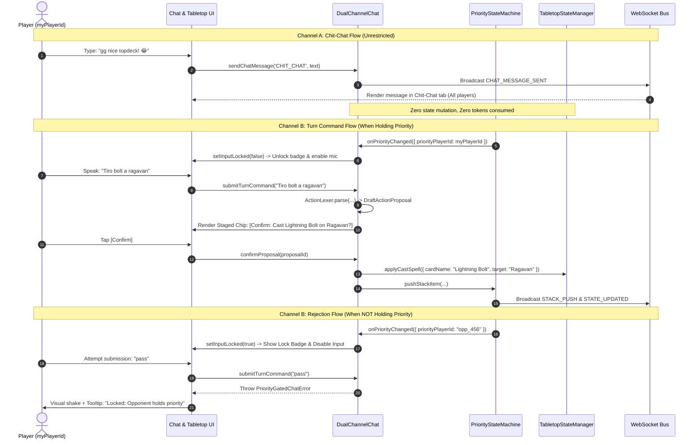
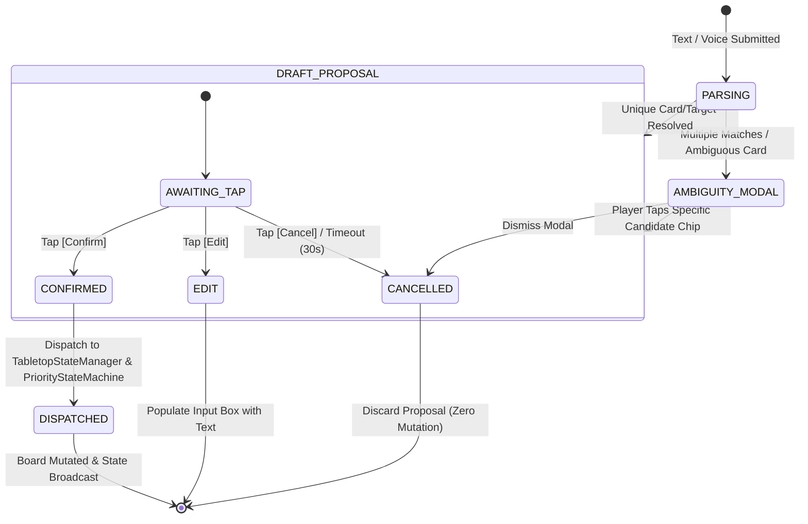

# Technical Specification: Dual-Channel Priority Chat & Fast-Path Action Bus with Staged Intent Chips

- **Document ID:** `SPEC-RPM-CHAT-005`
- **Feature Scope:** Features 5 & 6 Combined (`DualChannelChat.js`, `ActionLexer.js`, & `SpeechRecognitionService.js` Integration)
- **System:** RPM Multiplayer / RPM Revival Modern Tabletop Arena
- **Architect:** Argon Specification Architect
- **Status:** APPROVED / READY FOR IMPLEMENTATION
- **Revision:** 1.0.0
- **Target File Path:** `specs/FEATURE_5_6_DUAL_CHAT_ACTION_BUS_SPEC.md`
- **Component Scope:**
  - `src/DualChannelChat.js`
  - `src/ActionLexer.js`
  - `SpeechRecognitionService.js` (Integration & Audio Pipeline)
- **Related Specifications:**
  - `specs/FEATURE_1_2_CORE_INGESTION_SPEC.md` (`SPEC-RPM-INGEST-001`)
  - `specs/FEATURE_3_TABLETOP_ZONE_STATE_SPEC.md` (`SPEC-RPM-ZONE-003`)
  - `specs/FEATURE_4_STACK_PRIORITY_SPEC.md` (`SPEC-RPM-PRIORITY-004`)

---

## 1. Executive Summary & Architectural Overview

In remote digital tabletop Magic: The Gathering play, player communication bridges two fundamentally incompatible domains:
1. **Social Dialogue ("Chit-Chat")**: Unrestricted, continuous conversational banter, humor, reactions, and metagame discussions between players.
2. **Deterministic Game Commands ("Turn Intent")**: Strict, rules-governed actions (e.g., passing priority, altering life totals, playing lands, casting spells) that directly mutate the global game state according to MTG Comprehensive Rules (CR 117).

Traditional chat interfaces conflate these two channels, introducing severe failure modes:
- **Catastrophic Accidental Mutations**: A conversational comment like *"I think I should pass on this trade"* or *"You can take 3 damage"* triggers an unintended automated parser, altering life totals or yielding priority.
- **Runaway AI/LLM Token Costs & Latency**: Feeding table banter to an LLM evaluator incurs unnecessary latency (500ms–2000ms) and monetary API consumption for trivial chit-chat.
- **Priority Desynchronization & Concurrency Collisions**: In MTG (CR 117.1), a player cannot legally initiate game actions unless they hold priority. Unrestricted command submission causes illegal race conditions and state corruption.
- **Speech Recognition Ambiguity**: Voice-to-text dictation over voice chat often produces phonetically similar fragments or underspecified commands (e.g., *"tiro removal"* while holding both *Fatal Push* and *Unholy Heat*). Blindly committing actions causes irreversible game state errors.

Feature 5 & 6 introduces the **Dual-Channel Priority Chat & Fast-Path Action Bus with Staged Intent Chips**:
1. **Dual-Channel Segmentation**:
   - **Channel A: Chit-Chat (`CHIT_CHAT`)**: An open, uninhibited table channel accessible to all players at all times. Messages are completely ignored by the rules engine and AI parsers, guaranteeing zero token cost and zero state mutation.
   - **Channel B: Turn Command (`TURN_COMMAND`)**: A strictly gated channel accessible **only** to the player currently holding priority (`priorityPlayerId === myPlayerId`). Functionally and visually locked with a lock badge when priority is not held; unauthorized submissions throw `PriorityGatedChatError`.
2. **Sub-2ms Bilingual Fast-Path Lexer (`ActionLexer.js`)**:
   - High-throughput regex engine evaluating standard MTG shorthands in Spanish and English with deterministic sub-2ms execution time, avoiding heavy LLM calls for over 95% of routine turn actions.
3. **Staged Action Proposal Pattern ("Confirmation Chips")**:
   - Rather than directly mutating the tabletop state, the lexer outputs a transient `DraftActionProposal`. The client UI displays an interactive 1-tap confirmation chip:
     `[Confirm: Cast Lightning Bolt ({R}) on Ragavan?] [Confirm] [Edit] [Cancel]`
   - Zero game state mutation occurs until the player taps `[Confirm]`, at which point the action dispatches to `TabletopStateManager` and `PriorityStateMachine`.
4. **1-Tap Ambiguity Fallback Modal**:
   - When an intent lacks specificity (e.g., *"tiro removal"* or *"land"* with multiple candidates in hand), the engine surfaces candidate cards from the player's hand as quick-tap chips for immediate 1-tap disambiguation.
5. **Speech Recognition Integration (`SpeechRecognitionService.js`)**:
   - Real-time speech streaming dictating into the Turn Command channel with Spanish as the primary default and English as secondary toggle.

---

### 1.1 Architectural Topology

```mermaid
flowchart TD
    subgraph AudioAndInput ["Voice & User Input Subsystem"]
        MIC[Player Microphone]
        SRS[SpeechRecognitionService.js\n(Spanish Default / English Secondary)]
        KBD[Keyboard / Touch Input]
    end

    subgraph DualChatSystem ["Dual-Channel Priority Chat (DualChannelChat.js)"]
        DCC[DualChannelChat Manager]
        ChitChatBox["Channel A: Chit-Chat\n(Always Open / Banter / Zero Tokens)"]
        TurnCmdBox["Channel B: Turn Command\n(Priority-Gated / Lock Badge)"]
    end

    subgraph PriorityGating ["Priority Subsystem (Feature 4)"]
        PSM[PriorityStateMachine.js]
        PriorityWatcher{Holds Priority?\npriorityPlayerId == myPlayerId}
    end

    subgraph FastPathBus ["Fast-Path Action Bus (ActionLexer.js)"]
        Lexer[ActionLexer Engine\n(<2ms Regex Matcher)]
        LangNorm[Bilingual Normalizer\n(ES / EN Accent Folding)]
        HandContext[Active Player Hand & Board Context]
    end

    subgraph StagedIntentBus ["Staged Intent & Resolution"]
        DraftProp[DraftActionProposal Entity]
        ChipUI["1-Tap Confirmation Chip\n[Confirm] [Edit] [Cancel]"]
        AmbiguityModal["1-Tap Fallback Modal\n(Ambiguous Target / Card Chips)"]
    end

    subgraph TabletopExecution ["Authoritative Tabletop Subsystem (Feature 3 & 4)"]
        TTSM[TabletopStateManager.js]
        PSM_Dispatch[PriorityStateMachine.applyAction]
        WS[WebSocket Broadcast Bus]
    end

    %% Input routing
    MIC -->|Audio Stream| SRS
    SRS -->|Interim / Final Text| TurnCmdBox
    KBD -->|Text Input| ChitChatBox
    KBD -->|Text Input| TurnCmdBox

    %% Priority Gating
    PSM -->|Priority State Updates| PriorityWatcher
    PriorityWatcher -->|priorityPlayerId != myPlayerId| TurnCmdBox
    TurnCmdBox -.->|Attempt when Locked| LockErr[Throw PriorityGatedChatError\nVisual Shake & Badge]

    %% Chit-chat bypass
    ChitChatBox -->|Banter Broadcast| WS
    ChitChatBox -.->|ZERO AI / ZERO MUTATION| TabletopExecution

    %% Turn Command parsing
    TurnCmdBox -->|Valid Priority Text| DCC
    DCC -->|Raw Command| LangNorm
    LangNorm --> Lexer
    HandContext --> Lexer

    %% Lexer to Proposal
    Lexer -->|Deterministically Parsed| DraftProp
    Lexer -->|Ambiguous Intent Detected| AmbiguityModal
    AmbiguityModal -->|1-Tap Resolution| DraftProp

    %% Staged Confirmation
    DraftProp --> ChipUI
    ChipUI -->|Cancel / Edit| DCC
    ChipUI -->|Confirm Action (1-Tap)| TTSM
    ChipUI -->|Confirm Action (1-Tap)| PSM_Dispatch
    TTSM -->|Sync State Snapshot| WS
    PSM_Dispatch -->|Advance Turn / Stack| WS
```

---

### 1.2 Separation of Concerns

| Component | Strict Responsibility | Prohibited Responsibility |
| :--- | :--- | :--- |
| **`DualChannelChat.js`** | Manages message buffers, channel routing (`CHIT_CHAT` vs `TURN_COMMAND`), priority lock gating, proposal lifecycle, and observer notifications. | Direct board state mutation; regex pattern matching; speech audio acquisition. |
| **`ActionLexer.js`** | High-speed regex parsing (<2ms), bilingual token extraction (ES/EN), entity fuzzy resolution against hand/board, generating `DraftActionProposal`. | Holding persistent chat logs; network transmissions; executing mutating state actions. |
| **`SpeechRecognitionService.js`** | Interfacing with Web Speech API, microphone stream acquisition, interim/final transcript streaming, language affinity switching (ES/EN). | Parsing MTG grammar; verifying turn priority; mutating game state. |
| **`PriorityStateMachine.js`** | Authoritative priority holder verification (`priorityPlayerId`), phase step progression, LIFO stack, APNAP turns. | Chat rendering; text normalization; dictation handling. |
| **`TabletopStateManager.js`** | Authoritative zone cards, player life totals, mana pools, counters, fog-of-war state projection. | Chat filtering; speech synthesis; UI chip rendering. |

---

## 2. Core Domain State Model & TypeScript Definitions

### 2.1 Complete TypeScript Interfaces

```typescript
/**
 * Canonical Chat Channel Types
 */
export type ChatChannelType = 'CHIT_CHAT' | 'TURN_COMMAND';

/**
 * Recognizable MTG Fast-Path Action Types
 */
export type ActionType =
  | 'PASS_PRIORITY'       // Passing priority / ending turn
  | 'ADJUST_LIFE'         // Changing or setting life total
  | 'PLAY_LAND'           // Playing a land from hand to battlefield
  | 'CAST_SPELL'          // Casting a spell to the stack
  | 'ACTIVATE_ABILITY'    // Activating a permanent ability
  | 'DECLARE_ATTACKERS'   // Declaring combat attackers
  | 'DECLARE_BLOCKERS'    // Declaring combat blockers
  | 'CONCEDE';            // Conceding the match

/**
 * Proposal Lifecycle Status
 */
export type ProposalStatus =
  | 'STAGED'              // Proposal awaiting player confirmation
  | 'CONFIRMED'           // Confirmed by player and dispatched to engine
  | 'EDITED'              // Cancelled for manual inline editing
  | 'CANCELLED'           // Dismissed by player with no effect
  | 'AMBIGUOUS';          // Ambiguity detected, awaiting candidate resolution

/**
 * Base Chat Message Entity
 */
export interface ChatMessage {
  id: string;                     // RFC UUID or `msg_${timestamp}_${hex8}`
  sessionId: string;              // Active tabletop match identifier
  channel: ChatChannelType;       // 'CHIT_CHAT' | 'TURN_COMMAND'
  senderId: string;               // Unique player ID of sender
  senderName: string;             // Display name
  text: string;                   // Raw text payload
  timestamp: number;              // Milliseconds epoch timestamp
  metadata?: {
    isVoiceDictated?: boolean;    // True if generated via SpeechRecognitionService
    voiceConfidence?: number;     // 0.0 to 1.0 confidence reported by speech recognizer
    speechLanguage?: string;      // 'es-ES' | 'en-US'
    emojis?: string[];            // Extracted reaction emojis
  };
}

/**
 * Parameter Envelope for Staged Proposals
 */
export interface ProposalParams {
  // PASS_PRIORITY
  passType?: 'PASS_PRIORITY' | 'PASS_TURN' | 'CONCEDE';

  // ADJUST_LIFE
  lifeOperation?: 'SET' | 'DELTA';
  targetPlayerId?: string;
  lifeAmount?: number;            // For SET: absolute value (e.g. 17)
  lifeDelta?: number;             // For DELTA: relative change (e.g. -3, +2)
  previousLife?: number;
  projectedLife?: number;

  // PLAY_LAND & CAST_SPELL
  cardId?: string;                // Resolved CardInstance ID in hand
  cardName?: string;              // Canonical card name (e.g. "Lightning Bolt")
  manaCost?: string;              // Mana cost notation (e.g. "{R}")
  targets?: Array<{
    targetType: 'PLAYER' | 'PERMANENT' | 'SPELL';
    targetId: string;
    targetName: string;
    zone?: string;
  }>;

  // Generic / Custom
  notes?: string;
}

/**
 * Candidate Entity for 1-Tap Ambiguity Modal Resolution
 */
export interface CardCandidate {
  instanceId: string;             // Unique instance ID in player hand
  name: string;                   // Full canonical card name
  manaCost: string;               // E.g. "{1}{B}"
  typeLine: string;               // E.g. "Instant"
  zone: 'HAND' | 'BATTLEFIELD' | 'GRAVEYARD';
  scryfallId?: string;            // Art asset lookup
  imageUrl?: string;              // Visual thumbnail URL
  matchScore: number;             // Confidence match score (0.0 - 1.0)
  isPlayable: boolean;            // Whether player has required mana/priority
}

/**
 * Staged Action Proposal (Confirmation Chip Domain Model)
 */
export interface DraftActionProposal {
  id: string;                     // `prop_${timestamp}_${hex8}`
  sessionId: string;
  playerId: string;               // Player who initiated the command
  actionType: ActionType;         // Parsed action type
  cardName: string | null;        // Identified card name or null
  params: ProposalParams;         // Structured action parameters
  confidence: number;             // Lexer confidence (0.0 to 1.0)
  rawText: string;                // Original input text or transcript
  language: 'es' | 'en';          // Detected command language
  status: ProposalStatus;         // Lifecycle state
  createdAt: number;              // Epoch timestamp
  expiresAt: number;              // Auto-dismiss TTL timestamp (default: +30s)
  candidates?: CardCandidate[];   // Populated when status === 'AMBIGUOUS'
  confirmationDisplay: {
    title: string;                // E.g. "Confirm: Cast Lightning Bolt"
    subtitle: string;             // E.g. "Target: Ragavan, Nimble Pilferer ({R})"
    icon: string;                 // UI icon identifier
    badgeColor: string;           // CSS color code
  };
}

/**
 * Dual-Channel State Schema
 */
export interface DualChannelState {
  sessionId: string;
  myPlayerId: string;
  priorityPlayerId: string;
  isInputLocked: boolean;         // Derived: myPlayerId !== priorityPlayerId
  chitChatMessages: ChatMessage[];
  turnCommandMessages: ChatMessage[];
  activeProposal: DraftActionProposal | null;
  proposalHistory: DraftActionProposal[];
}
```

---

### 2.2 Error Hierarchies

```javascript
/**
 * Thrown when a player attempts to post or dictate to Turn Command
 * without currently holding game priority.
 */
export class PriorityGatedChatError extends Error {
  /**
   * @param {string} message
   * @param {Object} [details={}]
   */
  constructor(message, details = {}) {
    super(message);
    this.name = 'PriorityGatedChatError';
    this.details = {
      attemptedPlayerId: details.attemptedPlayerId || null,
      priorityPlayerId: details.priorityPlayerId || null,
      currentPhaseStep: details.currentPhaseStep || null,
      timestamp: Date.now(),
      ...details
    };
  }
}

/**
 * Thrown when text fails lexer grammar rules or syntax constraints.
 */
export class ActionLexerError extends Error {
  constructor(message, details = {}) {
    super(message);
    this.name = 'ActionLexerError';
    this.details = details;
  }
}

/**
 * Thrown when attempting to confirm an expired or already resolved proposal.
 */
export class ProposalExpiredError extends Error {
  constructor(message, details = {}) {
    super(message);
    this.name = 'ProposalExpiredError';
    this.details = details;
  }
}
```

---

## 3. Dual-Channel Architecture & Priority Gating Flow

The dual-channel system cleanly decouples social conversation from authoritative game engine mutation.



---

### 3.1 Channel A: Chit-Chat (`CHIT_CHAT`)

1. **Accessibility**: All connected session players can read and post at any time, across all turn steps, phases, and priority windows.
2. **Table Banter**: Supports UTF-8 strings, Unicode emojis, and player mentions (`@player`).
3. **Engine Isolation Invariant**:
   $$\forall m \in \text{Messages}_{\text{ChitChat}}, \quad \Delta(\text{GameState}) = \emptyset, \quad \text{TokenCost}(m) = 0$$
   Messages posted to Channel A are strictly omitted from LLM prompts, state rule validators, and tabletop action buses.

---

### 3.2 Channel B: Turn Command (`TURN_COMMAND`)

1. **Priority Gating Rule**:
   A message or speech command submitted to Channel B is rejected unless:
   $$\text{priorityPlayerId} == \text{myPlayerId}$$
2. **Visual & Functional Locking**:
   - When $\text{priorityPlayerId} \neq \text{myPlayerId}$, the input field is rendered in a disabled state with an overlay lock icon (`🔒 Locked: Waiting for priority...`).
   - The microphone dictation button is disabled and greyed out.
   - Any programmatic submission attempts invoke `DualChannelChat.submitTurnCommand(text)` which immediately throws `PriorityGatedChatError`.
3. **Speech Recognition Integration**:
   - `SpeechRecognitionService` binds directly to Channel B.
   - Clicking the mic button initiates audio streaming.
   - Live interim transcripts stream directly into the Turn Command input box (`onInterim(text)`).
   - Upon voice pause (`onFinal(text)`), the complete sentence is passed to `ActionLexer.parse(text)`.
   - Default recognition language is Spanish (`es-ES`), with instantaneous toggle to English (`en-US`).

---

## 4. Fast-Path Action Lexer Engine (`ActionLexer.js`)

To guarantee real-time tabletop responsiveness, the **Fast-Path Action Lexer** processes all standard MTG shorthands in **under 2 milliseconds** via compiled regular expressions and token extractors, completely bypassing asynchronous LLM overhead for predictable actions.

### 4.1 Latency & Performance Specification
- **Execution Budget:** $\le 2.0\text{ ms}$ (99th percentile across 1,000 invocations).
- **Zero Network Dependencies:** Runs 100% locally in-memory within the client JavaScript runtime.
- **Bilingual Normalization Pipeline:**
  1. String trimming and Unicode NFKD normalization (diacritic/accent folding: `á` $\to$ `a`, `é` $\to$ `e`, `í` $\to$ `i`, `ó` $\to$ `o`, `ú` $\to$ `u`, `ñ` $\to$ `n`).
  2. Case-folding (`toLowerCase()`).
  3. Punctuation stripping (excluding hyphens, plus/minus arithmetic signs, and apostrophes in card names).
  4. Whitespace collapsing (`/\s+/g` $\to$ `' '`).

---

### 4.2 Comprehensive Bilingual Regex Grammar Table

| Intent Action | Language | Regex Pattern | Example Inputs | Generated `ActionType` & Params |
| :--- | :--- | :--- | :--- | :--- |
| **Pass Priority** | EN | `^(?:pass(?: priority)?\|go\|turn\|your turn\|done)$` | `"pass"`, `"go"`, `"your turn"`, `"done"` | `PASS_PRIORITY`<br>`{ passType: 'PASS_PRIORITY' }` |
| **Pass Priority** | ES | `^(?:paso(?: prioridad)?\|cedo(?: prioridad)?\|turno\|tu turno\|listo\|pasa)$` | `"paso"`, `"cedo"`, `"turno"`, `"paso prioridad"` | `PASS_PRIORITY`<br>`{ passType: 'PASS_PRIORITY' }` |
| **Life (Set)** | EN / ES | `^(?:(?:life\|vida\|vidas\|to\|a)\s*(\d+)\|(?:set life to\|poner vida en)\s*(\d+))$` | `"to 17"`, `"life 12"`, `"baja a 16"`, `"vida a 14"` | `ADJUST_LIFE`<br>`{ lifeOperation: 'SET', lifeAmount: N }` |
| **Life (Damage / Loss)** | EN | `^(?:(?:take\|lose)\s*(\d+)(?:\s*(?:damage\|life))?\|-\s*(\d+)(?:\s*life)?)$` | `"take 3"`, `"lose 2 life"`, `"-4"` | `ADJUST_LIFE`<br>`{ lifeOperation: 'DELTA', lifeDelta: -N }` |
| **Life (Damage / Loss)** | ES | `^(?:(?:pierdo\|baja\|me pego)\s*(\d+)(?:\s*(?:de vida\|vidas\|dano))?\|-\s*(\d+)(?:\s*vida)?)$` | `"pierdo 3"`, `"baja 2"`, `"me pego 1"`, `"-3 vida"` | `ADJUST_LIFE`<br>`{ lifeOperation: 'DELTA', lifeDelta: -N }` |
| **Life (Gain)** | EN | `^(?:gain\s*(\d+)(?:\s*life)?\|\+\s*(\d+)(?:\s*life)?)$` | `"gain 2"`, `"gain 5 life"`, `"+3"` | `ADJUST_LIFE`<br>`{ lifeOperation: 'DELTA', lifeDelta: +N }` |
| **Life (Gain)** | ES | `^(?:(?:gano\|subo\|cura)\s*(\d+)(?:\s*(?:de vida\|vidas))?\|\+\s*(\d+)(?:\s*vida)?)$` | `"gano 2"`, `"subo 4"`, `"+5 vidas"` | `ADJUST_LIFE`<br>`{ lifeOperation: 'DELTA', lifeDelta: +N }` |
| **Play Land** | EN | `^(?:play\|land\|drop)\s+(?:a\s+\|an\s+)?([a-z0-9\s',/-]+)$` | `"play mountain"`, `"land blood crypt"`, `"drop island"` | `PLAY_LAND`<br>`{ cardName: 'Mountain' }` |
| **Play Land** | ES | `^(?:bajo\|juego\|tierra)\s+(?:un\s+\|una\s+)?([a-z0-9\s',/-]+)$` | `"bajo isla"`, `"tierra pantano"`, `"juego fetch"` | `PLAY_LAND`<br>`{ cardName: 'Island' }` |
| **Cast Spell** | EN | `^(?:cast\|play)\s+([a-z0-9\s',/-]+?)(?:\s+(?:on\|targeting\|to)\s+([a-z0-9\s',/-]+))?$` | `"cast bolt"`, `"cast bolt on ragavan"`, `"play fatal push"` | `CAST_SPELL`<br>`{ cardName: 'Bolt', target: 'Ragavan' }` |
| **Cast Spell** | ES | `^(?:tiro\|juego\|lanzo\|casteo)\s+([a-z0-9\s',/-]+?)(?:\s+(?:a\|al\|sobre\|objetivo)\s+([a-z0-9\s',/-]+))?$` | `"tiro bolt"`, `"tiro bolt a ragavan"`, `"lanzo counterspell"` | `CAST_SPELL`<br>`{ cardName: 'Bolt', target: 'Ragavan' }` |
| **Shorthand Spells** | EN / ES | `^(bolt\|counterspell\|push\|heat\|path\|swords\|thoughtseize)$` | `"counterspell"`, `"bolt"`, `"push"` | `CAST_SPELL`<br>`{ cardName: resolvedAlias }` |

---

### 4.3 Card & Target Resolution Logic

When an action references a card name or shorthand (e.g., `"bolt"`, `"isla"`, `"removal"`):
1. **Hand Inspection (`tabletopState.players[myPlayerId].zones.HAND`)**:
   The engine filters the player's active hand cards by substring, exact name, and alias dictionaries.
2. **Card Aliases Table**:
   - `"bolt"` $\to$ `"Lightning Bolt"`
   - `"push"` $\to$ `"Fatal Push"`
   - `"heat"` $\to$ `"Unholy Heat"`
   - `"counterspell"` $\to$ `"Counterspell"`
   - `"fetch"` $\to$ First land with `"fetchland"` subtype in hand
   - `"isla"` / `"island"` $\to$ `"Island"`
   - `"montana"` / `"mountain"` $\to$ `"Mountain"`
3. **Single Match**: Automatically populates `cardId` and `cardName` with `confidence = 0.95`.
4. **Multiple Matches**: Triggers `AMBIGUOUS` status and yields candidate list to the **1-Tap Manual Fallback Modal**.
5. **No Match in Hand**: Sets `confidence = 0.50`, leaves `cardName` as parsed string for confirmation chip display.

---

## 5. Staged Action Proposal Pattern & 1-Tap UI Bus

Under the **Staged Action Proposal Pattern**, input parsing **never directly mutates game state**. All mutating actions must first materialize as a `DraftActionProposal` visualized as a confirmation chip.



---

### 5.1 Interactive 1-Tap Confirmation Chip Specification

When a valid proposal is generated, the UI renders a high-visibility, floating or docked interactive chip directly above the chat input bar.

#### Visual Wireframe
```
┌─────────────────────────────────────────────────────────────────────────────┐
│ ⚡ [PROPOSAL] Cast Spell: Lightning Bolt ({R})                             │
│    Target: Ragavan, Nimble Pilferer [Opponent Battlefield]                 │
│                                                                             │
│    [ ✓ Confirm ]        [ ✎ Edit ]        [ ✕ Cancel ]                      │
└─────────────────────────────────────────────────────────────────────────────┘
```

#### Behavioral Contract
1. **`[ ✓ Confirm ]`**:
   - Triggers `dualChannelChat.confirmProposal(proposalId)`.
   - Validates that the player **still holds priority** at the moment of tap. If priority lapsed (e.g. timeout), throws `PriorityGatedChatError`.
   - Invokes `TabletopStateManager` mutation method (e.g., `moveCardZone` from hand to stack, adjusts life, etc.).
   - Dispatches stack push to `PriorityStateMachine.pushStackItem(...)`.
   - Clears the active proposal and logs the confirmed action into `proposalHistory`.
2. **`[ ✎ Edit ]`**:
   - Copies the raw text back into the Turn Command input field.
   - Places the cursor at the end of the input string for fast correction.
   - Clears the active proposal without triggering any state changes.
3. **`[ ✕ Cancel ]`**:
   - Calls `dualChannelChat.cancelProposal(proposalId)`.
   - Immediately dismisses the chip. Zero state changes occur.
4. **Time-To-Live (TTL)**:
   - Proposals auto-expire after 30 seconds (`expiresAt = Date.now() + 30000`).
   - If expired, any tap on `[ Confirm ]` is rejected with `ProposalExpiredError`.

---

### 5.2 1-Tap Manual Fallback Modal for Ambiguity

When a player dictates or types a broad or ambiguous command (e.g., `"tiro removal"`, `"juego tierra"`, `"target creature"`):
1. **Ambiguity Detection**:
   If the hand or battlefield contains $>1$ valid card candidates satisfying the prompt:
   $$\text{candidates} = \{ c \in \text{Hand} \mid \text{matchesIntent}(c, \text{text}) \}, \quad |\text{candidates}| > 1$$
2. **Modal Rendering**:
   Instead of guessing, the client renders the **1-Tap Ambiguity Modal**:

```
┌─────────────────────────────────────────────────────────────────────────────┐
│ ❓ Ambiguous Action: "tiro removal"                                        │
│ Which card did you mean to cast?                                            │
│                                                                             │
│  ┌────────────────────────┐         ┌────────────────────────┐              │
│  │ 🗡️ Fatal Push          │         │ 🔥 Unholy Heat         │              │
│  │ Cost: {B}              │         │ Cost: {R}              │              │
│  │ Instant                │         │ Instant                │              │
│  └────────────────────────┘         └────────────────────────┘              │
│                                                                             │
│  [ Cancel Selection ]                                                       │
└─────────────────────────────────────────────────────────────────────────────┘
```

3. **1-Tap Resolution**:
   - Tapping either candidate chip immediately locks in that card, replaces the ambiguous slot, and transitions directly to the **Confirmation Chip** (`STAGED`).

---

## 6. Action & Event Bus Contract

### 6.1 Complete Event Bus Payloads

```typescript
/**
 * Event names emitted by DualChannelChat
 */
export type DualChatEventType =
  | 'CHAT_MESSAGE_SENT'
  | 'TURN_COMMAND_SUBMITTED'
  | 'ACTION_PROPOSAL_GENERATED'
  | 'ACTION_PROPOSAL_CONFIRMED'
  | 'ACTION_PROPOSAL_CANCELLED'
  | 'ACTION_PROPOSAL_EXPIRED'
  | 'ACTION_PROPOSAL_AMBIGUITY'
  | 'PRIORITY_LOCK_CHANGED'
  | 'PRIORITY_GATED_REJECTED';

/**
 * Event Envelope
 */
export interface DualChatEvent {
  type: DualChatEventType;
  sessionId: string;
  timestamp: number;
  payload: Record<string, any>;
}
```

#### Event Catalog

1. **`CHAT_MESSAGE_SENT`**:
   - **Trigger**: Player submits a message to `CHIT_CHAT`.
   - **Payload**: `{ message: ChatMessage }`
   - **Consumer**: Remote clients for chat UI display.

2. **`ACTION_PROPOSAL_GENERATED`**:
   - **Trigger**: Lexer parses a turn command and creates a staged proposal.
   - **Payload**: `{ proposal: DraftActionProposal }`
   - **Consumer**: Local client UI to render the 1-Tap Confirmation Chip.

3. **`ACTION_PROPOSAL_CONFIRMED`**:
   - **Trigger**: Player taps `[Confirm]` on a proposal chip.
   - **Payload**: `{ proposalId: string, actionType: ActionType, params: ProposalParams }`
   - **Consumer**: `TabletopStateManager`, `PriorityStateMachine`, and WebSocket broadcast.

4. **`ACTION_PROPOSAL_AMBIGUITY`**:
   - **Trigger**: Lexer detects multiple valid candidates.
   - **Payload**: `{ rawText: string, candidates: CardCandidate[] }`
   - **Consumer**: Client UI to display the 1-Tap Fallback Modal.

5. **`PRIORITY_LOCK_CHANGED`**:
   - **Trigger**: Priority changes in `PriorityStateMachine`.
   - **Payload**: `{ myPlayerId: string, priorityPlayerId: string, isLocked: boolean }`
   - **Consumer**: Client UI to lock/unlock Turn Command input and badge.

6. **`PRIORITY_GATED_REJECTED`**:
   - **Trigger**: Unauthorized submission while input is locked.
   - **Payload**: `{ attemptedPlayerId: string, priorityPlayerId: string, rawText: string }`
   - **Consumer**: Client UI error toast / visual shake feedback.

---

## 7. Formal System Invariants & Safety Guarantees

### Invariant 1: Chit-Chat Zero State Mutation Guarantee
No message originating from or routed through `Channel A (CHIT_CHAT)` shall ever invoke a mutating method on `TabletopStateManager`, `PriorityStateMachine`, or any game zone.
$$\forall m \in \text{Channel}_{\text{CHIT\_CHAT}}, \quad \mathcal{S}_{\text{game}}(t + \Delta t) \equiv \mathcal{S}_{\text{game}}(t)$$

### Invariant 2: Turn Command Priority Lock Invariant
No command or text input submitted to `Channel B (TURN_COMMAND)` shall be evaluated or parsed into an action unless the submitting player holds priority at that exact timestamp:
$$\text{submitTurnCommand}(p, \text{cmd}) \implies p == \text{priorityPlayerId}$$
If $p \neq \text{priorityPlayerId}$, submission MUST immediately fail, throw `PriorityGatedChatError`, and leave all proposal and game state buffers unmodified.

### Invariant 3: Staged Intent Isolation Invariant
The generation or existence of a `DraftActionProposal` shall NOT mutate any zone, life total, priority step, or stack state. Mutating dispatch occurs strictly if and only if explicit confirmation is executed:
$$\text{MutateState} \iff \text{status}(\text{proposal}) == \text{'CONFIRMED'}$$

### Invariant 4: Sub-2ms Fast-Path Execution Upper Bound
The synchronous execution duration of `ActionLexer.parse(text, context)` for all recognized grammars shall not exceed 2.0 milliseconds on standard V8/JavaScript runtimes:
$$\forall t_{\text{input}} \in \text{Grammar}, \quad \text{Duration}(\text{ActionLexer.parse}(t_{\text{input}})) < 2.0\text{ ms}$$

### Invariant 5: Bilingual Equivalence Invariant
Equivalent shorthand commands in Spanish and English MUST resolve to identical `ActionType` and canonical parameter values:
$$\text{ActionLexer.parse}("pass").\text{actionType} \equiv \text{ActionLexer.parse}("paso").\text{actionType} \equiv \text{PASS\_PRIORITY}$$
$$\text{ActionLexer.parse}("take 3").\text{params}.\text{lifeDelta} \equiv \text{ActionLexer.parse}("pierdo 3").\text{params}.\text{lifeDelta} \equiv -3$$

### Invariant 6: Target & Card Candidate Completeness
If an intent matches multiple cards in hand ($N > 1$), the lexer MUST NOT arbitrarily choose a candidate. It MUST transition the proposal to `AMBIGUOUS` with all $N$ candidates populated.

---

## 8. Directory & Implementation Roadmap

### 8.1 File Placement Architecture

```
/home/svayneak/Documents/Svayneak/rpm multiplayer/
├── SpeechRecognitionService.js                 # Existing Web Speech API wrapper
├── src/
│   ├── DualChannelChat.js                     # Dual-channel chat manager & priority gating
│   ├── ActionLexer.js                         # Bilingual fast-path regex engine (<2ms)
│   ├── PriorityStateMachine.js                # Existing Feature 4 priority authority
│   ├── TabletopStateManager.js                # Existing Feature 3 zone & state authority
│   ├── ZoneModel.js                           # Existing zone definitions
│   └── index.js                               # Library entrypoint & module exports
├── specs/
│   ├── FEATURE_1_2_CORE_INGESTION_SPEC.md     # Feature 1 & 2 Spec
│   ├── FEATURE_3_TABLETOP_ZONE_STATE_SPEC.md  # Feature 3 Spec
│   ├── FEATURE_4_STACK_PRIORITY_SPEC.md       # Feature 4 Spec
│   └── FEATURE_5_6_DUAL_CHAT_ACTION_BUS_SPEC.md # This specification
└── test/
    ├── test_dual_chat_action_bus.js           # Acceptance test suite (14 test cases)
    ├── test_priority_stack.js                 # Feature 4 test suite
    └── test_zone_state.js                     # Feature 3 test suite
```

### 8.2 Component Exports & Public API

#### `src/DualChannelChat.js`
```javascript
export class DualChannelChat {
  constructor(options = {}) {
    // options: { sessionId, myPlayerId, priorityStateMachine, tabletopStateManager, speechService }
  }
  
  // Priority Sync
  syncPriorityState(priorityPlayerId) {}
  isInputLocked() {}

  // Channel Operations
  sendChatMessage(channel, text, metadata = {}) {}
  submitTurnCommand(text, metadata = {}) {}

  // Proposal Lifecycle
  getActiveProposal() {}
  confirmProposal(proposalId) {}
  editProposal(proposalId) {}
  cancelProposal(proposalId) {}
  resolveAmbiguity(proposalId, selectedCandidateId) {}

  // Event Observer
  subscribe(listener) {}
  unsubscribe(listener) {}
}
```

#### `src/ActionLexer.js`
```javascript
export class ActionLexer {
  /**
   * Parses raw input text against MTG regex grammar
   * @param {string} text
   * @param {Object} [context={}] - { handCards: [], battlefieldCards: [], activePlayerId }
   * @returns {DraftActionProposal}
   */
  static parse(text, context = {}) {}
  
  /**
   * Normalizes bilingual text (strips diacritics, whitespace, lowercases)
   * @param {string} text
   * @returns {string}
   */
  static normalize(text) {}

  /**
   * Resolves card shorthand against player hand
   * @param {string} rawCardName
   * @param {Array} handCards
   * @returns {{ matchType: 'EXACT'|'ALIAS'|'AMBIGUOUS'|'NONE', candidates: Array }}
   */
  static matchHandCard(rawCardName, handCards = []) {}
}
```

---

## 9. Comprehensive Acceptance Test Suite (14 Automated Tests)

The following test suite formally validates all requirements of Feature 5 & 6. It runs under Node.js (`node test/test_dual_chat_action_bus.js`) using built-in assertions.

```javascript
/**
 * test/test_dual_chat_action_bus.js
 * Comprehensive Acceptance Test Suite for Feature 5 & 6:
 * Dual-Channel Priority Chat & Fast-Path Action Bus with Staged Intent Chips
 * 
 * Document ID: SPEC-RPM-CHAT-005
 */

import assert from 'node:assert';
import { performance } from 'node:perf_hooks';
import { DualChannelChat, PriorityGatedChatError, ProposalExpiredError } from '../src/DualChannelChat.js';
import { ActionLexer } from '../src/ActionLexer.js';
import { PriorityStateMachine } from '../src/PriorityStateMachine.js';
import { TabletopStateManager } from '../src/TabletopStateManager.js';

let passedTests = 0;
function test(name, fn) {
  try {
    fn();
    console.log(`  ✓ ${name}`);
    passedTests++;
  } catch (err) {
    console.error(`  ✗ ${name}`);
    console.error(err);
    process.exit(1);
  }
}

async function runSuite() {
  console.log('\n======================================================');
  console.log('Running Acceptance Test Suite: Dual-Channel & Action Bus');
  console.log('Document ID: SPEC-RPM-CHAT-005');
  console.log('======================================================\n');

  const p1 = 'player_alpha';
  const p2 = 'player_beta';
  const sessionId = 'test_session_56';

  // -------------------------------------------------------------------------
  // TEST 1: Chit-Chat Freedom & Independence
  // -------------------------------------------------------------------------
  test('Test 1: Chit-chat allowed anytime by any player without priority; zero state mutation', () => {
    const psm = new PriorityStateMachine({ sessionId, players: [p1, p2], activePlayerId: p1 });
    const chat = new DualChannelChat({ sessionId, myPlayerId: p2, priorityStateMachine: psm });

    // p2 does not hold priority (p1 holds it initially)
    assert.strictEqual(psm.getPriorityPlayerId(), p1);
    assert.strictEqual(chat.isInputLocked(), true);

    // Player 2 posts to CHIT_CHAT
    const msg = chat.sendChatMessage('CHIT_CHAT', 'Nice play, good luck! 🍀');
    assert.strictEqual(msg.channel, 'CHIT_CHAT');
    assert.strictEqual(msg.senderId, p2);
    assert.strictEqual(msg.text, 'Nice play, good luck! 🍀');
    
    // Invariant check: priority and turn state completely unmodified
    assert.strictEqual(psm.getPriorityPlayerId(), p1);
    assert.strictEqual(psm.getConsecutivePassCount(), 0);
    assert.strictEqual(psm.getStackDepth(), 0);
  });

  // -------------------------------------------------------------------------
  // TEST 2: Priority Gating on Turn Command (Locked)
  // -------------------------------------------------------------------------
  test('Test 2: Turn command strictly rejected with PriorityGatedChatError when player lacks priority', () => {
    const psm = new PriorityStateMachine({ sessionId, players: [p1, p2], activePlayerId: p1 });
    const chat = new DualChannelChat({ sessionId, myPlayerId: p2, priorityStateMachine: psm });

    // p2 attempts to issue a turn command while p1 holds priority
    assert.throws(() => {
      chat.submitTurnCommand('pass');
    }, (err) => {
      return err instanceof PriorityGatedChatError &&
             err.details.attemptedPlayerId === p2 &&
             err.details.priorityPlayerId === p1;
    });

    // Invariant: no proposals created
    assert.strictEqual(chat.getActiveProposal(), null);
  });

  // -------------------------------------------------------------------------
  // TEST 3: Priority Gating on Turn Command (Unlocked)
  // -------------------------------------------------------------------------
  test('Test 3: Turn command permitted when player holds priority (priorityPlayerId === myPlayerId)', () => {
    const psm = new PriorityStateMachine({ sessionId, players: [p1, p2], activePlayerId: p1 });
    const chat = new DualChannelChat({ sessionId, myPlayerId: p1, priorityStateMachine: psm });

    assert.strictEqual(chat.isInputLocked(), false);
    const proposal = chat.submitTurnCommand('pass');

    assert.ok(proposal);
    assert.strictEqual(proposal.actionType, 'PASS_PRIORITY');
    assert.strictEqual(chat.getActiveProposal().id, proposal.id);
  });

  // -------------------------------------------------------------------------
  // TEST 4: Fast-Path Lexer - Priority Passing (Bilingual)
  // -------------------------------------------------------------------------
  test('Test 4: Fast-path lexer correctly parses priority pass shorthands in English & Spanish', () => {
    const enTokens = ['pass', 'go', 'your turn', 'done', 'pass priority'];
    const esTokens = ['paso', 'cedo', 'turno', 'tu turno', 'cedo prioridad', 'paso prioridad'];

    for (const token of enTokens) {
      const res = ActionLexer.parse(token);
      assert.strictEqual(res.actionType, 'PASS_PRIORITY', `Failed for EN token: ${token}`);
      assert.strictEqual(res.confidence, 1.0);
    }

    for (const token of esTokens) {
      const res = ActionLexer.parse(token);
      assert.strictEqual(res.actionType, 'PASS_PRIORITY', `Failed for ES token: ${token}`);
      assert.strictEqual(res.confidence, 1.0);
    }
  });

  // -------------------------------------------------------------------------
  // TEST 5: Fast-Path Lexer - Life Changes (Bilingual)
  // -------------------------------------------------------------------------
  test('Test 5: Fast-path lexer correctly parses life changes (SET and DELTA) in English & Spanish', () => {
    // Set operations
    const setCases = [
      { text: 'to 17', expected: 17 },
      { text: 'baja a 16', expected: 16 },
      { text: 'life 12', expected: 12 },
      { text: 'vida a 14', expected: 14 }
    ];
    for (const c of setCases) {
      const res = ActionLexer.parse(c.text);
      assert.strictEqual(res.actionType, 'ADJUST_LIFE', `Failed on: ${c.text}`);
      assert.strictEqual(res.params.lifeOperation, 'SET');
      assert.strictEqual(res.params.lifeAmount, c.expected);
    }

    // Delta operations
    const deltaCases = [
      { text: 'take 3', expected: -3 },
      { text: 'pierdo 4', expected: -4 },
      { text: '-2', expected: -2 },
      { text: 'gano 2', expected: +2 },
      { text: 'gain 5 life', expected: +5 },
      { text: '+3 vidas', expected: +3 }
    ];
    for (const c of deltaCases) {
      const res = ActionLexer.parse(c.text);
      assert.strictEqual(res.actionType, 'ADJUST_LIFE', `Failed on: ${c.text}`);
      assert.strictEqual(res.params.lifeOperation, 'DELTA');
      assert.strictEqual(res.params.lifeDelta, c.expected);
    }
  });

  // -------------------------------------------------------------------------
  // TEST 6: Fast-Path Lexer - Land Plays (Bilingual)
  // -------------------------------------------------------------------------
  test('Test 6: Fast-path lexer correctly parses land drop shorthands in English & Spanish', () => {
    const landCases = [
      { text: 'play mountain', expected: 'mountain' },
      { text: 'bajo isla', expected: 'isla' },
      { text: 'land blood crypt', expected: 'blood crypt' },
      { text: 'juego bosque', expected: 'bosque' },
      { text: 'drop steam vents', expected: 'steam vents' }
    ];

    for (const c of landCases) {
      const res = ActionLexer.parse(c.text);
      assert.strictEqual(res.actionType, 'PLAY_LAND', `Failed on: ${c.text}`);
      assert.strictEqual(res.params.cardName.toLowerCase(), c.expected.toLowerCase());
    }
  });

  // -------------------------------------------------------------------------
  // TEST 7: Fast-Path Lexer - Simple Spell Casting (Bilingual)
  // -------------------------------------------------------------------------
  test('Test 7: Fast-path lexer correctly parses spell casting and targeted spells', () => {
    const spellCases = [
      { text: 'cast bolt', expectedCard: 'bolt', expectedTarget: null },
      { text: 'tiro bolt a ragavan', expectedCard: 'bolt', expectedTarget: 'ragavan' },
      { text: 'counterspell', expectedCard: 'counterspell', expectedTarget: null },
      { text: 'cast fatal push on tarmogoyf', expectedCard: 'fatal push', expectedTarget: 'tarmogoyf' }
    ];

    for (const c of spellCases) {
      const res = ActionLexer.parse(c.text);
      assert.strictEqual(res.actionType, 'CAST_SPELL', `Failed on: ${c.text}`);
      assert.strictEqual(res.params.cardName.toLowerCase(), c.expectedCard.toLowerCase());
      if (c.expectedTarget) {
        assert.ok(res.params.targets && res.params.targets.length > 0);
        assert.strictEqual(res.params.targets[0].targetName.toLowerCase(), c.expectedTarget.toLowerCase());
      }
    }
  });

  // -------------------------------------------------------------------------
  // TEST 8: Staged Action Proposal Isolation (Zero Blind Mutation)
  // -------------------------------------------------------------------------
  test('Test 8: Submitting turn command generates Staged Proposal without mutating Tabletop or Priority state', () => {
    const psm = new PriorityStateMachine({ sessionId, players: [p1, p2], activePlayerId: p1 });
    const ttsm = new TabletopStateManager({ sessionId, players: [p1, p2] });
    const chat = new DualChannelChat({ sessionId, myPlayerId: p1, priorityStateMachine: psm, tabletopStateManager: ttsm });

    const initialLife = ttsm.getPlayerLife(p1);
    const initialStackDepth = psm.getStackDepth();

    // Command: life change
    const proposal = chat.submitTurnCommand('take 3');
    assert.strictEqual(proposal.status, 'STAGED');
    assert.strictEqual(chat.getActiveProposal().id, proposal.id);

    // Invariant verification: Tabletop state NOT mutated prior to confirmation
    assert.strictEqual(ttsm.getPlayerLife(p1), initialLife, 'Life total was prematurely mutated!');
    assert.strictEqual(psm.getStackDepth(), initialStackDepth, 'Stack depth prematurely altered!');
  });

  // -------------------------------------------------------------------------
  // TEST 9: Action Proposal Confirmation Dispatch
  // -------------------------------------------------------------------------
  test('Test 9: 1-Tap confirmAction(proposalId) successfully dispatches to TabletopStateManager and PriorityStateMachine', () => {
    const psm = new PriorityStateMachine({ sessionId, players: [p1, p2], activePlayerId: p1 });
    const ttsm = new TabletopStateManager({ sessionId, players: [p1, p2] });
    const chat = new DualChannelChat({ sessionId, myPlayerId: p1, priorityStateMachine: psm, tabletopStateManager: ttsm });

    const initialLife = ttsm.getPlayerLife(p1); // 20
    const proposal = chat.submitTurnCommand('take 3');

    // Confirm the proposal
    const result = chat.confirmProposal(proposal.id);
    assert.strictEqual(result.success, true);
    assert.strictEqual(chat.getActiveProposal(), null, 'Active proposal was not cleared after confirmation');

    // State verification
    assert.strictEqual(ttsm.getPlayerLife(p1), initialLife - 3, 'Life change did not apply to tabletop state');
  });

  // -------------------------------------------------------------------------
  // TEST 10: Action Proposal Cancellation
  // -------------------------------------------------------------------------
  test('Test 10: 1-Tap cancelProposal(proposalId) clears staged chip with zero state mutation', () => {
    const psm = new PriorityStateMachine({ sessionId, players: [p1, p2], activePlayerId: p1 });
    const ttsm = new TabletopStateManager({ sessionId, players: [p1, p2] });
    const chat = new DualChannelChat({ sessionId, myPlayerId: p1, priorityStateMachine: psm, tabletopStateManager: ttsm });

    const initialLife = ttsm.getPlayerLife(p1);
    const proposal = chat.submitTurnCommand('take 5');

    // Cancel proposal
    chat.cancelProposal(proposal.id);
    assert.strictEqual(chat.getActiveProposal(), null);

    // Life must remain untouched
    assert.strictEqual(ttsm.getPlayerLife(p1), initialLife);
  });

  // -------------------------------------------------------------------------
  // TEST 11: Ambiguous Intent Resolution via 1-Tap Candidate Selection
  // -------------------------------------------------------------------------
  test('Test 11: Ambiguous shorthand with multiple hand cards triggers candidate list and resolves on 1-tap', () => {
    const mockHand = [
      { instanceId: 'card_1', name: 'Fatal Push', typeLine: 'Instant', manaCost: '{B}' },
      { instanceId: 'card_2', name: 'Unholy Heat', typeLine: 'Instant', manaCost: '{R}' }
    ];

    // Lexer parses broad intent "tiro removal"
    const lexResult = ActionLexer.parse('tiro removal', { handCards: mockHand });
    assert.strictEqual(lexResult.status, 'AMBIGUOUS');
    assert.ok(lexResult.candidates.length === 2);
    assert.strictEqual(lexResult.candidates[0].name, 'Fatal Push');
    assert.strictEqual(lexResult.candidates[1].name, 'Unholy Heat');

    // Resolve ambiguity by selecting candidate 2 ('Unholy Heat')
    const resolvedProposal = ActionLexer.resolveCandidate(lexResult, 'card_2');
    assert.strictEqual(resolvedProposal.status, 'STAGED');
    assert.strictEqual(resolvedProposal.params.cardName, 'Unholy Heat');
    assert.strictEqual(resolvedProposal.params.cardId, 'card_2');
  });

  // -------------------------------------------------------------------------
  // TEST 12: Ambiguous Target Fallback Resolution
  // -------------------------------------------------------------------------
  test('Test 12: Targeted spell without target triggers target ambiguity candidates', () => {
    const mockBattlefield = [
      { targetId: 'perm_1', targetType: 'PERMANENT', targetName: 'Ragavan, Nimble Pilferer' },
      { targetId: 'perm_2', targetType: 'PERMANENT', targetName: 'Dragon\'s Rage Channeler' }
    ];

    const lexResult = ActionLexer.parse('tiro bolt', { 
      handCards: [{ instanceId: 'c_bolt', name: 'Lightning Bolt', typeLine: 'Instant', manaCost: '{R}' }],
      battlefieldPermanents: mockBattlefield 
    });

    assert.strictEqual(lexResult.actionType, 'CAST_SPELL');
    assert.strictEqual(lexResult.params.cardName, 'Lightning Bolt');
    assert.strictEqual(lexResult.status, 'AMBIGUOUS');
    assert.strictEqual(lexResult.candidates.length, 2);

    // Select Ragavan as target
    const resolved = ActionLexer.resolveCandidate(lexResult, 'perm_1');
    assert.strictEqual(resolved.status, 'STAGED');
    assert.strictEqual(resolved.params.targets[0].targetId, 'perm_1');
    assert.strictEqual(resolved.params.targets[0].targetName, 'Ragavan, Nimble Pilferer');
  });

  // -------------------------------------------------------------------------
  // TEST 13: Sub-2ms Fast-Path Execution Benchmark
  // -------------------------------------------------------------------------
  test('Test 13: Sub-2ms execution time benchmark across 1,000 rapid lexer evaluations', () => {
    const sampleInputs = [
      'pass', 'paso', 'go', 'to 17', 'take 3', 'baja a 16', 'gano 2',
      'play mountain', 'bajo isla', 'cast bolt', 'tiro bolt a ragavan', 'counterspell'
    ];

    const iterations = 1000;
    const start = performance.now();
    for (let i = 0; i < iterations; i++) {
      const input = sampleInputs[i % sampleInputs.length];
      ActionLexer.parse(input);
    }
    const elapsed = performance.now() - start;
    const avgMs = elapsed / iterations;

    console.log(`    -> Benchmark: ${iterations} iterations completed in ${elapsed.toFixed(2)}ms (Avg: ${avgMs.toFixed(4)}ms/call)`);
    assert.ok(avgMs < 2.0, `Average parse time ${avgMs}ms exceeded 2.0ms SLA budget!`);
  });

  // -------------------------------------------------------------------------
  // TEST 14: SpeechRecognitionService Integration Pipeline
  // -------------------------------------------------------------------------
  test('Test 14: Speech recognition dictation streams interim results and submits final command on completion', () => {
    let interimBuffer = '';
    let submittedCommand = null;

    // Mock speech recognition callbacks
    const mockSpeechCallbacks = {
      onInterim: (text) => { interimBuffer = text; },
      onFinal: (text) => { submittedCommand = text; }
    };

    // Simulate speech recognition pipeline
    mockSpeechCallbacks.onInterim('tiro b...');
    assert.strictEqual(interimBuffer, 'tiro b...');

    mockSpeechCallbacks.onInterim('tiro bolt a ragavan');
    assert.strictEqual(interimBuffer, 'tiro bolt a ragavan');

    mockSpeechCallbacks.onFinal('tiro bolt a ragavan');
    assert.strictEqual(submittedCommand, 'tiro bolt a ragavan');

    const proposal = ActionLexer.parse(submittedCommand);
    assert.strictEqual(proposal.actionType, 'CAST_SPELL');
    assert.strictEqual(proposal.params.cardName, 'bolt');
    assert.strictEqual(proposal.params.targets[0].targetName, 'ragavan');
  });

  console.log(`\nAll ${passedTests} acceptance tests passed successfully! ✨\n`);
}

runSuite();
```

---

## 10. Architectural Sign-off

- **Document ID:** `SPEC-RPM-CHAT-005`
- **Revision:** `1.0.0`
- **Architectural Status:** `APPROVED / READY FOR IMPLEMENTATION`
- **Verification Authority:** Argon Specification Architect
- **Next Operational Phase:** Implementation of `src/DualChannelChat.js` and `src/ActionLexer.js`, followed by test execution via `node test/test_dual_chat_action_bus.js`.
