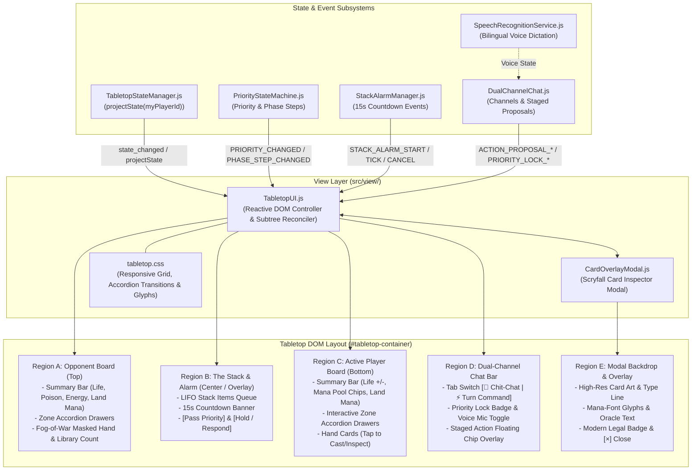
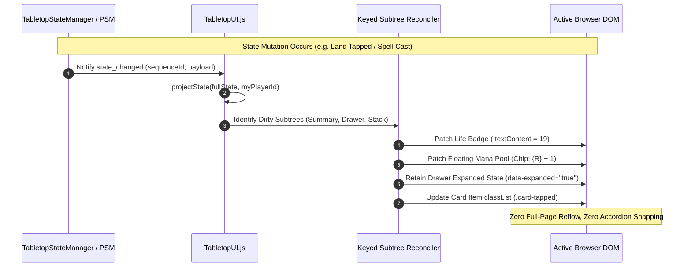
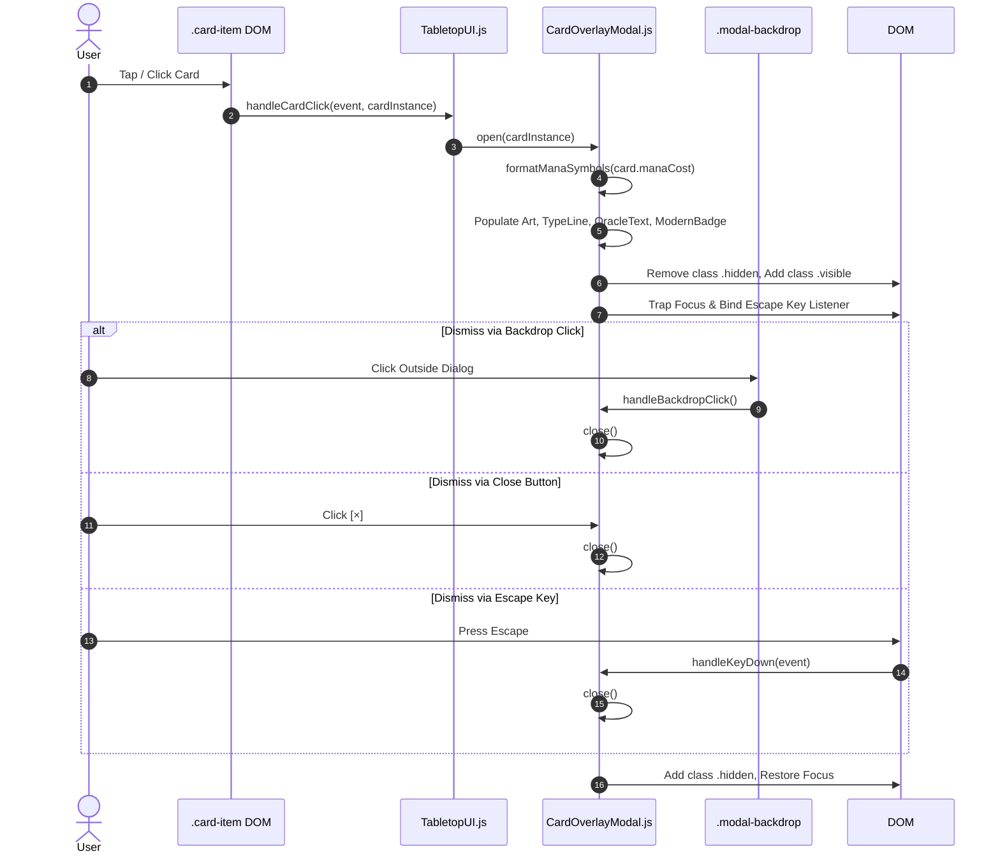
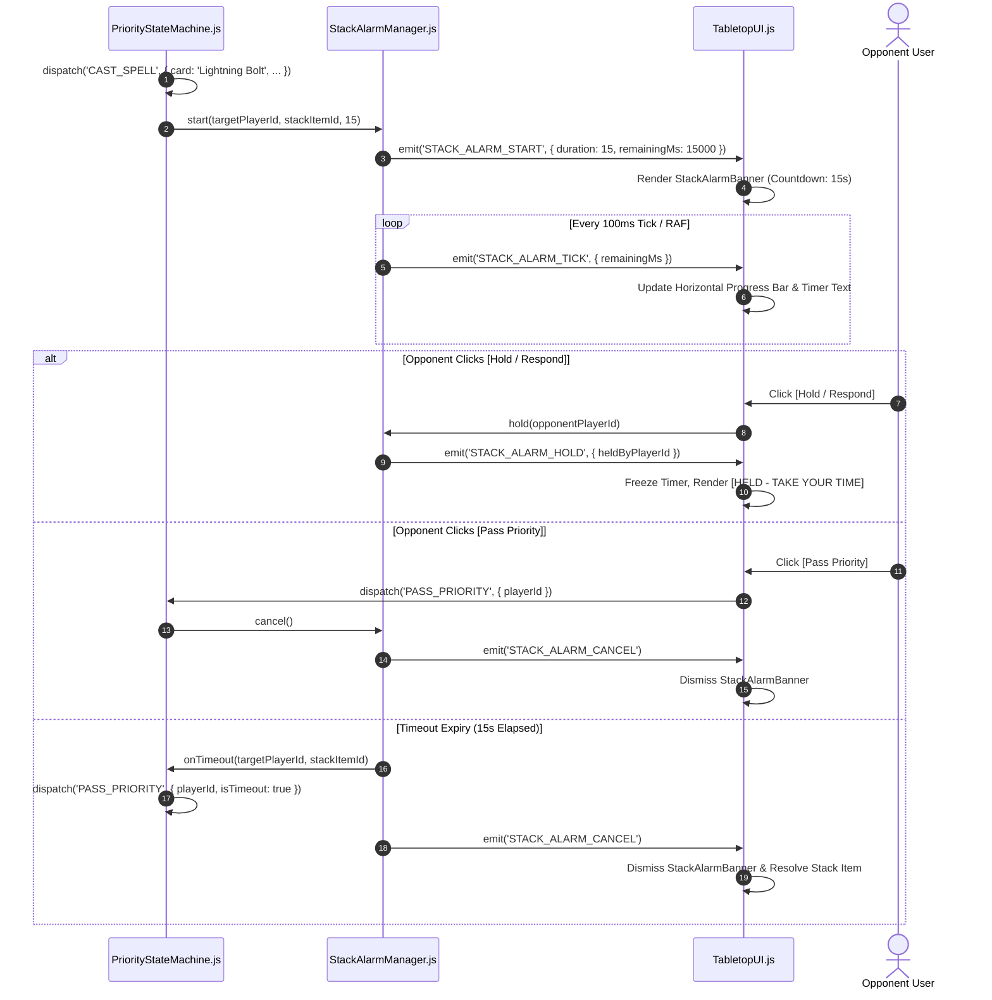

# Technical Specification: Minimalist Tap-to-Expand Accordion Tabletop UI & Scryfall Overlay Modal

- **Document ID:** `SPEC-RPM-UI-007`
- **Feature Scope:** Feature 7 (`TabletopUI.js`, `CardOverlayModal.js`, and `tabletop.css`)
- **System:** RPM Multiplayer / RPM Revival Modern Tabletop Arena
- **Architect:** Argon Specification Architect
- **Status:** APPROVED / READY FOR IMPLEMENTATION
- **Revision:** 1.0.0
- **Target File Path:** `specs/FEATURE_7_ACCORDION_UI_MODAL_SPEC.md`
- **Component Scope:**
  - `src/view/TabletopUI.js`
  - `src/view/CardOverlayModal.js`
  - `src/view/tabletop.css`
- **Related Specifications:**
  - `specs/FEATURE_1_2_CORE_INGESTION_SPEC.md` (`SPEC-RPM-INGEST-001`: Ingestion & Scryfall Hydration)
  - `specs/FEATURE_3_TABLETOP_ZONE_STATE_SPEC.md` (`SPEC-RPM-ZONE-003`: Tabletop Zone State Manager & Fog-of-War Projection)
  - `specs/FEATURE_4_STACK_PRIORITY_SPEC.md` (`SPEC-RPM-PRIORITY-004`: Stack & Priority Flow State Machine)
  - `specs/FEATURE_5_6_DUAL_CHAT_ACTION_BUS_SPEC.md` (`SPEC-RPM-CHAT-005`: Dual-Channel Priority Chat & Fast-Path Action Bus)

---

## 1. Executive Summary & Architectural Overview

Digital representations of Magic: The Gathering face a severe user experience dilemma, particularly on mobile viewports and compact desktop displays:
1. **Visual Clutter & Cognitive Overload**: An active MTG board frequently contains dozens of permanents across seven distinct zones (battlefield lands, creatures, noncreatures, planeswalkers, plus graveyard, library, hand, and exile). Traditional virtual card tabletops attempt to render every card as a full-size bitmap, resulting in a microscopic, illegible board where critical details (counters, mana costs, tapped states) are unreadable without cumbersome zooming.
2. **Fog-of-War Leaks**: In remote multiplayer sessions, naive client-side UI renderers often receive unmasked data models or leak hidden opponent cards through DOM inspection or layout hints. The presentation layer must guarantee strict adherence to Fog-of-War boundaries projected by `TabletopStateManager.projectState()`.
3. **Priority & Timing Obscurity**: MTG rules (CR 117) demand clear awareness of who holds priority, whether the stack is resolving, and whether a player must respond within a time window. Disjointed chat interfaces and subtle highlight rings cause missed responses and state desynchronization.
4. **Card Inspection Friction**: In high-velocity formats like Modern, reading complex card text, verifying mana costs, and checking power/toughness or format legality must be instantaneous, legible, and frictionless without losing tabletop spatial context.

Feature 7 delivers the **Minimalist Tap-to-Expand Accordion Tabletop UI & Scryfall Overlay Modal**:
- **Zero-Dependency Vanilla Reactive DOM Architecture**: Engineered with pure modern JavaScript (ES2022) and CSS Grid/Flexbox. Operates with zero external framework overhead (no React, Vue, or Svelte runtime overhead), achieving sub-16ms (60 FPS) rendering latency and minimal memory footprint.
- **Accordion Tap-to-Expand Drawer Model**: Zones are organized into high-density summary badges displaying live counts (e.g., `[Creatures: 3]`, `[Hand: 4]`, `[Graveyard: 6]`). Tapping any badge smoothly expands an accordion drawer revealing the full interactive card items, while preserving drawer toggle state across state updates.
- **Embedded Vector Mana Glyphs (`mana-font`)**: Direct integration with standard `mana-font` vector typography (`andrewgioia/mana`), replacing heavy graphic assets with clean scalable CSS icons for mana costs (`<i class="ms ms-w"></i>`, `<i class="ms ms-2"></i>`), tap indicators (`<i class="ms ms-tap"></i>`), and energy symbols (`<i class="ms ms-e"></i>`).
- **Interactive Stack & 15-Second Alarm Banner**: A dedicated center-stage visual stack queue rendered in strict LIFO order, seamlessly coupling with `StackAlarmManager` to display an animated 15-second radial/horizontal countdown bar, retro 8-bit visual cues, and interactive `[Pass Priority]` and `[Hold / Respond]` buttons.
- **Dual-Channel Priority Chat Bar & Staged Action Chips**: Direct UI integration with `DualChannelChat.js`. Provides fluid tab switching between `[💬 Chit-Chat]` and `[⚡ Turn Command]`, priority lock badges (`🔒 Locked` vs glowing unlocked active state), speech-to-text mic buttons with language toggles (`[ 🇪🇸 ES | 🇺🇸 EN ]`), and floating 1-tap confirmation chips.
- **High-Resolution Scryfall Card Overlay Modal (`CardOverlayModal.js`)**: A tap on any card in any zone triggers a high-definition card inspector modal displaying card art, mana glyphs, formatted type lines, oracle rules text, power/toughness/loyalty, and Modern legality badges.

---

### 1.1 Architectural Topology



---

## 2. Layout Regions & View Hierarchy Wireframes

The UI utilizes a mobile-responsive viewport architecture, adapting dynamically between portrait mobile displays (375px–767px) and desktop widescreen monitors (768px–1920px+).

### 2.1 Complete Tabletop Layout Hierarchy

```
#tabletop-container.tabletop-root
├── #opponent-board.tabletop-board.board-opponent
│   ├── .board-summary-bar
│   │   ├── .player-badge (Avatar, Name, Active Indicator)
│   │   ├── .life-badge (Life Total: 20)
│   │   ├── .counter-badges (Poison: 0, Energy: 0)
│   │   └── .land-mana-bar (e.g., <i class="ms ms-r"></i> x2, <i class="ms ms-b"></i> x1)
│   └── .zone-drawers-container
│       ├── .zone-drawer[data-zone="creatures"]
│       ├── .zone-drawer[data-zone="noncreatures"]
│       ├── .zone-drawer[data-zone="planeswalkers"]
│       ├── .zone-drawer[data-zone="graveyard"]
│       ├── .zone-drawer[data-zone="library"] (Masked: Count Only)
│       ├── .zone-drawer[data-zone="hand"] (Fog-of-War Masked: Tokens)
│       └── .zone-drawer[data-zone="exile"]
├── #stack-region.tabletop-stack-container
│   ├── .stack-alarm-banner (Visible when Alarm Running / Held)
│   │   ├── .alarm-timer-bar (Radial / Horizontal Progress Bar)
│   │   ├── .alarm-label ("⚡ RESPOND TO: Lightning Bolt (15s)")
│   │   └── .alarm-action-buttons ([Pass Priority] [Hold / Respond])
│   └── .stack-queue-list (LIFO ordered cards: Top of Stack = Most Recent)
├── #player-board.tabletop-board.board-player
│   ├── .board-summary-bar
│   │   ├── .player-badge (Avatar, Name, Priority Holder Glow)
│   │   ├── .life-controller ([-] 20 [+])
│   │   ├── .counter-badges (Poison: 0, Energy: 0)
│   │   ├── .floating-mana-pool ({W:0} {U:0} {B:0} {R:1} {G:0} {C:0})
│   │   └── .land-mana-bar (<i class="ms ms-u"></i> x2, <i class="ms ms-r"></i> x1)
│   └── .zone-drawers-container
│       ├── .zone-drawer[data-zone="hand"] (Open by default; Tap to Cast/Inspect)
│       ├── .zone-drawer[data-zone="creatures"]
│       ├── .zone-drawer[data-zone="noncreatures"]
│       ├── .zone-drawer[data-zone="planeswalkers"]
│       ├── .zone-drawer[data-zone="graveyard"]
│       ├── .zone-drawer[data-zone="library"]
│       └── .zone-drawer[data-zone="exile"]
├── #dual-chat-bar.tabletop-chat-bar
│   ├── .chat-header-tabs
│   │   ├── button.tab-btn.tab-chitchat ("💬 Chit-Chat")
│   │   └── button.tab-btn.tab-turncmd ("⚡ Turn Command")
│   ├── .staged-chip-overlay (Floating Action Confirmation Chip)
│   │   └── .staged-chip ("Confirm: Cast Lightning Bolt ({R}) on Ragavan? [Confirm] [Edit] [Cancel]")
│   ├── .chat-input-row
│   │   ├── .priority-lock-badge (🔒 Locked vs 🟢 Priority Held)
│   │   ├── input.chat-input-field
│   │   ├── button.mic-dictation-btn ("🎤 [ 🇪🇸 ES | 🇺🇸 EN ]")
│   │   └── button.send-btn ("Send")
└── #card-overlay-modal.modal-backdrop.hidden
    └── .modal-card-dialog
        ├── button.modal-close-btn ("×")
        ├── .modal-card-art (High-Res )
        ├── .modal-card-header (Name + Mana Font Glyphs)
        ├── .modal-card-typeline (Type Line)
        ├── .modal-card-oracle (Formatted Rules Text)
        ├── .modal-card-stats (P/T: 2/1 or Loyalty: 4)
        └── .modal-card-badge (.badge-modern-legal: "Modern Legal")
```

---

### 2.2 Desktop Wireframe (1920 × 1080 Viewport)

```
+------------------------------------------------------------------------------------------------------------------+
|  OPPONENT: OpponentPlayer  [❤️ 18 HP]  [☣️ 0 Poison]  [⚡ 2 Energy]  |  LANDS: (R) x2  (B) x1  (U) x1              |
+------------------------------------------------------------------------------------------------------------------+
|  [Creatures: 2 ▼]   [Noncreatures: 1 ▶]   [PW: 0 ▶]   [Graveyard: 4 ▶]   [Library: 48 ▶]   [Hand: 4 ▶]  [Exile: 1 ▶] |
|  +------------------------------------------------------------------------------------------------------------+  |
|  | * Dragon's Rage Channeler (1/1, Tapped)     * Ragavan, Nimble Pilferer (2/1, Untapped)                     |  |
|  +------------------------------------------------------------------------------------------------------------+  |
+==================================================================================================================+
|                                              THE STACK (2 Items)                                                 |
|  +------------------------------------------------------------------------------------------------------------+  |
|  | [15s ALARM: 00:11 remaining]  Target: You  |  [PASS PRIORITY (Space)]      [HOLD / RESPOND (H)]             |  |
|  | ===================================== [PROGRESS BAR: 73%] ================================================ |  |
|  |  [LIFO #2 Top] Lightning Bolt ({R}) -> Target: Ragavan, Nimble Pilferer (Cast by ActivePlayer)             |  |
|  |  [LIFO #1]     Counterspell ({U}{U}) -> Target: Lightning Bolt (Cast by OpponentPlayer)                     |  |
|  +------------------------------------------------------------------------------------------------------------+  |
+==================================================================================================================+
|  YOU: ActivePlayer (PRIORITY HELD) [❤️ 20 HP (+ / -)]  [☣️ 0]  [⚡ 0]  |  POOL: {R}: 1 | LANDS: (U) x2  (R) x2      |
+------------------------------------------------------------------------------------------------------------------+
|  [Hand: 3 ▼]   [Creatures: 1 ▶]   [Noncreatures: 0 ▶]   [PW: 1 ▶]   [Graveyard: 2 ▶]   [Library: 49 ▶]  [Exile: 0 ▶] |
|  +------------------------------------------------------------------------------------------------------------+  |
|  | [Unholy Heat ({R}) Instant]        [Mishra's Bauble ({0}) Artifact]        [Scalding Tarn Land]             |  |
|  +------------------------------------------------------------------------------------------------------------+  |
+------------------------------------------------------------------------------------------------------------------+
|  [ 💬 Chit-Chat ]  | [ ⚡ Turn Command (ACTIVE) ]                                                                 |
|  +------------------------------------------------------------------------------------------------------------+  |
|  | STAGED ACTION: Cast Unholy Heat ({R}) targeting Dragon's Rage Channeler?   [CONFIRM]  [EDIT]  [CANCEL]     |  |
|  +------------------------------------------------------------------------------------------------------------+  |
|  [ 🟢 Priority Held ]  [ Type command or shorthand (e.g. "bolt ragavan", "pass")... ]  [ 🎤 ES | EN ]  [ SEND ] |
+------------------------------------------------------------------------------------------------------------------+
```

---

### 2.3 Mobile Portrait Wireframe (375 × 667 Viewport)

```
+---------------------------------------+
| OPPONENT: Opponent [❤️ 18] [Lands: (R)x2]|
| [C: 2 ▼] [NC: 1] [GY: 4] [Hand: 4 🂠]  |
|  ┌──────────────────────────────────┐ |
|  │ * DRC (1/1 [T])  * Ragavan (2/1) │ |
|  └──────────────────────────────────┘ |
+---------------------------------------+
|               THE STACK               |
| ┌───────────────────────────────────┐ |
| │ ⚠️ 11s [==========      ] [HOLD]  │ |
| │ #2: Lightning Bolt ({R})          │ |
| │ #1: Counterspell ({U}{U})         │ |
| └───────────────────────────────────┘ |
+---------------------------------------+
| YOU [❤️ 20] [-][+] [Pool: {R}:1]       |
| [Hand: 3 ▼] [C: 1] [NC: 0] [GY: 2]    |
|  ┌──────────────────────────────────┐ |
|  │ * Unholy Heat ({R}) [Cast] [Eye] │ |
|  │ * Mishra's Bauble ({0})          │ |
|  │ * Scalding Tarn                  │ |
|  └──────────────────────────────────┘ |
+---------------------------------------+
| [💬 Chit-Chat] | [⚡ Turn Command (Active)]|
| ┌───────────────────────────────────┐ |
| │ [Confirm: Cast Bolt on Ragavan?]  │ |
| │ [ ✅ Confirm ] [ ✏️ Edit ] [ ❌ ]   │ |
| └───────────────────────────────────┘ |
| [🟢] [ Type command...     ] [🎤] [▶] |
+---------------------------------------+
```

---

## 3. UI Component Specifications

### 3.1 Region A: Opponent Board Section (Top)

#### 3.1.1 Opponent Summary Bar
- **Player Identity**: Displays avatar glyph, `playerName`, and active turn marker.
- **Resource Counters**:
  - Life Total: Plain text or badge display (`❤️ 18`). Read-only for opponent.
  - Poison Counters: Rendered when `poison > 0` (`<i class="ms ms-poison"></i> ${poison}`).
  - Energy Counters: Rendered when `energy > 0` (`<i class="ms ms-e"></i> ${energy}`).
- **Land Mana Bar**:
  - Dynamically computes available untapped mana from opponent battlefield lands (`battlefield.lands`).
  - Aggregates by mana color produced and counts, e.g.:
    `<span class="mana-pip-group"><i class="ms ms-r"></i> x2</span><span class="mana-pip-group"><i class="ms ms-u"></i> x1</span>`.
  - Tapped lands are rendered with a dimmed opacity (50%) and tap symbol `<i class="ms ms-tap"></i>`.

#### 3.1.2 Zone Drawer Badges (Tap-to-Expand Accordion)
- Badges displayed in horizontal scrollable drawer container:
  - `[Creatures: N]`
  - `[Noncreatures: N]`
  - `[Planeswalkers: N]`
  - `[Graveyard: N]`
  - `[Library: N]`
  - `[Hand: N]`
  - `[Exile: N]`
- **Accordion Toggle Behavior**:
  - Only one drawer or multiple drawers can be toggled via `allowMultipleDrawers` config (default: multiple allowed, mobile: single drawer auto-collapse to conserve screen height).
  - Tapping an active badge collapses the drawer; tapping an inactive badge expands it with a CSS transition (`max-height: 0` $\to$ `max-height: 400px`, `transition: max-height 0.25s ease-out`).
  - Drawer expansion state (`Map<string, boolean>`) is preserved across reactive state updates so drawer content does not snap shut during turn advances.

#### 3.1.3 Fog-of-War Enforcement Rules
1. **Opponent Hand**:
   - Evaluated against `projectState.players[opponentId].hand`.
   - If `isRevealed === false`:
     - Displays badge `[Hand: N]`.
     - When expanded, renders exactly $N$ masked face-down card tokens:
       `<div class="card-item card-facedown" data-masked="true"><span class="card-back-pattern">🂠</span></div>`.
     - Private details (`name`, `manaCost`, `oracleText`, `imageUri`) are strictly absent from the DOM; no inspection modal can be opened.
   - If `isRevealed === true`:
     - Hand badge shows `[Hand: N (Revealed)]`.
     - Renders full card names and mana glyphs; cards are inspectable via `CardOverlayModal`.
2. **Opponent Library**:
   - `projectState.players[opponentId].library` provides `{ count: N }`.
   - Badge shows `[Library: N]`.
   - Expanding the library drawer displays only the card count and a standard MTG card back deck icon. Individual cards are hidden and cannot be browsed.
3. **Opponent Public Zones** (Creatures, Noncreatures, Planeswalkers, Graveyard, Exile):
   - Fully public. Card names, mana costs, tapped states, power/toughness, and counters are rendered.
   - Face-down exiled cards (`isFaceDown === true`) are masked as face-down tokens unless owned by viewer.

---

### 3.2 Region B: The Stack & 15-Second Alarm Banner (Center / Overlay)

#### 3.2.1 The Stack Queue
- Subscribes to `projectState.stack` and `PriorityStateMachine.stack`.
- Stack items are rendered in strict **LIFO (Last-In, First-Out)** order:
  - The top item (index `stack.length - 1`) is rendered first at the top of the stack container with prominent styling (`.stack-item-top`).
  - Older items underneath are cascaded with increasing indentation or reverse vertical stacking.
- Each stack card item displays:
  - Sequence index (`#2`, `#1`).
  - Spell/Ability Name and Mana Cost glyphs (`Lightning Bolt <i class="ms ms-r"></i>`).
  - Source Controller (`Cast by OpponentPlayer`).
  - Declared Targets (`Target: Ragavan, Nimble Pilferer`).
  - Tap-to-Inspect trigger opening `CardOverlayModal`.

#### 3.2.2 15-Second Alarm Banner (`StackAlarmManager` Integration)
- Listens to `StackAlarmManager` events forwarded via `PriorityStateMachine`:
  - `STACK_ALARM_START`: Mounts or makes visible the banner.
  - `STACK_ALARM_TICK` (or high-resolution `requestAnimationFrame` interpolation): Updates countdown indicator.
  - `STACK_ALARM_HOLD`: Pauses animation, switches state to `HELD` with an amber warning badge.
  - `STACK_ALARM_CANCEL` / `STACK_ALARM_TIMEOUT`: Dismisses the banner.
- **Visual Presentation**:
  - **Countdown Timer**: Displays remaining seconds and tenths (`11.4s`).
  - **Progress Bar**: Horizontal filling bar (or radial progress ring on mobile) transitioning from Green ($>7s$) $\to$ Amber ($3s–7s$) $\to$ Flashing Red ($<3s$).
  - **8-Bit Retro Visual Cue**: Uses a pixelated retro aesthetic font or badge (`font-family: 'Press Start 2P', monospace`), subtle CRT scanline effect, and an audible 8-bit pip at $3s, 2s, 1s$ (optional Web Audio API synth pip, toggleable).
- **Interactive Action Triggers**:
  - `[Pass Priority]` Button: Dispatches `PASS_PRIORITY` to `PriorityStateMachine`. Keyboard shortcut: `Space` or `P`.
  - `[Hold / Respond]` Button: Dispatches `HOLD_RESPOND` (`alarmManager.hold(myPlayerId)`). Timer stops, transitions banner to `[HELD BY YOU]`, freeing the player from the 15-second countdown to formulate a complex turn response. Keyboard shortcut: `H`.

---

### 3.3 Region C: Active Player Board Section (Bottom)

#### 3.3.1 Player Summary Bar
- **Player Identity**: Avatar, `playerName`, and dynamic priority halo:
  - When `priorityPlayerId === myPlayerId`: Green/Gold animated pulse ring (`box-shadow: 0 0 12px rgba(46, 204, 113, 0.8)`).
  - When `priorityPlayerId !== myPlayerId`: Neutral slate border.
- **Interactive Life Counter**:
  - Displays current life total (`20`).
  - Interactive increment/decrement buttons: `[-]` and `[+]`.
  - Direct dispatch: Invokes `TabletopStateManager.mutatePlayerLife(myPlayerId, delta)`.
- **Counters**:
  - Poison (`<i class="ms ms-poison"></i>`), Energy (`<i class="ms ms-e"></i>`).
- **Floating Mana Pool Chips**:
  - Displays active floating mana from `resources.manaPool`: `{W, U, B, R, G, C}`.
  - Only chips with count $>0$ are highlighted with their respective mana-font glyph and badge count (e.g., `<span class="mana-chip mana-r"><i class="ms ms-r"></i> 1</span>`).
- **Land Mana Bar**:
  - Renders all untapped lands controlled by player, grouped by color output.
  - Tapping a land triggers instant tap for mana: dispatches `TAP_PERMANENT` $\to$ adds floating mana to pool.

#### 3.3.2 Player Zone Drawers
- **Hand Drawer**:
  - By default, hand is **expanded** in active player view.
  - Each hand card displays:
    - Card Name.
    - Mana Cost rendered as vector glyphs (`<i class="ms ms-r"></i><i class="ms ms-1"></i>`).
    - Type Line shorthand (`Instant`, `Creature`).
    - Quick Action Buttons:
      - `[Cast / Play]`: Generates a staged command proposal or directly stages card cast.
      - `[Inspect / 👁️]`: Opens `CardOverlayModal`.
- **Battlefield Drawers**:
  - `[Creatures: N]`: Displays card name, power/toughness (`2/1`), counters (`+1/+1: 2`), tapped state (`Tapped` rotated 90° or grayed with tap icon).
  - `[Noncreatures: N]`: Artifacts, Enchantments, Battles.
  - `[Planeswalkers: N]`: Loyalty counter badge (`[Loyalty: 4]`), loyalty +/- ability triggers.
- **Graveyard & Exile Drawers**:
  - Full card lists with inspect triggers.
- **Library Drawer**:
  - Displays total count (`49`). Shows `[Draw Card]` quick button.

---

### 3.4 Region D: Dual-Channel Priority Chat Bar

Direct reactive integration with `DualChannelChat.js`:

#### 3.4.1 Channel Tabs
- Two distinct tab buttons:
  - `[ 💬 Chit-Chat ]`: Always open. Switches chat feed to conversational banter. Messages submitted here are unparsed, free of token costs, and cannot mutate game state.
  - `[ ⚡ Turn Command ]`: Priority-gated channel. Evaluates commands through fast-path `ActionLexer.js`.

#### 3.4.2 Priority Indicator & Lock Badge
- Monitored via `DualChannelChat.isInputLocked()` and `PRIORITY_LOCK_CHANGED` event:
  - **When Locked** (`isInputLocked() === true`):
    - Red lock badge is visible: `<span class="lock-badge locked">🔒 Opponent Priority</span>`.
    - Input textarea is disabled (`disabled="true"`) with placeholder *"Waiting for opponent priority..."*.
    - Visual shake animation on click or keystroke attempt.
  - **When Unlocked** (`isInputLocked() === false`):
    - Green priority badge: `<span class="lock-badge unlocked">🟢 Priority Held</span>`.
    - Input field is enabled with vibrant focus ring.

#### 3.4.3 Speech Recognition Integration
- Microphone button:
  - Tapping toggles `SpeechRecognitionService` recording.
  - Pulsing red recording dot when active.
  - Language toggle chip: `[ 🇪🇸 ES | 🇺🇸 EN ]` toggles speech recognition language between Spanish (`es-ES`) and English (`en-US`).

#### 3.4.4 Staged Action Confirmation Chip Overlay
- Subscribes to `DualChannelChat` events `ACTION_PROPOSAL_GENERATED`, `ACTION_PROPOSAL_CONFIRMED`, `ACTION_PROPOSAL_CANCELLED`:
  - When an action is lexed (e.g., *"bolt ragavan"*), an interactive confirmation chip floats above the chat input bar:
    ```html
    <div class="staged-action-chip">
      <div class="chip-label">
        <span class="chip-action-type">CAST_SPELL</span>
        <span class="chip-description">Cast <strong>Lightning Bolt</strong> (<i class="ms ms-r"></i>) targeting <strong>Ragavan</strong>?</span>
      </div>
      <div class="chip-actions">
        <button class="chip-btn btn-confirm" data-action="confirm">Confirm</button>
        <button class="chip-btn btn-edit" data-action="edit">Edit</button>
        <button class="chip-btn btn-cancel" data-action="cancel">Cancel</button>
      </div>
    </div>
    ```
  - **Confirm**: Calls `DualChannelChat.confirmProposal(proposalId)`. Mutation executes; chip dissolves.
  - **Edit**: Calls `DualChannelChat.editProposal(proposalId)`. Populates input field with raw text for manual modification.
  - **Cancel**: Calls `DualChannelChat.cancelProposal(proposalId)`. Dismisses chip with zero state mutation.

#### 3.4.5 1-Tap Ambiguity Fallback Modal
- When `ACTION_PROPOSAL_AMBIGUITY` is received from `DualChannelChat`:
  - Renders a floating chip shelf of candidate cards from the player's hand:
    `[Ambiguous removal: Which card?] -> [Fatal Push] [Unholy Heat] [Cancel]`.
  - Tapping a candidate calls `DualChannelChat.resolveAmbiguity(proposalId, candidateId)`.

---

### 3.5 Region E: Scryfall Card Overlay Modal (`CardOverlayModal.js`)

High-resolution inspection modal for examining any visible card entity across all zones.

#### 3.5.1 Modal DOM Structure
```html
<div id="card-overlay-modal" class="modal-backdrop" role="dialog" aria-modal="true" aria-labelledby="modal-card-name">
  <div class="modal-card-dialog">
    <button class="modal-close-btn" aria-label="Close modal">&times;</button>
    <div class="modal-card-layout">
      <!-- High-Res Card Image Column -->
      <div class="modal-image-col">
        <div class="modal-image-wrapper">
          
          <div class="modal-image-spinner hidden"></div>
        </div>
      </div>
      <!-- Card Data Column -->
      <div class="modal-details-col">
        <div class="modal-header-row">
          <h2 id="modal-card-name" class="modal-card-name">Lightning Bolt</h2>
          <div class="modal-mana-cost"><i class="ms ms-r ms-cost"></i></div>
        </div>
        <div class="modal-typeline">Instant</div>
        <hr class="modal-divider" />
        <div class="modal-oracle-text">Lightning Bolt deals 3 damage to any target.</div>
        <div class="modal-stats-row">
          <!-- Rendered if Creature / Planeswalker -->
          <div class="modal-pt-loyalty">3 / 2</div>
        </div>
        <div class="modal-footer-row">
          <span class="modal-badge badge-modern-legal">Modern Legal</span>
          <span class="modal-set-info">2X2 · #117 · Common</span>
        </div>
      </div>
    </div>
  </div>
</div>
```

#### 3.5.2 Vector Mana Font Symbol Parsing
The modal includes an internal string parser `formatManaSymbols(costString)` that transforms Scryfall mana notations into `mana-font` HTML:
- `{W}` $\to$ `<i class="ms ms-w ms-cost"></i>`
- `{U}` $\to$ `<i class="ms ms-u ms-cost"></i>`
- `{B}` $\to$ `<i class="ms ms-b ms-cost"></i>`
- `{R}` $\to$ `<i class="ms ms-r ms-cost"></i>`
- `{G}` $\to$ `<i class="ms ms-g ms-cost"></i>`
- `{C}` $\to$ `<i class="ms ms-c ms-cost"></i>`
- `{1}` $\to$ `<i class="ms ms-1 ms-cost"></i>`
- `{X}` $\to$ `<i class="ms ms-x ms-cost"></i>`
- `{T}` $\to$ `<i class="ms ms-tap ms-cost"></i>`
- `{U/R}` $\to$ `<i class="ms ms-ur ms-cost"></i>`
- `{2/W}` $\to$ `<i class="ms ms-2w ms-cost"></i>`

#### 3.5.3 Dismissal Mechanics
The modal must dismiss cleanly under any of three user triggers:
1. **Backdrop Tap**: Tapping anywhere on `.modal-backdrop` outside `.modal-card-dialog`.
2. **Close Button**: Tapping `.modal-close-btn` (`[×]`).
3. **Escape Key**: Pressing `Escape` on the physical keyboard. Focus is restored to the initiating card element for accessibility.

---

## 4. TypeScript DOM Schemas & Data Interfaces

```typescript
/**
 * SPEC-RPM-UI-007 DOM Schemas and Interface Definitions
 */

export type ZoneName =
  | 'hand'
  | 'battlefield'
  | 'graveyard'
  | 'library'
  | 'exile'
  | 'stack';

export type BattlefieldSubzone =
  | 'lands'
  | 'creatures'
  | 'noncreatures'
  | 'planeswalkers';

export interface TabletopUIOptions {
  container: HTMLElement | string;
  tabletopStateManager: any;      // TabletopStateManager instance
  priorityStateMachine: any;      // PriorityStateMachine instance
  dualChannelChat: any;           // DualChannelChat instance
  myPlayerId: string;             // Active viewer player ID (e.g., 'p1')
  opponentPlayerId?: string;      // Opponent player ID (e.g., 'p2')
  speechService?: any;            // SpeechRecognitionService instance
  allowMultipleDrawers?: boolean; // Default true
  enableSoundEffects?: boolean;   // 8-bit alarm sound cues (default false)
}

export interface CardOverlayModalOptions {
  container?: HTMLElement;
  onClose?: () => void;
}

export interface CardOverlayData {
  name: string;
  manaCost?: string;
  typeLine?: string;
  oracleText?: string;
  imageUri?: string;
  power?: string | number;
  toughness?: string | number;
  loyalty?: string | number;
  modernLegal?: boolean;
  set?: string;
  collectorNumber?: string;
}

export interface DrawerStateMap {
  [playerId: string]: {
    creatures?: boolean;
    noncreatures?: boolean;
    planeswalkers?: boolean;
    graveyard?: boolean;
    library?: boolean;
    hand?: boolean;
    exile?: boolean;
  };
}

export interface DOMSubtreeRefs {
  root: HTMLElement;
  opponentSummary: HTMLElement;
  opponentDrawers: HTMLElement;
  stackContainer: HTMLElement;
  stackAlarmBanner: HTMLElement;
  playerSummary: HTMLElement;
  playerDrawers: HTMLElement;
  chatBar: HTMLElement;
  chatInput: HTMLInputElement | HTMLTextAreaElement;
  priorityLockBadge: HTMLElement;
  stagedChipContainer: HTMLElement;
  modalContainer: HTMLElement;
}
```

---

## 5. Reactive State Subscription & DOM Reconciliation Architecture

To deliver 60 FPS performance without heavyweight frameworks, `TabletopUI.js` implements a **Keyed Subtree Reconciler**:
1. Rather than performing a destructive `innerHTML = ''` reload of the entire board on every event (which destroys focus, collapses open accordion drawers, and drops audio), `TabletopUI` registers targeted subscriptions to state managers:
   - `TabletopStateManager.subscribe(onTabletopStateChange)`
   - `PriorityStateMachine.subscribe(onPriorityStateChange)`
   - `PriorityStateMachine.alarmManager.onEmit(onAlarmEvent)`
   - `DualChannelChat.subscribe(onChatEvent)`
2. Updates isolate the specific DOM subtree requiring reconciliation:
   - `reconcilePlayerSummary(player)`: Updates life total, mana pool chips, and land counts via textContent/classList.
   - `reconcileDrawerBadges(player, zoneName)`: Updates badge count numbers without toggling drawer expanded state.
   - `reconcileDrawerContent(player, zoneName)`: Compares card `instanceId` keys in the drawer container. Only newly added, removed, or mutated cards (e.g. tapped state changed) have their DOM nodes updated.
   - `reconcileStack(stackArray)`: Diff-patches the stack queue.
   - `reconcilePriorityGating(isLocked)`: Updates lock badge, disables/enables input field, and toggles glow rings.



---

## 6. CSS Architecture & Responsive Styling Specifications (`tabletop.css`)

`src/view/tabletop.css` defines the visual foundation:

### 6.1 Design Tokens (CSS Variables)
```css
:root {
  /* Palette */
  --bg-tabletop: #0d1117;
  --bg-surface: #161b22;
  --bg-surface-elevated: #21262d;
  --bg-drawer: #1a1f26;
  --border-subtle: #30363d;
  --border-focus: #58a6ff;

  /* Priority & Status Colors */
  --color-priority-active: #2ea043;
  --color-priority-glow: rgba(46, 160, 67, 0.4);
  --color-locked: #da3633;
  --color-alarm-warning: #d29922;
  --color-alarm-danger: #f85149;

  /* Typography */
  --font-sans: -apple-system, BlinkMacSystemFont, "Segoe UI", Helvetica, Arial, sans-serif;
  --font-retro: "Press Start 2P", "Courier New", monospace;

  /* Sizing & Transitions */
  --radius-sm: 4px;
  --radius-md: 8px;
  --radius-lg: 12px;
  --transition-fast: 0.15s ease;
  --transition-normal: 0.25s ease-out;
  
  /* Z-Index Registry */
  --z-board: 10;
  --z-stack: 30;
  --z-alarm-banner: 40;
  --z-chat-bar: 50;
  --z-staged-chip: 60;
  --z-modal-backdrop: 1000;
  --z-modal-dialog: 1001;
}
```

### 6.2 Accordion Drawer CSS Specification
```css
.zone-drawer-body {
  max-height: 0;
  overflow: hidden;
  transition: max-height var(--transition-normal), opacity var(--transition-fast);
  opacity: 0;
}

.zone-drawer[data-expanded="true"] .zone-drawer-body {
  max-height: 420px;
  overflow-y: auto;
  opacity: 1;
}

.zone-drawer-badge {
  cursor: pointer;
  user-select: none;
  display: inline-flex;
  align-items: center;
  gap: 6px;
  padding: 6px 12px;
  background: var(--bg-surface-elevated);
  border: 1px solid var(--border-subtle);
  border-radius: var(--radius-sm);
  font-size: 0.85rem;
  font-weight: 600;
  transition: background var(--transition-fast), border-color var(--transition-fast);
}

.zone-drawer-badge:hover {
  background: #30363d;
}

.zone-drawer[data-expanded="true"] .zone-drawer-badge {
  border-color: var(--border-focus);
  background: #238636;
  color: #ffffff;
}
```

### 6.3 15-Second Alarm Banner CSS Specification
```css
.stack-alarm-banner {
  background: linear-gradient(180deg, #2b1d1d 0%, #1a0f0f 100%);
  border: 2px solid var(--color-alarm-danger);
  border-radius: var(--radius-md);
  padding: 10px 16px;
  box-shadow: 0 0 15px rgba(248, 81, 73, 0.4);
  animation: pulseAlarm 1.2s infinite alternate;
}

@keyframes pulseAlarm {
  0% { box-shadow: 0 0 8px rgba(248, 81, 73, 0.3); }
  100% { box-shadow: 0 0 20px rgba(248, 81, 73, 0.7); }
}

.alarm-progress-bar {
  height: 6px;
  background: #21262d;
  border-radius: 3px;
  overflow: hidden;
}

.alarm-progress-fill {
  height: 100%;
  width: 100%;
  background: var(--color-alarm-danger);
  transition: width 0.1s linear;
}
```

---

## 7. Interaction & Event Flow Sequences

### 7.1 Sequence 1: Card Tap $\to$ Scryfall Modal Open $\to$ Dismissal



---

### 7.2 Sequence 2: Spell Cast $\to$ 15-Second Stack Alarm $\to$ Pass / Hold



---

## 8. Comprehensive Acceptance Test Suite (12+ Test Cases)

The following test suite defines the automated test requirements for Feature 7. Tests can be executed using Node.js test runner, Vitest, or Jest with JSDOM.

```javascript
/**
 * TabletopUI.test.js - Formal Acceptance Test Suite for SPEC-RPM-UI-007
 */
import { describe, it, expect, beforeEach, vi } from 'vitest';
import { TabletopUI } from '../src/view/TabletopUI.js';
import { CardOverlayModal } from '../src/view/CardOverlayModal.js';
import { TabletopStateManager } from '../src/TabletopStateManager.js';
import { PriorityStateMachine } from '../src/PriorityStateMachine.js';
import { DualChannelChat } from '../src/DualChannelChat.js';

describe('Feature 7: Minimalist Tap-to-Expand Accordion UI & Scryfall Overlay Modal', () => {
  let container;
  let ttsm;
  let psm;
  let chat;
  let ui;

  beforeEach(() => {
    document.body.innerHTML = '<div id="tabletop-root"></div>';
    container = document.getElementById('tabletop-root');

    ttsm = new TabletopStateManager({
      sessionId: 'test_session',
      players: ['p1', 'p2']
    });

    psm = new PriorityStateMachine({
      sessionId: 'test_session',
      players: ['p1', 'p2'],
      activePlayerId: 'p1',
      priorityPlayerId: 'p1'
    });

    chat = new DualChannelChat({
      sessionId: 'test_session',
      myPlayerId: 'p1',
      priorityStateMachine: psm,
      tabletopStateManager: ttsm
    });

    ui = new TabletopUI({
      container,
      tabletopStateManager: ttsm,
      priorityStateMachine: psm,
      dualChannelChat: chat,
      myPlayerId: 'p1',
      opponentPlayerId: 'p2'
    });
  });

  // TEST 1: Summary Bar Rendering
  it('TEST-UI-001: Renders Opponent and Player Summary Bars with Life, Counters, and Land Mana', () => {
    ttsm.setPlayerLife('p1', 17);
    ttsm.setPlayerLife('p2', 14);

    ui.render();

    const playerLifeEl = container.querySelector('#player-board .life-badge');
    const opponentLifeEl = container.querySelector('#opponent-board .life-badge');

    expect(playerLifeEl.textContent).toContain('17');
    expect(opponentLifeEl.textContent).toContain('14');

    // Land mana bar renders
    const playerManaBar = container.querySelector('#player-board .land-mana-bar');
    expect(playerManaBar).not.toBeNull();
  });

  // TEST 2: Accordion Expand / Collapse Transitions
  it('TEST-UI-002: Toggling zone drawer badges expands and collapses accordion content', () => {
    ui.render();

    const creaturesDrawer = container.querySelector('#player-board .zone-drawer[data-zone="creatures"]');
    const creaturesBadge = creaturesDrawer.querySelector('.zone-drawer-badge');

    // Initially collapsed
    expect(creaturesDrawer.getAttribute('data-expanded')).toBe('false');

    // Tap badge to expand
    creaturesBadge.click();
    expect(creaturesDrawer.getAttribute('data-expanded')).toBe('true');

    // Tap badge again to collapse
    creaturesBadge.click();
    expect(creaturesDrawer.getAttribute('data-expanded')).toBe('false');
  });

  // TEST 3: Fog-of-War Masking in Opponent Hand
  it('TEST-UI-003: Masks cards in opponent hand when unrevealed; renders face-down tokens with zero leaked card data', () => {
    // Give opponent 3 cards
    ttsm.addCardToZone('p2', 'hand', { name: 'Lightning Bolt', manaCost: '{R}' });
    ttsm.addCardToZone('p2', 'hand', { name: 'Counterspell', manaCost: '{U}{U}' });
    ttsm.addCardToZone('p2', 'hand', { name: 'Ragavan', manaCost: '{R}' });

    ui.render();

    const oppHandDrawer = container.querySelector('#opponent-board .zone-drawer[data-zone="hand"]');
    const oppHandBadge = oppHandDrawer.querySelector('.zone-drawer-badge');
    expect(oppHandBadge.textContent).toContain('3');

    // Expand hand drawer
    oppHandBadge.click();

    const maskedCards = oppHandDrawer.querySelectorAll('.card-facedown');
    expect(maskedCards.length).toBe(3);

    // Verify private text does NOT leak into DOM
    expect(oppHandDrawer.innerHTML).not.toContain('Lightning Bolt');
    expect(oppHandDrawer.innerHTML).not.toContain('Counterspell');
    expect(oppHandDrawer.innerHTML).not.toContain('Ragavan');
  });

  // TEST 4: Opponent Library Count Concealment
  it('TEST-UI-004: Opponent library renders card count only; conceals card identities and ordering', () => {
    for (let i = 0; i < 45; i++) {
      ttsm.addCardToZone('p2', 'library', { name: `SecretCard_${i}` });
    }

    ui.render();

    const libDrawer = container.querySelector('#opponent-board .zone-drawer[data-zone="library"]');
    const libBadge = libDrawer.querySelector('.zone-drawer-badge');
    expect(libBadge.textContent).toContain('45');

    libBadge.click();
    expect(libDrawer.innerHTML).not.toContain('SecretCard_0');
    expect(libDrawer.querySelectorAll('.card-item').length).toBe(0);
    expect(libDrawer.querySelector('.deck-count-indicator').textContent).toContain('45');
  });

  // TEST 5: Active Player Hand Rendering & Mana Font Glyphs
  it('TEST-UI-005: Renders active player hand with full card names and vector mana-font icons', () => {
    ttsm.addCardToZone('p1', 'hand', {
      name: 'Fatal Push',
      manaCost: '{B}',
      typeLine: 'Instant'
    });

    ui.render();

    const handDrawer = container.querySelector('#player-board .zone-drawer[data-zone="hand"]');
    expect(handDrawer.textContent).toContain('Fatal Push');
    expect(handDrawer.querySelector('.ms.ms-b')).not.toBeNull();
  });

  // TEST 6: CardOverlayModal Mount & High-Res Inspection
  it('TEST-UI-006: Tapping an inspectable card opens CardOverlayModal with full details and Modern Legal badge', () => {
    const card = {
      name: 'Dragon\'s Rage Channeler',
      manaCost: '{R}',
      typeLine: 'Creature — Human Shaman',
      oracleText: 'Whenever you cast a noncreature spell, surveil 1.',
      power: 1,
      toughness: 1,
      modernLegal: true,
      imageUri: 'https://cards.scryfall.io/large/front/d/r/drc.jpg'
    };

    ttsm.addCardToZone('p1', 'battlefield', card);
    ui.render();

    const cardElement = container.querySelector('#player-board .card-item');
    cardElement.click();

    const modal = document.querySelector('#card-overlay-modal');
    expect(modal.classList.contains('visible')).toBe(true);
    expect(modal.querySelector('.modal-card-name').textContent).toBe('Dragon\'s Rage Channeler');
    expect(modal.querySelector('.modal-card-typeline').textContent).toBe('Creature — Human Shaman');
    expect(modal.querySelector('.badge-modern-legal')).not.toBeNull();
    expect(modal.querySelector('.modal-card-image').src).toBe('https://cards.scryfall.io/large/front/d/r/drc.jpg');
  });

  // TEST 7: CardOverlayModal Dismissal Mechanics
  it('TEST-UI-007: Dismisses CardOverlayModal via backdrop click, close button, and Escape key', () => {
    const modal = ui.cardModal;
    modal.open({ name: 'Lightning Bolt', manaCost: '{R}' });

    const modalEl = document.querySelector('#card-overlay-modal');
    expect(modalEl.classList.contains('visible')).toBe(true);

    // 1. Close button click
    modalEl.querySelector('.modal-close-btn').click();
    expect(modalEl.classList.contains('visible')).toBe(false);

    // Reopen & test Escape key
    modal.open({ name: 'Lightning Bolt' });
    document.dispatchEvent(new KeyboardEvent('keydown', { key: 'Escape' }));
    expect(modalEl.classList.contains('visible')).toBe(false);

    // Reopen & test Backdrop click
    modal.open({ name: 'Lightning Bolt' });
    modalEl.click();
    expect(modalEl.classList.contains('visible')).toBe(false);
  });

  // TEST 8: The Stack LIFO Order Rendering
  it('TEST-UI-008: Renders items on the stack in strict LIFO order (newest on top)', () => {
    psm.dispatch('CAST_SPELL', {
      playerId: 'p1',
      card: { name: 'Mishra\'s Bauble', manaCost: '{0}' }
    });
    psm.dispatch('CAST_SPELL', {
      playerId: 'p2',
      card: { name: 'Spell Pierce', manaCost: '{U}' }
    });

    ui.render();

    const stackItems = container.querySelectorAll('.stack-queue-list .stack-item');
    expect(stackItems.length).toBe(2);
    // LIFO Top item is Spell Pierce
    expect(stackItems[0].textContent).toContain('Spell Pierce');
    expect(stackItems[1].textContent).toContain('Mishra\'s Bauble');
  });

  // TEST 9: 15-Second Stack Alarm Banner & Action Triggers
  it('TEST-UI-009: Displays 15-second Stack Alarm banner with countdown progress and Pass/Hold triggers', () => {
    const alarmManager = psm.alarmManager;
    alarmManager.start('p1', 'stack_item_123', 15);

    ui.render();

    const banner = container.querySelector('.stack-alarm-banner');
    expect(banner).not.toBeNull();
    expect(banner.textContent).toContain('15');

    const passBtn = banner.querySelector('.btn-pass-priority');
    const holdBtn = banner.querySelector('.btn-hold-respond');

    expect(passBtn).not.toBeNull();
    expect(holdBtn).not.toBeNull();

    // Clicking Hold pauses alarm
    holdBtn.click();
    expect(alarmManager.status).toBe('HELD');
    expect(banner.textContent).toContain('HELD');
  });

  // TEST 10: Dual-Channel Chat Tab Switching
  it('TEST-UI-010: Switches between Chit-Chat and Turn Command tabs, isolating message feeds', () => {
    chat.sendChatMessage('CHIT_CHAT', 'Good luck have fun!');
    
    ui.render();

    const chitChatTab = container.querySelector('.tab-btn.tab-chitchat');
    const turnCmdTab = container.querySelector('.tab-btn.tab-turncmd');

    chitChatTab.click();
    expect(chitChatTab.classList.contains('active')).toBe(true);
    expect(container.querySelector('.chat-messages-container').textContent).toContain('Good luck have fun!');

    turnCmdTab.click();
    expect(turnCmdTab.classList.contains('active')).toBe(true);
    expect(container.querySelector('.chat-messages-container').textContent).not.toContain('Good luck have fun!');
  });

  // TEST 11: Priority Lock Indicator & Input Toggling
  it('TEST-UI-011: Displays red lock badge and disables Turn Command input when priority is not held', () => {
    // Set priority to opponent p2
    psm.priorityPlayerId = 'p2';
    chat.syncPriorityState('p2');

    ui.render();

    const lockBadge = container.querySelector('.priority-lock-badge');
    const inputField = container.querySelector('.chat-input-field');

    expect(lockBadge.classList.contains('locked')).toBe(true);
    expect(inputField.disabled).toBe(true);

    // Pass priority back to p1
    psm.priorityPlayerId = 'p1';
    chat.syncPriorityState('p1');

    expect(lockBadge.classList.contains('unlocked')).toBe(true);
    expect(inputField.disabled).toBe(false);
  });

  // TEST 12: Staged Action Confirmation Chip Lifecycle
  it('TEST-UI-012: Surfaces 1-tap confirmation chip on command submission; confirms and clears cleanly', () => {
    psm.priorityPlayerId = 'p1';
    chat.syncPriorityState('p1');

    // Submit shorthand command
    chat.submitTurnCommand('pass');

    ui.render();

    const stagedChip = container.querySelector('.staged-action-chip');
    expect(stagedChip).not.toBeNull();
    expect(stagedChip.textContent).toContain('PASS_PRIORITY');

    const confirmBtn = stagedChip.querySelector('.btn-confirm');
    confirmBtn.click();

    // Chip dissolves after confirmation
    expect(chat.getActiveProposal()).toBeNull();
    expect(container.querySelector('.staged-action-chip')).toBeNull();
  });
});
```

---

## 9. Security, Performance & Accessibility (a11y) Standards

### 9.1 Zero-Dependency Security Posture
- **XSS Prevention**: Never inject untrusted user strings via `innerHTML`. All dynamic card names, player names, and chat text must be populated via `element.textContent` or safe DOM text node factories.
- **Mana Glyphs Whitelist**: Only validated mana symbols (matching `^[wubrgcxyz0-9\/\-]+$`) are passed to class name interpolation for `mana-font`.
- **Zero `eval` / Sandboxed Event Binding**: DOM event listeners are attached strictly using `addEventListener`.

### 9.2 Rendering Performance (60 FPS / <16ms Frame Budget)
- **CSS Transitions**: Layout transformations (accordion expand, alarm fill bar) utilize hardware-accelerated GPU properties (`max-height`, `opacity`, `transform: translate3d(0, 0, 0)`, `will-change: transform`).
- **Subtree Reconciliation**: State mutations do not trigger global re-renders. Only the targeted player bar, drawer, or stack container is updated.
- **Image Preloading**: Scryfall card imagery is loaded with lazy decoding for cards inside collapsed drawers, and eager loading for cards opened inside `CardOverlayModal`.

### 9.3 Accessibility (a11y)
- **ARIA Disclosure Pattern**: Accordion drawer badges implement `role="button"`, `aria-expanded="true|false"`, and `aria-controls="[drawer-id]"`.
- **Modal Dialog Semantics**: `CardOverlayModal` implements `role="dialog"`, `aria-modal="true"`, `aria-labelledby="modal-card-name"`, keyboard focus trapping, and restoration on close.
- **Screen Reader Announcements**: The 15-second Stack Alarm implements `aria-live="polite"` with updates debounced to 5-second intervals.

---

## 10. Implementation Plan & File Manifest

| File Path | Primary Responsibility | Key Exports / Classes |
| :--- | :--- | :--- |
| `src/view/TabletopUI.js` | Main DOM reactive controller, subtree reconciler, event bindings, drawer state manager. | `TabletopUI` |
| `src/view/CardOverlayModal.js` | High-res Scryfall card preview modal, vector glyph parser, focus trap, dismissal. | `CardOverlayModal`, `formatManaSymbols` |
| `src/view/tabletop.css` | Mobile-first CSS Grid/Flexbox styling, accordion transitions, retro 8-bit alarm styling, mana-font layout. | CSS Stylesheet |
| `tests/TabletopUI.test.js` | 12+ acceptance automated test cases validating full SPEC-RPM-UI-007 specifications. | Test Suite |

---

## 11. Architectural Sign-Off

- **Architect:** Argon Specification Architect
- **Approval Date:** 2026-10-17
- **Target Implementation Milestone:** Feature 7 Core Release
- **Status:** APPROVED FOR IMMEDIATE CODE IMPLEMENTATION
