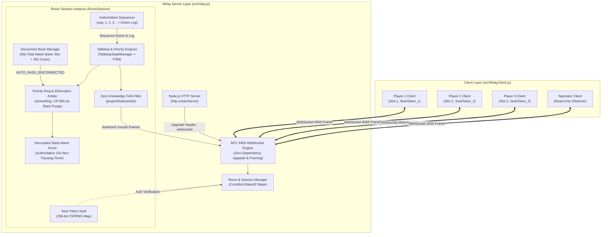
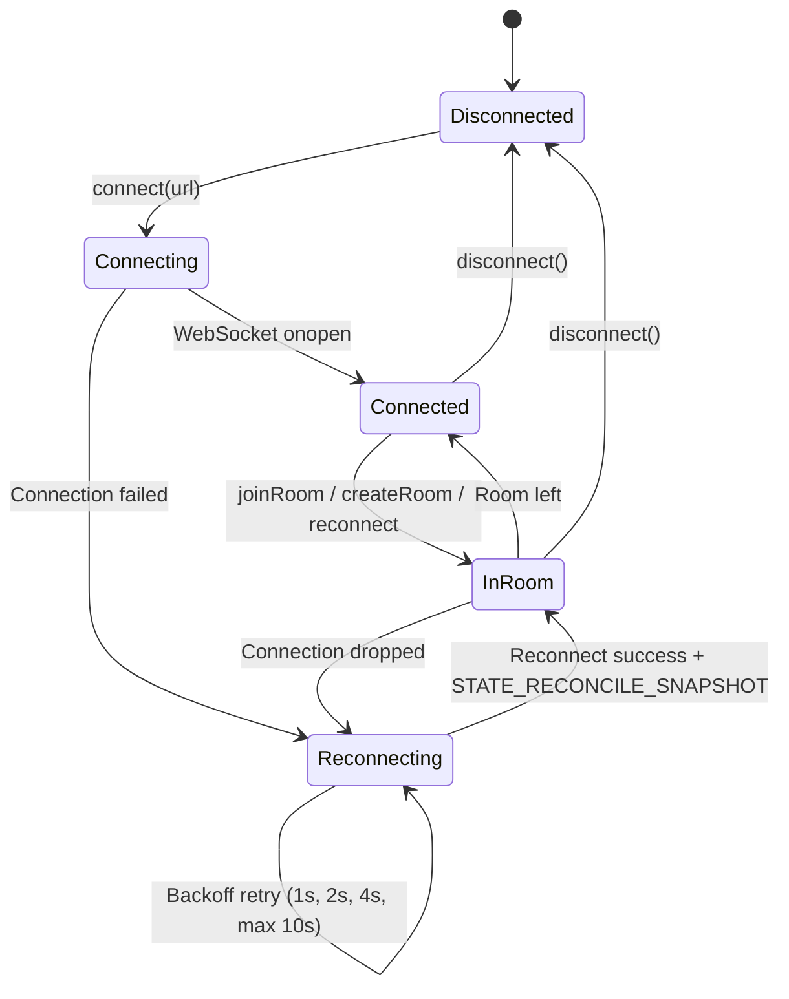
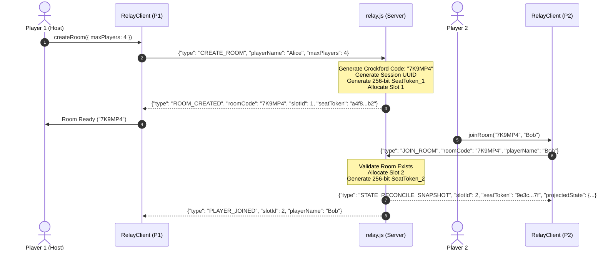
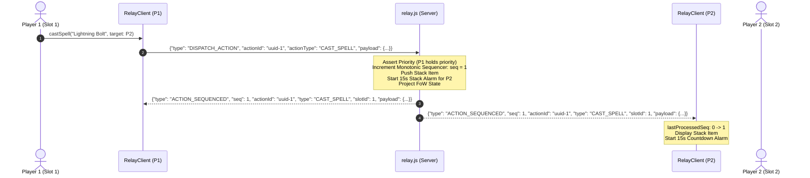
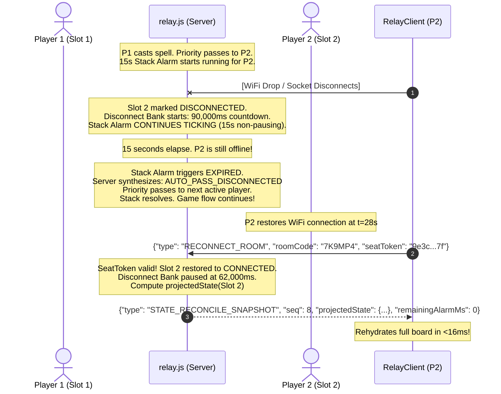
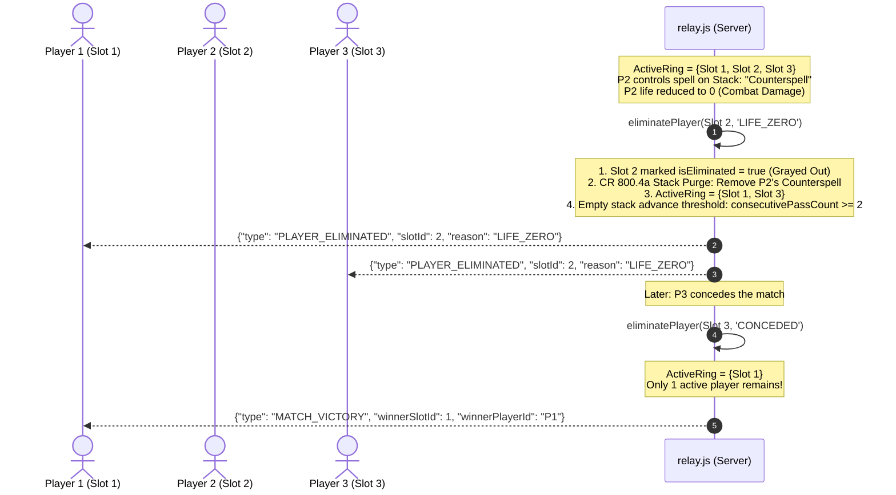

# Technical Specification: Multiplayer WebSocket Relay & Room Synchronization

- **Document ID:** `SPEC-RPM-RELAY-008`
- **Feature Scope:** Feature 8 (`src/relay.js` & `src/RelayClient.js`)
- **System:** RPM Multiplayer / RPM Revival Modern Tabletop Arena
- **Architect:** Argon Specification Architect
- **Status:** APPROVED / READY FOR IMPLEMENTATION
- **Revision:** 1.0.0
- **Target File Path:** `specs/FEATURE_8_RELAY_SYNC_SPEC.md`
- **Core Implementation Files:**
  - `src/relay.js` (Authoritative Zero-Dependency Node.js HTTP & RFC 6455 WebSocket Server)
  - `src/RelayClient.js` (Resilient Browser & Node.js Client with Gap-Detection Buffer)
  - `test/test_relay_sync.js` (Acceptance & Invariant Verification Suite)
- **Related Specifications & Decisions:**
  - `specs/FEATURE_3_TABLETOP_ZONE_STATE_SPEC.md` (`SPEC-RPM-ZONE-003`: Fog-of-War Projection & Tabletop State)
  - `specs/FEATURE_4_STACK_PRIORITY_SPEC.md` (`SPEC-RPM-PRIORITY-004`: Stack & Priority Flow State Machine)
  - `specs/FEATURE_5_6_DUAL_CHAT_ACTION_BUS_SPEC.md` (`SPEC-RPM-CHAT-005`: Dual-Channel Priority Chat & Action Bus)
  - `specs/FEATURE_7_ACCORDION_UI_MODAL_SPEC.md` (`SPEC-RPM-UI-007`: Accordion Tabletop UI)
  - `decisionlog.md`: `DEC-005` (Zero-Knowledge Projection), `DEC-009` (15s Stack Alarm), `DEC-013` (Multiplayer Scaling, Gray-Out Elimination & 60+30s Disconnect), `DEC-014` (Target Timing & Client Audio), `DEC-015` (Argon Systems Audit Invariants `INV-RELAY-1` through `INV-HARNESS-2`).

---

## 1. Executive Summary & Architectural Overview

The **Multiplayer WebSocket Relay & Room Synchronization** subsystem provides the authoritative, real-time networking backbone for 2 to 6 human players (plus unlimited spectators) participating in remote RPM Tabletop matches.

Digital tabletop card games, particularly those simulating high-speed, rules-intensive formats like Magic: The Gathering Modern, encounter four fatal networking failure modes when built upon standard naive full-mesh peer-to-peer or generic CRUD architectures:

1. **State Desynchronization & Concurrency Collisions**: In MTG, multiple players can declare priority passes, card moves, or stack responses within milliseconds of each other. Without an authoritative central sequencer, distributed clients diverge into irreconcilable state forks.
2. **Fog-of-War Metadata Leaks**: Transmitting raw, monolithic match state across clients allows malicious players to inspect opponents' hands, unrevealed library order, or face-down exiled cards via browser developer tools (`Network` tab / memory dumps).
3. **Disconnection-Priority Deadlocks**: In physical play, if a player steps away, the table waits or applies tournament tardiness penalties. In remote play, if an opponent disconnects while holding priority during a 15-second Stack Alarm countdown, naive servers either freeze indefinitely waiting for a socket or immediately forfeit the player, penalizing transient cellular/Wi-Fi drops.
4. **Multiplayer Priority Ring Breakdown on Player Death**: In 3 to 6 player matches, when a player is eliminated (reaches 0 life, 10 poison counters, or draws from an empty library), naive priority loops continue passing priority to the dead player or leave their orphaned spells on the stack, freezing turn progression.

Feature 8 solves these challenges through a hardened, **zero-dependency Node.js HTTP & WebSocket relay architecture (`src/relay.js`)** coupled with a resilient client interface (`src/RelayClient.js`):

- **Pure Zero-Dependency Architecture**: Leverages standard Node.js built-ins (`http`, `crypto`, `buffer`). Operates with zero external npm dependencies (no `ws`, no `socket.io`, no `express`), ensuring rapid container cold-starts (<50ms on Render/Fly.io), zero supply-chain vulnerability attack surface, and deterministic memory consumption.
- **Authoritative Monotonic Action Sequencer (`INV-RELAY-2`)**: The server assigns a strictly incrementing integer sequence number (`seq = 1, 2, 3...`) to every accepted state-mutating action. Clients maintain an out-of-order buffer and gap-detection engine that automatically requests retransmission of missing sequence packets if network jitter drops a frame.
- **Cryptographic Anti-Hijacking Seat Tokens (`INV-RELAY-4`)**: Seated player slots (1 through 6) are bound to 256-bit cryptographically secure random tokens. If a player experiences a network drop, an unauthorized observer or malicious client cannot usurp their seat; only a reconnection carrying the valid seat token can re-claim the player slot.
- **Decoupled Clocks & 90-Second Disconnect Bank (`INV-RELAY-3`)**: Each player is allotted a 90-second total match disconnect bank (60s disconnect tolerance + 30s final grace buffer). Crucially, the 15-second Stack Alarm **does not pause on disconnect**. If a disconnected player holds priority, the alarm ticks to completion and server-fires `AUTO_PASS_DISCONNECTED`, allowing the match to proceed without delay. Upon reconnecting, the server delivers an atomic `STATE_RECONCILE_SNAPSHOT`, rehydrating the client DOM in under 16ms.
- **Dynamic Active Priority Ring & CR 800.4a Elimination (`INV-RING-1` & `INV-RING-2`)**: The server maintains `ActiveRing = { p in Players | !p.isEliminated }`. When a player dies or concedes, their board slot is marked grayed-out (`isEliminated = true`), all stack objects owned by them are instantly purged under Magic Comprehensive Rule 800.4a, priority advances immediately to the next active player, and empty-stack phase step progression scales dynamically to `consecutivePassCount >= |ActiveRing|`. When only 1 active player remains, `MATCH_VICTORY` is emitted.
- **Zero-Knowledge Fog-of-War Projection (`INV-FOW-1`)**: The server transforms canonical match state using `projectState(slotId)` before serialization onto the wire. Opponent hands are masked to `{ instanceId: 'hidden', isHidden: true }` and libraries to `{ count: N }`. Zero private metadata touches the client socket.

---

### 1.1 Architectural Topology



---

## 2. Formal Invariants & Mathematical Laws

The relay server and client interface strictly enforce eight non-negotiable architectural invariants:

### 2.1 Invariant Table

| Invariant ID | Name | Mathematical / Formal Law | Enforcing Component | Violation Penalty |
|:---|:---|:---|:---|:---|
| **INV-RELAY-1** | Crockford Base32 Namespace | $\forall r \in Rooms, \text{len}(r) = 6 \land r \in [2\text{-}9\text{A\text{-}HJKMNP\text{-}Z}]^6 \land r \notin \text{ActiveRooms}$ | `RoomManager.createRoom()` | Regenerate code on collision; guarantee zero transcription error |
| **INV-RELAY-2** | Monotonic Action Sequencer | $\forall a_{i}, a_{i+1} \in \text{ActionLog}, \text{seq}(a_{i+1}) = \text{seq}(a_i) + 1 \land \text{seq}(a_1) = 1$ | `MonotonicSequencer.dispatch()` | Out-of-order execution rejected; triggers client gap-replay request |
| **INV-RELAY-3** | Decoupled Clock & Disconnect Bank | $T_{\text{StackAlarm}}(t) = T_{\text{StackAlarm}}(0) - t \quad (\text{independent of } S_{\text{conn}}(p))$<br>$B_{\text{disc}}(p, \Delta t) = \max(0, B_{\text{disc}}(p) - \Delta t) \quad (\text{max } 90\text{s total})$ | `DisconnectManager` & `StackAlarmManager` | Expiry at 15s fires `AUTO_PASS_DISCONNECTED`; bank expiry at 90s fires `ELIMINATE` |
| **INV-RELAY-4** | Cryptographic Anti-Hijack Token | $\forall p \in \text{Slots}, \text{Token}(p) \in \{0,1\}^{256} \land \text{Reconnect}(p, \tau) \implies \tau = \text{Token}(p)$ | `SeatManager.authenticate()` | Socket rejected with `4401 Unauthorized Seat Token` |
| **INV-RING-1** | Dynamic Active Priority Ring | $\text{ActiveRing} = \{ p \in \text{Players} \mid \neg p.\text{isEliminated} \}$<br>$\text{PhaseAdvance} \iff \text{consecutivePassCount} \ge |\text{ActiveRing}|$ | `PriorityRingArbiter` | Eliminated players skipped; zero ghost priority deadlocks |
| **INV-RING-2** | CR 800.4a Stack Purge & Immediate Shift | $p.\text{isEliminated} \implies \text{Stack} \gets \{ s \in \text{Stack} \mid s.\text{sourcePlayerId} \ne p \}$<br>$\text{If } \text{priorityPlayer} = p \implies \text{priorityPlayer} \gets \text{nextActive}(p) \land \text{cancelAlarm}()$ | `EliminationEngine` | Orphaned spells erased; priority hands off instantaneously |
| **INV-FOW-1** | Zero-Knowledge State Projection | $\forall s_i \in \text{OpponentHand}, \pi_{\text{wire}}(s_i) = \{ \text{instanceId: 'hidden', isHidden: true} \}$<br>$\forall c \in \text{Library}, \pi_{\text{wire}}(c) = \emptyset \land \pi_{\text{wire}}(\text{Library}) = \{ \text{count: } N \}$ | `TabletopStateManager.projectState()` | Zero private card attributes leaked over WebSocket |
| **INV-HARNESS-2** | Resource Cleanup & Process Leak Guards | $\forall t \in \text{Timers}, t.\text{unref}() \land \text{Teardown}() \implies \text{ActiveSockets} = \emptyset \land \text{ActiveTimers} = \emptyset$ | `relay.js` & `RelayClient.js` | Zero lingering Node.js event-loop handles; test suite exits cleanly |

---

## 3. Core Domain Types & TypeScript Definitions

The relay subsystem utilizes exact, strict TypeScript interfaces for all server entities, network frames, and client state.

```typescript
/**
 * 6-Character Crockford Base32 Room Code
 * Excludes ambiguous glyphs: 0, O, 1, I, L.
 * Alphabet: 23456789ABCDEFGHJKMNPQRSTUVWXYZ (32 symbols)
 */
export type RoomCode = string; // e.g. "7K9MP4"

/**
 * Player Seated Slot Identifier (1 to 6)
 */
export type SlotId = 1 | 2 | 3 | 4 | 5 | 6;

/**
 * 256-bit Cryptographic Hex Seat Token
 * Generated via crypto.randomBytes(32).toString('hex')
 */
export type SeatToken = string; // 64 hex characters

/**
 * 128-bit RFC 4122 v4 UUID
 */
export type SessionId = string;

/**
 * Player Slot Lifecycle Status
 */
export type SlotConnectionStatus = 'CONNECTED' | 'DISCONNECTED' | 'ABANDONED';

/**
 * Player Seated Slot Entity in Server Memory
 */
export interface PlayerSlot {
  slotId: SlotId;
  playerId: string;                 // Client-provided unique player identity
  playerName: string;               // Display handle
  seatToken: SeatToken;             // Secret token given only to slot occupant
  connectionStatus: SlotConnectionStatus;
  socket: WebSocketConnection | null; // Nullable when disconnected
  isEliminated: boolean;            // True when life <= 0, 10 poison, deckout, or conceded
  eliminationReason?: 'LIFE_ZERO' | 'POISON_TEN' | 'DECKOUT' | 'CONCEDED' | 'DISCONNECT_TIMEOUT';
  disconnectBankMsRemaining: number;// Starts at 90,000ms (60s base + 30s grace)
  disconnectedAt: number | null;    // Epoch ms when socket dropped
  joinedAt: number;                 // Epoch ms
}

/**
 * Spectator Connection Entity
 */
export interface SpectatorConnection {
  spectatorId: string;
  socket: WebSocketConnection;
  joinedAt: number;
}

/**
 * Monotonically Sequenced Mutating Game Action
 */
export interface SequencedAction<T = any> {
  seq: number;                      // Strictly monotonic integer: 1, 2, 3...
  actionId: string;                 // UUID generated by client dispatcher
  type: string;                     // Domain action type (e.g. 'CAST_SPELL', 'PASS_PRIORITY')
  payload: T;                       // Domain payload
  timestamp: number;                // Server-authoritative epoch ms
  slotId: SlotId;                   // Slot of the enacting player
}

/**
 * Client Gap Replay Request
 */
export interface ActionReplayRequest {
  type: 'ACTION_REPLAY_REQUEST';
  fromSeq: number;                  // Lowest missing sequence number
  toSeq: number;                    // Highest missing sequence number
}

/**
 * Reconciled State Snapshot delivered upon Reconnection or Initial Join
 */
export interface StateReconcileSnapshot {
  type: 'STATE_RECONCILE_SNAPSHOT';
  roomCode: RoomCode;
  sessionId: SessionId;
  slotId: SlotId | null;            // Null for spectators
  seatToken?: SeatToken;            // Returned only upon initial room creation/join
  seq: number;                      // Authoritative latest sequence number
  projectedState: ProjectedTabletopState; // Sanitized Fog-of-War state
  priorityPlayerId: string;         // Current priority holder
  activePlayerId: string;           // Active turn player
  currentPhaseStep: string;         // Current phase step (e.g. 'PRECOMBAT_MAIN')
  turnNumber: number;               // Current turn index
  stack: Array<Record<string, any>>;// Public stack items
  remainingAlarmMs: number;         // Milliseconds remaining on active 15s Stack Alarm (0 if idle)
  disconnectBankRemainingMs: number;// Disconnect bank ms for this player
  activeSlots: Array<{
    slotId: SlotId;
    playerId: string;
    playerName: string;
    isEliminated: boolean;
    connectionStatus: SlotConnectionStatus;
  }>;
}

/**
 * Sanitized Zero-Knowledge Projected Board State
 */
export interface ProjectedTabletopState {
  sessionId: SessionId;
  activePlayerId: string;
  turnNumber: number;
  stack: Array<Record<string, any>>;
  players: Record<string, {
    playerId: string;
    playerName: string;
    library: { count: number };
    hand: {
      count: number;
      cards: Array<{ instanceId: string; isHidden?: boolean } | Record<string, any>>;
      isRevealed: boolean;
    };
    battlefield: {
      lands: Array<Record<string, any>>;
      creatures: Array<Record<string, any>>;
      noncreatures: Array<Record<string, any>>;
      planeswalkers: Array<Record<string, any>>;
    };
    graveyard: Array<Record<string, any>>;
    exile: Array<Record<string, any>>;
    resources: {
      life: number;
      poison: number;
      energy: number;
      manaPool: Record<string, number>;
    };
  }>;
  viewerSlotId: SlotId | 'spectator';
  timestamp: number;
}
```

---

## 4. Zero-Dependency Server Architecture (`src/relay.js`)

`src/relay.js` executes as a standalone HTTP and RFC 6455 WebSocket server with **zero external dependencies**, importing only standard Node.js modules: `node:http`, `node:crypto`, `node:buffer`, and `node:events`.

### 4.1 RFC 6455 WebSocket Handshake & Framing Subsystem

The server implements a standards-compliant RFC 6455 engine using Node.js TCP streams:

#### 4.1.1 Upgrade Handshake
When an incoming HTTP `GET` request arrives with `Upgrade: websocket` and `Connection: Upgrade`:
1. Extract the client's `Sec-WebSocket-Key` header value.
2. Concatenate the key with the canonical RFC 6455 GUID: `"258EAFA5-E914-47DA-95CA-C5AB0DC85B11"`.
3. Compute the SHA-1 digest and base64-encode:
   $$\text{AcceptKey} = \text{base64}(\text{SHA-1}(\text{Key} \parallel \text{"258EAFA5-E914-47DA-95CA-C5AB0DC85B11"}))$$
4. Write the HTTP `101 Switching Protocols` response headers directly to the underlying raw socket:
   ```http
   HTTP/1.1 101 Switching Protocols\r\n
   Upgrade: websocket\r\n
   Connection: Upgrade\r\n
   Sec-WebSocket-Accept: <AcceptKey>\r\n\r\n
   ```

#### 4.1.2 Frame Decoding (Client-to-Server)
RFC 6455 mandates that all frames sent from client to server **must be masked**:
- **Byte 0**: `FIN` (Bit 7, 0x80) and `Opcode` (Bits 0–3: `0x1` Text, `0x8` Connection Close, `0x9` Ping, `0xA` Pong).
- **Byte 1**: `MASK` bit (Bit 7, must be 1) and `Payload Length` (Bits 0–6).
  - If length $\le 125$: actual payload length.
  - If length $= 126$: read following 2 bytes as 16-bit unsigned integer.
  - If length $= 127$: read following 8 bytes as 64-bit unsigned integer.
- **Masking Key**: 4 bytes immediately preceding the payload.
- **Unmasking Algorithm**: For byte index $i$ in payload:
  $$\text{Payload}[i] = \text{RawBytes}[i] \oplus \text{MaskKey}[i \bmod 4]$$

#### 4.1.3 Frame Encoding (Server-to-Client)
RFC 6455 mandates that frames sent from server to client **must not be masked**:
- Opcode `0x81` (FIN = 1, Opcode = 1 Text).
- If length $< 126$: Header is 2 bytes `[0x81, length]`.
- If $126 \le \text{length} \le 65535$: Header is 4 bytes `[0x81, 126, (len >> 8) & 0xFF, len & 0xFF]`.
- If $\text{length} > 65535$: Header is 10 bytes `[0x81, 127, ...8-byte BigInt BE]`.
- Followed immediately by raw UTF-8 JSON buffer.

```
 RFC 6455 Unmasked Server Frame Format:
  0                   1                   2                   3
  0 1 2 3 4 5 6 7 8 9 0 1 2 3 4 5 6 7 8 9 0 1 2 3 4 5 6 7 8 9 0 1
 +-+-+-+-+-------+-+-------------+-------------------------------+
 |F|R|R|R| opcode|M| Payload len |    Extended payload length    |
 |I|S|S|S|  (1)  |A|    (126)    |          (16-bit uint)        |
 |N|V|V|V|       |S|             |                               |
 |1|0|0|0|  0x1  |0|    0x7E     |                               |
 +-+-+-+-+-------+-+-------------+ - - - - - - - - - - - - - - - +
 |                     Payload Data (UTF-8 JSON)                 |
 + - - - - - - - - - - - - - - - - - - - - - - - - - - - - - - - +
```

---

### 4.2 Crockford Base32 Room Code Generator & Collision Map

To eliminate visual ambiguity on mobile viewports and physical paper slips, room codes are formatted strictly in Crockford Base32:
- Alphabet: `23456789ABCDEFGHJKMNPQRSTUVWXYZ` (Length 32).
- Excluded characters:
  - `0` (Zero) and `O` (Letter O) $\to$ eliminated.
  - `1` (One), `I` (Capital I), and `L` (Letter L) $\to$ eliminated.
- Total 6-character entropy: $32^6 = 1,073,741,824$ unique combinations.

```javascript
const CROCKFORD_ALPHABET = '23456789ABCDEFGHJKMNPQRSTUVWXYZ';

export function generateRoomCode(existingRoomsMap) {
  let code = '';
  let attempts = 0;
  do {
    code = '';
    const randomBytes = crypto.randomBytes(6);
    for (let i = 0; i < 6; i++) {
      code += CROCKFORD_ALPHABET[randomBytes[i] % 32];
    }
    attempts++;
    if (attempts > 50) {
      throw new Error('Room code collision exhaustion limit reached');
    }
  } while (existingRoomsMap.has(code));

  return code;
}
```

---

### 4.3 Monotonic Action Sequencer & Action Log Journal (`INV-RELAY-2`)

The room maintains an authoritative integer sequence counter `currentSeq` starting at 0.
1. When a seated player submits a mutating action `{ actionId, type, payload }`:
   - Server asserts that the sender holds the cryptographic seat token for `slotId`.
   - Server validates whether the player has priority (`PriorityStateMachine.assertHasPriority(playerId)`).
   - If valid, the server increments `currentSeq`:
     $$\text{currentSeq} \leftarrow \text{currentSeq} + 1$$
   - Constructs the sequenced package:
     ```javascript
     const sequencedAction = {
       seq: this.currentSeq,
       actionId,
       type,
       payload,
       timestamp: Date.now(),
       slotId
     };
     ```
   - Appends `sequencedAction` to the in-memory journal: `this.actionLog.push(sequencedAction)`.
   - Mutates the canonical internal `TabletopStateManager` and `PriorityStateMachine`.
   - Broadcasts the sequenced packet to all participants.

#### 4.3.1 Gap Replay Servicing
If any client emits `ACTION_REPLAY_REQUEST` with `{ fromSeq, toSeq }`:
- Server queries `this.actionLog` for all actions satisfying $\text{fromSeq} \le a.\text{seq} \le \text{toSeq}$.
- Transmits an immediate unicast packet `ACTION_REPLAY_BATCH` containing the ordered actions.

---

### 4.4 Disconnect Resilience & Clock Decoupling Engine (`INV-RELAY-3`)

```
 DISCONNECT CLOCK DECOUPLING TIMELINE
========================================================================================
 t=0s: Player 2 disconnects. Socket closes.
       - Disconnect Bank starts draining: 90,000ms remaining.
       - Player 1 casts Lightning Bolt -> Stack Alarm begins authoritative 15-second timer.
       ---------------------------------------------------------------------------------
 t=5s: Player 2 is still offline.
       - Disconnect Bank: 85,000ms remaining.
       - Stack Alarm: 10,000ms remaining. [ALARM DOES NOT PAUSE]
       ---------------------------------------------------------------------------------
 t=15s: Stack Alarm reaches 0ms.
       - Disconnect Bank: 75,000ms remaining.
       - Server fires AUTO_PASS_DISCONNECTED for Player 2.
       - Priority advances to next active player; Stack resolves if all passed.
       ---------------------------------------------------------------------------------
 t=25s: Player 2 reconnects presenting valid SeatToken_2.
       - Disconnect Bank pauses at 65,000ms.
       - Server emits STATE_RECONCILE_SNAPSHOT.
       - Player 2 rehydrates board, receives updated stack and active priority state.
========================================================================================
```

The disconnection manager executes an asynchronous tick loop every 1,000ms (`.unref()` enabled):
1. For each player where `connectionStatus === 'DISCONNECTED'`:
   - Calculate elapsed milliseconds $\Delta t = \text{now} - \text{lastTick}$.
   - Deduct: $p.\text{disconnectBankMsRemaining} \leftarrow p.\text{disconnectBankMsRemaining} - \Delta t$.
   - If $p.\text{disconnectBankMsRemaining} \le 0$:
     - Mark $p.\text{connectionStatus} = \text{'ABANDONED'}$.
     - Trigger player elimination: `this.eliminatePlayer(p.slotId, 'DISCONNECT_TIMEOUT')`.
2. **Stack Alarm Independence**:
   - The 15-second Stack Alarm managed by `StackAlarmManager` runs on its own authoritative timer.
   - When the alarm triggers `EXPIRED`:
     - If the player currently holding priority is disconnected:
       - The server synthesizes and dispatches an authoritative action:
         ```javascript
         this.dispatchSequencedAction({
           actionId: crypto.randomUUID(),
           type: 'AUTO_PASS_DISCONNECTED',
           slotId: disconnectedSlotId,
           payload: { reason: 'STACK_ALARM_EXPIRED_WHILE_OFFLINE' }
         });
         ```
       - Passes priority via `PriorityStateMachine.passPriority(disconnectedPlayerId)`.

---

### 4.5 Active Priority Ring & Elimination Arbiter (`INV-RING-1` & `INV-RING-2`)

In standard Magic rules (CR 800.4), when a player leaves a multiplayer game:
1. All objects owned by that player cease to exist.
2. All spells and abilities on the stack controlled by that player are purged.
3. If that player holds priority, priority passes to the next player in turn order.

The relay server encodes these rules deterministically:

```javascript
eliminatePlayer(slotId, reason = 'LIFE_ZERO') {
  const slot = this.slots.get(slotId);
  if (!slot || slot.isEliminated) return;

  slot.isEliminated = true;
  slot.eliminationReason = reason;

  // 1. CR 800.4a Stack Purge
  this.priorityStateMachine.stack = this.priorityStateMachine.stack.filter(
    item => item.sourcePlayerId !== slot.playerId
  );

  // 2. Cancel Stack Alarm if running on eliminated player
  if (this.priorityStateMachine.alarmManager) {
    this.priorityStateMachine.alarmManager.cancel();
  }

  // 3. Priority Hand-off
  if (this.priorityStateMachine.priorityPlayerId === slot.playerId) {
    const nextPlayer = this.getNextActivePlayer(slot.playerId);
    this.priorityStateMachine.priorityPlayerId = nextPlayer;
    this.priorityStateMachine.consecutivePassCount = 0;
  }

  // 4. Broadcast Elimination
  this.broadcastSequencedAction({
    type: 'PLAYER_ELIMINATED',
    slotId,
    payload: { playerId: slot.playerId, reason }
  });

  // 5. Check Victory Condition (|ActiveRing| == 1)
  const activePlayers = Array.from(this.slots.values()).filter(s => !s.isEliminated);
  if (activePlayers.length === 1) {
    const winner = activePlayers[0];
    this.broadcast({
      type: 'MATCH_VICTORY',
      winnerSlotId: winner.slotId,
      winnerPlayerId: winner.playerId,
      winnerPlayerName: winner.playerName,
      timestamp: Date.now()
    });
  }
}
```

#### 4.5.1 Empty Stack Step Advancement Formula
In `PriorityStateMachine`, phase advancement on empty stack is governed by:
$$\text{consecutivePassCount} \ge |\text{ActiveRing}|$$
Where:
$$|\text{ActiveRing}| = \sum_{s \in \text{Slots}} \mathbb{I}(\neg s.\text{isEliminated})$$
This prevents games from stalling when dead players cannot declare passes.

---

### 4.6 Zero-Knowledge Fog-of-War Projection (`INV-FOW-1`)

Before any state synchronization or action update packet leaves the server, it passes through `projectState(matchState, viewerSlotId)`.
- If the viewer is `Slot 1`:
  - `Slot 1` hand: full cards with oracle IDs, names, images, mana costs.
  - `Slot 2..6` hands: array of `{ instanceId: 'hidden', isHidden: true }`.
  - All libraries: `{ count: library.length }` (order, identities, and card attributes stripped).
  - Public zones (battlefield, graveyard, stack): complete public card data.
- If the viewer is a `Spectator`:
  - All players' hands are masked unless explicit tournament judge/spectator-reveal flag is enabled in room options.

---

## 5. Client Interface Architecture (`src/RelayClient.js`)

`src/RelayClient.js` provides a comprehensive, reactive client adapter that operates seamlessly in both browser environments (`window.WebSocket`) and Node.js testing environments (`globalThis.WebSocket`).

### 5.1 Reconnection with Exponential Backoff

When network disruption drops the socket connection:
1. Disconnection triggers `onclose`.
2. The client enters reconnection mode, calculating delay using exponential backoff with $\pm 20\%$ random jitter:
   $$t_{\text{backoff}} = \min(10000, 1000 \times 2^{\text{attempt}}) \times (1 + \text{Uniform}(-0.2, 0.2))$$
3. Retries at: ~1s, ~2s, ~4s, ~8s, capping at 10s.
4. On reconnection, immediately dispatches `RECONNECT_ROOM` with `{ roomCode, seatToken, lastSeenSeq }`.



---

### 5.2 Out-of-Order Packet Buffer & Gap-Detection State Machine

The client tracks `lastProcessedSeq`. Every incoming sequenced frame is processed through the gap-detection algorithm:

```
 INCOMING PACKET ARRIVAL
           │
           ▼
    ┌──────────────┐
    │ seq == last+1│ ────── YES ──────► Process Action Immediately
    └──────────────┘                    Update lastProcessedSeq = seq
           │ NO                         Drain Out-of-Order Buffer
           ▼
    ┌──────────────┐
    │ seq > last+1 │ ────── YES ──────► Store in outOfOrderBuffer Map
    └──────────────┘                    Emit ACTION_REPLAY_REQUEST
           │ NO                         (from: last+1, to: seq-1)
           ▼
    Discard Duplicate (seq <= last)
```

```javascript
_handleSequencedAction(action) {
  const { seq } = action;

  if (seq <= this.lastProcessedSeq) {
    // Duplicate or already processed; ignore
    return;
  }

  if (seq === this.lastProcessedSeq + 1) {
    // Expected sequential packet
    this._applyAction(action);
    this.lastProcessedSeq = seq;

    // Check if buffer contains subsequent packets
    while (this.outOfOrderBuffer.has(this.lastProcessedSeq + 1)) {
      const nextAction = this.outOfOrderBuffer.get(this.lastProcessedSeq + 1);
      this.outOfOrderBuffer.delete(this.lastProcessedSeq + 1);
      this._applyAction(nextAction);
      this.lastProcessedSeq++;
    }
  } else {
    // Gap detected! Stash current packet
    this.outOfOrderBuffer.set(seq, action);

    // Request missing span from server
    this.send({
      type: 'ACTION_REPLAY_REQUEST',
      fromSeq: this.lastProcessedSeq + 1,
      toSeq: seq - 1
    });
  }
}
```

---

### 5.3 Complete RelayClient API Contract

```javascript
export class RelayClient extends EventEmitter {
  constructor(options = {}) {
    super();
    this.url = options.url || null;
    this.socket = null;
    this.roomCode = null;
    this.slotId = null;
    this.seatToken = null;
    this.lastProcessedSeq = 0;
    this.outOfOrderBuffer = new Map();
    this.reconnectAttempts = 0;
    this.maxReconnectBackoffMs = 10000;
    this.reconnectTimer = null;
    this.isExplicitDisconnect = false;
  }

  /**
   * Establishes initial WebSocket transport.
   * @param {string} url - WebSocket server endpoint (e.g. "ws://localhost:8080")
   * @returns {Promise<void>}
   */
  async connect(url);

  /**
   * Creates a new multiplayer room.
   * @param {Object} options - { maxPlayers: 2..6, startingLife: 20 }
   * @returns {Promise<{ roomCode: string, slotId: SlotId, seatToken: string }>}
   */
  async createRoom(options = {});

  /**
   * Joins an existing room as a seated player or spectator.
   * @param {string} roomCode - 6-character Crockford Base32
   * @param {string} playerName - Player display handle
   * @param {number} [seatPreference] - Optional slot 1..6
   * @returns {Promise<{ slotId: SlotId | null, seatToken?: string }>}
   */
  async joinRoom(roomCode, playerName, seatPreference);

  /**
   * Reconnects to an ongoing room using a stored seat token.
   * @param {string} roomCode
   * @param {string} seatToken
   * @returns {Promise<StateReconcileSnapshot>}
   */
  async reconnect(roomCode, seatToken);

  /**
   * Submits a state-mutating action for authoritative sequencing.
   * @param {Object} action - { type: string, payload: any }
   * @returns {void}
   */
  sendAction(action);

  /**
   * Cleanly closes the socket and cancels all background reconnection timers.
   * @returns {void}
   */
  disconnect();
}
```

#### 5.3.1 Emitted Event Catalog
- `state_sync`: Fired when `STATE_RECONCILE_SNAPSHOT` is received. Delivers full sanitized board, phase step, and stack.
- `action_sequenced`: Fired when an action is executed in sequential order. Delivers `{ seq, actionId, type, payload, slotId }`.
- `player_joined`: Fired when a new player sits at a slot.
- `player_disconnected`: Fired when a peer's socket drops.
- `player_eliminated`: Fired when a player reaches 0 life, 10 poison, deckout, or concedes.
- `match_victory`: Fired when only 1 active player remains.
- `error`: Fired on protocol violations, unauthorized tokens, or invalid actions.

---

## 6. Comprehensive Sequence Diagrams

### 6.1 Room Creation, Seating & 256-Bit Seat Token Issuance



---

### 6.2 Normal Monotonic Action Sequencing & Broadcast



---

### 6.3 Network Jitter, Packet Gap Detection & Instant Replay Resolution

```mermaid
sequenceDiagram
    autonumber
    participant Server as relay.js (Server)
    participant Client2 as RelayClient (P2)

    Note over Server: Server broadcasts Action seq=4
    Server-->>Client2: [DROPPED BY NETWORK CELL JITTER]
    Note over Server: Server broadcasts Action seq=5
    Server->>Client2: {"type": "ACTION_SEQUENCED", "seq": 5, ...}
    Note over Client2: Expected seq=4, received seq=5!<br/>Gap detected: missing [4]<br/>Stash seq=5 in outOfOrderBuffer
    Client2->>Server: {"type": "ACTION_REPLAY_REQUEST", "fromSeq": 4, "toSeq": 4}
    Note over Server: Query ActionLog for seq=4
    Server-->>Client2: {"type": "ACTION_REPLAY_BATCH", "actions": [{"seq": 4, ...}]}
    Note over Client2: Apply seq=4 (lastProcessedSeq = 4)<br/>Drain Buffer: Apply seq=5 (lastProcessedSeq = 5)<br/>Buffer empty; state fully reconciled!
```

---

### 6.4 Disconnection, Clock Decoupling & Auto-Pass Expiry



---

### 6.5 Multiplayer Elimination, CR 800.4a Stack Purge & Match Victory



---

## 7. Wire Protocol Message Catalog

All frames transmitted over the WebSocket relay are UTF-8 JSON text frames.

### 7.1 Inbound Client Messages (Client $\to$ Server)

#### 1. `CREATE_ROOM`
Initiates a new game room.
```json
{
  "type": "CREATE_ROOM",
  "playerName": "Alice",
  "maxPlayers": 4,
  "startingLife": 20
}
```

#### 2. `JOIN_ROOM`
Requests to join an existing room as a player or spectator.
```json
{
  "type": "JOIN_ROOM",
  "roomCode": "7K9MP4",
  "playerName": "Bob",
  "seatPreference": 2,
  "isSpectator": false
}
```

#### 3. `RECONNECT_ROOM`
Reclaims a seated slot following a network disconnection.
```json
{
  "type": "RECONNECT_ROOM",
  "roomCode": "7K9MP4",
  "seatToken": "9e3c7a8f1b2c4d5e6f7a8b9c0d1e2f3a4b5c6d7e8f9a0b1c2d3e4f5a6b7c8d9e",
  "lastSeenSeq": 4
}
```

#### 4. `DISPATCH_ACTION`
Submits a state-mutating game action to the authoritative sequencer.
```json
{
  "type": "DISPATCH_ACTION",
  "actionId": "f47ac10b-58cc-4372-a567-0e02b2c3d479",
  "actionType": "CAST_SPELL",
  "payload": {
    "card": { "instanceId": "card_01", "name": "Lightning Bolt" },
    "targets": [{ "targetType": "PLAYER", "targetId": "player_2" }]
  }
}
```

#### 5. `ACTION_REPLAY_REQUEST`
Requests retransmission of missing sequence packets.
```json
{
  "type": "ACTION_REPLAY_REQUEST",
  "fromSeq": 5,
  "toSeq": 7
}
```

#### 6. `CONCEDE_MATCH`
Explicitly forfeits the game.
```json
{
  "type": "CONCEDE_MATCH"
}
```

---

### 7.2 Outbound Server Messages (Server $\to$ Client)

#### 1. `ROOM_CREATED`
Sent unicast to room host.
```json
{
  "type": "ROOM_CREATED",
  "roomCode": "7K9MP4",
  "sessionId": "4b68e920-5c61-4fa3-9f12-09419163c482",
  "slotId": 1,
  "seatToken": "a4f8e9102c3b4a5d6e7f8a9b0c1d2e3f4a5b6c7d8e9f0a1b2c3d4e5f6a7b8c9d"
}
```

#### 2. `STATE_RECONCILE_SNAPSHOT`
Delivered upon initial room join or reconnection.
```json
{
  "type": "STATE_RECONCILE_SNAPSHOT",
  "roomCode": "7K9MP4",
  "sessionId": "4b68e920-5c61-4fa3-9f12-09419163c482",
  "slotId": 2,
  "seatToken": "9e3c7a8f1b2c4d5e6f7a8b9c0d1e2f3a4b5c6d7e8f9a0b1c2d3e4f5a6b7c8d9e",
  "seq": 14,
  "projectedState": {
    "activePlayerId": "player_1",
    "turnNumber": 3,
    "players": {
      "player_1": {
        "playerName": "Alice",
        "hand": { "count": 4, "cards": [{ "instanceId": "hidden", "isHidden": true }] },
        "resources": { "life": 20, "poison": 0 }
      },
      "player_2": {
        "playerName": "Bob",
        "hand": { "count": 5, "cards": [{ "instanceId": "card_b1", "name": "Counterspell" }] },
        "resources": { "life": 17, "poison": 0 }
      }
    }
  },
  "priorityPlayerId": "player_2",
  "activePlayerId": "player_1",
  "currentPhaseStep": "PRECOMBAT_MAIN",
  "turnNumber": 3,
  "stack": [
    {
      "id": "stack_1729182900_a4f1",
      "sourcePlayerId": "player_1",
      "card": { "name": "Lightning Bolt" },
      "type": "SPELL"
    }
  ],
  "remainingAlarmMs": 8450,
  "disconnectBankRemainingMs": 90000,
  "activeSlots": [
    { "slotId": 1, "playerId": "player_1", "playerName": "Alice", "isEliminated": false, "connectionStatus": "CONNECTED" },
    { "slotId": 2, "playerId": "player_2", "playerName": "Bob", "isEliminated": false, "connectionStatus": "CONNECTED" }
  ]
}
```

#### 3. `ACTION_SEQUENCED`
Authoritative broadcast of a sequenced action.
```json
{
  "type": "ACTION_SEQUENCED",
  "seq": 15,
  "actionId": "f47ac10b-58cc-4372-a567-0e02b2c3d479",
  "type": "PASS_PRIORITY",
  "slotId": 2,
  "payload": {},
  "timestamp": 1729182905120
}
```

#### 4. `ACTION_REPLAY_BATCH`
Unicast reply to `ACTION_REPLAY_REQUEST`.
```json
{
  "type": "ACTION_REPLAY_BATCH",
  "actions": [
    { "seq": 5, "actionId": "uuid-5", "type": "TAP_LAND", "slotId": 1, "payload": { "cardId": "land_01" } },
    { "seq": 6, "actionId": "uuid-6", "type": "CAST_SPELL", "slotId": 1, "payload": { "cardId": "spell_01" } }
  ]
}
```

#### 5. `PLAYER_ELIMINATED`
Broadcast when a player leaves the active ring.
```json
{
  "type": "PLAYER_ELIMINATED",
  "slotId": 2,
  "playerId": "player_2",
  "reason": "LIFE_ZERO",
  "timestamp": 1729182910000
}
```

#### 6. `MATCH_VICTORY`
Broadcast when the match concludes.
```json
{
  "type": "MATCH_VICTORY",
  "winnerSlotId": 1,
  "winnerPlayerId": "player_1",
  "winnerPlayerName": "Alice",
  "timestamp": 1729182915000
}
```

---

## 8. Failure Modes, Security & Edge Cases

| Threat / Failure Mode | Root Cause | Impact | Mitigation / Architectural Defense |
|:---|:---|:---|:---|
| **Seat Token Hijacking** | Malicious client attempts to hijack Slot 1 by sending arbitrary commands | Unauthorized player commandeers opponent's board | Each slot is protected by a 256-bit cryptographically secure token (`crypto.randomBytes(32)`). The server rejects any mutating message or reconnect request whose token does not match with constant-time comparison (`crypto.timingSafeEqual`). |
| **Fog-of-War Memory Scraping** | User opens Chrome DevTools `Network` tab or dumps `window.__STATE__` | Player scouts opponent's hand and upcoming library cards | Full state is never serialized over the wire. `projectState()` replaces opponent hand cards with `{ instanceId: 'hidden', isHidden: true }` and libraries with `{ count }` before serialization. |
| **Packet Flooding / Denial of Service** | Rogue client spams 10,000 `DISPATCH_ACTION` messages per second | CPU starvation / server event loop lag | Server enforces a per-socket rate limit (max 25 actions/second) and checks priority before processing. Excess frames trigger socket termination with code `1008 Policy Violation`. |
| **Out-of-Priority Injection** | Client sends `CAST_SPELL` when it is not their turn | Illegal board state manipulation | Server validates `PriorityStateMachine.assertHasPriority(slot.playerId)`. Disallowed actions are rejected with `PRIORITY_VIOLATION_ERROR` without mutating state or advancing `seq`. |
| **Deadlock on Elimination during Stack Alarm** | Player under 15-second Stack Alarm reaches 0 life or concedes | Alarm ticks for non-existent player; stack hangs | `eliminatePlayer()` checks if the eliminated player holds priority, instantly cancels the Stack Alarm, advances priority to `nextActivePlayer()`, and resets `consecutivePassCount = 0`. |
| **Process Hang in Test Suite** | Background timers (`setInterval` / `setTimeout`) keep Node.js event loop alive | Automated CI test runner hangs indefinitely | All relay server and client timers use `.unref()` (`INV-HARNESS-2`). The `RelayClient.disconnect()` and `RelayServer.close()` teardown methods explicitly clear all timers and close all sockets. |

---

## 9. Acceptance Test Matrix (`test/test_relay_sync.js`)

The acceptance test suite executes in Node.js with native ESM imports, validating all 8 formal invariants across 14 deterministic test vectors.

| Vector ID | Test Name | Invariant | Preconditions | Input Stimulus / Actions | Expected Output & Verification Target |
|:---|:---|:---|:---|:---|:---|
| **VEC-01** | RFC 6455 Handshake & Zero-Dependency Boot | System Boot | Pure Node.js environment without external packages | Boot `src/relay.js` HTTP server; establish native WebSocket connection | 101 Switching Protocols header received; Sec-WebSocket-Accept verified; socket connects |
| **VEC-02** | Crockford Base32 Code & Collision Map | `INV-RELAY-1` | Room manager initialized | Generate 100 room codes | All codes match `^[2-9A-HJKMNP-Z]{6}$`; zero collisions; zero ambiguous glyphs (0, O, 1, I, L) |
| **VEC-03** | 2 to 6 Player Seating & 256-Bit Seat Tokens | `INV-RELAY-4` | Room created with `maxPlayers: 4` | 4 clients connect and join slots 1 to 4; 5th joins as spectator | Slots 1..4 receive unique 64-character hex seat tokens; 5th client marked spectator (slotId: null) |
| **VEC-04** | Anti-Hijacking Token Verification | `INV-RELAY-4` | Slot 1 occupied with `SeatToken_1` | Rogue client attempts to reconnect to Slot 1 using forged token | Server rejects connection with `4401 Unauthorized`; Slot 1 occupant undisturbed |
| **VEC-05** | Monotonic Action Sequencing (`seq = 1, 2, 3...`) | `INV-RELAY-2` | 2 players seated; `seq = 0` | Player 1 dispatches 3 consecutive valid actions | Server broadcasts actions with `seq = 1`, `seq = 2`, `seq = 3`; timestamps strictly ordered |
| **VEC-06** | Packet Gap Detection & Automatic Replay | `INV-RELAY-2` | Client at `lastProcessedSeq = 3` | Inject artificial packet drop (seq 4); deliver packet with `seq = 5` | Client detects gap; buffers seq 5; sends `ACTION_REPLAY_REQUEST(4, 4)`; server replays seq 4; client applies 4 then 5 |
| **VEC-07** | Zero-Knowledge Fog-of-War Masking | `INV-FOW-1` | Player 1 holds *Lightning Bolt*; Player 2 receives state | Inspect JSON payload received on Player 2's socket | Player 1's hand contains `{ instanceId: 'hidden', isHidden: true }`; zero card names or IDs in wire payload |
| **VEC-08** | Disconnect Bank 90-Second Draining | `INV-RELAY-3` | 2 players connected | Sever Player 2's socket; advance virtual clock by 10 seconds | `disconnectBankMsRemaining` decreases from 90,000ms to 80,000ms; player status marked `DISCONNECTED` |
| **VEC-09** | Decoupled 15s Stack Alarm & `AUTO_PASS` | `INV-RELAY-3` | Player 1 casts spell; Player 2 receives priority then disconnects | Let 15 seconds elapse while Player 2 is disconnected | Alarm does NOT pause; triggers `EXPIRED`; server fires `AUTO_PASS_DISCONNECTED`; priority hands off |
| **VEC-10** | Reconnect & Sub-16ms State Rehydration | `INV-RELAY-3` | Player 2 disconnected with 75s bank remaining | Player 2 reconnects presenting `SeatToken_2` | Server returns `STATE_RECONCILE_SNAPSHOT`; client rehydrates in <16ms; socket status restored to `CONNECTED` |
| **VEC-11** | Dynamic Active Ring & Eliminated Player Skipping | `INV-RING-1` | 3 players seated (A, B, C); Player B eliminated | Player A passes priority on empty stack | Priority advances directly from A to C (skipping B); phase advances when `consecutivePassCount >= 2` |
| **VEC-12** | CR 800.4a Stack Purge & Immediate Priority Shift | `INV-RING-2` | 3 players; Player B casts spell; Player B life reaches 0 | Trigger `eliminatePlayer(Slot 2)` | Player B's spell is purged from stack immediately; alarm cancelled; priority shifts to Player C |
| **VEC-13** | Last Player Standing & `MATCH_VICTORY` | `INV-RING-1` | 3 players; Player B and Player C eliminated | Player C eliminated via concession | `ActiveRing` count drops to 1; server broadcasts `MATCH_VICTORY` naming Player A as winner |
| **VEC-14** | Process Teardown & Zero Lingering Timers | `INV-HARNESS-2` | Active room with timers running | Invoke `client.disconnect()` and `server.close()` | All sockets closed; all timers cleared (`.unref()`); Node.js test runner exits with code 0 without hanging |

---

## 10. Implementation Guidance & Non-Regression Notes

1. **Native ESM Syntax**: Both `src/relay.js` and `src/RelayClient.js` must be pure ES modules (`import`/`export`), aligning with `"type": "module"` in `package.json`.
2. **Buffer Management**: In pure Node.js WebSocket framing, network packets can arrive in fragments across multiple TCP `data` events. The server's frame parser must accumulate partial chunks in an unmasking buffer until a full frame length is received.
3. **No External Dependencies**: Do not introduce `ws`, `express`, or external libraries. Pure `node:http` and `node:crypto` guarantee zero installation friction and total alignment with the project's zero-dependency mandate.
4. **Integration with Feature 4**: `relay.js` delegates priority arbitration directly to `PriorityStateMachine.js` and `StackAlarmManager.js`. Ensure that the `alarmManager` instances created inside rooms do not emit unhandled exceptions on socket disconnects.
5. **Node.js Process Exit**: In `test/test_relay_sync.js`, ensure that every server instance is closed via `server.close()` and all client sockets are terminated before test completion to ensure `npm test` runs smoothly without dangling processes.
