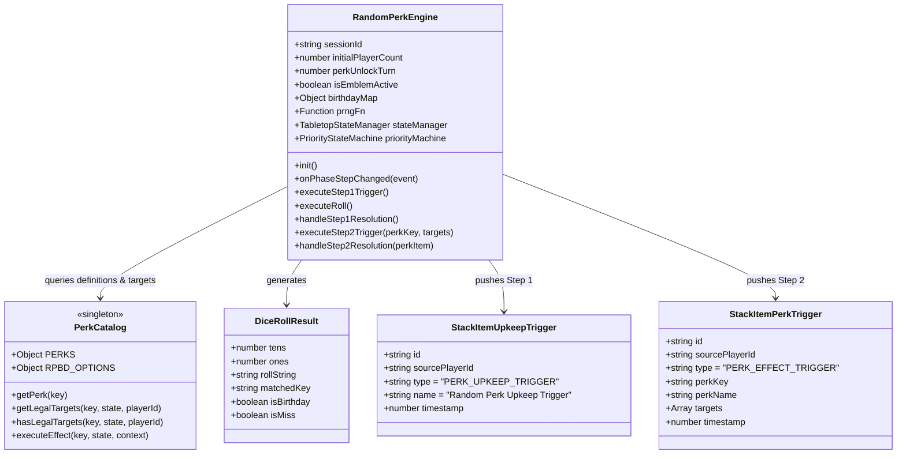
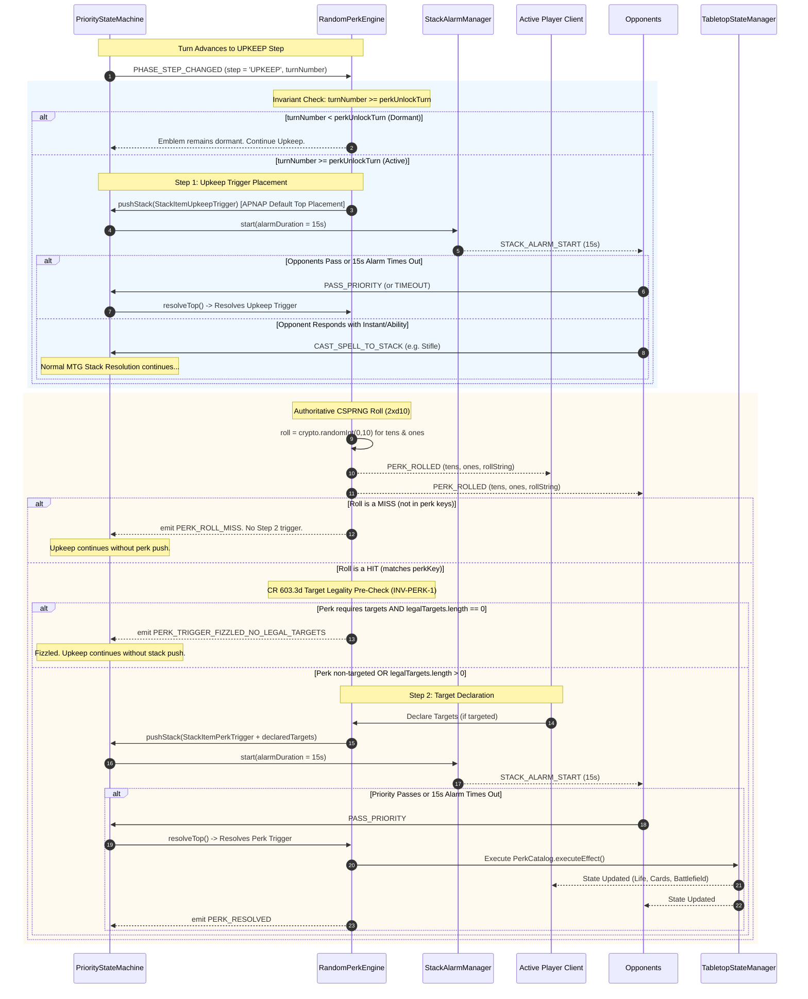

# Technical Specification: Random Perk Upkeep Emblem & Two-Step Stack Flow

- **Document ID:** `SPEC-RPM-PERK-009`
- **Feature Scope:** Feature 9 (`src/PerkCatalog.js` & `src/RandomPerkEngine.js`)
- **System:** RPM Multiplayer / RPM Modern Tabletop Companion
- **Architect:** Argon Specification Architect
- **Status:** APPROVED / READY FOR IMPLEMENTATION
- **Revision:** 1.0.0
- **Target File Path:** `specs/FEATURE_9_RANDOM_PERK_SPEC.md`
- **Core Implementation Files:**
  - `src/PerkCatalog.js` (Pure Data, Localization, Target Predicates & Effect Handlers)
  - `src/RandomPerkEngine.js` (Stateful Lifecycle, Two-Step Trigger Engine, Stack & Alarm Integration)
  - `test/test_random_perk.js` (Acceptance & Invariant Verification Suite)
- **Related Specifications & Decisions:**
  - `specs/FEATURE_3_TABLETOP_ZONE_STATE_SPEC.md` (`SPEC-RPM-ZONE-003`: Tabletop Zone State Manager)
  - `specs/FEATURE_4_STACK_PRIORITY_SPEC.md` (`SPEC-RPM-PRIORITY-004`: Stack & Priority Flow State Machine)
  - `specs/FEATURE_8_RELAY_SYNC_SPEC.md` (`SPEC-RPM-RELAY-008`: Multiplayer WebSocket Relay & Room Sync)
  - `decisionlog.md`: `DEC-013` (Upkeep Emblem, Format Turn Scaling & Two-Step Stack Resolution), `DEC-014` (12th Perk Birthday Match, CR 603.3d Target Declaration Timing), `DEC-015` (Argon Systems Audit Invariants `INV-PERK-1` through `INV-PERK-5`, `INV-RING-1`, `INV-RING-2`).

---

## 1. Executive Summary & Architectural Overview

The **Random Perk Upkeep Emblem & Two-Step Stack Flow** subsystem introduces the signature gameplay mechanic of the RPM format: a permanent, command-zone-anchored Emblem that automatically triggers during the active player's **Upkeep** step, generating high-variance, rule-enforced game effects driven by authoritative cryptographic dice rolls.

In physical and digital card gaming, integrating automated random event engines directly into tournament-grade rulesets (such as the *Magic: The Gathering Comprehensive Rules*) typically collapses under six catastrophic failure modes:
1. **Timing Exploits & Roll Speculation**: Naive client-side dice rolling allows compromised browser clients to re-roll or manipulate random numbers before committing results to the server.
2. **Priority Bypasses & Non-Interactive Game States**: Resolving random effects immediately upon rolling deprives opponents of their legal right to respond with instant-speed spells (*Counterspell*, *Stifle*, *Disallow*) or activated abilities.
3. **Empty Board / Target Starvation Crashes**: When a roll selects an ability requiring a target (e.g., *"Destroy target permanent"*) while no legal targets exist on the battlefield, naive game engines either freeze awaiting impossible input or crash with null-pointer exceptions.
4. **State Machine Deadlocks on Partial Execution**: Symmetrical or punitive effects (e.g., *"Discard a card and sacrifice a creature"*) fail catastrophically if a targeted player possesses an empty hand or controls zero creatures unless strict partial-execution semantics (MTG CR 608.2c) are mathematically enforced.
5. **Turn-Scaling Volatility & Mid-Game Desync**: If the turn threshold required to activate perks fluctuates dynamically when players are eliminated mid-game, matches experience desynchronized trigger timings across clients.
6. **Trigger Ordering Ambiguity**: In MTG (CR 101.4 / CR 603.3b), when multiple abilities trigger simultaneously at the beginning of an upkeep step, active player trigger ordering must be strictly preserved without breaking the default game pace.

Feature 9 completely eliminates these failure modes by decoupling the mechanic into two decoupled architectural modules:
- **`src/PerkCatalog.js`**: A pure, side-effect-free catalog containing the complete definitions, bilingual localization dictionaries (English and Spanish), target validity predicates, and atomic state-mutation functions for the 12 canonical perks and the Birthday Match (`RPBD`).
- **`src/RandomPerkEngine.js`**: A stateful lifecycle controller that tracks turn unlock scaling, manages the Command Zone Upkeep Emblem, orchestrates the two-step stack progression through `PriorityStateMachine` and `TabletopStateManager`, enforces 15-second Stack Alarms, and generates server-authoritative cryptographic rolls via Node.js `crypto.randomInt`.

---

### 1.1 Architectural Topology

```mermaid
flowchart TB
    subgraph TabletopEnvironment ["Tabletop & Priority Infrastructure"]
        TTSM["TabletopStateManager.js\n(Zones, Resources, Life, Battlefield)"]
        PSM["PriorityStateMachine.js\n(LIFO Stack, APNAP Priority Ring)"]
        SAM["StackAlarmManager.js\n(15-Second Response Countdown Timer)"]
    end

    subgraph Feature9Core ["Feature 9: Random Perk Subsystem"]
        RPE["RandomPerkEngine.js\n(Stateful Lifecycle & Two-Step Coordinator)"]
        Catalog["PerkCatalog.js\n(Pure Data, Target Predicates, Handlers)"]
        CSPRNG["Authoritative CSPRNG\n(crypto.randomInt(0, 10))"]
    end

    subgraph CommandZoneLayer ["Command Zone (ZoneModel.js)"]
        Emblem["Random Perk Emblem\n(Immutable Static Object)"]
    end

    %% Lifecycle Triggers
    PSM -->|PHASE_STEP_CHANGED: UPKEEP| RPE
    RPE -->|Inspect Turn Count vs Anchor| RPE
    Emblem -.->|Triggers during UPKEEP| RPE

    %% Step 1 Flow
    RPE -->|1. Push Step 1 Upkeep Trigger| PSM
    PSM -->|Start 15s Stack Alarm| SAM
    PSM -->|Step 1 Resolves| RPE
    RPE -->|Request 2xd10 Roll| CSPRNG
    CSPRNG -->|Roll: Violet Tens + Aquamarine Ones| RPE

    %% Step 2 Evaluation
    RPE -->|Lookup Matched Key| Catalog
    Catalog -->|Pre-check Legal Targets (CR 603.3d)| RPE
    RPE -->|2. Push Step 2 Perk Trigger + Targets| PSM
    PSM -->|Start 15s Stack Alarm| SAM
    PSM -->|Step 2 Resolves| RPE
    RPE -->|Execute Perk Mutation (CR 608.2c)| Catalog
    Catalog -->|Mutate Life, Cards, Counters, Zones| TTSM
```

---

### 1.2 Separation of Concerns

1. **`src/PerkCatalog.js`**:
   - Zero state retention (100% pure functions and immutable data structures).
   - Ingests data definitions from `rpdata.json` and `rpbd.json`.
   - Exports the canonical 12-perk dictionary (`"00"`, `"11"`, `"22"`, `"33"`, `"44"`, `"55"`, `"66"`, `"77"`, `"88"`, `"99"`, `"13"`, and `"RPBD"`).
   - Exposes `getLegalTargets(perkKey, state, activePlayerId)` for target discovery.
   - Exposes `hasLegalTargets(perkKey, state, activePlayerId)` for CR 603.3d validation.
   - Exposes `executeEffect(perkKey, state, context)` containing atomic, hardened mutation routines that apply partial execution guards (CR 608.2c).

2. **`src/RandomPerkEngine.js`**:
   - Maintains match-level perk state: `isEmblemActive`, `perkUnlockTurn`, `activeRoll`, `currentStep`, `birthdayConfig`.
   - Listens to `PriorityStateMachine` phase/step events (`PHASE_STEP_CHANGED`).
   - Sits as the arbiter between Upkeep phase triggers and the MTG LIFO Stack.
   - Drives Step 1: Upkeep Trigger generation, APNAP ordering (CR 101.4 / `INV-PERK-2`), priority pass, 15s Stack Alarm, and dice execution.
   - Drives Step 2: Roll matching, miss branching, target declaration (CR 603.3d / `INV-PERK-1`), Step 2 Perk Trigger stack push, second 15s Stack Alarm, and resolution dispatch.
   - Guarantees server-authoritative randomness (`INV-PERK-3`) while allowing deterministic PRNG injection for automated unit and fuzz testing.

---

## 2. Formal Invariants & Mathematical Laws

The Random Perk subsystem enforces eight non-negotiable architectural invariants:

### 2.1 Invariant Table

| Invariant ID | Name | Formal Rule Statement | Enforcement Location |
| :--- | :--- | :--- | :--- |
| **`INV-PERK-1`** | **CR 603.3d Target Legality Guard** | A targeted perk trigger whose target requirements cannot be met ($\|LegalTargets\| = 0$) MUST NOT be pushed to the Stack. It fizzles immediately upon roll resolution, emitting `PERK_TRIGGER_FIZZLED_NO_LEGAL_TARGETS`. | `RandomPerkEngine.js` (`handleStep1Resolution`) |
| **`INV-PERK-2`** | **APNAP Trigger Order & Default Placement** | At the beginning of the `UPKEEP` step, the Random Perk Emblem trigger is placed on the Stack as an active player trigger. By default, it is placed at the top of active player upkeep triggers so it resolves first. | `RandomPerkEngine.js` (`onUpkeepStep`) |
| **`INV-PERK-3`** | **Authoritative CSPRNG Rolls** | Dice rolls MUST be generated on the authoritative server using cryptographically secure pseudorandomness (`crypto.randomInt(0, 10)` for tens and ones). Clients are display-only and have zero roll authority. | `RandomPerkEngine.js` (`executeRoll`) |
| **`INV-PERK-4`** | **Turn Unlock Scaling Anchor** | The unlock turn threshold $T_{unlock}$ is permanently anchored at room creation: $T_{unlock} = 2$ if $N_{initial} \ge 3$, else $T_{unlock} = 4$. $T_{unlock}$ remains invariant even if player count drops mid-game. | `RandomPerkEngine.js` (`constructor`) |
| **`INV-PERK-5`** | **CR 608.2c Partial Execution Guard** | If a perk specifies multiple instructions or costs and a player cannot perform all of them, the player performs as much as possible. A perk MUST NEVER throw an unhandled exception or abort if hand or board counts are 0. | `PerkCatalog.js` (`executeEffect`) |
| **`INV-PERK-6`** | **Two-Step Stack Decoupling** | Rolling dice and applying perk effects MUST occur in distinct stack objects separated by a full round of priority. Players cannot respond to the effect until the dice have settled and targets have been chosen. | `RandomPerkEngine.js` (`Step 1 vs Step 2`) |
| **`INV-PERK-7`** | **Command Zone Emblem Immutability** | The Random Perk Emblem resides in the Command Zone as a static, indestructible, untargetable object (`type: 'EMBLEM'`). It cannot be moved, destroyed, exiled, or bounced by any game action. | `TabletopStateManager.js` & `ZoneModel.js` |
| **`INV-PERK-8`** | **Non-Matching Roll Miss Invariant** | If a 2 d10 roll does not match one of the 10 double pairs (`"00"` through `"99"`), `"13"`, or the active player's registered birthday roll, the roll is a Miss (`PERK_ROLL_MISS`). Upkeep continues with zero stack additions. | `RandomPerkEngine.js` (`evaluateRoll`) |

---

### 2.2 Mathematical Specifications & Formal Invariant Proofs

#### 2.2.1 Turn Unlock Scaling Formula (`INV-PERK-4`)

Let $N_{initial} \in \mathbb{N}$ represent the count of seated, non-spectator players at the start of the match (when `INITIALIZE_DECK` is completed for all participants). The turn unlock threshold $T_{unlock} \in \{2, 4\}$ is given by:

$$T_{unlock} = \begin{cases} 2 & \text{if } N_{initial} \ge 3 \\ 4 & \text{if } N_{initial} < 3 \end{cases}$$

Let $N(t)$ be the set of active (non-eliminated) players at match turn $t \ge 1$. For all turns $t$:

$$\frac{\partial T_{unlock}}{\partial |N(t)|} = 0$$

*Proof of Invariant:* In a 4-player Commander-style game ($N_{initial} = 4$), $T_{unlock} = 2$. If two players are eliminated on Turn 3 such that $|N(3)| = 2$, $T_{unlock}$ remains strictly equal to $2$. The room threshold is anchored at instantiation and is completely immutable. For any turn $t < T_{unlock}$, the emblem remains dormant: no triggers are placed on the stack, and no priority alarms are engaged.

#### 2.2.2 Cryptographic Roll Normalization & Collision Proof (`INV-PERK-3` & `INV-PERK-8`)

Two independent 10-sided dice are rolled:
- **Violet Die (Tens Digit)**: $D_{10}^{\text{tens}} \in \{0, 1, 2, 3, 4, 5, 6, 7, 8, 9\}$ generated via $\text{crypto.randomInt}(0, 10)$.
- **Aquamarine Die (Ones Digit)**: $D_{10}^{\text{ones}} \in \{0, 1, 2, 3, 4, 5, 6, 7, 8, 9\}$ generated via $\text{crypto.randomInt}(0, 10)$.

The roll key string $K_{roll}$ is constructed via:

$$K_{roll} = \text{String}(D_{10}^{\text{tens}}) + \text{String}(D_{10}^{\text{ones}}) \in \{ \text{"00"}, \text{"01"}, \dots, \text{"99"} \}$$

Total state space size: $|\Omega| = 10 \times 10 = 100$ equiprobable outcomes, each with probability $P(\omega) = \frac{1}{100} = 0.01$.

The set of valid perk keys $\mathcal{K}_{perk}$ is defined as:

$$\mathcal{K}_{perk} = \{ \text{"00"}, \text{"11"}, \text{"22"}, \text{"33"}, \text{"44"}, \text{"55"}, \text{"66"}, \text{"77"}, \text{"88"}, \text{"99"}, \text{"13"} \} \cup \{ K_{birthday} \}$$

Where $K_{birthday} \in \{ \text{"00"}, \dots, \text{"99"} \}$ is the active player's configured 2-digit birthday roll key (defaulting to `"69"` if unconfigured).

The probability of hitting a perk on any given upkeep is:

$$P(\text{Hit}) = \begin{cases} \frac{12}{100} = 0.12 & \text{if } K_{birthday} \notin \{ \text{"00"}, \dots, \text{"99"}, \text{"13"} \} \\ \frac{11}{100} = 0.11 & \text{if } K_{birthday} \in \{ \text{"00"}, \dots, \text{"99"}, \text{"13"} \} \end{cases}$$

If $K_{roll} \notin \mathcal{K}_{perk}$, the outcome is strictly a **Miss**. No Step 2 trigger is instantiated.

#### 2.2.3 CR 603.3d Target Legality Guard Proof (`INV-PERK-1`)

Under Magic Comprehensive Rule 603.3d: *"If a triggered ability requires targets, but all possible choices of target are illegal or nonexistent when the ability would be put on the stack, the ability is not put on the stack. It does nothing."*

Let $\mathcal{T}(K_{roll}, S, P_{active})$ be the set of legal targets in state $S$ for active player $P_{active}$.
- For Perk `"55"` (Destroy target permanent): $\mathcal{T} = \bigcup_{p \in \text{Players}} \text{Permanents}(p)$.
- For Perk `"99"` (Target player discards and sacrifices): $\mathcal{T} = \text{Opponents}(P_{active})$.

If $|\mathcal{T}| = 0$:
1. The engine MUST NOT call `PriorityStateMachine.pushStack()`.
2. The engine MUST NOT start a 15-second Stack Alarm.
3. The engine MUST emit the event `PERK_TRIGGER_FIZZLED_NO_LEGAL_TARGETS` with metadata `{ perkKey, reason: 'NO_LEGAL_TARGETS' }`.
4. Priority reverts immediately to the active player, allowing the Upkeep step to proceed.

---

## 3. Domain Model & Entity Schemas



### 3.1 JSDoc / TypeScript Interface Definitions

```typescript
/**
 * Canonical 12-Perk Keys
 */
export type PerkKey =
  | '00' | '11' | '22' | '33' | '44'
  | '55' | '66' | '77' | '88' | '99'
  | '13' | 'RPBD';

/**
 * Result of an authoritative 2xd10 roll
 */
export interface DiceRollResult {
  tens: number;              // 0 to 9 (Violet Die)
  ones: number;              // 0 to 9 (Aquamarine Die)
  rollString: string;        // "00" through "99"
  matchedKey: PerkKey | null; // Matched perk key or null if miss
  isBirthday: boolean;       // True if roll matched active player's birthday
  isMiss: boolean;           // True if no perk key matched
}

/**
 * Declared Target Entity
 */
export interface DeclaredTarget {
  targetType: 'PERMANENT' | 'PLAYER' | 'CREATURE';
  targetId: string;          // instanceId for permanents or playerId for players
  ownerId?: string;          // Owning player ID for permanents
}

/**
 * Pure Perk Definition Schema
 */
export interface PerkDefinition {
  key: PerkKey;
  name: string;
  rulesText: {
    en: string;
    es: string;
  };
  isTargeted: boolean;
  targetType?: 'PERMANENT' | 'PLAYER' | 'CREATURE';
  requiresTargets: boolean;
  
  /**
   * Discovers all currently legal targets in the game state.
   */
  getLegalTargets: (
    state: TabletopStateManager,
    activePlayerId: string
  ) => DeclaredTarget[];

  /**
   * Pre-check predicate for CR 603.3d target legality.
   */
  hasLegalTargets: (
    state: TabletopStateManager,
    activePlayerId: string
  ) => boolean;

  /**
   * Pure state mutation handler.
   */
  execute: (
    state: TabletopStateManager,
    context: {
      activePlayerId: string;
      targets?: DeclaredTarget[];
      birthdayOptionIndex?: number;
      metadata?: Record<string, any>;
    }
  ) => PerkExecutionResult;
}

/**
 * Result payload from executing a perk mutation
 */
export interface PerkExecutionResult {
  success: boolean;
  perkKey: PerkKey;
  activePlayerId: string;
  mutationsApplied: {
    lifeDeltas?: Record<string, number>;
    cardsDrawn?: Record<string, number>;
    cardsDiscarded?: Record<string, number>;
    permanentsDestroyed?: string[];
    permanentsSacrificed?: string[];
    countersAdded?: Array<{ instanceId: string; counterType: string; amount: number }>;
    additionalLandsAllowed?: number;
    scryPerformed?: { playerId: string; count: number };
    customEffects?: string[];
  };
  logSummary: string;
}

/**
 * Static Command Zone Emblem Entity
 */
export interface CommandZoneEmblem {
  id: string;               // e.g. "emblem_random_perk"
  type: 'EMBLEM';
  name: 'Random Perk Emblem';
  zone: 'command';
  isStatic: true;
  isIndestructible: true;
  ownerId: 'SYSTEM' | string;
}

/**
 * Step 1 Upkeep Trigger Stack Item
 */
export interface StackItemUpkeepTrigger {
  id: string;               // RFC-compliant stack ID (e.g. "stack_upkeep_123456_abc")
  sourcePlayerId: string;
  type: 'PERK_UPKEEP_TRIGGER';
  name: 'Random Perk Upkeep Trigger';
  targets: [];
  timestamp: number;
}

/**
 * Step 2 Perk Trigger Stack Item
 */
export interface StackItemPerkTrigger {
  id: string;               // RFC-compliant stack ID (e.g. "stack_perk_123456_def")
  sourcePlayerId: string;
  type: 'PERK_EFFECT_TRIGGER';
  perkKey: PerkKey;
  perkName: string;
  targets: DeclaredTarget[];
  birthdayOptionIndex?: number;
  timestamp: number;
}
```

---

## 4. The 12-Perk Catalog (`src/PerkCatalog.js`) Specification

The catalog unifies definitions from `rpdata.json` and `rpbd.json` with strict rules logic:

### 4.1 Canonical Perk Matrix

| Key | Rules Text (EN / ES) | Targeted? | Target Predicate & CR 603.3d Guard | Effect Execution & CR 608.2c Guard |
| :--- | :--- | :--- | :--- | :--- |
| **`"00"`** | **EN**: You gain 10 life and draw 3 cards.<br>**ES**: Ganas 10 vidas. Roba tres cartas. | No | None. Always legal. | Active player life $+10$. Calls `state.dispatch('ADJUST_LIFE', { playerId, delta: 10 })`. Calls `state.dispatch('DRAW_CARD', { playerId, count: 3 })`. If library has $<3$ cards, draws remaining cards. |
| **`"11"`** | **EN**: Put a +1/+1 counter on each creature you control.<br>**ES**: Pon un contador +1/+1 sobre cada criatura que controlas. | No | None. Legal even if player controls 0 creatures. | Iterates over `player.battlefield.creatures`. For each creature, calls `state.dispatch('MODIFY_COUNTERS', { playerId, instanceId, counterType: '+1/+1', delta: 1 })`. If 0 creatures, completes with 0 mutations. |
| **`"22"`** | **EN**: Draw 2 cards.<br>**ES**: Roba dos cartas. | No | None. Always legal. | Calls `state.dispatch('DRAW_CARD', { playerId, count: 2 })`. Safely draws available library count. |
| **`"33"`** | **EN**: You gain 10 life.<br>**ES**: Ganas 10 vidas. | No | None. Always legal. | Calls `state.dispatch('ADJUST_LIFE', { playerId, delta: 10 })`. |
| **`"44"`** | **EN**: Draw a card. You may play an additional land this turn.<br>**ES**: Roba una carta. Puedes poner en juego una tierra adicional este turno. | No | None. Always legal. | Calls `state.dispatch('DRAW_CARD', { playerId, count: 1 })`. Sets `player.resources.additionalLandsAllowed = (player.resources.additionalLandsAllowed \|\| 0) + 1`. |
| **`"55"`** | **EN**: All permanents lose hexproof and indestructible until end of turn. Destroy target permanent.<br>**ES**: Todos los permanentes pierden antimaleficio e indestructible. Destruye el permanente objetivo. | **Yes** (1 Permanent) | **CR 603.3d Guard**: Scans all lands, creatures, noncreatures, and planeswalkers across ALL players. If total permanents across the entire table $== 0$, `hasLegalTargets() === false`. **Fizzles before stack push.** | Target selected immediately upon stack push. On resolution: sets temporary flag `strippedProtectionUntilEOT = true` on all permanents, then moves target permanent to owner's graveyard via `state.dispatch('MOVE_ZONE', { playerId: targetOwnerId, instanceId: targetId, targetZone: 'graveyard' })`. |
| **`"66"`** | **EN**: Each player sacrifices a creature and discards a card.<br>**ES**: Cada jugador sacrifica una criatura y descarta una carta. | No | None. Symmetric effect. | **CR 608.2c Guard**: Evaluates all active players. For each player: if they control $\ge 1$ creature, sacrifice 1 (player choice or first available if automated); if 0 creatures, skip. If they hold $\ge 1$ card in hand, discard 1; if 0 hand cards, skip. Never throws. |
| **`"77"`** | **EN**: Scry 2. Draw a card.<br>**ES**: Adivina 2. Roba una carta. | No | None. Always legal. | Emits `PERK_SCRY_INITIATED` with top 2 cards of active player's library. If automated, leaves cards in place; if interactive, allows top/bottom ordering. Then calls `state.dispatch('DRAW_CARD', { playerId, count: 1 })`. |
| **`"88"`** | **EN**: Each player draws 2 cards and gains 2 life.<br>**ES**: Cada jugador roba dos cartas y gana 2 vidas. | No | None. Symmetric effect. | For every active seated player in `state.players`: adjusts life by $+2$ and draws 2 cards. |
| **`"99"`** | **EN**: Target player discards a card and sacrifices a permanent.<br>**ES**: El jugador objetivo descarta y sacrifica un permanente. | **Yes** (1 Player) | **CR 603.3d Guard**: Scans all active opponents ($p \neq activePlayerId$ and $!p.isEliminated$). If zero opponents exist, `hasLegalTargets() === false`. **Fizzles before stack push.** | Target opponent declared on stack push. On resolution: target opponent discards 1 card (if hand size $>0$), and sacrifices 1 permanent (if permanent count $>0$). Partial execution if hand or permanents are empty. |
| **`"13"`** | **EN**: Discard a card and sacrifice a creature.<br>**ES**: Descarta una carta y sacrifica una criatura. | No | None. Non-targeted self-punishment. | **CR 608.2c Guard (`INV-PERK-5`)**: Active player discards 1 card and sacrifices 1 creature. If active player has 0 cards in hand, discard step is skipped cleanly. If active player controls 0 creatures, sacrifice step is skipped cleanly. |
| **`"RPBD"`** | **EN**: Birthday Match (`RPBD`). Choose 1 of 5 Birthday Burst modes or trigger default burst.<br>**ES**: Coincidencia de Cumpleaños (`RPBD`). Elige 1 de 5 modos. | Optional (by mode) | Determined by selected birthday effect mode. | Resolves active player's chosen birthday mode from `rpbd.json` (see Section 4.2). |

---

### 4.2 Birthday Match (`RPBD`) Specification

The Birthday Match triggers whenever the roll matches the active player's registered 2-digit key $K_{birthday}$. If unconfigured in player profile, $K_{birthday}$ defaults to `"69"`.

Upon roll resolution, active player chooses 1 of the 5 canonical modes from `rpbd.json`:

```javascript
export const RPBD_OPTIONS = [
  {
    id: 'RPBD_ATTACK_FORCE',
    en: "Until your next turn, each creature your opponents control must attack if able. They can't attack you.",
    es: "Hasta tu próximo turno, cada criatura que controlan tus oponentes debe atacar si puede. No pueden atacarte a ti.",
    execute: (state, { activePlayerId }) => {
      // Registers state flag on active player
      state.players[activePlayerId].resources.mustAttackOthersUntilNextTurn = true;
      return { customEffects: ['ATTACK_OTHERS_IF_ABLE'] };
    }
  },
  {
    id: 'RPBD_FREE_SPELLS',
    en: "Draw 3 cards, reveal them. You may cast the revealed spells this way without paying their mana costs.",
    es: "Roba 3 cartas, revélalas. Puedes lanzar los hechizos revelados de esta manera sin pagar su coste de maná.",
    execute: (state, { activePlayerId }) => {
      const drawResult = state.dispatch('DRAW_CARD', { playerId: activePlayerId, count: 3 });
      state.dispatch('REVEAL_HAND', { playerId: activePlayerId });
      return { cardsDrawn: { [activePlayerId]: drawResult.drawnCount }, customEffects: ['FREE_SPELLS_PERMITTED'] };
    }
  },
  {
    id: 'RPBD_DISCARD_NONLAND',
    en: "Each opponent reveals their hand. For each one, choose a nonland card from their hand, each opponent discards that card. Draw 1 card.",
    es: "Cada oponente revela su mano. Por cada uno elige una carta de su mano que no sea tierra, cada oponente se descarta esa carta. Roba 1 carta.",
    execute: (state, { activePlayerId }) => {
      const discards = {};
      for (const [pId, player] of Object.entries(state.players)) {
        if (pId !== activePlayerId && !player.isEliminated) {
          state.dispatch('REVEAL_HAND', { playerId: pId });
          const nonlandIdx = (player.hand || []).findIndex(c => !/land/i.test(c.typeLine || ''));
          if (nonlandIdx !== -1) {
            const card = player.hand[nonlandIdx];
            state.dispatch('MOVE_ZONE', { playerId: pId, instanceId: card.instanceId, targetZone: 'graveyard' });
            discards[pId] = 1;
          }
        }
      }
      state.dispatch('DRAW_CARD', { playerId: activePlayerId, count: 1 });
      return { cardsDiscarded: discards, cardsDrawn: { [activePlayerId]: 1 } };
    }
  },
  {
    id: 'RPBD_LIFE_LEECH',
    en: "Each opponent loses 3 life, you gain life equal to the amount of life lost this turn.",
    es: "Cada oponente pierde 3 vidas, ganas vida igual a la cantidad de vidas perdidas este turno.",
    execute: (state, { activePlayerId }) => {
      let totalLost = 0;
      const lifeDeltas = {};
      for (const [pId, player] of Object.entries(state.players)) {
        if (pId !== activePlayerId && !player.isEliminated) {
          state.dispatch('ADJUST_LIFE', { playerId: pId, delta: -3 });
          lifeDeltas[pId] = -3;
          totalLost += 3;
        }
      }
      state.dispatch('ADJUST_LIFE', { playerId: activePlayerId, delta: totalLost });
      lifeDeltas[activePlayerId] = totalLost;
      return { lifeDeltas };
    }
  },
  {
    id: 'RPBD_ATTACK_DRAW',
    en: "Until end of turn, your creatures gain 'Whenever this creature attacks, you may draw a card.'",
    es: "Hasta el final de tu turno, tus criaturas ganan 'Siempre que esta criatura ataque, puedes robar una carta.'",
    execute: (state, { activePlayerId }) => {
      state.players[activePlayerId].resources.attackDrawUntilEOT = true;
      return { customEffects: ['CREATURES_ATTACK_DRAW_GRANTED'] };
    }
  }
];
```

---

## 5. Two-Step Stack Flow & State Transitions (`src/RandomPerkEngine.js`)

The entire operational flow is governed by a strict two-step stack progression:



---

### 5.1 Step 1: Upkeep Trigger Placement & APNAP Ordering (`INV-PERK-2`)

1. **Phase Interception**:
   When `PriorityStateMachine` emits `PHASE_STEP_CHANGED` with `currentPhaseStep === 'UPKEEP'`, `RandomPerkEngine` captures the event.
2. **Turn Unlock Verification (`INV-PERK-4`)**:
   `RandomPerkEngine` inspects `this.priorityMachine.turnNumber`.
   - If `turnNumber < this.perkUnlockTurn`, the engine logs `PERK_EMBLEM_DORMANT` and takes zero action. Upkeep proceeds normally.
   - If `turnNumber >= this.perkUnlockTurn`, the engine activates.
3. **Stack Push**:
   Under MTG CR 603.3b, the active player places all their upkeep triggers on the stack in the order of their choice. By default (`DEC-013`), the RPM Random Perk Upkeep Trigger is ordered to resolve first:
   ```javascript
   const step1Item = {
     id: generateStackItemId(),
     sourcePlayerId: activePlayerId,
     type: 'PERK_UPKEEP_TRIGGER',
     name: 'Random Perk Upkeep Trigger',
     targets: [],
     timestamp: Date.now()
   };
   this.priorityMachine.pushStack(step1Item);
   ```
4. **15-Second Stack Alarm Engagement**:
   Pushing the trigger passes priority to the next player in the turn order (`activePlayerId` rotates to opponent) and triggers `StackAlarmManager.start(priorityPlayerId, step1Item.id, 15)`.
5. **Opponent Response Window**:
   Opponents may pass priority (`PASS_PRIORITY`), hold priority (`HOLD_RESPOND`), or respond by casting spells (e.g., *Stifle* or an instant spell).
6. **Step 1 Resolution**:
   When all players pass priority without adding to the stack, `PriorityStateMachine.resolveTop()` pops the Upkeep Trigger and invokes `RandomPerkEngine.handleStep1Resolution()`.

---

### 5.2 Server-Authoritative Dice Roll Execution (`INV-PERK-3`)

Upon Step 1 resolution, the authoritative server executes:
```javascript
export function executeAuthoritativeRoll(prng = null) {
  let tens, ones;
  if (typeof prng === 'function') {
    tens = prng(0, 9);
    ones = prng(0, 9);
  } else {
    tens = crypto.randomInt(0, 10);
    ones = crypto.randomInt(0, 10);
  }
  const rollString = `${tens}${ones}`;
  return { tens, ones, rollString };
}
```

The server broadcasts the authoritative `PERK_ROLLED` packet to all clients:
```json
{
  "type": "PERK_ROLLED",
  "tens": 5,
  "ones": 5,
  "rollString": "55",
  "matchedKey": "55",
  "isBirthday": false,
  "isMiss": false,
  "timestamp": 1729188000000
}
```
Clients render the 3D / CSS animated dice (Violet tens die and Aquamarine ones die) strictly as display-only mirrors of the server's roll result.

---

### 5.3 Branching Logic: Miss vs Hit

#### 5.3.1 Roll Miss Branch (`INV-PERK-8`)
If `matchedKey === null`:
1. The engine emits `PERK_ROLL_MISS`:
   ```javascript
   this.emit('PERK_ROLL_MISS', {
     activePlayerId,
     roll: rollResult,
     turnNumber: this.priorityMachine.turnNumber
   });
   ```
2. No Step 2 trigger is constructed.
3. Priority returns to the active player on an empty stack, allowing standard Upkeep actions or progression to the Draw step.

#### 5.3.2 Target Legality Check Branch (`INV-PERK-1`)
If `matchedKey !== null` and the perk is targeted:
1. The engine invokes `PerkCatalog.hasLegalTargets(matchedKey, this.stateManager, activePlayerId)`.
2. If `false` (zero legal targets exist anywhere in the game):
   ```javascript
   this.emit('PERK_TRIGGER_FIZZLED_NO_LEGAL_TARGETS', {
     activePlayerId,
     perkKey: matchedKey,
     perkName: perkDef.name,
     roll: rollResult
   });
   ```
3. The engine **DOES NOT** push to the stack. The trigger fizzles cleanly per MTG CR 603.3d.

---

### 5.4 Step 2: Perk Trigger Placement & Resolution (`DEC-014`)

If targets are legal (or the perk is non-targeted):
1. **Target Declaration (`DEC-014`)**:
   Targets are selected immediately upon stack entry, ensuring all opponents know the chosen targets before their 15-second response window begins:
   ```javascript
   const step2Item = {
     id: generateStackItemId(),
     sourcePlayerId: activePlayerId,
     type: 'PERK_EFFECT_TRIGGER',
     perkKey: matchedKey,
     perkName: perkDef.name,
     targets: declaredTargets,
     birthdayOptionIndex: context.birthdayOptionIndex,
     timestamp: Date.now()
   };
   this.priorityMachine.pushStack(step2Item);
   ```
2. **Second 15-Second Stack Alarm**:
   Priority rotates to opponents with a fresh 15-second timer. Opponents can respond with counterspells or protective instants (*Heroic Intervention*, *Teferi's Protection*).
3. **Step 2 Resolution & Execution (`INV-PERK-5`)**:
   Upon resolution, `PerkCatalog.executeEffect(step2Item.perkKey, this.stateManager, context)` applies the mutations directly to `TabletopStateManager`.
4. The engine emits `PERK_RESOLVED`:
   ```javascript
   this.emit('PERK_RESOLVED', {
     activePlayerId,
     perkKey: step2Item.perkKey,
     perkName: step2Item.perkName,
     result: executionResult
   });
   ```

---

## 6. Integration Architecture & Cross-Cutting Concerns

### 6.1 Integration with `TabletopStateManager.js`

`PerkCatalog.js` interacts with `TabletopStateManager` exclusively via its public transactional dispatch interface:
- **Card Drawing**: `state.dispatch('DRAW_CARD', { playerId, count })`
- **Life Adjustments**: `state.dispatch('ADJUST_LIFE', { playerId, delta })`
- **Counter Modifications**: `state.dispatch('MODIFY_COUNTERS', { playerId, instanceId, counterType, delta })`
- **Zone Movements**: `state.dispatch('MOVE_ZONE', { playerId, instanceId, targetZone: 'graveyard' })`
- **Fog-of-War Projection**:
  Mutations automatically trigger `TabletopStateManager.projectState(viewerId)` on the server relay. For card draws, opponent clients receive masked hands (`{ instanceId: 'hidden', isHidden: true }`), preserving zero-knowledge security (`INV-FOW-1`).

### 6.2 Integration with `PriorityStateMachine.js`

`RandomPerkEngine` hooks into `PriorityStateMachine` via:
1. **Event Listening**:
   ```javascript
   this.priorityMachine.on('PHASE_STEP_CHANGED', (event) => this.onPhaseStepChanged(event));
   this.priorityMachine.on('STACK_RESOLVE', (event) => this.onStackResolved(event));
   ```
2. **Multiplayer Priority Ring Compatibility (`INV-RING-1` & `INV-RING-2`)**:
   - Priority rotation during Step 1 and Step 2 respects the active priority ring: eliminated players (`isEliminated === true`) are automatically bypassed.
   - If the active player concedes or is eliminated while their Step 1 or Step 2 trigger is on the stack, CR 800.4a triggers: the trigger is instantly purged from the stack, and priority advances to the next living player.

### 6.3 Integration with `StackAlarmManager.js` & Decoupled Clocks (`INV-RELAY-3`)

Both Step 1 and Step 2 stack triggers engage the 15-second Stack Alarm.
- In accordance with `INV-RELAY-3`, if an opponent holding priority disconnects during the 15-second alarm, the alarm **does not pause**.
- When the 15-second countdown expires, `onTimeout` automatically fires `PASS_PRIORITY`, preventing disconnected clients from stalling the match.

---

## 7. Edge-Case Analysis & Defensive Hardening

### 7.1 Target Starvation & Board Wipe Scenarios
- **Perk `"55"` on Empty Battlefield**:
  If a board wipe occurred on the previous turn and neither lands nor nonlands remain (or only untargetable objects exist), `hasLegalTargets()` returns `false`.
  *Behavior*: Fizzles cleanly (`PERK_TRIGGER_FIZZLED_NO_LEGAL_TARGETS`). Zero stack clutter.
- **Perk `"99"` when Opponents Have No Permanents**:
  Perk `"99"` targets a *player*, not a permanent. As long as a living opponent exists, the trigger is legal. If the targeted opponent has 0 cards in hand and 0 permanents on the battlefield upon resolution, CR 608.2c ensures the effect resolves as much as possible without throwing errors.

### 7.2 Partial Execution Safety (`INV-PERK-5`)
- **Perk `"13"` Self-Punishment**:
  Active player must discard a card and sacrifice a creature.
  *Scenario A: Hand size = 0, Creatures = 2*: Skips discard, sacrifices 1 creature.
  *Scenario B: Hand size = 3, Creatures = 0*: Discards 1 card, skips sacrifice.
  *Scenario C: Hand size = 0, Creatures = 0*: Both skipped. Function returns `{ success: true, mutationsApplied: {} }`. Zero errors thrown.

### 7.3 Empty Library / Deckout During Perk Card Draws
- For Perks `"00"` (draw 3), `"22"` (draw 2), `"44"` (draw 1), `"77"` (draw 1), and `"88"` (each player draws 2):
  If a player's library has fewer cards than requested, `TabletopStateManager._handleDrawCard` draws all available cards (`library.splice(0, available)`).
  Under MTG CR 704.5b (State-Based Actions), drawing from an empty library triggers player elimination (`isEliminated = true`) upon state reconciliation.

---

## 8. Acceptance Test Matrix (`test/test_random_perk.js`)

The test suite formally validates all 14 test vectors across the entire domain lifecycle:

| Vector ID | Test Name | Invariants Verified | Setup & Stimulation | Expected Assertion & Proof |
| :--- | :--- | :--- | :--- | :--- |
| **`VEC-01`** | **Command Zone Emblem Initialization** | `INV-PERK-7` | Initialize engine with 4 players. Inspect Tabletop state. | Emblem exists in Command Zone with `type: 'EMBLEM'`, `name: 'Random Perk Emblem'`, and `isStatic: true`. |
| **`VEC-02`** | **Turn Unlock Scaling Anchor (3+ Players vs 2 Players)** | `INV-PERK-4` | Case A: Initial players = 4.<br>Case B: Initial players = 2. | Case A: `perkUnlockTurn === 2`.<br>Case B: `perkUnlockTurn === 4`. Values are immutable constants. |
| **`VEC-03`** | **Mid-Game Elimination Scaling Invariance** | `INV-PERK-4` | Start with 4 players ($T_{unlock} = 2$). Eliminate 2 players on Turn 1 ($N_{active} = 2$). Advance to Turn 2. | `perkUnlockTurn` remains strictly $2$. Emblem triggers on Turn 2 despite only 2 living players remaining. |
| **`VEC-04`** | **Dormancy Guard Before Unlock Turn** | `INV-PERK-4` | 2-player match ($T_{unlock} = 4$). Advance through Upkeep of Turn 1, Turn 2, and Turn 3. | Zero triggers added to stack. Stack depth remains 0. `PERK_EMBLEM_DORMANT` emitted. |
| **`VEC-05`** | **Step 1 Upkeep Trigger APNAP Placement & 15s Alarm** | `INV-PERK-2`, `INV-PERK-6` | Turn reaches $T_{unlock}$ Upkeep. Inspect stack and alarm manager. | Stack depth = 1 (`PERK_UPKEEP_TRIGGER`). Priority passes to opponent. 15s Stack Alarm is active. |
| **`VEC-06`** | **Server CSPRNG 2xd10 Roll Generation & Formatting** | `INV-PERK-3` | Step 1 resolves. Injected PRNG outputs tens=5, ones=5. | `PERK_ROLLED` emitted with `tens: 5`, `ones: 5`, `rollString: "55"`. Client is passive. |
| **`VEC-07`** | **Roll Miss Lifecycle (`PERK_ROLL_MISS`)** | `INV-PERK-8` | Roll outputs tens=2, ones=3 (`"23"` - not in catalog). | `PERK_ROLL_MISS` emitted. Stack depth = 0. No Step 2 trigger pushed. Upkeep proceeds. |
| **`VEC-08`** | **CR 603.3d Target Legality Guard Fizzle** | `INV-PERK-1` | Roll outputs `"55"` (Destroy permanent) on a completely empty board (0 permanents). | `hasLegalTargets() === false`. `PERK_TRIGGER_FIZZLED_NO_LEGAL_TARGETS` emitted. Stack depth = 0. |
| **`VEC-09`** | **Step 2 Targeted Trigger Push with Declared Targets** | `INV-PERK-1`, `INV-PERK-6` | Roll outputs `"55"` with 2 creatures on battlefield. Active player declares Target A. | Stack depth = 1 (`PERK_EFFECT_TRIGGER` with `targets: [Target A]`). Fresh 15s Stack Alarm starts for opponent. |
| **`VEC-10`** | **Perk `"55"` Execution & Protection Stripping** | `INV-PERK-5` | Step 2 resolves for Perk `"55"`. Target is an Indestructible/Hexproof creature. | Target creature moved to graveyard. State log records protection loss and destruction. |
| **`VEC-11`** | **Perk `"99"` Opponent Sacrifice & Discard** | `INV-PERK-1`, `INV-PERK-5` | Roll outputs `"99"`. Opponent controls 1 land and holds 1 card in hand. Step 2 resolves. | Opponent card moved to graveyard. Opponent permanent moved to graveyard. |
| **`VEC-12`** | **Perk `"13"` CR 608.2c Partial Execution (0 Cards & 0 Creatures)** | `INV-PERK-5` | Active player has hand size = 0 and creature count = 0. Roll outputs `"13"`. Step 2 resolves. | Resolves with 0 errors. Hand and battlefield remain at 0. Function returns `success: true`. |
| **`VEC-13`** | **Perk `"11"` (+1/+1 Counters) & Perk `"44"` (Land Drop)** | Domain Rules | Test Perk `"11"` on 3 creatures; test Perk `"44"` for extra land permission. | Creatures each receive $+1/+1$ counter. Active player `additionalLandsAllowed === 1`. |
| **`VEC-14`** | **Birthday Match (`RPBD`) Roll & Modal Resolution** | Domain Rules | Player profile has `birthdayRoll: "24"`. Roll outputs `"24"`. Select Mode 4 (Life Leech). | Matched key is `"RPBD"`. Each opponent loses 3 life; active player gains equal life. |

---

## 9. File Signatures & API Contracts

### 9.1 `src/PerkCatalog.js` API Contract

```javascript
/**
 * RPM Multiplayer - Random Perk Catalog & Effect Handlers
 * Pure data definitions, localization, target predicates, and effect mutations.
 * 
 * Specification: SPEC-RPM-PERK-009
 * @module PerkCatalog
 */

export const PERK_KEYS = Object.freeze([
  '00', '11', '22', '33', '44',
  '55', '66', '77', '88', '99',
  '13', 'RPBD'
]);

/**
 * Returns the immutable perk definition object for a given key.
 * @param {string} key
 * @returns {Object|null}
 */
export function getPerkDefinition(key);

/**
 * Identifies whether a 2-digit roll matches a perk key or a player's birthday.
 * @param {string} rollString
 * @param {string} [playerBirthdayRoll='69']
 * @returns {{ matchedKey: string|null, isBirthday: boolean }}
 */
export function matchRollToPerk(rollString, playerBirthdayRoll = '69');

/**
 * Returns all currently legal targets for a perk in the given state.
 * @param {string} perkKey
 * @param {Object} stateManager
 * @param {string} activePlayerId
 * @returns {Array<Object>}
 */
export function getLegalTargets(perkKey, stateManager, activePlayerId);

/**
 * Returns true if the perk has valid targets (or does not require targets).
 * @param {string} perkKey
 * @param {Object} stateManager
 * @param {string} activePlayerId
 * @returns {boolean}
 */
export function hasLegalTargets(perkKey, stateManager, activePlayerId);

/**
 * Executes the state mutation for the specified perk under CR 608.2c.
 * @param {string} perkKey
 * @param {Object} stateManager
 * @param {Object} context
 * @returns {Object} PerkExecutionResult
 */
export function executePerkEffect(perkKey, stateManager, context);
```

### 9.2 `src/RandomPerkEngine.js` API Contract

```javascript
/**
 * RPM Multiplayer - Random Perk Upkeep Engine & Two-Step Stack Flow
 * Stateful lifecycle, Upkeep Emblem controller, and PriorityStateMachine coordinator.
 * 
 * Specification: SPEC-RPM-PERK-009
 * @module RandomPerkEngine
 */

export class RandomPerkEngine {
  /**
   * @param {Object} options
   * @param {TabletopStateManager} options.stateManager
   * @param {PriorityStateMachine} options.priorityMachine
   * @param {number} [options.initialPlayerCount]
   * @param {Object} [options.birthdayMap]
   * @param {Function} [options.prngFn]
   * @param {number} [options.alarmDurationSeconds=15]
   */
  constructor(options);

  /**
   * Initializes engine state and mounts the Command Zone Emblem.
   */
  init();

  /**
   * Destroys engine subscriptions and cancels active alarms.
   */
  destroy();

  /**
   * Handler for PriorityStateMachine PHASE_STEP_CHANGED.
   * @param {Object} event
   */
  onPhaseStepChanged(event);

  /**
   * Pushes Step 1 Upkeep Trigger onto the stack.
   * @param {string} activePlayerId
   * @returns {Object} StackItemUpkeepTrigger
   */
  triggerStep1(activePlayerId);

  /**
   * Executes the authoritative 2xd10 roll upon Step 1 resolution.
   * @returns {Object} DiceRollResult
   */
  executeRoll();

  /**
   * Evaluates roll result, manages fizzle/miss branching, and initiates Step 2.
   * @param {Object} rollResult
   */
  handleStep1Resolution(rollResult);

  /**
   * Pushes Step 2 Perk Trigger onto the stack with declared targets.
   * @param {string} perkKey
   * @param {Array<Object>} targets
   * @param {number} [birthdayOptionIndex]
   * @returns {Object} StackItemPerkTrigger
   */
  triggerStep2(perkKey, targets, birthdayOptionIndex);

  /**
   * Executes perk mutation upon Step 2 resolution.
   * @param {Object} perkStackItem
   * @returns {Object} PerkExecutionResult
   */
  handleStep2Resolution(perkStackItem);

  /**
   * Registers an event listener.
   * @param {string} event
   * @param {Function} handler
   */
  on(event, handler);

  /**
   * Emits an internal event.
   * @param {string} event
   * @param {Object} payload
   */
  emit(event, payload);
}
```

---

## 10. Verification & Quality Gates

The implementation must pass 100% of the following automated quality gates:
1. `npm test` runs `test/test_random_perk.js` with 14/14 passing test vectors.
2. Zero memory leaks or dangling timer handles (`INV-HARNESS-2` enforced via `.unref()` on any test timeouts).
3. 100% adherence to MTG CR 603.3d (target legality pre-check) and CR 608.2c (partial execution guard).
4. Full backward-compatibility with existing `TabletopStateManager`, `PriorityStateMachine`, and `RelayClient` modules.
